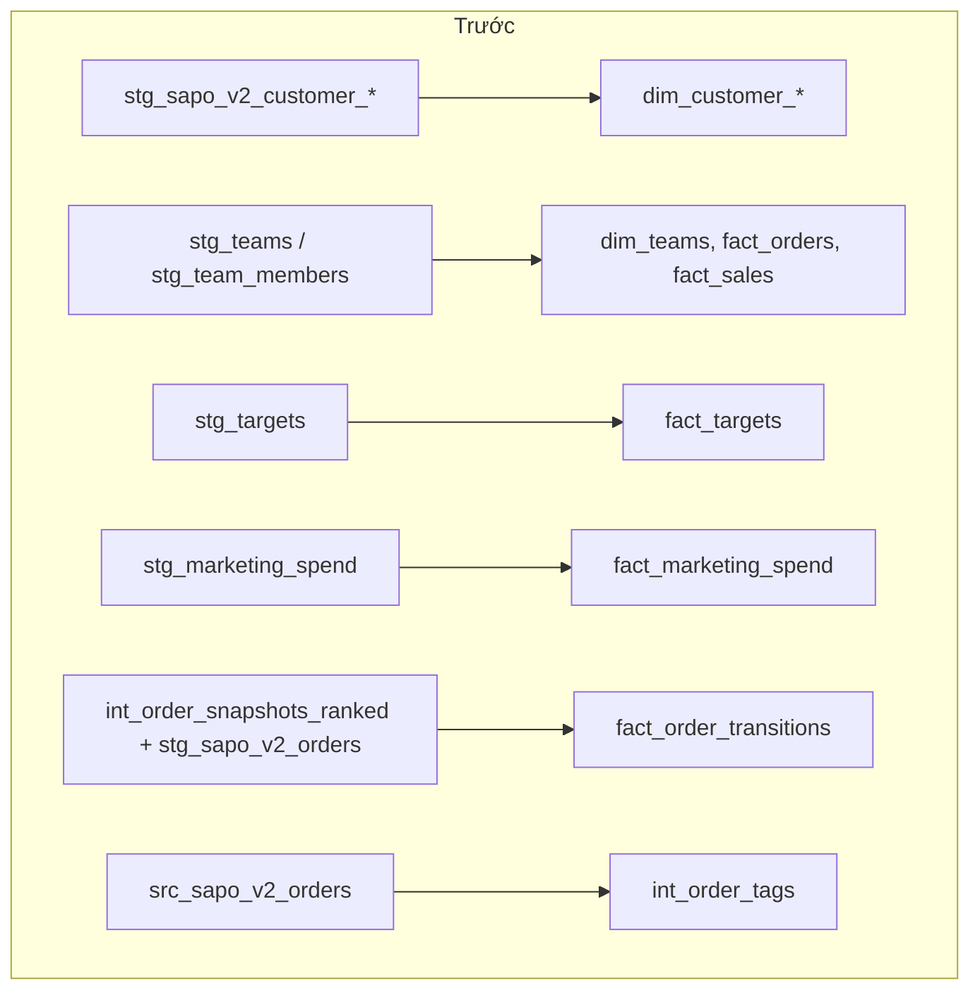
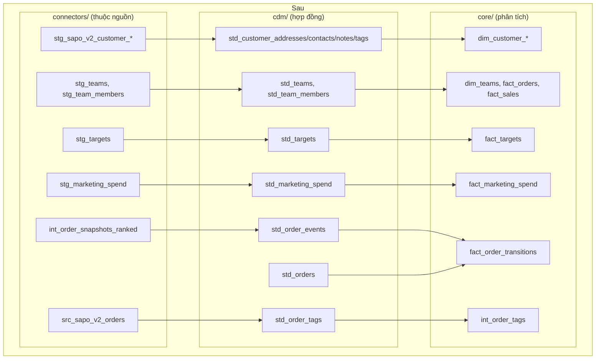
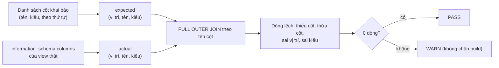

# Canonical Layer (CDM): core chỉ đọc dữ liệu đã chuẩn hoá

> Tầng canonical (`transformation/models/cdm/`, các model `std_*`) là **hợp đồng dữ liệu** giữa connector (Sapo, MISA, Google Sheets, ...) và phần lõi phân tích (`core/`, `packs/`). Core không bao giờ đọc thẳng dữ liệu riêng của một nguồn; nó chỉ đọc `std_*`. Nhờ vậy, đổi nguồn (Sapo v2 → v3, thêm Haravan) chỉ phải sửa tầng canonical, không phải sửa core.
>
> Tài liệu này giải thích tầng đó làm gì và hoạt động thế nào, đặc biệt phần được hoàn thiện khi module hoá (10 view mới, test cột, luật kiểm tra lineage). Quy tắc ngắn gọn: [std-layer-conventions.md](./std-layer-conventions.md). Bản đồ module: [modules.md](./modules.md) §3, §6.

## Mục lục

1. [Vấn đề được giải quyết](#1-vấn-đề-được-giải-quyết)
2. [Trước và sau](#2-trước-và-sau)
3. [Các view std_* và nguồn của chúng](#3-các-view-std_-và-nguồn-của-chúng)
4. [Cách một view pass-through hoạt động](#4-cách-một-view-pass-through-hoạt-động)
5. [Giữ bảng public không đổi](#5-giữ-bảng-public-không-đổi)
6. [Test hợp đồng cột (std_column_contract)](#6-test-hợp-đồng-cột-std_column_contract)
7. [Cưỡng chế ranh giới](#7-cưỡng-chế-ranh-giới)
8. [Chứng minh không đổi số liệu](#8-chứng-minh-không-đổi-số-liệu)
9. [Những gì còn ngoại lệ](#9-những-gì-còn-ngoại-lệ)
10. [Hướng dẫn: thêm hoặc đổi một std_*](#10-hướng-dẫn-thêm-hoặc-đổi-một-std_)
11. [Rollback](#11-rollback)

---

## 1. Vấn đề được giải quyết

Trước khi module hoá, 15 chỗ trong core đọc thẳng model staging của connector, ví dụ `dim_customer_addresses` đọc `stg_sapo_v2_customer_addresses`, `fact_orders` đọc `stg_teams` (Google Sheet). Hệ quả:

| Hệ quả | Ví dụ cụ thể |
|---|---|
| Đổi nguồn phải sửa core | Lên Sapo v3 hoặc thêm Haravan thì phải mở từng dim/fact để đổi `ref` |
| Không có nơi duy nhất mô tả "dữ liệu chuẩn" | Cùng thông tin team/target nằm rải trong staging của Google Sheet |
| Không kiểm tra được ranh giới bằng máy | Một model core mới có thể lại đọc `stg_*` mà không ai biết |
| Không biết dòng dữ liệu đến từ nguồn nào khi có nhiều nguồn | Không có `source_system` ở đầu vào của core |

Mục tiêu: **mọi dữ liệu core dùng đều đi qua `std_*`**, và việc này được kiểm tra tự động, mà **không đổi một con số nào** trên dashboard.

## 2. Trước và sau





Bảng public (`dim_*`, `fact_*`) giữ nguyên tên, cột, kiểu và giá trị. Chỉ đường đi của dữ liệu đổi: thêm một bước canonical ở giữa.

## 3. Các view std_* và nguồn của chúng

Tầng canonical hiện có 24 model; 10 model dưới đây được thêm khi đóng các chỗ core đọc thẳng nguồn. Tất cả đều là **view** (không lưu dữ liệu, không tốn dung lượng, không đổi thời gian build đáng kể).

| View | Đọc từ (connector) | Hạt (grain) | `source_system` | Model core dùng |
|---|---|---|---|---|
| `std_customer_addresses` | `stg_sapo_v2_customer_addresses` | 1 dòng / địa chỉ | `sapo_v2` | `dim_customer_addresses` |
| `std_customer_contacts` | `stg_sapo_v2_customer_contacts` | 1 dòng / liên hệ | `sapo_v2` | `dim_customer_contacts` |
| `std_customer_notes` | `stg_sapo_v2_customer_notes` | 1 dòng / ghi chú | `sapo_v2` | `dim_customer_notes` |
| `std_customer_tags` | `stg_sapo_v2_customer_tags` | 1 dòng / tag khách | `sapo_v2` | `dim_customer_tags` |
| `std_order_events` | `int_order_snapshots_ranked` (lịch sử trạng thái đơn từ history log) | 1 dòng / (đơn, thời điểm sự kiện) | `sapo_v2` | `fact_order_transitions` |
| `std_order_tags` | `src_sapo_v2_orders` (chỉ `order_id`, `tags`) | 1 dòng / bản ghi đơn của nguồn | `sapo_v2` | `int_order_tags` |
| `std_teams` | `stg_teams` (Google Sheet) | 1 dòng / team | `gsheet` | `dim_teams`, `fact_orders`, `fact_sales` |
| `std_team_members` | `stg_team_members` (Google Sheet) | 1 dòng / thành viên | `gsheet` | `dim_teams`, `fact_orders`, `fact_sales` |
| `std_targets` | `stg_targets` (Google Sheet) | 1 dòng / target | `gsheet` | `fact_targets` |
| `std_marketing_spend` | `stg_marketing_spend` (Google Sheet) | 1 dòng / khoản chi | `gsheet` | `fact_marketing_spend` |

`fact_order_transitions` trước đây lấy `order_code` từ `stg_sapo_v2_orders`; nay lấy từ `std_orders` (đã có sẵn trong tầng canonical, cùng nội dung cột này).

## 4. Cách một view pass-through hoạt động

Mỗi view theo cùng một mẫu (quy tắc R2 "faithful pass-through" trong [std-layer-conventions.md](./std-layer-conventions.md)):

```sql
{{ config(materialized='view', tags=['standard', 'teams']) }}

WITH source_data AS (
    SELECT * FROM {{ ref('stg_teams') }}       -- đọc đúng một model của connector
)

SELECT
    team_key, team_code, team_name,            -- liệt kê cột tường minh, cùng tên,
    revenue_type, revenue_filter,              -- cùng kiểu, cùng thứ tự như nguồn
    leader_email, description, ingest_method,
    'gsheet' AS source_system                  -- thêm nguồn ở CUỐI
FROM source_data
```

| Đặc điểm | Lý do |
|---|---|
| Không đổi tên, không tính toán, không lọc | Đảm bảo dữ liệu đi qua không đổi; mọi logic nghiệp vụ nằm ở core |
| Liệt kê cột tường minh (không `SELECT *` ở đầu ra) | Nguồn thêm cột thì view không tự đổi hình dạng; thay đổi phải có chủ đích |
| `source_system` ở cuối | Khi có nhiều nguồn (vd. `sapo_v2` và `haravan_v1`), core biết dòng đến từ đâu; giá trị theo ADR-014 |
| `materialized: view` | Không nhân bản dữ liệu; dbt chỉ tạo câu lệnh view trong schema `main_staging` |

Ngoại lệ có chủ đích: `std_order_tags` chỉ lấy `order_id`, `tags` thay vì toàn bộ `src_sapo_v2_orders`, vì nơi duy nhất dùng nó (`int_order_tags`) chỉ cần tag và bảng nguồn rất rộng. Khi có consumer cần thêm cột, mở rộng view này.

## 5. Giữ bảng public không đổi

Thêm cột `source_system` vào đầu vào có thể làm **lọt cột mới ra bảng public** nếu model core dùng `SELECT *` từ nguồn, khiến schema bảng Metabase/Evidence đọc bị đổi. Vì vậy:

- Mọi model core đã đổi `ref` đều giữ **danh sách cột tường minh**; `source_system` dừng ở tầng canonical.
- Golden snapshot so cả danh sách cột và kiểu của 83 bảng public (mục 8), nên một cột lọt ra sẽ làm gate fail.

## 6. Test hợp đồng cột (std_column_contract)

Mỗi view mới có một test kiểm tra **đúng tên, thứ tự và kiểu cột** so với khai báo trong `transformation/models/cdm/staging/_cdm__models.yml`.

```yaml
  - name: std_teams
    tests:
      - std_column_contract:
          config: {severity: warn}
          columns:
            - {name: team_key, type: "VARCHAR"}
            - {name: team_code, type: "VARCHAR"}
            ...
            - {name: source_system, type: "VARCHAR"}
```

Cách hoạt động (`transformation/tests/generic/std_column_contract.sql`):



| Quyết định | Lý do |
|---|---|
| Mức `warn`, không phải `error` | Quyết định của chủ sản phẩm (13/10/2026): khi Sapo đổi kiểu một cột, nightly vẫn chạy tiếp; cảnh báo hiện trong kết quả test của Dagster để người vận hành xử lý. |
| Không dùng `contract: enforced` của dbt | Enforce sẽ chặn build; để dành cho đợt sau, khi quy trình xử lý lỗi schema đã sẵn sàng. |
| Kiểu lấy từ warehouse thật | Khai báo kiểu đúng như DuckDB đang tạo, không đoán; test pass ngay từ đầu. |

Kết quả hiện tại: cả 10 test pass trong mọi lần build. 14 model `std_*` có từ trước chưa có test này (xem mục 9).

## 7. Cưỡng chế ranh giới

`scripts/checks/check_boundaries.py` đọc manifest dbt và kiểm tra ma trận phụ thuộc (chi tiết: [scripts/checks/README.md](../../scripts/checks/README.md)):

| Model ở | Được đọc |
|---|---|
| `connectors/<x>/` | chính connector đó |
| `cdm/` | mọi connector, `cdm/` |
| `core/` | `cdm/`, `core/` |
| `packs/<p>/` | `cdm/`, `core/`, connector pack khai báo |
| `tenants/<t>/` | mọi thứ |

Một model core mới đọc `stg_*` sẽ làm checker báo `VIOLATION [dbt-ref]` và gate fail. Mọi model mới phải được khai báo bucket trong `scripts/checks/model_buckets.yaml` (10 view mới có bucket `cdm`).

Khi đóng một chỗ rò, mục tương ứng phải được **xoá khỏi** `scripts/checks/boundary_allowlist.yaml` trong cùng commit: checker báo `STALE-ALLOW` nếu allowlist còn ghi một vi phạm không còn xảy ra. Đợt này xoá 15 mục (61 → 46).

## 8. Chứng minh không đổi số liệu

Đổi `ref` là thay đổi SQL, nên dùng gate mức S của [refactor safety harness](../operations/refactor-safety-harness.md):

| Kiểm tra | Kết quả |
|---|---|
| Golden 83 bảng public (lake-A main vs lake-B nhánh) | 0 khác biệt |
| Golden sau `--full-refresh` toàn project | 0 khác biệt |
| Golden trên lake trống (dựng lại thư mục rolling) | 0 khác biệt |
| dbt inventory | 0 khác biệt; INFO: 10 node mới, 11 model đổi dependency |
| Module boundaries | 46 đã biết, 0 vi phạm mới, 0 mục allowlist cũ |
| Dagster inventory | 0 khác biệt; INFO: 10 asset view mới + 10 asset check mới, selection của 5 job lớn thêm đúng các view mới |
| Dbt subset qua Dagster, pytest | pass |

**Luật lineage trong dbt inventory.** Inventory so `depends_on` của từng model. Đổi `ref` từ `stg_teams` sang `std_teams` làm `depends_on` đổi, nên trước đây sẽ bị coi là khác biệt. Luật được thêm (chỉ có hiệu lực với cờ `--allow-code-change`): đổi dependency được chấp nhận **khi mọi dependency bị bỏ vẫn là tổ tiên của model** trong đồ thị mới. Ví dụ `fact_targets` bỏ `stg_targets`, nhưng `stg_targets` vẫn nằm ngay phía trên `std_targets`, nên lineage tới nguồn gốc không đổi. Inventory in `INFO ... stg_targets -> via std_targets`. Mọi thay đổi dependency khác vẫn là khác biệt. Có 3 unit test trong `scripts/tests/test_dbt_inventory.py`.

## 9. Những gì còn ngoại lệ

Sau đợt này, core vẫn còn 9 phụ thuộc vượt ranh giới, đều ghi trong allowlist kèm lý do và hướng xử lý:

| Nhóm | Số | Model | Vì sao chưa sửa |
|---|---|---|---|
| Tenant hook (Fine Japan) | 4 | `dim_staff` → `stg_crm__app_user`; `fact_order_costs`, `fact_order_economics` → `int_order_overhead_allocation`; `mart_data_quality` → `fact_us_shipment_economics` | Logic riêng Fine Japan nằm trong phép tính lõi; tách ra cần quyết định nghiệp vụ |
| Kế toán MISA trong core | 2 | `dim_sku_alias`, `mart_sku_economics_monthly` → `int_misa_sales_lines` | Cần đưa dữ liệu sổ cái qua tầng canonical như đầu vào tuỳ chọn |
| Phí sàn Shopee trong core | 3 | `fact_order_costs` → `stg_shopee_*` (2); `fact_order_economics` → `int_shopee_order_fees` | Cần tách phần phí sàn sang `packs/marketplace` |

Ngoài ra, 14 model `std_*` có từ trước (`std_orders`, `std_customers`, ...) chưa có `std_column_contract`; bổ sung khi một đợt sau chạm vào chúng.

## 10. Hướng dẫn: thêm hoặc đổi một std_*

1. Tạo `transformation/models/cdm/staging/std_<entity>.sql` theo mẫu ở mục 4: một `ref` tới model của connector, cột tường minh cùng tên/kiểu/thứ tự, `'<system>_<version>' AS source_system` ở cuối.
2. Thêm khai báo vào `_cdm__models.yml` với `description` (ghi grain) và test `std_column_contract` mức `warn`. Lấy kiểu cột từ warehouse shadow (`information_schema.columns`), không đoán.
3. Thêm `std_<entity>: cdm` vào `scripts/checks/model_buckets.yaml`.
4. Đổi `ref` trong model core sang `std_<entity>`, giữ danh sách cột tường minh để `source_system` không lọt ra bảng public.
5. Xoá mục allowlist tương ứng nếu đây là chỗ rò đã biết.
6. Chạy `scripts/shadow/gate.sh S --allow-new --allow-code-change` trong worktree; phải `GATE S: PASS`.
7. Cập nhật bảng ở mục 3 của tài liệu này và [modules.md](./modules.md) §6 trong cùng commit.

**Khi có nguồn thứ hai** (vd. Haravan): `std_<entity>` sẽ `UNION ALL` các model của từng connector, mỗi nhánh mang `source_system` riêng. Core không đổi.

## 11. Rollback

Revert commit `a35878af` trả core về đọc staging như cũ. 10 view `std_*` sẽ còn lại trong schema `main_staging` (vô hại vì không ai đọc). Nếu muốn dọn: `DROP VIEW main_staging.<tên>;` cho từng view ở mục 3, chạy khi container `data_platform` đang dừng.
