# Kiến trúc module: authority và boundary theo component

> Tài liệu sống của kiến trúc module. Mỗi thay đổi về module (thư mục, bucket, ma trận phụ thuộc, connector, tenant) cập nhật mục tương ứng **trong cùng commit với code**. Quy ước chung: **mỗi vùng lưu trữ chỉ có một component được ghi**; component khác chỉ đọc qua giao diện đã khai báo.
>
> Lộ trình và lý do: plan `plans/261013-1751-modularize-data-platform-suite/` (gồm `roadmap.md`). Công cụ kiểm chứng refactor: [docs/operations/refactor-safety-harness.md](../operations/refactor-safety-harness.md).

## Trạng thái hiện tại

| Hạng mục | Trạng thái |
|---|---|
| Bucket của mọi dbt model (183 model: 173 đang bật, 10 đang tắt) | ✅ Khai báo trong `scripts/checks/model_buckets.yaml` |
| Ma trận phụ thuộc, lõi đọc seed tenant, import chéo (kể cả connector → pack và pack → pack trong orchestration), seed trùng tên, URL/domain cứng trong connector và pack | ✅ Cưỡng chế bằng `scripts/checks/check_boundaries.py` (mục 3, mục 12) |
| Vi phạm đã biết | 28, sinh từ manifest và import orchestration: 8 cạnh `ref` (tenant hook, pack → pack, pack → connector; không còn pack hook), 3 lõi đọc seed tenant, 12 pack đọc source, 5 import connector/pack → pack; ghi trong `scripts/checks/boundary_allowlist.yaml` kèm lý do và hướng thoát (mục 3, 10) |
| Kiểm tra trước commit bằng một lệnh | ✅ `scripts/checks/run-all.sh`: `dbt parse`, `check_boundaries.py`, `dagster definitions validate`, pytest (bắt buộc, ghi trong `AGENTS.md`) |
| Quyết định kiến trúc | ✅ [ADR-015](../decisions/015-module-boundaries.md) (ranh giới module), [ADR-016](../decisions/016-taxonomy-module.md) (taxonomy), [ADR-017](../decisions/017-packs-and-tenants.md) (pack và tenant) |
| Thư mục dbt theo module `models/<module>/<layer>/` | ✅ Mọi model nằm trong module (connectors, cdm, core, packs, tenants) hoặc `monitoring/`; thư mục cũ `staging/`, `intermediate/`, `marts/` và `models/sources.yml` đã bỏ |
| Connector package cho orchestration (`orchestration/connectors/<id>/`, bật/tắt qua `config/modules.yaml`) | ✅ 5 connector: `sapo_v2`, `shopee`, `misa_amis`, `sheets`, `hug` (mục 4, 5) |
| Pack sản phẩm (`models/packs/<id>/`, `orchestration/packs/<id>/`, khai báo trong `config/modules.yaml`) | ✅ 7 pack: `crm`, `hug`, `finance`, `sales_playbook` (thử nghiệm), `marketplace`, `facebook_ads`, `facebook_messenger` (mục 8) |
| Công tắc pack (`enabled_packs`, `+enabled` theo thư mục, `pack_enabled`/`pack_ref`, hợp đồng cột `pack_contracts()`, rule `module-config`) | ✅ Lõi đọc pack chỉ qua `pack_ref` (5 hợp đồng, mục 8.1), không còn cạnh lõi → pack bằng `ref()`; dbt build xanh với mọi pack tắt (profile "lõi trần", bước 6b của gate); ⏳ trên prod còn lõi đọc seed tenant (phase 5) và job connector chọn `crm_cache_refresh` (phase 6) của plan `261014-2225-pack-mechanism` |
| Taxonomy: đặc tả, seed phân loại, `seed_paths.py`, check kiểm kê | ✅ `transformation/docs/TAXONOMY.md`, `transformation/seeds/taxonomy/` (8 seed), `ingestion/src/utils/seed_paths.py`, `scripts/checks/check_taxonomy_inventory.py` (mục 9) |
| Tenant overlay Fine Japan | ✅ Tối thiểu: US shipment (dbt), `seeds/tenants/fine_japan/`, `orchestration/tenants/fine_japan/config.py` (endpoint CRM); 6 URL Google Sheet chỉ ở biến môi trường `SOURCES__SPREADSHEET_URL__*`, không còn URL mặc định trong code (mục 10) |
| Bộ máy phân loại (luật thành dữ liệu) | ⏳ Plan riêng sau Đợt 1 (mục 9) |

Các mục dưới đây mô tả trạng thái đích; chỗ nào đã khớp code được đánh dấu ✅.

## Mục lục

1. [Bản đồ tổng thể](#1-bản-đồ-tổng-thể)
2. [Quyền ghi theo vùng lưu trữ](#2-quyền-ghi-theo-vùng-lưu-trữ)
   - [2b. Bố cục thư mục dbt](#2b-bố-cục-thư-mục-dbt-)
3. [Ma trận phụ thuộc giữa các module dbt](#3-ma-trận-phụ-thuộc-giữa-các-module-dbt-)
4. [Kernel](#4-kernel-)
5. [Connectors](#5-connectors-)
6. [CDM (canonical layer)](#6-cdm-canonical-layer)
7. [Core](#7-core)
8. [Packs](#8-packs-)
   - [8.1 Bật/tắt pack](#81-bậttắt-pack-công-tắc-pack)
9. [Taxonomy module](#9-taxonomy-module)
10. [Tenant overlay Fine Japan](#10-tenant-overlay-fine-japan-)
11. [Serving và người tiêu thụ](#11-serving-và-người-tiêu-thụ)
12. [Ranh giới Python và container](#12-ranh-giới-python-và-container-)

---

## 1. Bản đồ tổng thể

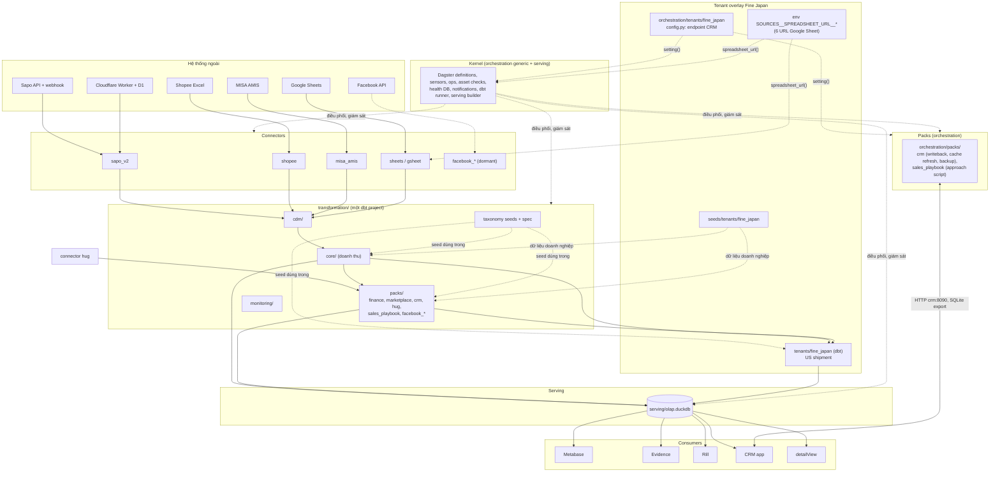

## 2. Quyền ghi theo vùng lưu trữ

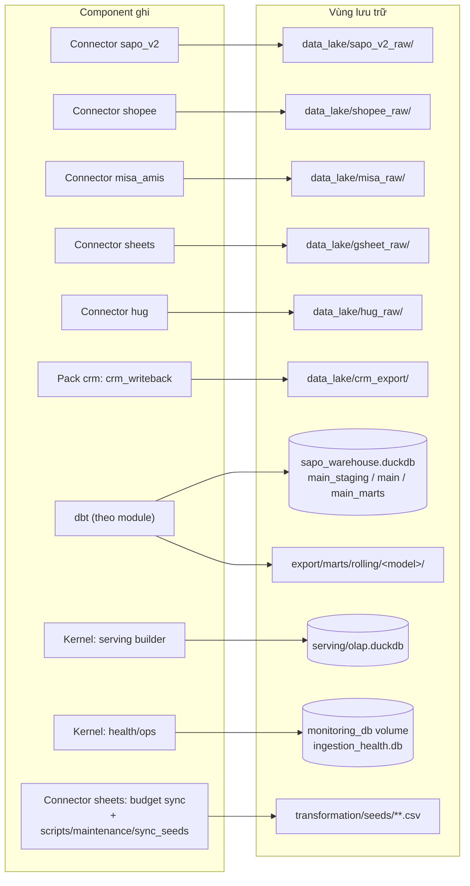

| Vùng | Owner (ghi) | Được đọc bởi | Cấm |
|---|---|---|---|
| `data_lake/<source>_raw/{entity}/ingest_method=/year=/month=` | Connector của nguồn đó | `transformation/models/connectors/<source>/_sources.yml` | Connector khác ghi; core/pack đọc trực tiếp |
| `data_lake/crm_export/` | Pack crm (`orchestration/packs/crm/crm_writeback_assets.py`) | `packs/crm` (`stg_crm__*`), `packs/hug` (`stg_crm__hug_voucher`) qua source `crm_export` | Ghi từ ngoài pack crm |
| `sapo_warehouse.duckdb` | dbt (một tiến trình, khoá `duckdb_lock` / `dbt_rw`) | dbt, scripts kiểm tra read-only | Ghi ngoài dbt |
| `export/marts/rolling/<model>/` | dbt model có `get_rolling_location()` | Kernel serving builder, Rill publish | Sửa tay |
| `serving/olap.duckdb` | Kernel (`refresh_rolling.py`, `bootstrap_serving_views.py`) | Metabase, Evidence, CRM, detailView (read-only) | Mọi consumer ghi |
| `monitoring_db` (health DB) | Kernel ops/sensors | Kernel asset checks, digest | Connector ghi trực tiếp (đi qua ops chung) |
| `transformation/seeds/taxonomy/*.csv` | Taxonomy module; writer Python đi qua `seed_paths.py` ✅ | dbt seed | Ghi theo đường dẫn cứng (đường dẫn seed phải do `seed_path(name)` tra) |
| `transformation/seeds/tenants/fine_japan/*.csv` ✅ | Tenant FJ (dữ liệu doanh nghiệp). Writer Python duy nhất: connector `sheets` (`budget_sheet_sync_asset`, hai seed ngân sách, qua `seed_path`); seed khác sửa tay | dbt seed: pack `sales_playbook`, `finance` (đúng thiết kế); lõi `dim_channel_targets`, `dim_sku_alias`, `int_customer_sku_supply_tracking` (3 mục allowlist của luật `dbt-seed`) | Ghi theo đường dẫn cứng; lõi, cdm, connector đọc thêm seed tenant (luật `dbt-seed`) |

### Vùng shadow (công cụ refactor, không phải prod)

| Vùng | Owner | Quy tắc |
|---|---|---|
| `/home/vantt/app/fg-dw-shadow/` (mode 0700) | Công cụ `scripts/shadow/*` | Chỉ tạo từ backup; chứa PII nên xoá lake nhánh sau mỗi gate, xoá toàn bộ khi đóng plan |
| Worktree `fg-dw-modular`, `fg-dw-baseline` | Người làm refactor | Không bao giờ mount vào container prod |
| Checkout prod `/home/vantt/app/fg-dataware-house` | Chỉ runbook deploy | Mọi script shadow từ chối đường dẫn này (`guard_not_prod.py`) |

## 2b. Bố cục thư mục dbt ✅

```text
transformation/models/
├── connectors/
│   ├── sapo_v2/staging/        # src_sapo_v2_* (incremental), stg_sapo_v2_*, _sources.yml
│   ├── sapo_v2/intermediate/   # int_order_snapshots_ranked (đọc thẳng raw history log)
│   ├── shopee/staging/  misa/staging/  gsheet/staging/
│   ├── hug/staging/            # src_hug_* (incremental), _sources.yml (hug_raw)
│   └── facebook_ads/staging/  facebook_messenger/staging/      # đang tắt
├── cdm/staging/                # std_* (canonical layer)
├── core/
│   ├── intermediate/{sapo,tags}/
│   └── marts/                  # dim_* ; intermediate/ (int_customer_*), sales/, customer/, inventory/
├── packs/                      # mỗi pack có README.md
│   ├── finance/                # staging/, intermediate/{cogs,misa,overhead}/, marts/{,sales,intermediate}/
│   ├── marketplace/intermediate/shopee/
│   ├── crm/                    # staging/ (stg_crm__*, _sources.yml: crm_export), marts/{,intermediate}/
│   ├── hug/                    # staging/ (stg_hug_*, stg_crm__hug_voucher), marts/
│   ├── sales_playbook/marts/   # thử nghiệm
│   └── facebook_ads/marts/  facebook_messenger/marts/          # đang tắt
├── tenants/
│   └── fine_japan/             # README.md; staging/, intermediate/us_shipment/, marts/ (US shipment)
├── monitoring/
└── exposures_rill.yml

transformation/seeds/
├── properties.yml              # mô tả và column_types theo tên seed
├── taxonomy/                   # 8 seed phân loại
└── tenants/fine_japan/         # 6 seed dữ liệu doanh nghiệp
```

Quy tắc:

- **Module** = thư mục cấp 1 (theo bucket trong `scripts/checks/model_buckets.yaml`); luật `dbt-path` kiểm tra file nằm đúng `models/<module>/`.
- **Layer** = thư mục ngay dưới module (`staging`, `intermediate`, `marts`). `dbt_project.yml` cấu hình schema/materialization/tags theo layer bằng YAML anchor (`&layer_staging`, `&layer_intermediate`, `&layer_marts`, định nghĩa ở chỗ dùng đầu tiên) và mỗi module tái sử dụng anchor đó, nên relation không phụ thuộc module. Thư mục con `shopee/`, `misa/`, `us_shipment/` trong `intermediate/` mang tag `int` + tên nguồn.
- Seed cấu hình theo đường dẫn thư mục: `+column_types` của seed trong `seeds/taxonomy/` nằm dưới khoá `taxonomy:`, của seed tenant dưới `tenants: fine_japan:`.
- Properties YAML nằm cạnh model: `_<module>__models.yml`; nguồn dbt của connector ở `connectors/<source>/staging/_sources.yml`.
- Thư mục `rolling/<model>/` được tạo từ manifest (`transformation/scripts/rolling_dirs.py`), không phụ thuộc thư mục model.
- Selection mà dagster-dbt gửi cho dbt dùng `fqn` (gồm thư mục), nên code server phải nạp manifest parse từ bố cục mới; lệnh start của container đã chạy `dbt parse` trước `dagster dev`.

## 3. Ma trận phụ thuộc giữa các module dbt ✅

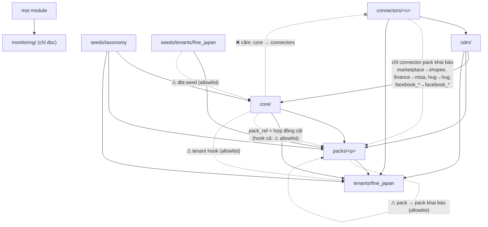

| Từ \ Tới | connectors | cdm | core | packs | tenants | seeds |
|---|---|---|---|---|---|---|
| **connectors/<x>** | chỉ `<x>` | ❌ | ❌ | ❌ | ❌ | ✅ (seed tenant: ❌) |
| **cdm** | ✅ | ✅ | ❌ | ❌ | ❌ | ✅ (seed tenant: ❌) |
| **core** | ❌ | ✅ | ✅ | chỉ qua `pack_ref` (hook cũ: ⚠) | ⚠ tenant hook | ✅ (seed tenant: ⚠) |
| **packs/<p>** | connector khai báo (khác: ⚠) | ✅ | ✅ | chỉ `<p>` (khác: ⚠ khai báo) | ❌ | ✅ |
| **tenants/<t>** | ✅ | ✅ | ✅ | ✅ | ✅ | ✅ |
| **monitoring** | ✅ | ✅ | ✅ | ✅ | ✅ | ✅ |

⚠ = chỉ được qua một mục trong `scripts/checks/boundary_allowlist.yaml` kèm lý do và hướng thoát; ma trận không bao giờ cho phép core → tenants. **Core → pack** hợp lệ khi và chỉ khi đi qua macro `pack_ref('<pack>', '<model>')` (mục 8): `check_boundaries.py` (luật `dbt-ref`) chấp nhận cạnh core → `pack:<p>` tới model `m` chỉ khi `raw_code` của model lõi gọi đúng dạng `pack_ref('<p>', '<m>'` (vị trí, nháy đơn hoặc kép), không có `ref('<m>')` thẳng, và `m` có hợp đồng của pack `<p>` trong `pack_contracts()`. Cạnh core → pack bằng `ref()` thẳng là vi phạm; từ 14/10/2026 allowlist không còn mục nào loại này. `check_boundaries.py` fail khi có cạnh mới ngoài ma trận, và cả khi một mục allowlist không còn xảy ra (để allowlist không phình). Allowlist được **sinh từ manifest** (`depends_on` của model đang bật; model tắt vẫn phải có bucket và nằm đúng thư mục, nhưng dbt không phân giải ref của nó nên không kiểm cạnh) và từ import Python của `orchestration/connectors/**`, `orchestration/packs/**` (`--write-allowlist`), không viết tay. Đọc source dbt chỉ dành cho connector và tenant (luật `dbt-source`). Cột seeds: seed dùng chung (`seeds/taxonomy/`, ...) ai cũng đọc; seed tenant (`seeds/tenants/<t>/`) chỉ pack, `monitoring` và chính tenant `<t>` được đọc (luật `dbt-seed`).

Số model theo bucket (`model_buckets.yaml`, 183 model gồm 10 đang tắt):

| Bucket | Model | Bucket | Model |
|---|---|---|---|
| connector:sapo_v2 | 28 | cdm | 24 |
| connector:shopee | 8 | core | 54 |
| connector:misa | 3 | pack:finance | 22 |
| connector:gsheet | 4 | pack:crm | 14 |
| connector:hug | 2 | pack:hug | 5 |
| connector:facebook_ads (tắt) | 3 | pack:sales_playbook | 3 |
| connector:facebook_messenger (tắt) | 2 | pack:marketplace | 3 |
| tenant:fine_japan | 3 | pack:facebook_ads (tắt), pack:facebook_messenger (tắt) | 2 + 2 |
| monitoring | 1 | | |

Vi phạm đã biết (28, đúng bằng allowlist):

| Nhóm | Số | Cạnh | Hướng thoát |
|---|---|---|---|
| Pack hook (core → pack) | 0 | Không còn: mọi chỗ lõi đọc pack đi qua `pack_ref` với hợp đồng cột (mục 8.1) | — |
| Tenant hook (core → tenant) | 1 | `mart_data_quality` → `fact_us_shipment_economics` | Dời check US vào `tenants/fine_japan` |
| Lõi đọc seed tenant (`dbt-seed`) | 3 | `dim_channel_targets` → `seed_channel_targets`; `int_customer_sku_supply_tracking` → `seed_sku_regimen_config`; `dim_sku_alias` → `seed_sku_alias_manual` | Sau Đợt 1, cùng `pack_ref`: lõi có seed mặc định rỗng đúng cột, tenant ghi đè |
| Pack → pack (khai báo) | 5 | `mart_hug_attribution` (hug) → `fact_order_economics` (finance); `fact_order_economics` (finance) → `int_shopee_order_fees` (marketplace); `mart_customer_action_queue` → `stg_crm__last_contact`, `int_crm_party_tag_flags`; `mart_customer_sku_action_queue` → `stg_crm__last_contact` (sales_playbook → crm) | Khai báo phụ thuộc pack + `pack_ref` sau Đợt 1 |
| Pack → connector ngoài `pack_connectors` | 2 | `fact_order_costs` → `stg_shopee_order_revenue`, `stg_shopee_order_service_fees` | Chuyển phần phí sàn sang `pack:marketplace`. Chọn allowlist thay vì thêm `shopee` vào `pack_connectors` của finance để luật vẫn chặt |
| Pack đọc source | 12 | 11 mục từ 10 model `stg_crm__*` (gồm `stg_crm__hug_voucher` của hug; `stg_crm__party_tag` đọc hai bảng) → `crm_export.*`; `stg_overhead_account_classification` → `gsheet_raw.overhead_account_classification_raw` | Khai báo source thuộc pack (hoặc connector crm); dời staging overhead sang connector gsheet |
| Import orchestration (`orch-import`) | 5 | Job của `sapo_v2`, `shopee`, `misa_amis`, `sheets` import `crm_cache_refresh` từ `orchestration.packs.crm` (user giữ import, 14/10); `sales_playbook` → `crm` (deps `crm_cache_refresh`) | Sau Đợt 1: pack crm tự gắn refresh vào job connector; khai báo phụ thuộc pack |

**Đã đóng (core đọc thẳng staging của connector, 15 cạnh):** core chỉ đọc `cdm/` qua 10 view `std_*` mới (mục 6). Đường đi trước → sau: `dim_customer_{addresses,contacts,notes,tags}` ← `stg_sapo_v2_customer_*` → `std_customer_*`; `fact_order_transitions` ← `int_order_snapshots_ranked` → `std_order_events` và `stg_sapo_v2_orders` → `std_orders`; `int_order_tags` ← `src_sapo_v2_orders` → `std_order_tags`; `dim_teams`, `fact_orders`, `fact_sales` ← `stg_teams`/`stg_team_members` → `std_teams`/`std_team_members`; `fact_targets` → `std_targets`; `fact_marketing_spend` → `std_marketing_spend`. `dim_gl_account` đã nằm ở `packs/finance` từ trước.

**Đã đóng bằng `pack_ref` (14/10/2026):** `dim_customers` → `int_customer_economics`, `dim_staff` → `stg_crm__app_user`, `dim_sku_alias` → `int_misa_sales_lines`, `mart_data_quality` → `fact_order_economics`, `mart_product_health` → `mart_sku_economics_monthly` (cột biên; hợp đồng cột ở mục 8.1, giá trị khi tắt pack ở mục 7). **Đã đóng bằng tách model (14/10/2026):** `int_product_velocity_trend`, `mart_inventory_health`, `mart_product_action_queue` chỉ dùng cột doanh số/tốc độ nên đọc model lõi mới `int_sku_sales_monthly`; `mart_product_health` đọc doanh số ở đó và biên qua `pack_ref`.

**Đã đóng khi dời pack/tenant:** `fact_order_costs`/`fact_order_economics` → `int_order_overhead_allocation` và `mart_sku_economics_monthly` → `int_misa_sales_lines` thành cạnh nội bộ pack finance; 37 mục `dbt-path` (model tenant còn ở thư mục cũ) hết.

**Quyết định phân loại:** 13/10/2026 xếp COGS vào core. **14/10/2026 user đổi: lõi giữ doanh thu, pack finance giữ toàn bộ chi phí và lợi nhuận** (`int_order_cogs_reconciled`, `int_order_promo_goods_cost`, `int_promo_642_monthly_total`, `mart_order_cogs_summary`, `fact_order_costs`, `fact_order_economics`, `int_customer_economics`, `mart_sku_economics_monthly`), vì không phải connector nào cũng có giá vốn (sàn, Pancake, Haravan không quản lý kho) và chọn/đối chiếu nguồn giá vốn là logic kế toán chi phí. Tồn kho (`fact_inventory_*`, `int_sapo_inventories`, `int_return_sku_lines`, `mart_inventory_health`) vẫn ở core. `int_order_snapshots_ranked` đọc thẳng raw Sapo nên thuộc `connector:sapo_v2`.

## 4. Kernel ✅

Kernel là phần dùng chung cho mọi tenant. Các file kernel **giữ nguyên vị trí** (dời sẽ làm hỏng đường dẫn tính theo `__file__`: `ops/purge_runs.py`, `asset_checks/sla_loader.py`, `ops/system_backup.py`) và được nhận diện bằng tài liệu này.

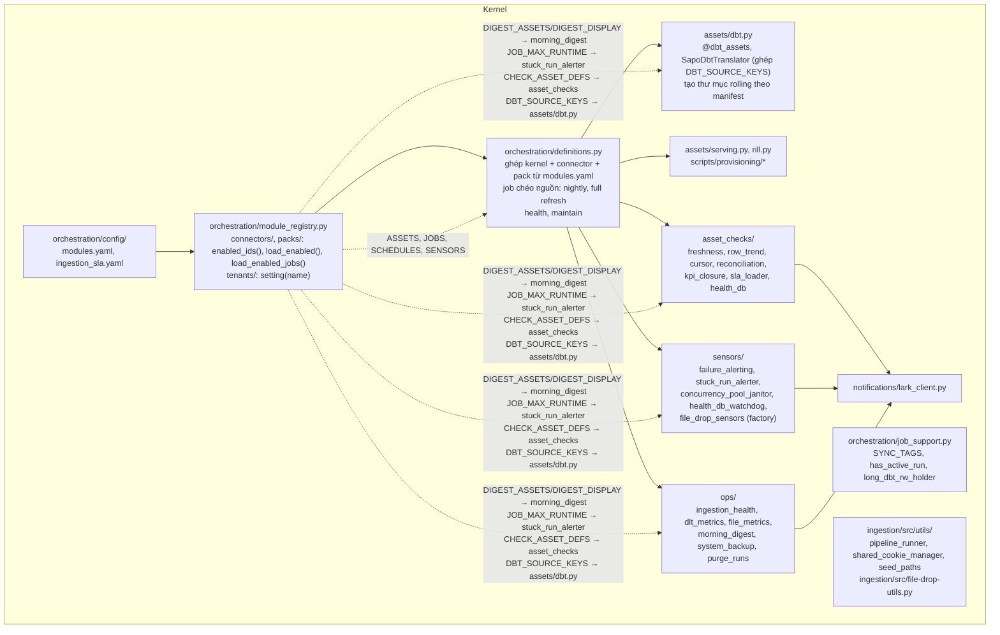

| Giao diện kernel cung cấp | Ai dùng |
|---|---|
| `SYNC_TAGS` (`job_support.py`) và `duckdb_lock` (khoá ghi DuckDB) | Mọi job ghi warehouse |
| `has_active_run`, `long_dbt_rw_holder` (`job_support.py`) | Schedule của connector (bỏ tick khi run trước còn chạy hoặc nightly đang giữ `dbt_rw`) |
| `make_file_drop_sensor(...)` (`sensors/file_drop_sensors.py`) | Connector shopee, misa_amis (sensor theo dõi thư mục thả file .xlsx) |
| `load_dlt_configuration`, `DLT_DIR` (`assets/utils.py`) | Mọi `assets.py` của connector: đường dẫn script ingestion lấy từ `DLT_DIR`, không tính theo `__file__` nên package dời được |
| `run_pipeline(...)` (dlt) | Connector sapo_v2, hug |
| `get_data_lake_path()`, partition writer | Connector shopee, misa_amis |
| `seed_path(name)` | Taxonomy writers, budget sync |
| `spreadsheet_url(name)` (`ingestion/src/gsheet_auth.py`): URL Google Sheet từ env `SOURCES__SPREADSHEET_URL__<NAME>`, không có mặc định; thiếu hoặc rỗng thì `SpreadsheetUrlNotConfigured` nêu tên biến, lúc dùng (không phải lúc import) | 5 reader `ingestion/src/gsheet_*.py`, `gsheet_budget_sync`, `sensors/sheets_modified_sensor.py` |
| `setting(name)` (`orchestration/tenants/__init__.py`): env cùng tên, nếu không có thì `tenants/<tenant>/config.py`; thiếu thì `TenantConfigError` | Pack `crm`, pack `sales_playbook` |
| `send_lark_card(...)` | Sensors, ops |
| SLA (`ingestion_sla.yaml`, khoá `<prefix>/<function_name>`; thiếu file thì `sla_loader` raise) | Asset checks |

**Kernel không import connector, pack hay tenant theo tên**: nó nhận dữ liệu qua `load_enabled()` / `load_enabled_jobs()` của `orchestration.connectors` và `orchestration.packs`, và giá trị tenant qua `orchestration.tenants.setting()`. Chiều ngược lại được phép: connector import hạ tầng kernel (`assets/utils.py`, `ops/*`, `job_support.py`, asset kernel như `dbt`, `serving`, `rill` để chọn trong job).

Job chéo nguồn nằm trong `definitions.py`: `pipeline_batch_nightly_job` và `pipeline_batch_fullrefresh_job` chọn `NIGHTLY_ASSETS` của mọi connector đang bật cùng toàn bộ dbt và serving.

`sensors/sheets_modified_sensor.py` nằm ở kernel và được connector `sheets` khai báo trong `SENSORS`. Nó theo dõi ba sheet `TARGETS`, `MARKETING_SPEND`, `US_SHIPMENT_PRICES` qua **cùng biến môi trường với reader** (`spreadsheet_url(name)`), tự đổi link sheet thành link CSV export (`/export?format=csv`, thêm `gid` cho tab giá US), đọc mỗi tick; thiếu biến thì tick lỗi `SpreadsheetUrlNotConfigured` (fail closed), code location vẫn chạy. Mỗi URL khai báo một nơi (env); bản sao `SHEETS_SENSOR_*_URL` trong tenant config đã bỏ.

Job của pack (`crm_backup_job`, `crm_backup_schedule`) không còn khai báo trong `definitions.py`: chúng đến từ `orchestration/packs/<id>/jobs.py` (mục 8).

## 5. Connectors ✅

### 5.1 Hợp đồng chung của một connector

Mỗi connector là package `orchestration/connectors/<id>/`; `orchestration/config/modules.yaml` liệt kê các id được bật (thứ tự file = thứ tự dòng trong morning digest). Package chỉ export list/dict thuần, không có lớp registry. Chi tiết hợp đồng, cách thêm/bỏ connector: [orchestration/connectors/README.md](../../orchestration/connectors/README.md).

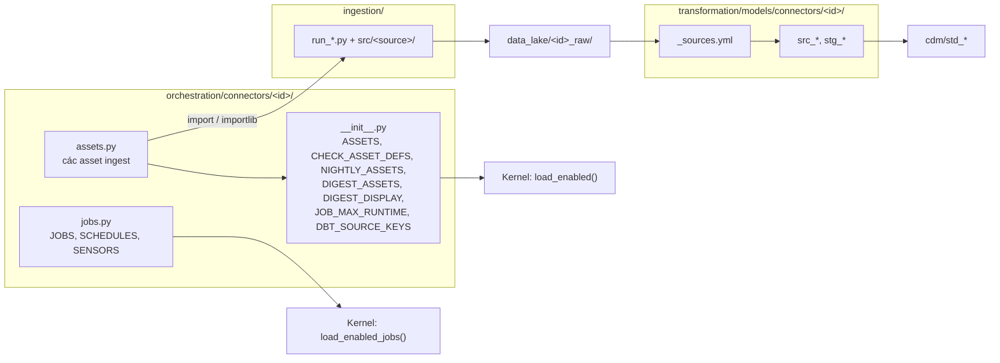

`jobs.py` tách khỏi `__init__.py` để tránh vòng import: `assets/dbt.py` đọc `DBT_SOURCE_KEYS` từ package, còn job cần `dbt.sapo_dbt_assets`.

| Export | Kiểu | Kernel dùng ở đâu |
|---|---|---|
| `ASSETS` | list asset | `definitions.py` |
| `CHECK_ASSET_DEFS` | `dict[sla_key, asset \| AssetKey]` | `asset_checks/__init__.py` (freshness, not-empty, trend, cursor) |
| `NIGHTLY_ASSETS` | list asset ingest | job nightly và full refresh |
| `DIGEST_ASSETS`, `DIGEST_DISPLAY` | `list[(short, sla_key, recon_key\|None)]`, `dict[str, tuple[str, str, str]]` | `ops/morning_digest.py` |
| `JOB_MAX_RUNTIME` | `dict[str, timedelta]` theo tên job | `sensors/stuck_run_alerter.py` |
| `DBT_SOURCE_KEYS` | `dict[source_name, dict[table, AssetKey]]` (`"*"` = bảng còn lại) | `SapoDbtTranslator` |
| `JOBS`, `SCHEDULES`, `SENSORS` | list | `definitions.py` |

Bất biến: tên asset key, check key, job, schedule (cron, timezone, default status), sensor và tập `unique_id` dbt mà mỗi job chọn không đổi khi dời code (trạng thái bật/tắt schedule trên prod gắn với code location + repository + tên). `scripts/shadow/gate.sh M` chứng minh bằng Dagster inventory.

Bỏ một connector khỏi `modules.yaml` chỉ làm mất asset, job, schedule, sensor, check và dòng digest của connector đó (đã thử trong shadow với `hug`).

| Connector | Asset | Job (schedule) | Sensor |
|---|---|---|---|
| `sapo_v2` | 7 `ingest_sapo_v2_*` (`sapo/…`) | `pipeline_sapo_v2_realtime_job` (*/3), `…_incremental_job` (*/10), `…_hourly_job` (:25) | — |
| `shopee` | `shopee_income_file_drop_asset` (multi-asset, 4 output) | `ingest_filedrop_shopee_job` | `ingest_filedrop_shopee_sensor` |
| `misa_amis` | 2 `misa_*_download_asset`, 2 `misa_*_file_drop_asset` | `ingest_weekly_job`, `ingest_monthly_job` (3 schedule), `ingest_filedrop_misa_job`, `ingest_filedrop_misa_account_ledger_job` | `ingest_filedrop_misa_sensor`, `ingest_filedrop_misa_account_ledger_sensor` |
| `sheets` | 5 `sheets_*_asset`, `budget_sheet_sync_asset`, `budget_suggestion_writeback_asset` | `ingest_sheets_sync_job`, `budget_sheet_sync_job` (02:30), `budget_suggestion_writeback_job` (1st, 08:00) | `ingest_sheets_modified_sensor` |
| `hug` | `ingest_hug_webhook_consumer_asset` | `pipeline_hug_realtime_job` (*/3) | — |

| Connector | Ingestion | Raw | dbt | Ra cdm |
|---|---|---|---|---|
| `sapo_v2` | 7 `run_sapo_v2_*.py`, `src/sapo/` (batch, history log, webhook consumer từ D1) | `sapo_v2_raw/` | `src_sapo_v2_*` (11, incremental), `stg_sapo_v2_*` (16) | `std_orders`, `std_order_items`, `std_customers`, `std_products`, `std_variants`, … |
| `shopee` | `run-shopee-income-file-drop.py`, `src/shopee/` | `shopee_raw/` | `src_shopee_*`, `stg_shopee_*` | (đi thẳng `packs/marketplace`) |
| `misa_amis` | 6 `run-misa-*.py`, `src/misa_amis/` | `misa_raw/` | `src_misa_*`, `stg_misa_sales_lines` | `std_misa_sales_lines`, `std_misa_account_ledger` |
| `sheets` | `src/gsheet_*.py` (URL từ env `SOURCES__SPREADSHEET_URL__<NAME>`, không mặc định) | `gsheet_raw/` | `stg_targets`, `stg_marketing_spend`, `stg_teams`, `stg_team_members` | `std_targets`, `std_marketing_spend`, `std_teams`, `std_team_members` |
| `hug` | `run_hug_webhook_consumer.py` (poll Cloudflare D1) | `hug_raw/` | `src_hug_scan`, `src_hug_optin_event` (incremental) | (đi thẳng `packs/hug`) |
| `facebook_*` | `run_facebook_*_batch.py` (chưa có asset, dormant) | `facebook_ads`, `raw_messenger_data` | `stg_fb_*` | (đi thẳng `packs/facebook_*`) |

### 5.2 Connector sapo_v2 (chi tiết)

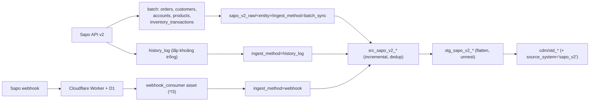

Code orchestration của connector sapo_v2 không chứa giá trị riêng của Fine Japan (luật `connector-url`). Domain Sapo, `login_url` và worker URL vẫn ở `ingestion/.dlt/config.toml` (user quyết định 14/10/2026), ghi nhận là cấu hình Fine Japan ở [orchestration/tenants/fine_japan/README.md](../../orchestration/tenants/fine_japan/README.md).

## 6. CDM (canonical layer)

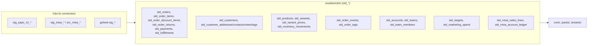

Giải thích chi tiết (vì sao, cách hoạt động, kiểm chứng, hướng dẫn thêm view): [canonical-layer.md](./canonical-layer.md). Luật của tầng này theo `docs/architecture/std-layer-conventions.md`: R1 downstream không đọc `stg_*`; R2 pass-through trung thành + `source_system`. Mỗi `std_*` có test danh sách cột/kiểu mức **warn**. Owner: module CDM; connector chỉ cung cấp `stg_*` đầu vào.

10 view `std_*` mới (tất cả `view`, pass-through trung thành, `source_system` ở cuối): 

| View | Đọc từ | `source_system` | Core dùng |
|---|---|---|---|
| `std_customer_addresses/contacts/notes/tags` | `stg_sapo_v2_customer_*` | `sapo_v2` | `dim_customer_*` |
| `std_order_events` | `int_order_snapshots_ranked` (lịch sử trạng thái đơn từ history log) | `sapo_v2` | `fact_order_transitions` |
| `std_order_tags` | `src_sapo_v2_orders` (`order_id`, `tags`) | `sapo_v2` | `int_order_tags` |
| `std_teams`, `std_team_members` | `stg_teams`, `stg_team_members` | `gsheet` | `dim_teams`, `fact_orders`, `fact_sales` |
| `std_targets` | `stg_targets` | `gsheet` | `fact_targets` |
| `std_marketing_spend` | `stg_marketing_spend` | `gsheet` | `fact_marketing_spend` |

Cột `source_system` chỉ có trong `std_*`; các model core giữ danh sách cột tường minh nên cột này không lọt ra bảng public. `fact_order_transitions` lấy `order_code` từ `std_orders` (cùng nội dung `stg_sapo_v2_orders`). Test: generic test `std_column_contract` (`transformation/tests/generic/`) so khớp tên, thứ tự và kiểu cột với `information_schema`, `severity: warn`; kiểu lấy từ warehouse thật, không bật `contract: enforced`.

## 7. Core

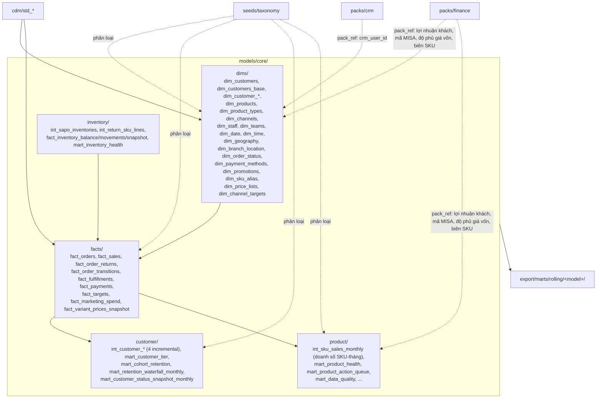

- **Lõi giữ doanh thu**; giá vốn, chi phí và lợi nhuận ở pack `finance` (mục 8). Chỉ có lõi thì xem doanh thu, bật finance thì xem thêm lợi nhuận.
- **Doanh số SKU theo tháng ở lõi: `int_sku_sales_monthly`** (`core/marts/intermediate/`, `table` trong warehouse, không có parquet rolling, không lên serving). Grain `(product_key, snapshot_month)`, 24 tháng đã đóng; cột doanh số, tốc độ bán, trả hàng, kênh đứng đầu, `is_slow_mover`, `revenue_share_pct`. Đây là nửa doanh thu của `mart_sku_economics_monthly` cũ: mart finance đọc lại mọi cột này nguyên giá trị (cùng tập dòng) và chỉ thêm giá vốn/biên, nên số thực không lệch do tính lại. Người đọc ở lõi: `int_product_velocity_trend`, `mart_inventory_health`, `mart_product_action_queue` (chỉ doanh số), `mart_product_health` (doanh số ở đây, biên qua `pack_ref`).
- **Ngoại lệ có lối ra (user chốt 14/10/2026):** `fact_variant_prices_snapshot.implied_gross_margin_pct`, `is_below_cost` là phép tính biên trên giá nhập Sapo (`GIANHAP`) nhưng vẫn nằm ở lõi. Dời sang finance là đổi bảng public tích luỹ ảnh chụp hằng ngày (serving đọc gộp file theo `union_by_name`: ngày cũ còn giá trị, ngày mới NULL), trong khi hai cột không đọc pack nào nên không cản lõi trần. Lối ra: dời khi plan report định nghĩa chỉ tiêu biên theo bảng giá trong finance (gate S, deploy riêng).
- Core chỉ đọc `cdm/`, `core/` và seed dùng chung (`seeds/taxonomy`). Ba seed của tenant mà core còn đọc (`seed_channel_targets`, `seed_sku_alias_manual`, `seed_sku_regimen_config`) là vi phạm luật `dbt-seed` được allowlist, lối ra cùng `pack_ref` (mục 3). Các luật phân loại còn viết trong SQL của core được kiểm kê ở `transformation/docs/TAXONOMY.md`.
- Mọi tên model ở đây là **public** (76 serving view, Rill, CRM, detailView): không đổi tên khi refactor module.
- **Cột lõi đến từ pack** (đọc qua `pack_ref`, hợp đồng ở mục 8.1). Khi pack bật, SQL compile ra giống hệt `ref()` cũ (Fine Japan không đổi số). Khi pack tắt:

| Model lõi | Pack | Cột lấy từ pack | Khi pack tắt |
|---|---|---|---|
| `dim_customers` | `finance` (`int_customer_economics`) | `lifetime_gross_profit`, `lifetime_contribution_margin`, `avg_order_contribution_margin_pct`, `margin_cogs_coverage_pct`, `is_margin_negative`, `total_cogs`, `avg_gross_margin_pct`, `total_return_amount`, `return_count`, `cogs_order_count` | Tất cả **NULL**. Khi bật, `lifetime_gross_profit`/`lifetime_contribution_margin` vẫn `COALESCE(x, 0)` và `is_margin_negative` `COALESCE(x, FALSE)`; khi tắt bỏ `COALESCE` vì thiếu giá vốn không phải lãi 0 (user chốt 14/10/2026). `mart_customer_tier.lifetime_contribution_margin` chuyển tiếp nên cũng NULL. ⚠ `total_return_amount`, `return_count` (trả hàng, không phải chi phí) cũng mất khi tắt finance vì đang tính trong `int_customer_economics` |
| `dim_staff` | `crm` (`stg_crm__app_user`) | `crm_user_id` (user CRM đang hoạt động, nối theo email) | `crm_user_id` NULL; các cột khác không đổi (đã build shadow với `crm`, `sales_playbook` tắt: chỉ cột này khác) |
| `dim_sku_alias` | `finance` (`int_misa_sales_lines`) | Mã hàng MISA của dòng hàng hoá (không khuyến mãi, không dịch vụ) | Không sinh alias tự động VTS → VCS (`INNER JOIN` mã MISA ra 0 dòng); chỉ còn alias tay từ seed |
| `mart_data_quality` | `finance` (`fact_order_economics`) | Số đơn, `has_cogs`, `has_platform_fees` | `total_orders` = 0, `cogs_rate_pct`, `platform_fees_rate_pct` NULL (`nullif`); các chỉ số khác không đổi |
| `mart_product_health` | `finance` (`mart_sku_economics_monthly`, `LEFT JOIN` theo `(product_key, snapshot_month)` vào `int_sku_sales_monthly` tháng mới nhất) | `realized_margin_pct`, `cogs_variance_pct`, `margin_outlier`, `cogs_source` | 4 cột biên NULL, `has_margin_data` FALSE cho mọi SKU có bán, `health_class` NULL cho các SKU đó (SKU chỉ có tồn kho vẫn rơi vào `BALANCED` như hiện nay); kéo theo `mart_product_action_queue` (`health_class`, `has_margin_data`, `realized_margin_pct`) và `mart_deadstock_target_queue` (chọn SKU theo `health_class` DOG/QUESTION) |
- Nợ còn lại: xem bảng vi phạm đã biết ở mục 3.

## 8. Packs ✅

Pack là **logic sản phẩm dùng lại được**, không phụ thuộc ngành; doanh nghiệp (tenant) chỉ cung cấp dữ liệu và cấu hình. Connector lấy dữ liệu, pack dùng dữ liệu; hai bên gặp nhau ở `std_*` (trừ connector pack khai báo trong `pack_connectors`). Fine Japan là doanh nghiệp đầu tiên bật các pack dưới đây.

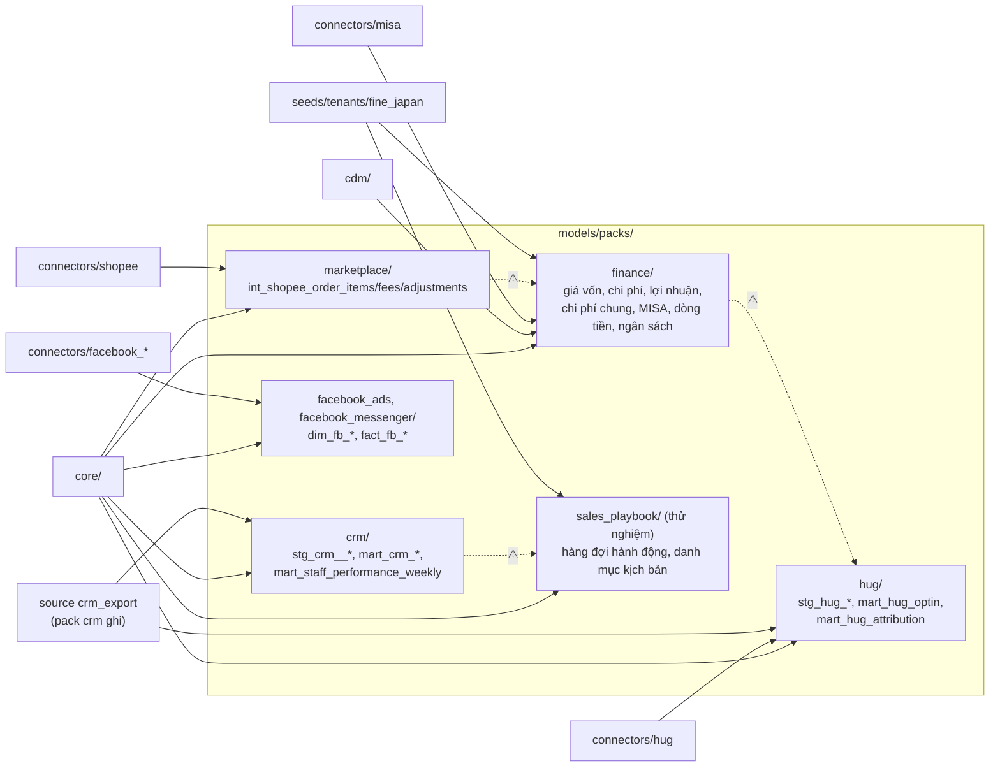

| Pack | dbt (`models/packs/<id>/`) | Orchestration (`orchestration/packs/<id>/`) | Connector khai báo | README |
|---|---|---|---|---|
| `finance` | 22 model: giá vốn (`int_order_cogs_reconciled`, `int_order_promo_goods_cost`, `int_promo_642_monthly_total`, `mart_order_cogs_summary`), chi phí và lợi nhuận (`fact_order_costs`, `fact_order_economics`, `int_customer_economics`, `mart_sku_economics_monthly`), chi phí chung (`stg_overhead_account_classification`, `int_overhead_pool_monthly`, `int_order_overhead_allocation`), MISA (`int_misa_sales_lines`, `dim_gl_account`, `fact_account_balance_monthly`, `fact_cash_movement`), dòng tiền/ngân sách (`fact_cashflow_budget`, `dim_cash_allocation_policy`, `mart_cashflow_*`, `mart_cash_surplus_allocation`) | không có code (rỗng) | `misa` | [dbt](../../transformation/models/packs/finance/README.md), [orchestration](../../orchestration/packs/finance/README.md) |
| `crm` | 14 model: 9 `stg_crm__*`, `int_crm_party_tag_flags`, `int_crm_outreach_effort_events`, `mart_crm_activity_log`, `mart_crm_outreach_effort_by_action_weekly`, `mart_staff_performance_weekly` | `crm_writeback_assets.py` (11 export), `crm_sync.py` (`crm_cache_refresh`, `crm_backup`, `crm_restore_verify`), `jobs.py` (`crm_backup_job`, `crm_backup_schedule`) | — (đọc source `crm_export`) | [dbt](../../transformation/models/packs/crm/README.md), [orchestration](../../orchestration/packs/crm/README.md) |
| `hug` | 5 model: `stg_hug_scan`, `stg_hug_optin_event`, `stg_crm__hug_voucher`, `mart_hug_optin`, `mart_hug_attribution` | không có code (ingestion là connector `hug`) | `hug` | [dbt](../../transformation/models/packs/hug/README.md), [orchestration](../../orchestration/packs/hug/README.md) |
| `sales_playbook` (thử nghiệm, chưa chuẩn hoá) | 3 model: `mart_customer_action_queue`, `mart_customer_sku_action_queue`, `dim_action_scenario_registry` | `approach_script_generation.py` (`approach_script_autogen`) | — | [dbt](../../transformation/models/packs/sales_playbook/README.md), [orchestration](../../orchestration/packs/sales_playbook/README.md) |
| `marketplace` | 3 model `int_shopee_order_*` | không có code (rỗng) | `shopee` | [orchestration](../../orchestration/packs/marketplace/README.md) |
| `facebook_ads`, `facebook_messenger` (model tắt trong config của từng model) | 2 + 2 model | không có code (rỗng) | `facebook_*` | [facebook_ads](../../orchestration/packs/facebook_ads/README.md), [facebook_messenger](../../orchestration/packs/facebook_messenger/README.md) |

HUG là module **nối lại khách từ sàn thương mại điện tử về mua trực tiếp với shop** (tại quầy, website). Pack finance giữ **toàn bộ chi phí và lợi nhuận**; lõi giữ doanh thu (quyết định 14/10/2026, mục 3). Ở mức SKU-tháng, `mart_sku_economics_monthly` của finance đọc doanh số từ `int_sku_sales_monthly` của lõi (pack → lõi, hợp lệ) và chỉ tính thêm giá vốn (MISA, dự phòng MAC Sapo) và biên; lõi đọc lại 4 cột biên qua `pack_ref` (mục 7).

Quy tắc:

- Một pack chỉ đọc `cdm`, `core`, chính nó và connector khai báo trong `pack_connectors` của `model_buckets.yaml` (finance → misa, marketplace → shopee, hug → hug, facebook_* → facebook_*). Pack → pack khác và pack → connector khác chỉ qua allowlist (mục 3).
- Orchestration: mỗi pack là package `orchestration/packs/<id>/` export `ASSETS`, `NIGHTLY_ASSETS` (`__init__.py`) và `JOBS`, `SCHEDULES`, `SENSORS` (`jobs.py`); `definitions.py` nạp các pack liệt kê ở `packs:` trong `config/modules.yaml` giống connector, và đưa `NIGHTLY_ASSETS` vào job nightly/full refresh. Hợp đồng: [orchestration/packs/README.md](../../orchestration/packs/README.md).
- Pack không import pack khác, connector không import pack (luật `orch-import`); pack không chứa URL/domain cứng (luật `pack-url`), endpoint lấy qua `orchestration.tenants.setting()`.
- Bật/tắt pack: mục 8.1. Lõi đọc pack chỉ qua `pack_ref` với hợp đồng cột; cạnh pack → pack vẫn là `ref()`.

### 8.1 Bật/tắt pack (công tắc pack)

Plan `plans/261014-2225-pack-mechanism/`. Kết quả spike (dbt-core 1.11.12, dbt-duckdb 1.10.1): `plans/261014-2225-pack-mechanism/reports/spike-dbt-pack-switch.md`.

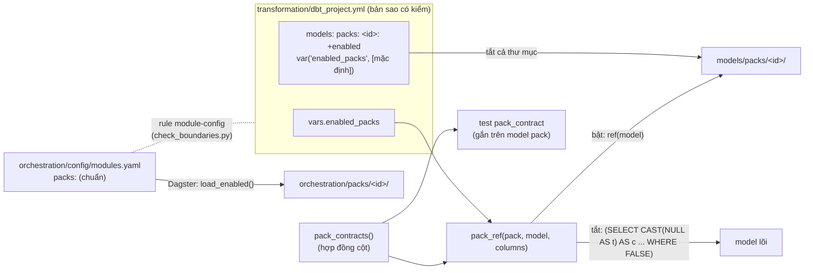

**Nguồn khai báo.** `packs:` trong `orchestration/config/modules.yaml` là danh sách chuẩn của một triển khai (Fine Japan: cả 7 pack). dbt không đọc được file YAML tuỳ ý lúc parse, và `dbt parse` chạy ở nhiều nơi không qua Dagster (lệnh start container, `build-lake.sh`, `run-all.sh`), nên `transformation/dbt_project.yml` giữ bản sao:

| Chỗ | Nội dung | Ai đọc |
|---|---|---|
| `vars.enabled_packs` | Danh sách pack bật, cùng id và thứ tự `modules.yaml` | `pack_enabled()`/`pack_ref()` trong model (ngữ cảnh model thấy khối `vars:`) |
| `models: sapo_warehouse: packs: <id>: +enabled` | `"{{ ('<id>' in var('enabled_packs', [<danh sách mặc định>])) \| as_bool }}"`, một dòng cho **mọi** thư mục `models/packs/<id>/` | dbt khi nạp project: tắt cả thư mục pack (model, test generic của nó) |
| `pack_ids()` (`macros/packs/pack_enabled.sql`) | Mọi pack có thư mục, bật hay tắt | `pack_enabled()`: id lạ là lỗi biên dịch |

Danh sách mặc định phải lặp trong từng `+enabled`, vì dbt render `dbt_project.yml` trước khi nạp khối `vars:` của chính file đó: `var()` ở đây chỉ thấy `--vars` (thiếu mặc định thì `dbt parse` lỗi `Required var 'enabled_packs' not found`; spike b). Rule **`module-config`** của `check_boundaries.py` giữ ba chỗ khớp nhau: `modules.yaml packs` == `vars.enabled_packs` == danh sách mặc định trong mọi `+enabled` (so nguyên chuỗi với mẫu), mỗi thư mục pack có `+enabled`, mỗi pack của `modules.yaml` có thư mục, `pack_ids()` == tập thư mục pack. Lệch thì check fail (không allowlist được) và in sẵn khối cần dán. `--vars '{enabled_packs: [...]}'` ghi đè cả hai phía (biến và mặc định); chỉ dùng cho profile thử trên shadow (`scripts/shadow/build-profile.sh`), không dùng trên prod.

**Macro** (`transformation/macros/packs/`):

| Macro | Hợp đồng |
|---|---|
| `pack_enabled(pack)` | `pack in var('enabled_packs')`; pack không có trong `pack_ids()` là lỗi biên dịch |
| `pack_contracts()` | Dict `{'<model pack>': {'pack': '<pack>', 'columns': {'<cột>': '<kiểu DuckDB>'}}}`: **một chỗ duy nhất** khai báo cột lõi đọc từ pack. `check_boundaries.py` đọc cặp model → pack bằng regex, nên mỗi mục viết đúng dạng `'<model>': {'pack': '<pack>', ...}` |
| `pack_ref(pack, model, columns=none)` | Bật: `return(ref(model))`, SQL compile ra đúng chuỗi relation như `ref()` cũ (spike: 8/8 model hook giống hệt) và lineage giữ cạnh lõi → pack. Tắt: `(SELECT CAST(NULL AS <kiểu>) AS <cột>, ... WHERE FALSE)`, không gọi `ref()` nên dbt không ghi cạnh và model pack đã tắt không cần có. Lỗi biên dịch khi: model không có hợp đồng, hợp đồng thuộc pack khác, `columns` (tập con tuỳ chọn cho model lõi chỉ đọc vài cột) có cột hoặc kiểu không có trong hợp đồng |
| test generic `pack_contract` (`tests/generic/pack_contract.sql`) | Gắn vào model pack (`data_tests: - pack_contract` trong file properties của pack); so `information_schema.columns` của relation với hợp đồng (tên, kiểu; không phân biệt hoa thường, bỏ khoảng trắng; cột thừa được phép); một dòng cho mỗi cột thiếu hoặc sai kiểu; mức `error` |

Mọi quyết định dựa trên `var` (không `run_query`, không `graph`), nên lineage tĩnh và đổi `--vars` làm dbt parse lại toàn bộ (spike a, f). Hợp đồng hiện có (kiểu lấy bằng `DESCRIBE` trên lake shadow; mỗi model pack gắn test `pack_contract` trong mục properties sẵn có của nó, vì dbt không cho hai mục properties cho cùng một model và không cho `tests:` cùng `data_tests:` trong một mục):

| Model pack | Pack | Cột hợp đồng (kiểu DuckDB) | Lõi đọc | Test gắn ở |
|---|---|---|---|---|
| `int_customer_economics` | `finance` | `customer_key` VARCHAR, `lifetime_gross_profit` BIGINT, `lifetime_contribution_margin` BIGINT, `avg_order_contribution_margin_pct` DOUBLE, `margin_cogs_coverage_pct` DOUBLE, `is_margin_negative` BOOLEAN, `total_cogs` BIGINT, `avg_gross_margin_pct` DOUBLE, `total_return_amount` BIGINT, `return_count` INTEGER, `cogs_order_count` INTEGER | `dim_customers` | `packs/finance/marts/intermediate/_finance__models.yml` (mới) |
| `stg_crm__app_user` | `crm` | `crm_user_id` VARCHAR, `email` VARCHAR, `is_active` BOOLEAN | `dim_staff` | `packs/crm/staging/_crm__models.yml` |
| `int_misa_sales_lines` | `finance` | `product_code` VARCHAR, `is_promo_line` BOOLEAN, `is_service_line` BOOLEAN | `dim_sku_alias` | `packs/finance/intermediate/misa/_finance__models.yml` (danh sách `tests:` sẵn có) |
| `fact_order_economics` | `finance` | `has_cogs` BOOLEAN, `has_platform_fees` BOOLEAN | `mart_data_quality` (cùng `count(*)`) | `packs/finance/marts/sales/_finance__models.yml` |

| `mart_sku_economics_monthly` | `finance` | `product_key` VARCHAR, `snapshot_month` DATE, `realized_margin_pct` DOUBLE, `cogs_variance_pct` DOUBLE, `margin_outlier` BOOLEAN, `cogs_source` VARCHAR | `mart_product_health` | `packs/finance/marts/sales/_finance__models.yml` (danh sách `tests:` sẵn có) |

Giá trị khi tắt pack: mục 7.

**Quan hệ rỗng và JOIN.** `LEFT JOIN` vào quan hệ rỗng giữ mọi dòng lõi, cột pack thành NULL. `JOIN` inner hoặc `CROSS JOIN` vào dữ liệu pack ra 0 dòng khi pack tắt; khi áp `pack_ref` cho một hook phải xem lại các chỗ đó (`dim_sku_alias` `INNER JOIN` mã MISA: đúng nghĩa, không alias tự động; chuỗi `int_product_velocity_trend` → `mart_product_health` từng đọc `mart_sku_economics_monthly`, nay đọc `int_sku_sales_monthly` của lõi nên khi tắt finance vẫn đủ dòng: 18 và 99 dòng như Fine Japan).

**Test khi pack tắt.** dbt tự tắt (không lỗi, không cảnh báo) mọi test có `ref` tới model đã tắt, kể cả 6 test đơn lẻ trong `transformation/tests/` đọc model finance/marketplace; node test vẫn nằm trong `manifest.nodes` với `config.enabled = false`. Vì vậy `dbt_inventory.py`, `dagster_inventory.py` bỏ qua node có `config.enabled = false`, và `check_boundaries.py` không kiểm cạnh của model tắt (vẫn kiểm bucket và thư mục). Một số test bị tắt vẫn giữ cạnh tới model lõi trong `depends_on` và `child_map` (lõi trần: 4 trên 128, ví dụ `assert_overhead_accounts_classified` → `std_misa_account_ledger`, `relationships` của `fact_order_economics` → `dim_channels`), nhưng dagster-dbt không tạo asset check cho test tắt: nạp `orchestration/definitions.py` với manifest lõi trần cho 387 asset check (Fine Japan 506), không có check nào của 4 test đó.

**Phụ thuộc pack → pack đã biết** (vẫn là `ref()` thẳng, allowlist mục 3): `hug` → `finance` (`mart_hug_attribution` → `fact_order_economics`), `finance` → `marketplace` (`fact_order_economics` → `int_shopee_order_fees`), `sales_playbook` → `crm`. Tắt một pack mà vẫn bật pack phụ thuộc nó thì `dbt parse` lỗi rõ (fail closed), ví dụ `Model 'model.sapo_warehouse.mart_hug_attribution' ... depends on a node named 'fact_order_economics' which is disabled`.

**Pack chỉ có tên.** `facebook_ads`, `facebook_messenger` có trong `enabled_packs` nhưng 4 model của chúng tắt bằng `config(enabled=false)` trong từng model; config trong model thắng config theo thư mục, nên `+enabled: true` không bật lại. `marketplace`, `facebook_*` có package Dagster rỗng để `modules.yaml` khớp phía dbt.

**Tắt một pack (khi các hook đã chuyển sang `pack_ref`).** Bỏ id khỏi `packs:` trong `modules.yaml`, chạy `check_boundaries.py` và dán khối nó in vào `dbt_project.yml` (`vars.enabled_packs` và danh sách mặc định của mọi `+enabled`), chạy `scripts/checks/run-all.sh`, rồi khởi động lại code server Dagster. Trạng thái 14/10/2026 (build thử bằng `scripts/shadow/build-profile.sh <worktree> '<vars>'`):

- `{enabled_packs: [hug, finance, marketplace, facebook_ads, facebook_messenger]}` (tắt `crm` và `sales_playbook`, pack phụ thuộc nó): dbt build xanh; so với Fine Japan chỉ khác `dim_staff.crm_user_id` (NULL) và vắng 7 bảng của hai pack. Trên prod còn phải làm phase 6 (job connector chọn `crm_cache_refresh`) trước khi tắt `crm` thật.
- `{enabled_packs: [], tenant: ""}` (**lõi trần**, bước 6b của `scripts/shadow/gate.sh`): dbt build xanh (140 model và seed `success`, 347 test `pass`; `int_product_velocity_trend` 18, `mart_product_health` 99, `mart_product_action_queue` 14, `mart_inventory_health` 2 052 dòng, bằng Fine Japan). Khác với Fine Japan: 30 bảng public của pack vắng; `dim_customers` (10 cột lấy từ finance NULL), `mart_customer_tier.lifetime_contribution_margin`, `dim_staff.crm_user_id`, `dim_sku_alias` (174 → 137 dòng: mất alias tự động VTS → VCS), `dim_products.misa_join_key`, `mart_data_quality` (3 cột), `mart_product_health`, `mart_product_action_queue` (cột biên, `health_class`), `mart_deadstock_target_queue` (249 → 208 dòng theo `health_class`). Danh sách dự kiến dùng để duyệt: `scripts/shadow/README.md` mục "Bare-core profile". Trên prod còn lõi đọc seed tenant (phase 5) và job connector chọn `crm_cache_refresh` (phase 6).

## 9. Taxonomy module

**Trạng thái:** phần đã làm là **đặc tả, seed và công cụ kiểm tra**. Chưa có macro taxonomy và chưa sửa model nào; các khối `CASE` phân loại vẫn nằm trong SQL của core. Bộ máy phân loại (luật thành dữ liệu, mỗi domain một model sinh từ macro chung) là **plan riêng sau Đợt 1**, thiết kế đã duyệt ở [taxonomy-engine.md](taxonomy-engine.md), bộ mã chuẩn của nó **chưa chốt**.

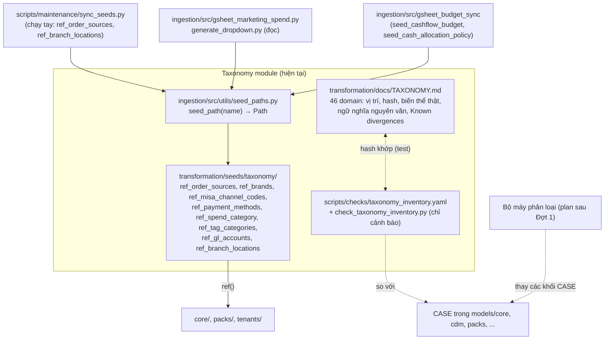

| Thành phần | Vai trò | Tài liệu |
|---|---|---|
| `transformation/docs/TAXONOMY.md` | Đặc tả: mọi luật phân loại (file:dòng, sha256, biến thể, ngữ nghĩa, tenant literal), đã là dữ liệu hay còn là SQL, Known divergences. Là **đặc tả đầu vào** của bộ máy | chính nó |
| `docs/architecture/taxonomy-engine.md` | Thiết kế bộ máy phân loại (v2, đã duyệt hướng, chưa triển khai) | [taxonomy-engine.md](taxonomy-engine.md) |
| `docs/reference/taxonomy/` | Bốn tài liệu tham chiếu bên ngoài (Shopify, Trung Quốc, nguồn TMĐT Việt Nam, chuẩn liên ngành) | [reference/taxonomy/](../reference/taxonomy/) |
| `scripts/checks/check_taxonomy_inventory.py`, `taxonomy_inventory.yaml` | Cảnh báo khi khối đã kiểm kê đổi hash hoặc có `CASE` mới gán cột taxonomy; shadow gate bước 3c | [scripts/checks/README.md](../../scripts/checks/README.md#check_taxonomy_inventorypy) |
| `ingestion/src/utils/seed_paths.py` | `seed_path(name)` tra thư mục thật của seed (quét `transformation/seeds/**/<name>.csv`, lỗi nếu không có hoặc trùng) | docstring của module |
| `transformation/seeds/taxonomy/` | 8 seed phân loại; `+column_types` đặt dưới khoá `taxonomy:` trong `dbt_project.yml` | `transformation/AGENTS.md` |

Ai ghi seed nào: `sync_seeds.py` (chạy tay) thêm dòng vào `ref_order_sources` và `ref_branch_locations`; không writer tự động nào ghi seed phân loại. Job Google Sheet 02:30 (`budget_sheet_sync_asset` gọi `gsheet_budget_sync`) ghi hai seed ngân sách của tenant (`seed_cashflow_budget`, `seed_cash_allocation_policy`, ở `transformation/seeds/tenants/fine_japan/`), cũng qua `seed_path`. Bảng đầy đủ đọc/ghi: [TAXONOMY.md mục 5](../../transformation/docs/TAXONOMY.md#5-seed-phân-loại-và-ai-đọc-ai-ghi).

Hình dạng luật hôm nay (chi tiết ở TAXONOMY.md, mục "Dạng luật"): ánh xạ trực tiếp, dò mẫu có ưu tiên, chia ngưỡng, tổ hợp, gán tay, phân cấp. Phần còn là SQL: hầu hết nhãn khách, kênh cấp 1, phạm vi đơn, loại giảm giá, trạng thái chuẩn. Phần đã là dữ liệu: nguồn đơn, thương hiệu, mã kênh MISA, nhóm tag đơn.

| Thuộc sản phẩm | Thuộc tenant |
|---|---|
| Danh sách domain, cơ chế `seed_path`, kiểm tra trùng seed, check kiểm kê, đặc tả cấu trúc | Giá trị seed, nội dung luật (hôm nay nằm trong SQL core, sau này chuyển thành dữ liệu), literal như `CTN00014`, `'US'`, `'Đại Lý'` (danh sách ở TAXONOMY.md mục 6) |

## 10. Tenant overlay Fine Japan ✅

Nguyên tắc (user chốt 14/10/2026): **logic là sản phẩm (pack), dữ liệu và cấu hình là của doanh nghiệp (tenant)**. Phần dbt riêng Fine Japan chỉ còn US shipment; CRM, HUG, tài chính, kịch bản bán hàng là pack (mục 8).

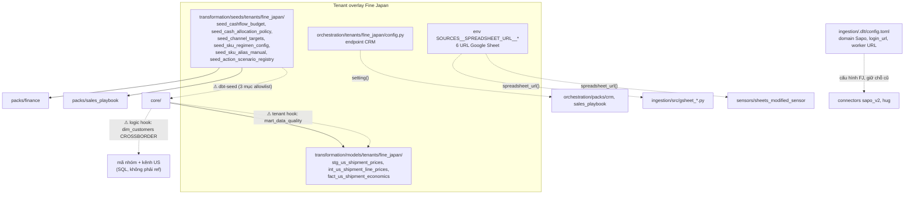

| Phần | Vị trí | README |
|---|---|---|
| US shipment (3 model, tag `us_shipment` giữ nguyên nhờ thư mục `intermediate/us_shipment/`) | `transformation/models/tenants/fine_japan/` | [dbt](../../transformation/models/tenants/fine_japan/README.md) |
| 6 seed dữ liệu doanh nghiệp (Python ghi qua `seed_path`) | `transformation/seeds/tenants/fine_japan/` | như trên |
| Cấu hình đọc qua `orchestration.tenants.setting(name)` (env cùng tên ghi đè; thiếu thì `TenantConfigError`): endpoint CRM | `orchestration/tenants/fine_japan/config.py`; bật bằng `tenants: [fine_japan]` trong `config/modules.yaml` | [orchestration](../../orchestration/tenants/fine_japan/README.md) |
| 6 URL Google Sheet (`TARGETS`, `MARKETING_SPEND`, `US_SHIPMENT_PRICES`, `TEAM_CONFIG`, `OVERHEAD_CLASSIFICATION`, `BUDGET`), chỉ khai báo một nơi | Biến môi trường `SOURCES__SPREADSHEET_URL__<NAME>` (`.env.docker`; tên ở `.env.docker.example`); code không có mặc định, ingestion không import `orchestration.tenants` | như trên |
| Domain Sapo, `login_url`, worker URL (giữ chỗ cũ, user quyết định 14/10) | `ingestion/.dlt/config.toml` | như trên |

### Hook (sinh từ manifest)

Danh sách đầy đủ là `scripts/checks/boundary_allowlist.yaml`, sinh từ `depends_on` của manifest (`check_boundaries.py --write-allowlist`), không viết tay. Bảng tổng hợp ở mục 3.

| Loại | Cạnh | Hướng xử lý (sau Đợt 1) |
|---|---|---|
| Tenant hook (core → tenant) | `mart_data_quality` → `fact_us_shipment_economics` | Dời check US vào tenant |
| Lõi đọc seed tenant (`dbt-seed`) | `dim_channel_targets`, `int_customer_sku_supply_tracking`, `dim_sku_alias` → ba seed Fine Japan | Seed mặc định rỗng đúng cột ở lõi, tenant ghi đè, cùng `pack_ref` |
| Pack hook (core → pack) | Đã đóng 14/10/2026: lõi đọc pack qua `pack_ref` (mục 8.1); `mart_sku_economics_monthly` tách nửa doanh thu thành `int_sku_sales_monthly` (mục 7) | — |
| Pack → pack (khai báo) | `mart_hug_attribution` → `fact_order_economics`; `fact_order_economics` → `int_shopee_order_fees`; `sales_playbook` → `crm` (3 cạnh) | `pack_ref` |

**Logic hook (không phải cạnh `ref`, checker không thấy):** nhánh `CROSSBORDER` của `customer_type` trong `dim_customers` dùng mã nhóm viết cứng `TYPE_CROSSBORDER`/`CTN00014` và tín hiệu "có đơn không huỷ trên kênh `US`" viết trong SQL. Đây là logic riêng Fine Japan nằm trong lõi; không có trong allowlist. Chi tiết và hai biến thể: [TAXONOMY.md](../../transformation/docs/TAXONOMY.md) (domain `customer_type`, `is_us_gift_recipient`, mục 6). Hướng xử lý: quyết định nghiệp vụ + bộ máy phân loại.

Literal Fine Japan khác trong các khối `CASE` của core (`KY_GUI`, `'Đại Lý'`, tên thương hiệu, từ khoá giảm giá) cũng không phải cạnh `ref`; danh sách ở [TAXONOMY.md mục 6](../../transformation/docs/TAXONOMY.md#6-giá-trị-tenant-viết-cứng-trong-sql), chuyển vào tenant cùng bộ máy phân loại.

## 11. Serving và người tiêu thụ

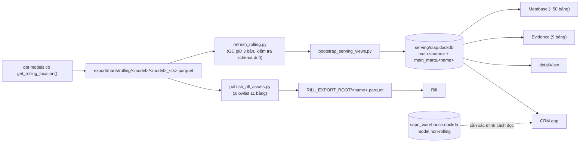

| Người tiêu thụ | Đọc từ | Quyền |
|---|---|---|
| Metabase | `serving/olap.duckdb` (`main_marts.*`) | read-only |
| Evidence | `evidence/sources/datalake/connection.yaml` → serving | read-only |
| Rill | `RILL_EXPORT_ROOT/<name>.parquet` | read-only |
| detailView | `serving/olap.duckdb` (`read_only=True`) | read-only |
| CRM | `serving/olap.duckdb` read-only, theo tên relation (`crm/sync/duckdb_reader.py`, `crm/src/adapters/outbound/duckdb/`); gồm model của lõi, `finance`, `sales_playbook`, `hug` và tenant | read-only với warehouse; ghi SQLite riêng |

Tên các bảng này là hợp đồng public; danh sách nằm ở `scripts/checks/public_models.yaml`.

## 12. Ranh giới Python và container ✅

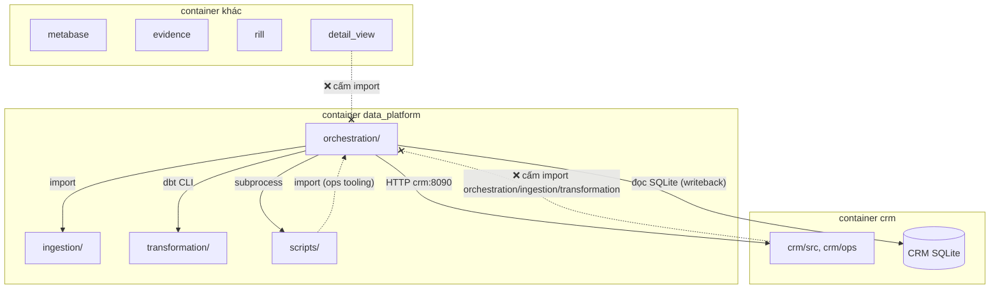

| Quy tắc | Cưỡng chế |
|---|---|
| `crm/`, `detailView/` không import `orchestration`, `ingestion`, `transformation` | `check_boundaries.py` (ast) |
| `ingestion/` không import `orchestration` (kể cả `orchestration.tenants`: URL Google Sheet đọc từ env `SOURCES__SPREADSHEET_URL__*`) | `check_boundaries.py` |
| Lõi, cdm, connector không đọc seed tenant (luật `dbt-seed`, 3 mục allowlist) | `check_boundaries.py` (manifest) |
| Mọi luật trên chạy trước mỗi commit | `scripts/checks/run-all.sh` (cùng `dbt parse`, `dagster definitions validate`, pytest) |
| `orchestration/connectors/**` và `orchestration/packs/**` không chứa URL/domain cứng (luật `connector-url`, `pack-url`); giá trị tenant đọc qua `orchestration.tenants.setting()` | `check_boundaries.py` |
| Connector không import pack; pack không import pack khác (luật `orch-import`, 5 mục allowlist) | `check_boundaries.py` (ast) |
| Giao tiếp CRM ↔ orchestration chỉ qua HTTP và file export | Review + quy tắc import |
