# Kiến trúc module: authority và boundary theo component

> Tài liệu sống của kiến trúc module. Mỗi thay đổi về module (thư mục, bucket, ma trận phụ thuộc, connector, tenant) cập nhật mục tương ứng **trong cùng commit với code**. Quy ước chung: **mỗi vùng lưu trữ chỉ có một component được ghi**; component khác chỉ đọc qua giao diện đã khai báo.
>
> Lộ trình và lý do: plan `plans/261013-1751-modularize-data-platform-suite/` (gồm `roadmap.md`). Công cụ kiểm chứng refactor: [docs/operations/refactor-safety-harness.md](../operations/refactor-safety-harness.md).

## Trạng thái hiện tại

| Hạng mục | Trạng thái |
|---|---|
| Bucket của mọi dbt model (172 model, kể cả 10 model đang tắt) | ✅ Khai báo trong `scripts/checks/model_buckets.yaml` |
| Ma trận phụ thuộc, import chéo, seed trùng tên, URL cứng trong connector | ✅ Cưỡng chế bằng `scripts/checks/check_boundaries.py` (mục 3, mục 12) |
| Vi phạm đã biết | 46 = 9 phụ thuộc (mục 3) + 37 model tenant chưa dời thư mục, ghi trong `scripts/checks/boundary_allowlist.yaml` kèm lý do và hướng thoát |
| Thư mục dbt theo module `models/<module>/<layer>/` | ✅ 134 model (connectors, cdm, core, packs) + monitoring; ⏳ 37 model `tenant:fine_japan` còn ở `staging/`, `intermediate/`, `marts/` cũ |
| Connector package cho orchestration (`orchestration/connectors/<id>/`, bật/tắt qua `config/modules.yaml`) | ✅ 5 connector: `sapo_v2`, `shopee`, `misa_amis`, `sheets`, `hug` (mục 4, 5) |
| Taxonomy: đặc tả, seed phân loại, `seed_paths.py`, check kiểm kê | ✅ `transformation/docs/TAXONOMY.md`, `transformation/seeds/taxonomy/` (8 seed), `ingestion/src/utils/seed_paths.py`, `scripts/checks/check_taxonomy_inventory.py` (mục 9) |
| Bộ máy phân loại (luật thành dữ liệu), tenant overlay | ⏳ Đích, bộ máy là plan riêng sau Đợt 1 (mục 9, 10) |

Các mục dưới đây mô tả trạng thái đích; chỗ nào đã khớp code được đánh dấu ✅.

## Mục lục

1. [Bản đồ tổng thể](#1-bản-đồ-tổng-thể)
2. [Quyền ghi theo vùng lưu trữ](#2-quyền-ghi-theo-vùng-lưu-trữ)
3. [Ma trận phụ thuộc giữa các module dbt](#3-ma-trận-phụ-thuộc-giữa-các-module-dbt)
4. [Kernel](#4-kernel)
5. [Connectors](#5-connectors)
6. [CDM (canonical layer)](#6-cdm-canonical-layer)
7. [Core](#7-core)
8. [Packs](#8-packs)
9. [Taxonomy module](#9-taxonomy-module)
10. [Tenant overlay Fine Japan](#10-tenant-overlay-fine-japan)
11. [Serving và người tiêu thụ](#11-serving-và-người-tiêu-thụ)
12. [Ranh giới Python và container](#12-ranh-giới-python-và-container)

---

## 1. Bản đồ tổng thể

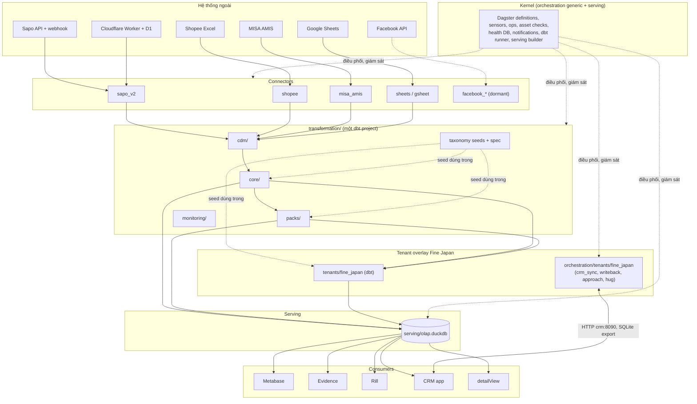

## 2. Quyền ghi theo vùng lưu trữ

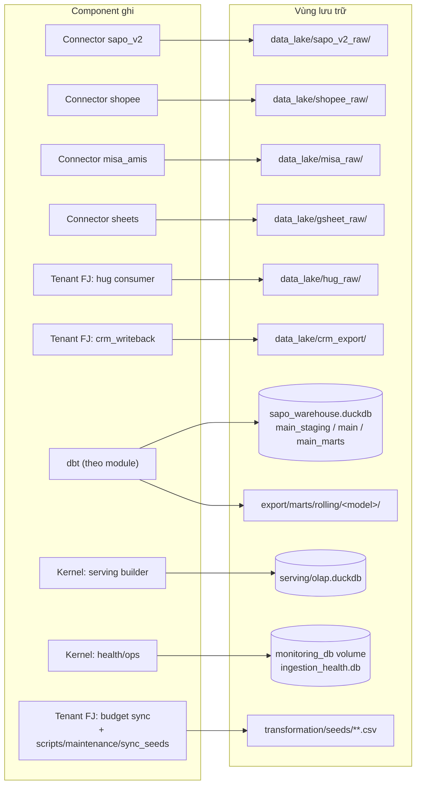

| Vùng | Owner (ghi) | Được đọc bởi | Cấm |
|---|---|---|---|
| `data_lake/<source>_raw/{entity}/ingest_method=/year=/month=` | Connector của nguồn đó | `transformation/models/connectors/<source>/_sources.yml` | Connector khác ghi; core/pack đọc trực tiếp |
| `data_lake/crm_export/` | Tenant FJ (`crm_writeback_assets`) | `connectors/crm` (stg_crm__*) | Ghi từ ngoài tenant FJ |
| `sapo_warehouse.duckdb` | dbt (một tiến trình, khoá `duckdb_lock` / `dbt_rw`) | dbt, scripts kiểm tra read-only | Ghi ngoài dbt |
| `export/marts/rolling/<model>/` | dbt model có `get_rolling_location()` | Kernel serving builder, Rill publish | Sửa tay |
| `serving/olap.duckdb` | Kernel (`refresh_rolling.py`, `bootstrap_serving_views.py`) | Metabase, Evidence, CRM, detailView (read-only) | Mọi consumer ghi |
| `monitoring_db` (health DB) | Kernel ops/sensors | Kernel asset checks, digest | Connector ghi trực tiếp (đi qua ops chung) |
| `transformation/seeds/taxonomy/*.csv` | Taxonomy module; writer Python đi qua `seed_paths.py` ✅ | dbt seed | Ghi theo đường dẫn cứng (đường dẫn seed phải do `seed_path(name)` tra) |
| `transformation/seeds/tenants/fine_japan/*.csv` | Tenant FJ (budget sync) | dbt seed | Module khác ghi |

### Vùng shadow (công cụ refactor, không phải prod)

| Vùng | Owner | Quy tắc |
|---|---|---|
| `/home/vantt/app/fg-dw-shadow/` (mode 0700) | Công cụ `scripts/shadow/*` | Chỉ tạo từ backup; chứa PII nên xoá lake nhánh sau mỗi gate, xoá toàn bộ khi đóng plan |
| Worktree `fg-dw-modular`, `fg-dw-baseline` | Người làm refactor | Không bao giờ mount vào container prod |
| Checkout prod `/home/vantt/app/fg-dataware-house` | Chỉ runbook deploy | Mọi script shadow từ chối đường dẫn này (`guard_not_prod.py`) |

## 2b. Bố cục thư mục dbt ✅

```text
transformation/models/
├── connectors/
│   ├── sapo_v2/staging/        # src_sapo_v2_* (incremental), stg_sapo_v2_*, _sources.yml
│   ├── sapo_v2/intermediate/   # int_order_snapshots_ranked (đọc thẳng raw history log)
│   ├── shopee/staging/  misa/staging/  gsheet/staging/
│   └── facebook_ads/staging/  facebook_messenger/staging/      # đang tắt
├── cdm/staging/                # std_* (canonical layer)
├── core/
│   ├── intermediate/{cogs,sapo,tags}/
│   └── marts/                  # dim_* ; intermediate/ (int_customer_*), sales/, customer/, inventory/
├── packs/
│   ├── finance/{intermediate/misa,marts}/
│   ├── marketplace/intermediate/shopee/
│   └── facebook_ads/marts/  facebook_messenger/marts/          # đang tắt
├── monitoring/
├── staging/ intermediate/ marts/   # chỉ còn model tenant:fine_japan, sẽ dời vào tenants/fine_japan/
├── sources.yml                 # nguồn của tenant (hug_raw, crm_export)
└── exposures_rill.yml
```

Quy tắc:

- **Module** = thư mục cấp 1 (theo bucket trong `scripts/checks/model_buckets.yaml`); luật `dbt-path` kiểm tra file nằm đúng `models/<module>/`.
- **Layer** = thư mục cấp 2 (`staging`, `intermediate`, `marts`). `dbt_project.yml` cấu hình schema/materialization/tags theo layer bằng YAML anchor (`&layer_staging`, `&layer_intermediate`, `&layer_marts`) và mỗi module tái sử dụng anchor đó, nên relation không phụ thuộc module. Thư mục con `shopee/`, `misa/`, `us_shipment/` trong `intermediate/` mang tag `int` + tên nguồn.
- Properties YAML nằm cạnh model: `_<module>__models.yml`; nguồn dbt của connector ở `connectors/<source>/staging/_sources.yml`.
- Thư mục `rolling/<model>/` được tạo từ manifest (`transformation/scripts/rolling_dirs.py`), không phụ thuộc thư mục model.
- Selection mà dagster-dbt gửi cho dbt dùng `fqn` (gồm thư mục), nên code server phải nạp manifest parse từ bố cục mới; lệnh start của container đã chạy `dbt parse` trước `dagster dev`.

## 3. Ma trận phụ thuộc giữa các module dbt ✅

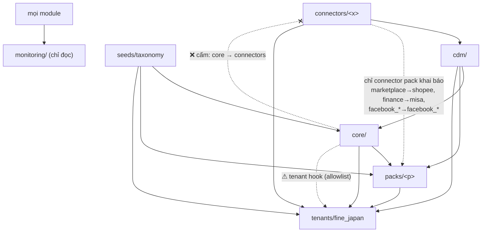

| Từ \ Tới | connectors | cdm | core | packs | tenants | seeds/taxonomy |
|---|---|---|---|---|---|---|
| **connectors/<x>** | chỉ `<x>` | ❌ | ❌ | ❌ | ❌ | ✅ |
| **cdm** | ✅ | ✅ | ❌ | ❌ | ❌ | ✅ |
| **core** | ❌ | ✅ | ✅ | ❌ | ⚠ hook | ✅ |
| **packs/<p>** | connector khai báo | ✅ | ✅ | chỉ `<p>` | ⚠ hook | ✅ |
| **tenants/<t>** | ✅ | ✅ | ✅ | ✅ | ✅ | ✅ |
| **monitoring** | ✅ | ✅ | ✅ | ✅ | ✅ | ✅ |

⚠ hook = vi phạm đã biết, ghi trong `scripts/checks/boundary_allowlist.yaml` kèm lý do (xem mục 10). `check_boundaries.py` fail khi có cạnh mới ngoài ma trận, và cả khi một mục allowlist không còn xảy ra (để allowlist không phình).

Số model theo bucket (`model_buckets.yaml`):

| Bucket | Model | Bucket | Model |
|---|---|---|---|
| connector:sapo_v2 | 28 | cdm | 24 |
| connector:shopee | 8 | core | 61 |
| connector:misa | 3 | pack:finance | 4 |
| connector:gsheet | 4 | pack:marketplace | 3 |
| connector:facebook_ads (tắt) | 3 | pack:facebook_ads (tắt) | 2 |
| connector:facebook_messenger (tắt) | 2 | pack:facebook_messenger (tắt) | 2 |
| tenant:fine_japan | 37 | monitoring | 1 |

Vi phạm đã biết (9):

| Nhóm | Số | Ví dụ | Hướng thoát |
|---|---|---|---|
| Tenant hook (core phụ thuộc dữ liệu FJ) | 4 | `dim_staff` → `stg_crm__app_user`; `fact_order_costs` → `int_order_overhead_allocation`; `mart_data_quality` → `fact_us_shipment_economics` | Tách phần FJ vào tenant overlay |
| Core dùng dữ liệu kế toán MISA | 2 | `dim_sku_alias`, `mart_sku_economics_monthly` → `int_misa_sales_lines` | Đưa ledger qua tầng canonical như input tuỳ chọn |
| Core trộn phí sàn Shopee | 3 | `fact_order_costs` → `stg_shopee_*`; `fact_order_economics` → `int_shopee_order_fees` | Chuyển phần phí sàn sang `pack:marketplace` |

**Đã đóng (core đọc thẳng staging của connector, 15 cạnh):** core chỉ đọc `cdm/` qua 10 view `std_*` mới (mục 6). Đường đi trước → sau: `dim_customer_{addresses,contacts,notes,tags}` ← `stg_sapo_v2_customer_*` → `std_customer_*`; `fact_order_transitions` ← `int_order_snapshots_ranked` → `std_order_events` và `stg_sapo_v2_orders` → `std_orders`; `int_order_tags` ← `src_sapo_v2_orders` → `std_order_tags`; `dim_teams`, `fact_orders`, `fact_sales` ← `stg_teams`/`stg_team_members` → `std_teams`/`std_team_members`; `fact_targets` → `std_targets`; `fact_marketing_spend` → `std_marketing_spend`. `dim_gl_account` đã nằm ở `packs/finance` từ trước. Các cạnh còn lại ở bảng trên là nợ có chủ đích (tenant hook, MISA, phí sàn Shopee), đóng ở các phase sau.

**Quyết định phân loại (13/10/2026):** COGS (`int_order_cogs_reconciled`, `int_order_promo_goods_cost`, `int_promo_642_monthly_total`, `mart_order_cogs_summary`) và tồn kho (`fact_inventory_*`, `int_sapo_inventories`, `int_return_sku_lines`, `mart_inventory_health`) thuộc **core**, không phải pack: các fact lõi (`fact_order_costs`, `fact_order_economics`, `mart_sku_economics_monthly`, `mart_product_health`) phụ thuộc vào chúng, và đây là phần chuẩn của bán hàng thương mại điện tử. `int_order_snapshots_ranked` đọc thẳng raw Sapo nên thuộc `connector:sapo_v2`.

## 4. Kernel ✅

Kernel là phần dùng chung cho mọi tenant. Các file kernel **giữ nguyên vị trí** (dời sẽ làm hỏng đường dẫn tính theo `__file__`: `ops/purge_runs.py`, `asset_checks/sla_loader.py`, `ops/system_backup.py`) và được nhận diện bằng tài liệu này.

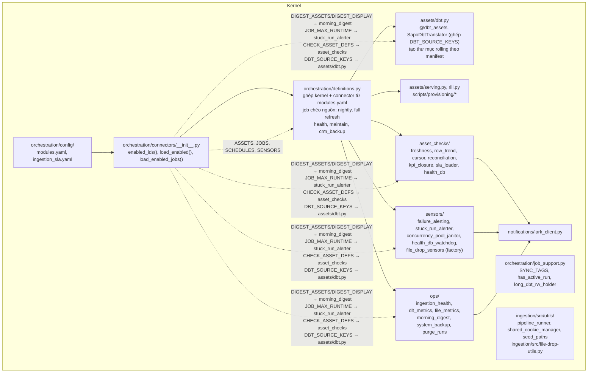

| Giao diện kernel cung cấp | Ai dùng |
|---|---|
| `SYNC_TAGS` (`job_support.py`) và `duckdb_lock` (khoá ghi DuckDB) | Mọi job ghi warehouse |
| `has_active_run`, `long_dbt_rw_holder` (`job_support.py`) | Schedule của connector (bỏ tick khi run trước còn chạy hoặc nightly đang giữ `dbt_rw`) |
| `make_file_drop_sensor(...)` (`sensors/file_drop_sensors.py`) | Connector shopee, misa_amis (sensor theo dõi thư mục thả file .xlsx) |
| `load_dlt_configuration`, `DLT_DIR` (`assets/utils.py`) | Mọi `assets.py` của connector: đường dẫn script ingestion lấy từ `DLT_DIR`, không tính theo `__file__` nên package dời được |
| `run_pipeline(...)` (dlt) | Connector sapo_v2, hug |
| `get_data_lake_path()`, partition writer | Connector shopee, misa_amis |
| `seed_path(name)` | Taxonomy writers, budget sync |
| `send_lark_card(...)` | Sensors, ops |
| SLA (`ingestion_sla.yaml`, khoá `<prefix>/<function_name>`; thiếu file thì `sla_loader` raise) | Asset checks |

**Kernel không import connector theo tên**: nó nhận dữ liệu qua `load_enabled()` / `load_enabled_jobs()`. Chiều ngược lại được phép: connector import hạ tầng kernel (`assets/utils.py`, `ops/*`, `job_support.py`, asset kernel như `dbt`, `serving`, `rill` để chọn trong job).

Job chéo nguồn nằm trong `definitions.py`: `pipeline_batch_nightly_job` và `pipeline_batch_fullrefresh_job` chọn `NIGHTLY_ASSETS` của mọi connector đang bật cùng toàn bộ dbt và serving.

Còn nằm ngoài package vì chứa giá trị riêng của Fine Japan: `sensors/sheets_modified_sensor.py` (URL Google Sheet mặc định). Connector `sheets` khai báo nó trong `SENSORS`; giá trị URL chuyển sang cấu hình tenant ở bước tenant overlay.

## 5. Connectors ✅

### 5.1 Hợp đồng chung của một connector

Mỗi connector là package `orchestration/connectors/<id>/`; `orchestration/config/modules.yaml` liệt kê các id được bật (thứ tự file = thứ tự dòng trong morning digest). Package chỉ export list/dict thuần, không có lớp registry. Chi tiết hợp đồng, cách thêm/bỏ connector: [orchestration/connectors/README.md](../../orchestration/connectors/README.md).

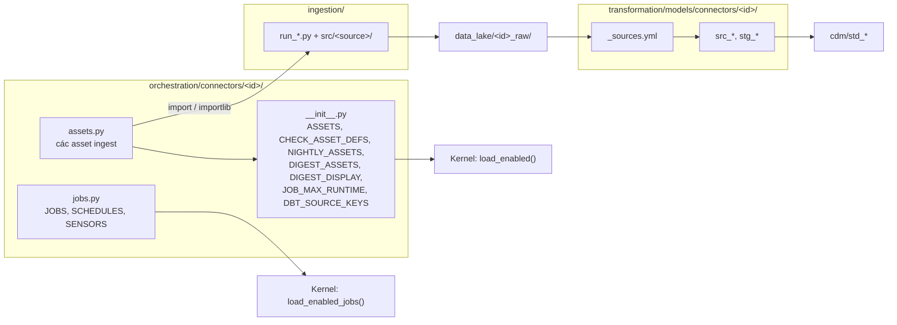

`jobs.py` tách khỏi `__init__.py` để tránh vòng import: `assets/dbt.py` đọc `DBT_SOURCE_KEYS` từ package, còn job cần `dbt.sapo_dbt_assets`.

| Export | Kiểu | Kernel dùng ở đâu |
|---|---|---|
| `ASSETS` | list asset | `definitions.py` |
| `CHECK_ASSET_DEFS` | `dict[sla_key, asset \| AssetKey]` | `asset_checks/__init__.py` (freshness, not-empty, trend, cursor) |
| `NIGHTLY_ASSETS` | list asset ingest | job nightly và full refresh |
| `DIGEST_ASSETS`, `DIGEST_DISPLAY` | `list[(short, sla_key, recon_key\|None)]`, `dict[str, tuple[str, str, str]]` | `ops/morning_digest.py` |
| `JOB_MAX_RUNTIME` | `dict[str, timedelta]` theo tên job | `sensors/stuck_run_alerter.py` |
| `DBT_SOURCE_KEYS` | `dict[source_name, dict[table, AssetKey]]` (`"*"` = bảng còn lại) | `SapoDbtTranslator` |
| `JOBS`, `SCHEDULES`, `SENSORS` | list | `definitions.py` |

Bất biến: tên asset key, check key, job, schedule (cron, timezone, default status), sensor và tập `unique_id` dbt mà mỗi job chọn không đổi khi dời code (trạng thái bật/tắt schedule trên prod gắn với code location + repository + tên). `scripts/shadow/gate.sh M` chứng minh bằng Dagster inventory.

Bỏ một connector khỏi `modules.yaml` chỉ làm mất asset, job, schedule, sensor, check và dòng digest của connector đó (đã thử trong shadow với `hug`).

| Connector | Asset | Job (schedule) | Sensor |
|---|---|---|---|
| `sapo_v2` | 7 `ingest_sapo_v2_*` (`sapo/…`) | `pipeline_sapo_v2_realtime_job` (*/3), `…_incremental_job` (*/10), `…_hourly_job` (:25) | — |
| `shopee` | `shopee_income_file_drop_asset` (multi-asset, 4 output) | `ingest_filedrop_shopee_job` | `ingest_filedrop_shopee_sensor` |
| `misa_amis` | 2 `misa_*_download_asset`, 2 `misa_*_file_drop_asset` | `ingest_weekly_job`, `ingest_monthly_job` (3 schedule), `ingest_filedrop_misa_job`, `ingest_filedrop_misa_account_ledger_job` | `ingest_filedrop_misa_sensor`, `ingest_filedrop_misa_account_ledger_sensor` |
| `sheets` | 5 `sheets_*_asset`, `budget_sheet_sync_asset`, `budget_suggestion_writeback_asset` | `ingest_sheets_sync_job`, `budget_sheet_sync_job` (02:30), `budget_suggestion_writeback_job` (1st, 08:00) | `ingest_sheets_modified_sensor` |
| `hug` | `ingest_hug_webhook_consumer_asset` | `pipeline_hug_realtime_job` (*/3) | — |

| Connector | Ingestion | Raw | dbt | Ra cdm |
|---|---|---|---|---|
| `sapo_v2` | 7 `run_sapo_v2_*.py`, `src/sapo/` (batch, history log, webhook consumer từ D1) | `sapo_v2_raw/` | `src_sapo_v2_*` (11, incremental), `stg_sapo_v2_*` (16) | `std_orders`, `std_order_items`, `std_customers`, `std_products`, `std_variants`, … |
| `shopee` | `run-shopee-income-file-drop.py`, `src/shopee/` | `shopee_raw/` | `src_shopee_*`, `stg_shopee_*` | (đi thẳng `packs/marketplace`) |
| `misa_amis` | 6 `run-misa-*.py`, `src/misa_amis/` | `misa_raw/` | `src_misa_*`, `stg_misa_sales_lines` | `std_misa_sales_lines`, `std_misa_account_ledger` |
| `sheets` | `src/gsheet_*.py` | `gsheet_raw/` | `stg_targets`, `stg_marketing_spend`, `stg_teams`, `stg_team_members` | `std_targets`, `std_marketing_spend`, `std_teams`, `std_team_members` |
| `facebook_*` | `run_facebook_*_batch.py` (chưa có asset, dormant) | `facebook_ads`, `raw_messenger_data` | `stg_fb_*` | (đi thẳng `packs/facebook_*`) |

### 5.2 Connector sapo_v2 (chi tiết)

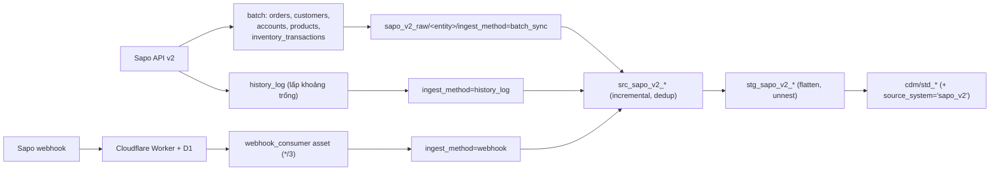

Đích: connector sapo_v2 **không** chứa giá trị riêng của Fine Japan; domain Sapo và worker URL nằm ở cấu hình tenant.

## 6. CDM (canonical layer)

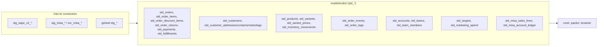

Giải thích chi tiết (vì sao, cách hoạt động, kiểm chứng, hướng dẫn thêm view): [canonical-layer.md](./canonical-layer.md). Luật của tầng này theo `docs/architecture/std-layer-conventions.md`: R1 downstream không đọc `stg_*`; R2 pass-through trung thành + `source_system`. Mỗi `std_*` có test danh sách cột/kiểu mức **warn**. Owner: module CDM; connector chỉ cung cấp `stg_*` đầu vào.

10 view `std_*` mới (tất cả `view`, pass-through trung thành, `source_system` ở cuối): 

| View | Đọc từ | `source_system` | Core dùng |
|---|---|---|---|
| `std_customer_addresses/contacts/notes/tags` | `stg_sapo_v2_customer_*` | `sapo_v2` | `dim_customer_*` |
| `std_order_events` | `int_order_snapshots_ranked` (lịch sử trạng thái đơn từ history log) | `sapo_v2` | `fact_order_transitions` |
| `std_order_tags` | `src_sapo_v2_orders` (`order_id`, `tags`) | `sapo_v2` | `int_order_tags` |
| `std_teams`, `std_team_members` | `stg_teams`, `stg_team_members` | `gsheet` | `dim_teams`, `fact_orders`, `fact_sales` |
| `std_targets` | `stg_targets` | `gsheet` | `fact_targets` |
| `std_marketing_spend` | `stg_marketing_spend` | `gsheet` | `fact_marketing_spend` |

Cột `source_system` chỉ có trong `std_*`; các model core giữ danh sách cột tường minh nên cột này không lọt ra bảng public. `fact_order_transitions` lấy `order_code` từ `std_orders` (cùng nội dung `stg_sapo_v2_orders`). Test: generic test `std_column_contract` (`transformation/tests/generic/`) so khớp tên, thứ tự và kiểu cột với `information_schema`, `severity: warn`; kiểu lấy từ warehouse thật, không bật `contract: enforced`.

## 7. Core


- Core chỉ đọc `cdm/`, `core/` và seeds (kể cả `seeds/taxonomy`). Các luật phân loại còn viết trong SQL của core được kiểm kê ở `transformation/docs/TAXONOMY.md`.
- Mọi tên model ở đây là **public** (76 serving view, Rill, CRM, detailView): không đổi tên khi refactor module.
- Nợ còn lại: xem bảng vi phạm đã biết ở mục 3.

## 8. Packs

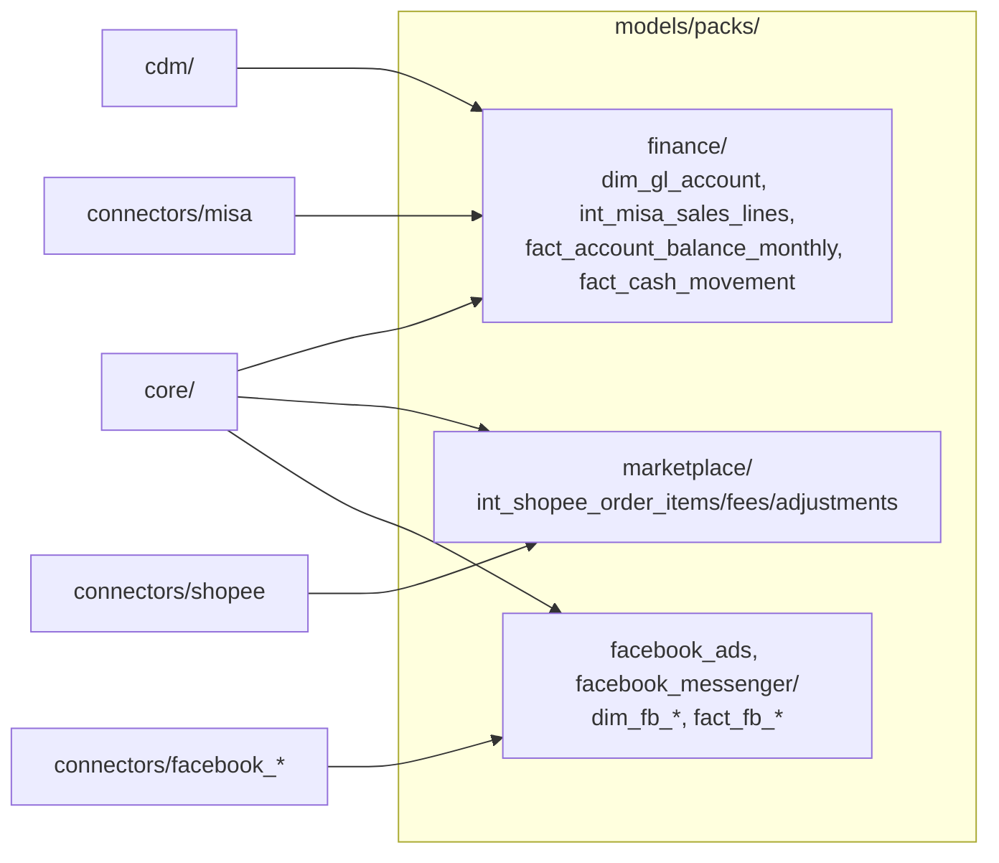

Một pack chỉ được đọc connector mà nó khai báo trong `pack_connectors` của `model_buckets.yaml` (finance → misa, marketplace → shopee, facebook_* → facebook_*); pack không đọc pack khác.

## 9. Taxonomy module

**Trạng thái:** phần đã làm là **đặc tả, seed và công cụ kiểm tra**. Chưa có macro taxonomy và chưa sửa model nào; các khối `CASE` phân loại vẫn nằm trong SQL của core. Bộ máy phân loại (luật thành dữ liệu, mỗi domain một model sinh từ macro chung) là **plan riêng sau Đợt 1**, thiết kế đã duyệt ở [taxonomy-engine.md](taxonomy-engine.md), bộ mã chuẩn của nó **chưa chốt**.

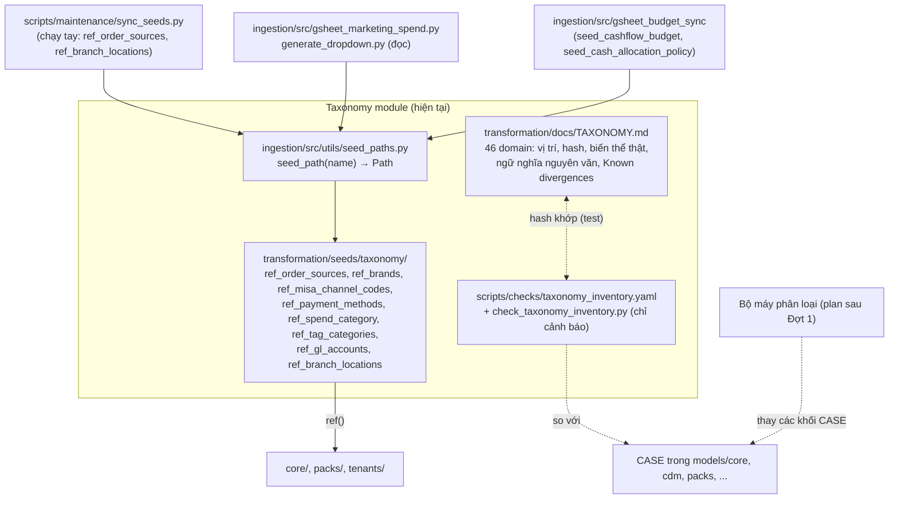

| Thành phần | Vai trò | Tài liệu |
|---|---|---|
| `transformation/docs/TAXONOMY.md` | Đặc tả: mọi luật phân loại (file:dòng, sha256, biến thể, ngữ nghĩa, tenant literal), đã là dữ liệu hay còn là SQL, Known divergences. Là **đặc tả đầu vào** của bộ máy | chính nó |
| `docs/architecture/taxonomy-engine.md` | Thiết kế bộ máy phân loại (v2, đã duyệt hướng, chưa triển khai) | [taxonomy-engine.md](taxonomy-engine.md) |
| `docs/reference/taxonomy/` | Bốn tài liệu tham chiếu bên ngoài (Shopify, Trung Quốc, nguồn TMĐT Việt Nam, chuẩn liên ngành) | [reference/taxonomy/](../reference/taxonomy/) |
| `scripts/checks/check_taxonomy_inventory.py`, `taxonomy_inventory.yaml` | Cảnh báo khi khối đã kiểm kê đổi hash hoặc có `CASE` mới gán cột taxonomy; shadow gate bước 3c | [scripts/checks/README.md](../../scripts/checks/README.md#check_taxonomy_inventorypy) |
| `ingestion/src/utils/seed_paths.py` | `seed_path(name)` tra thư mục thật của seed (quét `transformation/seeds/**/<name>.csv`, lỗi nếu không có hoặc trùng) | docstring của module |
| `transformation/seeds/taxonomy/` | 8 seed phân loại; `+column_types` đặt dưới khoá `taxonomy:` trong `dbt_project.yml` | `transformation/AGENTS.md` |

Ai ghi seed nào: `sync_seeds.py` (chạy tay) thêm dòng vào `ref_order_sources` và `ref_branch_locations`; không writer tự động nào ghi seed phân loại. Job Google Sheet 02:30 (`budget_sheet_sync_asset` gọi `gsheet_budget_sync`) ghi hai seed ngân sách của tenant (`seed_cashflow_budget`, `seed_cash_allocation_policy`, chưa dời khỏi `transformation/seeds/`), cũng qua `seed_path`. Bảng đầy đủ đọc/ghi: [TAXONOMY.md mục 5](../../transformation/docs/TAXONOMY.md#5-seed-phân-loại-và-ai-đọc-ai-ghi).

Hình dạng luật hôm nay (chi tiết ở TAXONOMY.md, mục "Dạng luật"): ánh xạ trực tiếp, dò mẫu có ưu tiên, chia ngưỡng, tổ hợp, gán tay, phân cấp. Phần còn là SQL: hầu hết nhãn khách, kênh cấp 1, phạm vi đơn, loại giảm giá, trạng thái chuẩn. Phần đã là dữ liệu: nguồn đơn, thương hiệu, mã kênh MISA, nhóm tag đơn.

| Thuộc sản phẩm | Thuộc tenant |
|---|---|
| Danh sách domain, cơ chế `seed_path`, kiểm tra trùng seed, check kiểm kê, đặc tả cấu trúc | Giá trị seed, nội dung luật (hôm nay nằm trong SQL core, sau này chuyển thành dữ liệu), literal như `CTN00014`, `'US'`, `'Đại Lý'` (danh sách ở TAXONOMY.md mục 6) |

## 10. Tenant overlay Fine Japan

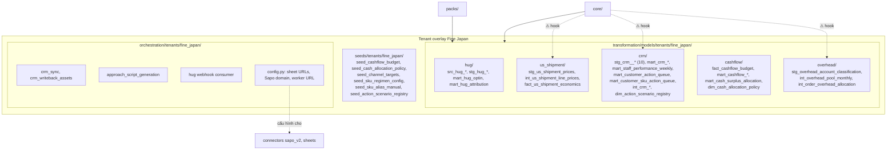

### Tenant hooks (core/pack đang phụ thuộc tenant, ghi trong allowlist)

| Model lõi | Phụ thuộc FJ | Hướng xử lý |
|---|---|---|
| `fact_order_costs` | ref `int_order_overhead_allocation` | Tách phần overhead ra tenant |
| `fact_order_economics` | ref `int_order_overhead_allocation` | Như trên |
| `dim_staff` | ref `stg_crm__app_user` | Tách enrich CRM ra tenant |
| `mart_data_quality` | ref `fact_us_shipment_economics` | Tách check US ra tenant |
| `dim_customers` | Logic SQL: CROSSBORDER dùng đơn kênh US (không phải cạnh ref, checker không thấy) | Quyết định nghiệp vụ + taxonomy |
| Literal Fine Japan trong các khối `CASE` taxonomy của core (`CTN00014`, `KY_GUI`, `'US'`, `'Đại Lý'`, tên thương hiệu, từ khoá giảm giá) | Không phải cạnh ref, checker không thấy | Danh sách ở [TAXONOMY.md mục 6](../../transformation/docs/TAXONOMY.md#6-giá-trị-tenant-viết-cứng-trong-sql); chuyển vào tenant overlay cùng bộ máy |

`int_customer_economics` và các model đọc `fact_order_costs` phụ thuộc tenant gián tiếp; khi tách phần overhead, các model này đổi theo.

Danh sách đầy đủ là các mục tenant hook trong `scripts/checks/boundary_allowlist.yaml`, sinh từ `depends_on` của manifest.

## 11. Serving và người tiêu thụ

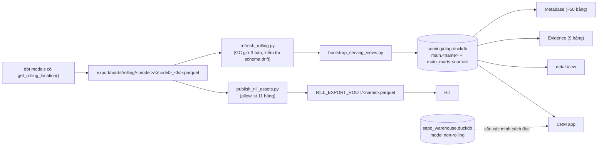

| Người tiêu thụ | Đọc từ | Quyền |
|---|---|---|
| Metabase | `serving/olap.duckdb` (`main_marts.*`) | read-only |
| Evidence | `evidence/sources/datalake/connection.yaml` → serving | read-only |
| Rill | `RILL_EXPORT_ROOT/<name>.parquet` | read-only |
| detailView | `serving/olap.duckdb` (`read_only=True`) | read-only |
| CRM | serving + (cần xác minh) model non-rolling | read-only với warehouse; ghi SQLite riêng |

Tên các bảng này là hợp đồng public; danh sách nằm ở `scripts/checks/public_models.yaml`.

## 12. Ranh giới Python và container ✅

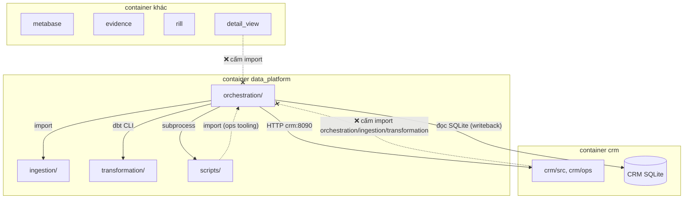

| Quy tắc | Cưỡng chế |
|---|---|
| `crm/`, `detailView/` không import `orchestration`, `ingestion`, `transformation` | `check_boundaries.py` (ast) |
| `ingestion/` không import `orchestration` | `check_boundaries.py` |
| `orchestration/connectors/**` không chứa URL/domain cứng | `check_boundaries.py` |
| Giao tiếp CRM ↔ orchestration chỉ qua HTTP và file export | Review + quy tắc import |
