# Kiến trúc module: authority và boundary theo component

> Tài liệu sống của kiến trúc module. Mỗi thay đổi về module (thư mục, bucket, ma trận phụ thuộc, connector, tenant) cập nhật mục tương ứng **trong cùng commit với code**. Quy ước chung: **mỗi vùng lưu trữ chỉ có một component được ghi**; component khác chỉ đọc qua giao diện đã khai báo.
>
> Lộ trình và lý do: plan `plans/261013-1751-modularize-data-platform-suite/` (gồm `roadmap.md`). Công cụ kiểm chứng refactor: [docs/operations/refactor-safety-harness.md](../operations/refactor-safety-harness.md).

## Trạng thái hiện tại

| Hạng mục | Trạng thái |
|---|---|
| Bucket của mọi dbt model (172 model, kể cả 10 model đang tắt) | ✅ Khai báo trong `scripts/checks/model_buckets.yaml` |
| Ma trận phụ thuộc, import chéo, seed trùng tên, URL cứng trong connector | ✅ Cưỡng chế bằng `scripts/checks/check_boundaries.py` (mục 3, mục 12) |
| Vi phạm đã biết | 61 = 24 phụ thuộc (mục 3) + 37 model tenant chưa dời thư mục, ghi trong `scripts/checks/boundary_allowlist.yaml` kèm lý do và hướng thoát |
| Thư mục dbt theo module `models/<module>/<layer>/` | ✅ 134 model (connectors, cdm, core, packs) + monitoring; ⏳ 37 model `tenant:fine_japan` còn ở `staging/`, `intermediate/`, `marts/` cũ |
| Connector package cho orchestration, tenant overlay, taxonomy module | ⏳ Đích (mục 4, 5, 9, 10) |

Các mục dưới đây mô tả trạng thái đích; chỗ nào đã khớp code được đánh dấu ✅.

## Mục lục

1. [Bản đồ tổng thể](#1-bản-đồ-tổng-thể)
2. [Quyền ghi theo vùng lưu trữ](#2-quyền-ghi-theo-vùng-lưu-trữ)
3. [Ma trận phụ thuộc giữa các module dbt](#3-ma-trận-phụ-thuộc-giữa-các-module-dbt)
4. [Kernel](#4-kernel)
5. [Connectors](#5-connectors)
6. [CDM (canonical layer)](#6-cdm-canonical-layer)
7. [Core](#7-core)
8. [Packs](#8-packs)
9. [Taxonomy module](#9-taxonomy-module)
10. [Tenant overlay Fine Japan](#10-tenant-overlay-fine-japan)
11. [Serving và người tiêu thụ](#11-serving-và-người-tiêu-thụ)
12. [Ranh giới Python và container](#12-ranh-giới-python-và-container)

---

## 1. Bản đồ tổng thể

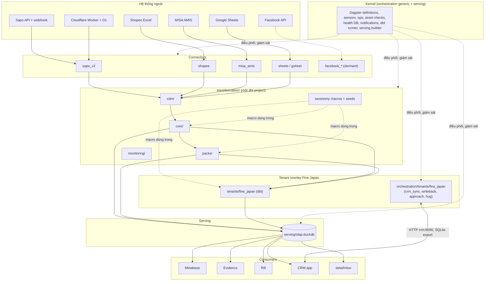

## 2. Quyền ghi theo vùng lưu trữ

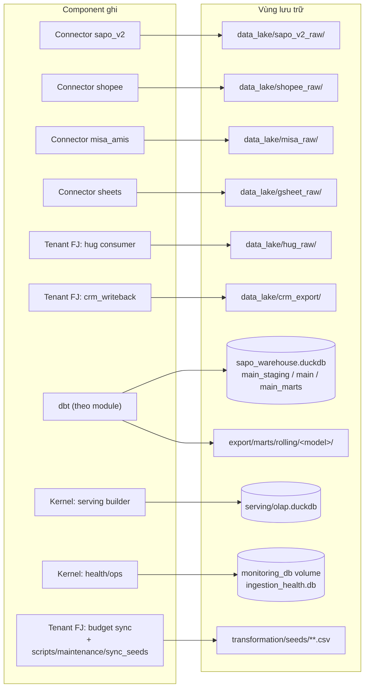

| Vùng | Owner (ghi) | Được đọc bởi | Cấm |
|---|---|---|---|
| `data_lake/<source>_raw/{entity}/ingest_method=/year=/month=` | Connector của nguồn đó | `transformation/models/connectors/<source>/_sources.yml` | Connector khác ghi; core/pack đọc trực tiếp |
| `data_lake/crm_export/` | Tenant FJ (`crm_writeback_assets`) | `connectors/crm` (stg_crm__*) | Ghi từ ngoài tenant FJ |
| `sapo_warehouse.duckdb` | dbt (một tiến trình, khoá `duckdb_lock` / `dbt_rw`) | dbt, scripts kiểm tra read-only | Ghi ngoài dbt |
| `export/marts/rolling/<model>/` | dbt model có `get_rolling_location()` | Kernel serving builder, Rill publish | Sửa tay |
| `serving/olap.duckdb` | Kernel (`refresh_rolling.py`, `bootstrap_serving_views.py`) | Metabase, Evidence, CRM, detailView (read-only) | Mọi consumer ghi |
| `monitoring_db` (health DB) | Kernel ops/sensors | Kernel asset checks, digest | Connector ghi trực tiếp (đi qua ops chung) |
| `transformation/seeds/taxonomy/*.csv` | Taxonomy module; writer Python đi qua `seed_paths.py` | dbt seed | Ghi theo đường dẫn cứng |
| `transformation/seeds/tenants/fine_japan/*.csv` | Tenant FJ (budget sync) | dbt seed | Module khác ghi |

### Vùng shadow (công cụ refactor, không phải prod)

| Vùng | Owner | Quy tắc |
|---|---|---|
| `/home/vantt/app/fg-dw-shadow/` (mode 0700) | Công cụ `scripts/shadow/*` | Chỉ tạo từ backup; chứa PII nên xoá lake nhánh sau mỗi gate, xoá toàn bộ khi đóng plan |
| Worktree `fg-dw-modular`, `fg-dw-baseline` | Người làm refactor | Không bao giờ mount vào container prod |
| Checkout prod `/home/vantt/app/fg-dataware-house` | Chỉ runbook deploy | Mọi script shadow từ chối đường dẫn này (`guard_not_prod.py`) |

## 2b. Bố cục thư mục dbt ✅

```text
transformation/models/
├── connectors/
│   ├── sapo_v2/staging/        # src_sapo_v2_* (incremental), stg_sapo_v2_*, _sources.yml
│   ├── sapo_v2/intermediate/   # int_order_snapshots_ranked (đọc thẳng raw history log)
│   ├── shopee/staging/  misa/staging/  gsheet/staging/
│   └── facebook_ads/staging/  facebook_messenger/staging/      # đang tắt
├── cdm/staging/                # std_* (canonical layer)
├── core/
│   ├── intermediate/{cogs,sapo,tags}/
│   └── marts/                  # dim_* ; intermediate/ (int_customer_*), sales/, customer/, inventory/
├── packs/
│   ├── finance/{intermediate/misa,marts}/
│   ├── marketplace/intermediate/shopee/
│   └── facebook_ads/marts/  facebook_messenger/marts/          # đang tắt
├── monitoring/
├── staging/ intermediate/ marts/   # chỉ còn model tenant:fine_japan, sẽ dời vào tenants/fine_japan/
├── sources.yml                 # nguồn của tenant (hug_raw, crm_export)
└── exposures_rill.yml
```

Quy tắc:

- **Module** = thư mục cấp 1 (theo bucket trong `scripts/checks/model_buckets.yaml`); luật `dbt-path` kiểm tra file nằm đúng `models/<module>/`.
- **Layer** = thư mục cấp 2 (`staging`, `intermediate`, `marts`). `dbt_project.yml` cấu hình schema/materialization/tags theo layer bằng YAML anchor (`&layer_staging`, `&layer_intermediate`, `&layer_marts`) và mỗi module tái sử dụng anchor đó, nên relation không phụ thuộc module. Thư mục con `shopee/`, `misa/`, `us_shipment/` trong `intermediate/` mang tag `int` + tên nguồn.
- Properties YAML nằm cạnh model: `_<module>__models.yml`; nguồn dbt của connector ở `connectors/<source>/staging/_sources.yml`.
- Thư mục `rolling/<model>/` được tạo từ manifest (`transformation/scripts/rolling_dirs.py`), không phụ thuộc thư mục model.
- Selection mà dagster-dbt gửi cho dbt dùng `fqn` (gồm thư mục), nên code server phải nạp manifest parse từ bố cục mới; lệnh start của container đã chạy `dbt parse` trước `dagster dev`.

## 3. Ma trận phụ thuộc giữa các module dbt ✅

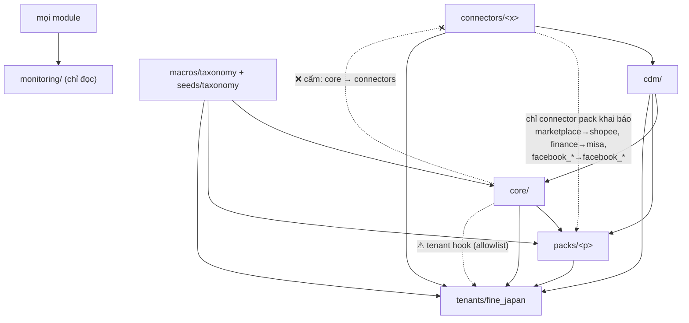

| Từ \ Tới | connectors | cdm | core | packs | tenants | seeds/taxonomy |
|---|---|---|---|---|---|---|
| **connectors/<x>** | chỉ `<x>` | ❌ | ❌ | ❌ | ❌ | ✅ |
| **cdm** | ✅ | ✅ | ❌ | ❌ | ❌ | ✅ |
| **core** | ❌ | ✅ | ✅ | ❌ | ⚠ hook | ✅ |
| **packs/<p>** | connector khai báo | ✅ | ✅ | chỉ `<p>` | ⚠ hook | ✅ |
| **tenants/<t>** | ✅ | ✅ | ✅ | ✅ | ✅ | ✅ |
| **monitoring** | ✅ | ✅ | ✅ | ✅ | ✅ | ✅ |

⚠ hook = vi phạm đã biết, ghi trong `scripts/checks/boundary_allowlist.yaml` kèm lý do (xem mục 10). `check_boundaries.py` fail khi có cạnh mới ngoài ma trận, và cả khi một mục allowlist không còn xảy ra (để allowlist không phình).

Số model theo bucket (`model_buckets.yaml`):

| Bucket | Model | Bucket | Model |
|---|---|---|---|
| connector:sapo_v2 | 28 | cdm | 14 |
| connector:shopee | 8 | core | 61 |
| connector:misa | 3 | pack:finance | 4 |
| connector:gsheet | 4 | pack:marketplace | 3 |
| connector:facebook_ads (tắt) | 3 | pack:facebook_ads (tắt) | 2 |
| connector:facebook_messenger (tắt) | 2 | pack:facebook_messenger (tắt) | 2 |
| tenant:fine_japan | 37 | monitoring | 1 |

Vi phạm đã biết (24):

| Nhóm | Số | Ví dụ | Hướng thoát |
|---|---|---|---|
| Core đọc thẳng staging của connector | 15 | `dim_customer_addresses` → `stg_sapo_v2_customer_addresses`; `fact_orders` → `stg_teams` | Thêm `std_*` pass-through, core chỉ đọc tầng canonical |
| Tenant hook (core phụ thuộc dữ liệu FJ) | 4 | `dim_staff` → `stg_crm__app_user`; `fact_order_costs` → `int_order_overhead_allocation`; `mart_data_quality` → `fact_us_shipment_economics` | Tách phần FJ vào tenant overlay |
| Core dùng dữ liệu kế toán MISA | 2 | `dim_sku_alias`, `mart_sku_economics_monthly` → `int_misa_sales_lines` | Đưa ledger qua tầng canonical như input tuỳ chọn |
| Core trộn phí sàn Shopee | 3 | `fact_order_costs` → `stg_shopee_*`; `fact_order_economics` → `int_shopee_order_fees` | Chuyển phần phí sàn sang `pack:marketplace` |

**Quyết định phân loại (13/10/2026):** COGS (`int_order_cogs_reconciled`, `int_order_promo_goods_cost`, `int_promo_642_monthly_total`, `mart_order_cogs_summary`) và tồn kho (`fact_inventory_*`, `int_sapo_inventories`, `int_return_sku_lines`, `mart_inventory_health`) thuộc **core**, không phải pack: các fact lõi (`fact_order_costs`, `fact_order_economics`, `mart_sku_economics_monthly`, `mart_product_health`) phụ thuộc vào chúng, và đây là phần chuẩn của bán hàng thương mại điện tử. `int_order_snapshots_ranked` đọc thẳng raw Sapo nên thuộc `connector:sapo_v2`.

## 4. Kernel

Kernel là phần dùng chung cho mọi tenant. Các file kernel **giữ nguyên vị trí** (dời sẽ làm hỏng đường dẫn tính theo `__file__`) và được nhận diện bằng tài liệu.

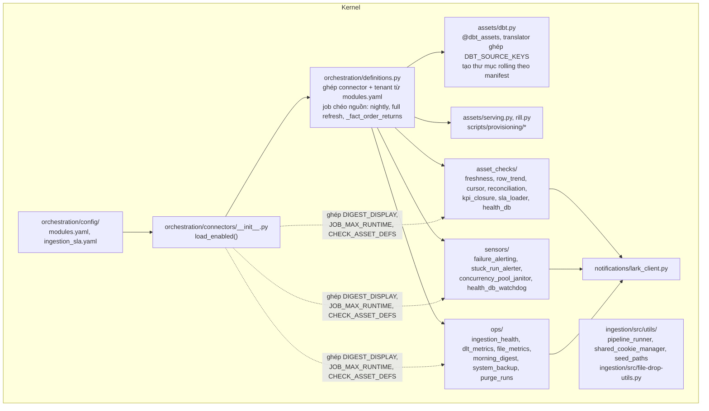

| Giao diện kernel cung cấp | Ai dùng |
|---|---|
| `SYNC_TAGS` / `duckdb_lock` (khoá ghi DuckDB) | Mọi job ghi warehouse |
| `run_pipeline(...)` (dlt) | Connector sapo_v2, hug |
| `get_data_lake_path()`, partition writer | Connector shopee, misa_amis |
| `seed_path(name)` | Taxonomy writers, budget sync |
| `send_lark_card(...)` | Sensors, ops |
| SLA (`ingestion_sla.yaml`, khoá `<prefix>/<function_name>`) | Asset checks |

**Kernel không import connector hay tenant**; chỉ nhận dữ liệu qua `load_enabled()`.

## 5. Connectors

### 5.1 Hợp đồng chung của một connector

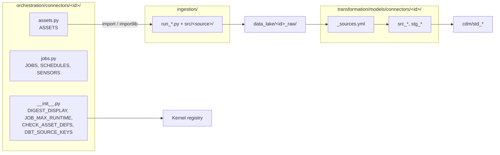

| Connector | Ingestion | Raw | dbt | Ra cdm |
|---|---|---|---|---|
| `sapo_v2` | 7 `run_sapo_v2_*.py`, `src/sapo/` (batch, history log, webhook consumer từ D1) | `sapo_v2_raw/` | `src_sapo_v2_*` (11, incremental), `stg_sapo_v2_*` (16) | `std_orders`, `std_order_items`, `std_customers`, `std_products`, `std_variants`, … |
| `shopee` | `run-shopee-income-file-drop.py`, `src/shopee/` | `shopee_raw/` | `src_shopee_*`, `stg_shopee_*` | (đi thẳng `packs/marketplace`) |
| `misa_amis` | 6 `run-misa-*.py`, `src/misa_amis/` | `misa_raw/` | `src_misa_*`, `stg_misa_sales_lines` | `std_misa_sales_lines`, `std_misa_account_ledger` |
| `sheets` | `src/gsheet_*.py` | `gsheet_raw/` | `stg_targets`, `stg_marketing_spend`, `stg_teams`, `stg_team_members` | `std_targets`, `std_marketing_spend`, `std_teams`, `std_team_members` |
| `facebook_*` | `run_facebook_*_batch.py` (chưa có asset, dormant) | `facebook_ads`, `raw_messenger_data` | `stg_fb_*` | (đi thẳng `packs/facebook_*`) |

### 5.2 Connector sapo_v2 (chi tiết)

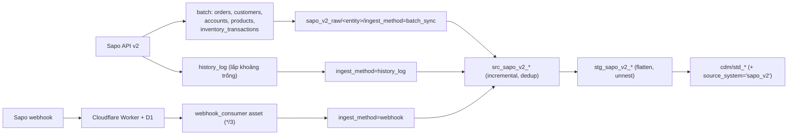

Đích: connector sapo_v2 **không** chứa giá trị riêng của Fine Japan; domain Sapo và worker URL nằm ở cấu hình tenant.

## 6. CDM (canonical layer)

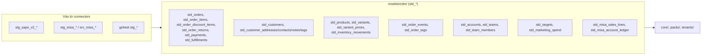

Luật của tầng này theo `docs/architecture/std-layer-conventions.md`: R1 downstream không đọc `stg_*`; R2 pass-through trung thành + `source_system`. Mỗi `std_*` có test danh sách cột/kiểu mức **warn**. Owner: module CDM; connector chỉ cung cấp `stg_*` đầu vào.

## 7. Core

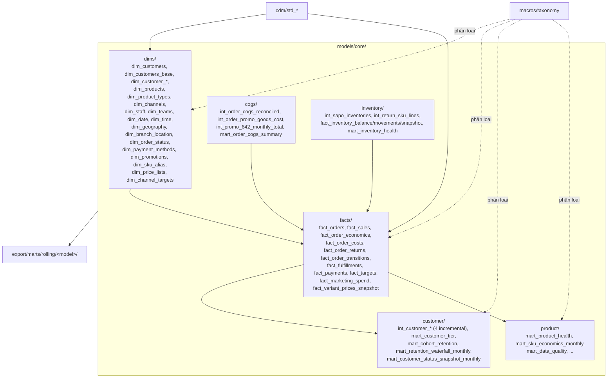

- Core chỉ đọc `cdm/`, `core/`, seeds và macro taxonomy.
- Mọi tên model ở đây là **public** (76 serving view, Rill, CRM, detailView): không đổi tên khi refactor module.
- Nợ còn lại: xem bảng vi phạm đã biết ở mục 3.

## 8. Packs

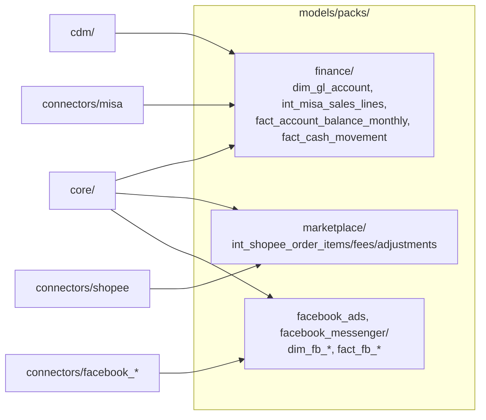

Một pack chỉ được đọc connector mà nó khai báo trong `pack_connectors` của `model_buckets.yaml` (finance → misa, marketplace → shopee, facebook_* → facebook_*); pack không đọc pack khác.

## 9. Taxonomy module

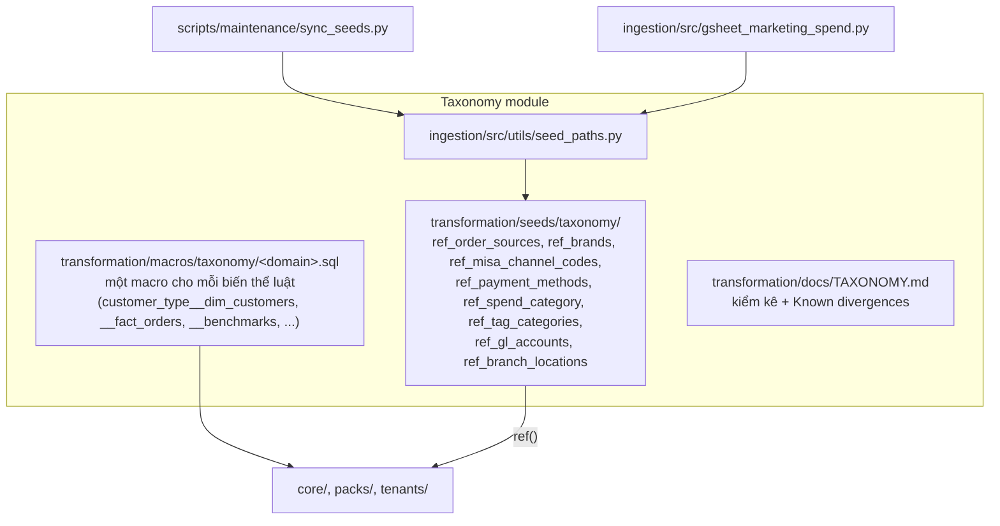

| Thuộc sản phẩm | Thuộc tenant |
|---|---|
| Danh sách domain, tên macro, cơ chế `seed_path`, kiểm tra trùng seed | Giá trị seed, nội dung luật trong từng macro biến thể (sau này chuyển thành dữ liệu) |

## 10. Tenant overlay Fine Japan

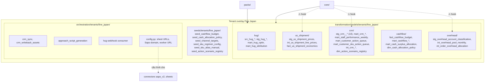

### Tenant hooks (core/pack đang phụ thuộc tenant, ghi trong allowlist)

| Model lõi | Phụ thuộc FJ | Hướng xử lý |
|---|---|---|
| `fact_order_costs` | ref `int_order_overhead_allocation` | Tách phần overhead ra tenant |
| `fact_order_economics` | ref `int_order_overhead_allocation` | Như trên |
| `dim_staff` | ref `stg_crm__app_user` | Tách enrich CRM ra tenant |
| `mart_data_quality` | ref `fact_us_shipment_economics` | Tách check US ra tenant |
| `dim_customers` | Logic SQL: CROSSBORDER dùng đơn kênh US (không phải cạnh ref, checker không thấy) | Quyết định nghiệp vụ + taxonomy |

`int_customer_economics` và các model đọc `fact_order_costs` phụ thuộc tenant gián tiếp; khi tách phần overhead, các model này đổi theo.

Danh sách đầy đủ là các mục tenant hook trong `scripts/checks/boundary_allowlist.yaml`, sinh từ `depends_on` của manifest.

## 11. Serving và người tiêu thụ

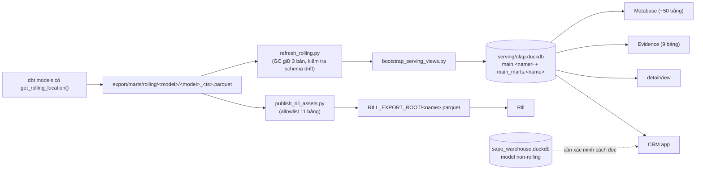

| Người tiêu thụ | Đọc từ | Quyền |
|---|---|---|
| Metabase | `serving/olap.duckdb` (`main_marts.*`) | read-only |
| Evidence | `evidence/sources/datalake/connection.yaml` → serving | read-only |
| Rill | `RILL_EXPORT_ROOT/<name>.parquet` | read-only |
| detailView | `serving/olap.duckdb` (`read_only=True`) | read-only |
| CRM | serving + (cần xác minh) model non-rolling | read-only với warehouse; ghi SQLite riêng |

Tên các bảng này là hợp đồng public; danh sách nằm ở `scripts/checks/public_models.yaml`.

## 12. Ranh giới Python và container ✅

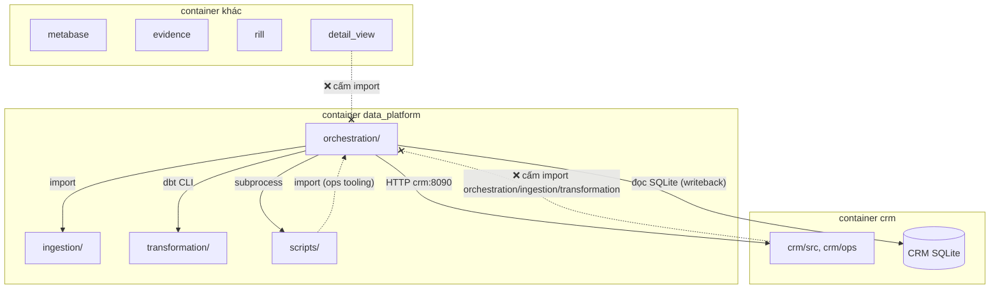

| Quy tắc | Cưỡng chế |
|---|---|
| `crm/`, `detailView/` không import `orchestration`, `ingestion`, `transformation` | `check_boundaries.py` (ast) |
| `ingestion/` không import `orchestration` | `check_boundaries.py` |
| `orchestration/connectors/**` không chứa URL/domain cứng | `check_boundaries.py` |
| Giao tiếp CRM ↔ orchestration chỉ qua HTTP và file export | Review + quy tắc import |
