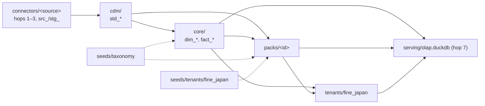

# System Architecture

> Complete architecture documentation for the Data Integration Pipeline

## Table of Contents

1. [Executive Summary](#executive-summary)
2. [Architecture Diagram](#architecture-diagram)
3. [Core Components](#core-components)
4. [Design Principles](#design-principles)
5. [Technology Decisions](#technology-decisions)
6. [Security & Access](#security--access)

---

## Executive Summary

The Data Integration Pipeline is a modern data lakehouse built to sync and analyze Sapo e-commerce data. It implements a 7-hop architecture from source systems to analytics dashboards, using entirely open-source technologies running on local infrastructure.

### Tech Stack Overview

- **Ingestion:** dlt (Data Load Tool) - Python
- **Storage:** Parquet files (immutable, partitioned)
- **Query Engine:** DuckDB (in-process OLAP)
- **Transformation:** dbt (SQL-based ELT)
- **Orchestration:** Dagster (job scheduling)
- **Serving:** DuckDB + Metabase (BI)
- **Insight App:** FastAPI + Jinja2 + HTMX — `detailView`, read-only order/customer detail pages (hexagonal; reads `olap.duckdb` read-only; Docker service `detail_view` @ `detailview.lan.fwg.vn`)
- **Webhooks:** Cloudflare Workers + D1
- **File Drop:** Shopee Income + MISA Sales Ledger (Excel → pandas → Parquet)

### Deployment Topology

```
┌─────────────────────────────────────────────────────────────────┐
│                        LOCAL MACHINE                             │
│  ┌─────────────┐  ┌─────────────┐  ┌─────────────────────────┐  │
│  │  Dagster    │  │  dbt        │  │  Metabase (Docker)      │  │
│  │  Scheduler  │  │  Transform  │  │  BI Dashboard           │  │
│  └──────┬──────┘  └──────┬──────┘  └───────────┬─────────────┘  │
│         │                │                     │                 │
│         ▼                ▼                     ▼                 │
│  ┌─────────────────────────────────────────────────────────────┐│
│  │        Docker Volume: /app/var/ (Data) + /app/ (Code)      ││
│  │  Data (/app/var/):          Code (/app/):                  ││
│  │  ├── data_lake/             ├── transformation/             ││
│  │  │   ├── sapo_raw/          ├── ingestion/                 ││
│  │  │   ├── shopee_raw/        ├── orchestration/             ││
│  │  │   ├── misa_raw/          └── scripts/                   ││
│  │  │   ├── export/marts/                                      ││
│  │  │   └── serving/           Local Host Bind:               ││
│  │  ├── dagster_home/          ./app_data/data_lake          ││
│  │  ├── logs/                  ./app_data/dagster_home       ││
│  │  ├── backups/               ./app_data/logs                ││
│  │  └── input_source/          ./app_data/backups             ││
│  │                             ./app_data/input_source        ││
│  └─────────────────────────────────────────────────────────────┘│
└─────────────────────────────────────────────────────────────────┘
                              │
                              │ HTTPS
                              ▼
┌─────────────────────────────────────────────────────────────────┐
│                     CLOUDFLARE (EDGE)                            │
│  ┌─────────────────────────────────────────────────────────────┐│
│  │  Cloudflare Worker + D1 Database                            ││
│  │  Webhook Buffer (High Availability)                         ││
│  └─────────────────────────────────────────────────────────────┘│
└─────────────────────────────────────────────────────────────────┘
                              │
                              │ Webhook Events
                              ▼
┌─────────────────────────────────────────────────────────────────┐
│                      SAPO PLATFORM                               │
│  Orders, Customers, Products, Payments, etc.                     │
└─────────────────────────────────────────────────────────────────┘
```

---

## Architecture Diagram

### 7-Hop Data Pipeline

```
┌─────────────────────────────────────────────────────────────────────────────┐
│ HOP 1: SAPO DATA SOURCES                                                    │
├────────────────────┬────────────────────┬───────────────────────────────────┤
│    Batch API       │     Webhooks       │          History Log              │
│   (modified_on)    │   (Real-time)      │         (Gap Filling)             │
│   Orders/Customers │   All Events       │         All Entities              │
└─────────┬──────────┴─────────┬──────────┴──────────────┬────────────────────┘
          │                    │                         │
          ▼                    ▼                         ▼
┌─────────────────────────────────────────────────────────────────────────────┐
│ HOP 2: COLLECTION LAYER                                                     │
├────────────────────┬────────────────────┬───────────────────────────────────┤
│  dlt Batch Sync    │ Cloudflare Worker  │      dlt History Poller           │
│  run_*_batch.py    │ + D1 Buffer        │      run_history_log.py           │
└─────────┬──────────┴─────────┬──────────┴──────────────┬────────────────────┘
          │                    │                         │
          └────────────────────┼─────────────────────────┘
                               ▼
┌─────────────────────────────────────────────────────────────────────────────┐
│ HOP 3: RAW STORAGE (Parquet Files)                                          │
│                                                                             │
│  data_lake/<source>_raw/{entity}/ingest_method={X}/year={Y}/month={M}/      │
│                                                                             │
│  Partitions:                                                                │
│  ├── ingest_method=batch_sync/    (Daily snapshots)                         │
│  ├── ingest_method=webhook/       (Real-time events)                        │
│  └── ingest_method=history_log/   (Gap filling)                             │
└─────────────────────────────────────┬───────────────────────────────────────┘
                                      │
                                      ▼
┌─────────────────────────────────────────────────────────────────────────────┐
│ HOP 4: QUERY LAYER (DuckDB)                                                 │
│                                                                             │
│  data_lake/sapo_warehouse.duckdb                                            │
│  - In-process OLAP engine                                                   │
│  - Reads Parquet via read_parquet() with hive partitioning                  │
│  - Vectorized query execution                                               │
└─────────────────────────────────────┬───────────────────────────────────────┘
                                      │
                                      ▼
┌─────────────────────────────────────────────────────────────────────────────┐
│ HOP 5: STAGING LAYER (dbt)                                                  │
│                                                                             │
│  models/connectors/<source>/staging/          (module: connector)           │
│  ├── src_sapo_v2_*.sql   (INCREMENTAL: JSON extract + tech/biz dedup)       │
│  └── stg_sapo_v2_*.sql   (VIEW: enrichment joins + unnest)                  │
│  models/cdm/staging/                           (module: cdm)                │
│  └── std_*.sql           (VIEW: canonical pass-through + source_system)     │
│                                                                             │
│  Key: src_ extracts + deduplicates, outputs flat data (no payload).         │
│  stg_ and std_ work with lightweight flat columns only.                     │
└─────────────────────────────────────┬───────────────────────────────────────┘
                                      │
                                      ▼
┌─────────────────────────────────────────────────────────────────────────────┐
│ HOP 6: TRANSFORMATION LAYER (dbt)                                           │
│                                                                             │
│  models/core/{intermediate,marts}/   (module: core — revenue, customers,    │
│                                       products, inventory: dim_*, fact_*)   │
│  models/packs/<pack>/                (finance, crm, hug, sales_playbook,    │
│                                       marketplace, facebook_*)              │
│  models/tenants/fine_japan/          (US shipment only)                     │
│  models/monitoring/                  (data quality, reads every module)     │
│                                                                             │
│  Output: Export to Parquet (Rolling Snapshots)                              │
│  data_lake/export/marts/rolling/{table}_{timestamp}.parquet                 │
└─────────────────────────────────────┬───────────────────────────────────────┘
                                      │
                                      ▼
┌─────────────────────────────────────────────────────────────────────────────┐
│ HOP 7: SERVING LAYER                                                        │
│                                                                             │
│  data_lake/serving/olap.duckdb                                              │
│  - Rolling Self-Refresh Views pointing to latest Parquet snapshots          │
│  - Zero-downtime updates (immutable files)                                  │
│                                                                             │
│  Metabase (Docker)                                                          │
│  - Connects to olap.duckdb                                                  │
│  - Dashboards for sales, customers, operations                              │
└─────────────────────────────────────────────────────────────────────────────┘
```

### Modules in the 7 hops

The same pipeline is cut vertically into modules with enforced boundaries (design:
[modules.md](./modules.md); decisions: [ADR-015](../decisions/015-module-boundaries.md),
[ADR-016](../decisions/016-taxonomy-module.md), [ADR-017](../decisions/017-packs-and-tenants.md)).

| Hop | Module | Code |
|-----|--------|------|
| 1–3 (source, collection, raw) | **Connector** `<id>`: one per source (`sapo_v2`, `shopee`, `misa_amis`, `sheets`, `hug`) | `ingestion/`, `orchestration/connectors/<id>/`; writes only `data_lake/<source>_raw/` |
| 5 (`src_*`, `stg_*`) | **Connector** (dbt side) | `transformation/models/connectors/<source>/` |
| 5 (`std_*`) | **CDM**, the canonical layer: the only door from connectors to core | `transformation/models/cdm/` |
| 6 | **Core**: revenue, customers, products, inventory | `transformation/models/core/` |
| 6 | **Packs**: reusable product logic (finance = cost and profit, crm, hug, sales_playbook, marketplace, facebook_*) | `transformation/models/packs/<id>/`, `orchestration/packs/<id>/` |
| 6 | **Tenant** Fine Japan: its data and configuration, US shipment models | `transformation/models/tenants/fine_japan/`, `transformation/seeds/tenants/fine_japan/`, `orchestration/tenants/fine_japan/`, `SOURCES__SPREADSHEET_URL__*` env |
| 4–7 (all) | **Kernel**: Dagster definitions, sensors, asset checks, ops, dbt runner, serving builder | `orchestration/` top level; modules enabled in `orchestration/config/modules.yaml` |



`scripts/checks/check_boundaries.py` enforces the arrows (core never reads a connector, a pack or a
tenant except through an allowlisted hook); `scripts/checks/run-all.sh` runs it before every commit.

### Component Interaction

```
                    ┌──────────────────┐
                    │     Dagster      │
                    │   Orchestrator   │
                    └────────┬─────────┘
                             │ triggers
         ┌───────────────────┼───────────────────┐
         ▼                   ▼                   ▼
┌─────────────────┐ ┌─────────────────┐ ┌─────────────────┐
│   dlt Ingest    │ │ dbt Transform   │ │ Serving Gen     │
│                 │ │                 │ │                 │
│ • Batch sync    │ │ • Staging       │ │ • Create views  │
│ • Webhooks      │ │ • Intermediate  │ │ • Refresh DB    │
│ • History log   │ │ • Marts         │ │                 │
└────────┬────────┘ └────────┬────────┘ └────────┬────────┘
         │                   │                   │
         ▼                   ▼                   ▼
┌─────────────────────────────────────────────────────────┐
│                    data_lake/                            │
│  ┌─────────────┐  ┌─────────────┐  ┌─────────────────┐  │
│  │  sapo_raw/  │  │   export/   │  │    serving/     │  │
│  │  (Parquet)  │  │   marts/    │  │   olap.duckdb   │  │
│  └─────────────┘  └─────────────┘  └─────────────────┘  │
└─────────────────────────────────────────────────────────┘
```

---

## Core Components

### 1. Ingestion Layer (`/ingestion`)

**Technology:** dlt (Data Load Tool) - Python

**Purpose:** Extract data from Sapo e-commerce platform and load into Parquet files.

**Key Components:**

| Script | Source | Schedule | Description |
|--------|--------|----------|-------------|
| `run_orders_batch.py` | JSON API | Daily | Incremental by `modified_on` |
| `run_customers_batch.py` | JSON API | Daily | Incremental by `created_on` |
| `run_accounts_batch.py` | JSON API | Weekly | Full scan |
| `run_history_log.py` | History API | 10 min | Gap filling via `occur_at` |
| `run_webhook_consumer.py` | D1 Buffer | 1 min | Poll webhook events |

**Configuration:**
- `.dlt/secrets.toml` - API credentials
- `.dlt/config.toml` - Pipeline settings

[Detailed docs →](../../ingestion/docs/README.md)

---

### 2. Transformation Layer (`/transformation`)

**Technology:** dbt with DuckDB adapter

**Purpose:** Clean, deduplicate, and model data using SQL transformations.

**Model Layers:**

| Layer | Path | Materialization | Purpose |
|-------|------|-----------------|---------|
| Sources | `connectors/<source>/staging/src_*.sql` | **Incremental** | JSON extraction + dedup + accumulation |
| Staging | `connectors/<source>/staging/stg_*.sql` | View | Enrichment, unnest |
| Standard | `cdm/staging/std_*.sql` | View | Canonical pass-through + `source_system` |
| Intermediate | `<module>/intermediate/*.sql` | External/Incremental | Cross-entity metrics |
| Marts | `<module>/marts/**/*.sql` (`core`, `packs/<id>`, `tenants/<id>`) | External (Parquet) | Dimensional model |

Paths are under `transformation/models/`. The layer folder decides schema and materialization, the
module folder decides ownership ([modules.md §2b](./modules.md#2b-bố-cục-thư-mục-dbt-)).

**Key Concepts:**
- **2-Level Dedup in src_**: Tech dedup (entity_id) + biz dedup (order_id) in INCREMENTAL src_ model. Payload discarded after JSON extraction → OOM-safe.
- **Rolling Snapshots**: Zero-downtime serving updates
- **Kimball Star Schema**: Dimensional modeling for analytics

[Detailed docs →](../../transformation/docs/README.md)

---

### 3. Orchestration Layer (`/orchestration`)

**Technology:** Dagster

**Purpose:** Schedule and coordinate all pipeline jobs.

**Key Jobs:**

| Job | Schedule | Assets |
|-----|----------|--------|
| `pipeline_sapov2_realtime_job` | Every 1 min | Webhook + dbt |
| `pipeline_sapov2_incremental_job` | Every 10 min | History log + dbt |
| `pipeline_batch_nightly_job` | 04:00 AM | Batch + dbt + serving |

**Asset Groups:**
- `sapo_ingestion` - All dlt ingestion assets
- `serving_layer` - DuckDB serving database

**Layout:** kernel files at the top of `orchestration/`; one package per source under
`connectors/<id>/`, product packs under `packs/<id>/`, tenant configuration under `tenants/<id>/`,
all enabled in `config/modules.yaml` ([orchestration/README.md](../../orchestration/README.md)).

[Detailed docs →](../../orchestration/docs/README.md)

---

### 4. Webhook System

**Technology:** Cloudflare Workers + D1 (SQLite)

**Purpose:** Buffer incoming webhooks with high availability.

**Architecture:**

```
Sapo Platform
      │
      │ POST /webhook/{source}/{entity}/{action}
      ▼
┌─────────────────────────────────┐
│    Cloudflare Worker            │
│    - HMAC validation            │
│    - Atomic insert to D1        │
└──────────────┬──────────────────┘
               │
               ▼
┌─────────────────────────────────┐
│    D1 Database (SQLite)         │
│    - Message queue              │
│    - Status tracking            │
└──────────────┬──────────────────┘
               │
               │ GET /poll (dlt consumer)
               ▼
┌─────────────────────────────────┐
│    Webhook Consumer             │
│    - Poll pending messages      │
│    - Load to Parquet            │
│    - ACK processed              │
└─────────────────────────────────┘
```

[Detailed docs →](../../webhook_receiver/docs/README.md)

---

### 5. Serving Layer

**Technology:** DuckDB + Metabase

**Purpose:** Provide fast analytics queries via BI dashboards.

**Architecture:**

```
data_lake/export/marts/rolling/
├── dim_customers_20260128_1001.parquet
├── dim_products_20260128_1001.parquet
├── fact_orders_20260128_1001.parquet
└── ...

data_lake/serving/olap.duckdb
└── Views automatically selecting latest snapshot
    CREATE VIEW dim_customers AS
    SELECT * FROM '/data_lake/export/marts/rolling/dim_customers/*.parquet'
```

**Zero-Downtime Updates:**
1. dbt creates new timestamped Parquet files
2. Rolling Self-Refresh Views auto-select latest files
3. No locking, no interruption to queries

---

## Design Principles

### 1. ELT over ETL

Transform data **after** loading into the warehouse, not during extraction.

**Benefits:**
- Raw data preserved for debugging
- Transformations are versioned (dbt)
- Easy to reprocess historical data

### 2. Immutable Data Lake

Parquet files are **append-only**, never modified or deleted during normal operations.

**Benefits:**
- Full audit trail
- Time-travel queries possible
- Safe concurrent access

### 3. Segregated Storage

Data from different ingestion methods stored in separate partitions:

```
sapo_raw/order/
├── ingest_method=batch_sync/    # Daily API sync
├── ingest_method=webhook/       # Real-time events
└── ingest_method=history_log/   # Gap filling
```

**Benefits:**
- Easy to re-sync specific source
- Clear data lineage
- Source-aware deduplication

### 4. 2-Level Deduplication in src_

All dedup happens in src_ models (INCREMENTAL tables), producing 1 row per business entity:

```sql
-- Level 1: Tech dedup (remove duplicate ingestions of same event)
ROW_NUMBER() OVER (
    PARTITION BY entity_id
    ORDER BY event_timestamp DESC,
        CASE ingest_method WHEN 'webhook' THEN 3 WHEN 'history_log' THEN 2 ELSE 1 END DESC
) = 1

-- Level 2: Biz dedup (keep latest version of same order, on flat extracted data)
QUALIFY ROW_NUMBER() OVER (
    PARTITION BY order_id
    ORDER BY event_timestamp DESC, modified_on DESC
) = 1
```

Biz dedup runs on flat data (payload already discarded) → negligible memory overhead.

### 5. Zero-Downtime Serving

Rolling snapshots ensure analytics queries never fail during updates:

1. New Parquet files written with timestamp suffix
2. Views select latest files via `read_parquet('*/*.parquet')`
3. Old files cleaned up after confirmation

### 6. Separation of Concerns

Clear boundaries between components:

| Component | Responsibility |
|-----------|---------------|
| dlt | Extract & Load only |
| dbt | Transform only |
| Dagster | Schedule only |
| DuckDB | Query only |
| Metabase | Visualize only |

---

## Technology Decisions

### Why dlt?

| Alternative | Comparison |
|-------------|------------|
| Airbyte | More complex, requires server |
| Fivetran | Expensive, cloud-only |
| Custom scripts | Harder to maintain, no incremental support |

**dlt Benefits:**
- Python-native, easy to customize
- Built-in incremental loading
- Local-first (no cloud required)
- Active community

### Why DuckDB?

| Alternative | Comparison |
|-------------|------------|
| PostgreSQL | Requires server, slower OLAP |
| BigQuery | Cloud cost, latency |
| Spark | Overkill for our scale |

**DuckDB Benefits:**
- In-process (no server)
- Vectorized columnar execution
- Native Parquet support
- Zero configuration

### Why Parquet?

| Alternative | Comparison |
|-------------|------------|
| CSV | No schema, poor compression |
| JSON | Large files, slow queries |
| Delta Lake | More complex, overkill |

**Parquet Benefits:**
- Columnar format (fast analytics)
- Excellent compression (70% savings)
- Schema evolution support
- Industry standard

### Why Dagster?

| Alternative | Comparison |
|-------------|------------|
| Airflow | Complex setup, DAG-centric |
| Prefect | Cloud-focused |
| Cron | No visibility, hard to debug |

**Dagster Benefits:**
- Asset-centric (not DAG-centric)
- Great development experience
- Built-in UI for debugging
- Native dbt integration

---

## Security & Access

### Credential Management

| Secret | Location | Access |
|--------|----------|--------|
| Sapo API | `ingestion/.dlt/secrets.toml` | Local file (gitignored) |
| D1 API | `webhook_receiver/wrangler.toml` | Cloudflare dashboard |
| Metabase | `.env` | Local file (gitignored) |

### Network Topology

```
Internet
    │
    ├── Sapo API (HTTPS)
    │       │
    │       ▼
    │   Local Machine
    │       │
    │       ├── dlt (outbound only)
    │       ├── Metabase (localhost:3000)
    │       └── Dagster UI (localhost:3000)
    │
    └── Cloudflare (Webhook endpoint)
            │
            ▼
        D1 Database (Cloudflare managed)
```

### Data Sensitivity

| Data Type | Classification | Handling |
|-----------|---------------|----------|
| Order data | Business sensitive | Local storage only |
| Customer PII | Personal | Anonymize in marts if needed |
| API credentials | Secret | gitignored, local only |

---

## Related Documents

- [Data Flow](./data-flow.md) - Detailed pipeline flow
- [Modules](./modules.md) - Module boundaries, write authority, enforcement
- [Data Dictionary](./data-dictionary.md) - Schema reference
- [Deployment](../operations/deployment.md) - Setup guide
- [Component Documentation](#core-components) - Links above
