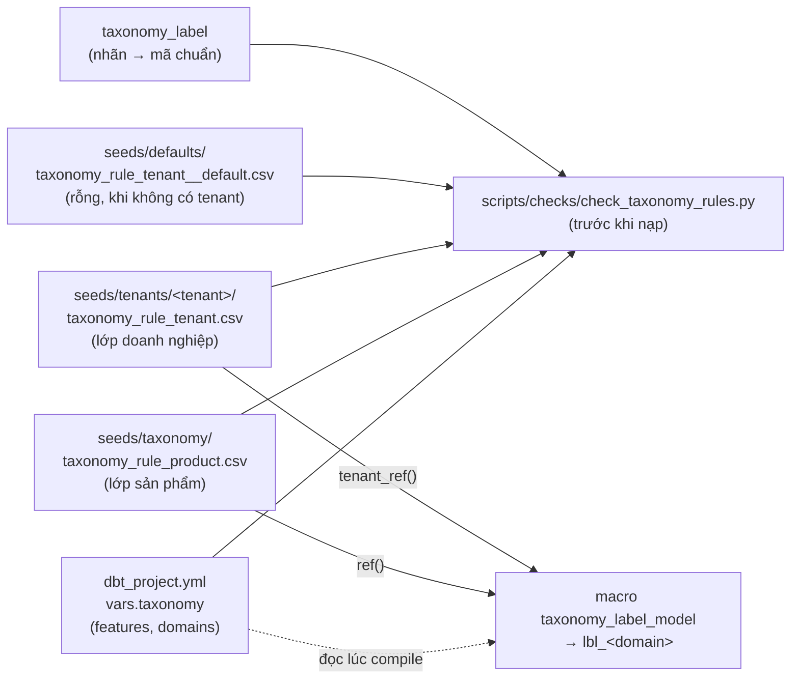

# Thiết kế bộ máy phân loại

> **v2 (14/10/2026).** User duyệt hướng thiết kế sau 4 bản phản biện (tổng hợp phản biện nằm ở hồ sơ plan, không nằm trong repo). Đang hiện thực MVP: phần đã có ở §4b. Bộ mã chuẩn ở §5 là đề xuất, **chưa chốt** cho tới khi có dữ liệu của một doanh nghiệp thứ hai (hiện chưa có). Quyết định đã chốt ở §8.

> Đọc cùng [transformation/docs/TAXONOMY.md](../../transformation/docs/TAXONOMY.md) (kiểm kê từng luật đang chạy) và [modules.md](modules.md) §9 (vị trí của module taxonomy). Bộ máy đang được hiện thực theo từng bước; phần đã có nằm ở [§4b](#4b-hiện-thực-mvp), phần còn lại của tài liệu là thiết kế.

> **Đã làm trước bộ máy (15/10/2026, plan `261014-2225-pack-mechanism` phase 8): lớp nhãn dạng dữ liệu của §3.3–3.4.** Hai bảng seed `taxonomy_canonical` (sản phẩm, `seeds/taxonomy/`) và `taxonomy_label` (tenant, `seeds/tenants/<tenant>/`, đọc qua `tenant_ref`) cùng 5 model `lbl_channel_format`, `lbl_channel_category`, `lbl_customer_type`, `lbl_value_group`, `lbl_customer_lifecycle_stage` (cột `<nhãn>_std`). Các model này **chỉ neo nhãn mà SQL hiện tại sinh ra** vào một mã chuẩn (macro `label_std_model`), chưa có luật. Khi bộ máy làm: nó thay phần sinh nhãn trong `lbl_<domain>` bằng luật, **giữ tên model `lbl_<domain>` và hai bảng seed** để người đọc `*_std` không phải đổi. Chi tiết: [TAXONOMY.md mục 5b](../../transformation/docs/TAXONOMY.md).

## 1. Vấn đề cần giải

Sự khác biệt thật giữa các doanh nghiệp nằm ở **cách phân loại**: cùng là đơn hàng, khách, sản phẩm, nhưng mỗi nơi gọi nhóm khách, nguồn đơn, loại giảm giá theo cách riêng. Hiện nay ở Fine Japan, mỗi luật phân loại là một khối SQL đọc thẳng cột của bảng nào đó (`customer_group LIKE '%CTN00014%'`, `EXISTS ... channel_name = 'US'`). Vì luật có thể đụng bất cứ đâu:

- mỗi doanh nghiệp mới sẽ kéo theo SQL mới, tức là custom;
- cùng một khái niệm bị viết nhiều lần và lệch nhau (CROSSBORDER có 3 định nghĩa; `lifecycle_stage` mang hai nghĩa; tài liệu và seed MISA nói ngược nhau);
- không trả lời được "vì sao khách này là WHOLESALE".

Mục tiêu: **một cơ chế chuẩn** để mọi doanh nghiệp khai báo phân loại của mình bằng dữ liệu, pipeline và report chuẩn không phải sửa.

## 2. Kết luận từ bộ tham chiếu

Bốn nguồn độc lập (Shopify, các nền tảng Trung Quốc, các hệ bán hàng Việt Nam, chuẩn liên ngành) cùng chỉ về một mô hình. Không nguồn nào bác bỏ hướng đề xuất; chúng bổ sung các chi tiết bắt buộc.

| Nguyên tắc | Bằng chứng |
|---|---|
| Luôn giữ hai cột: nhãn riêng của doanh nghiệp và giá trị chuẩn; report chuẩn chỉ dùng giá trị chuẩn | Shopify `category` + `productType`; Alibaba DataWorks "修饰词 枚举" bắt buộc lấy từ bảng mã chuẩn; ESEF/XBRL "anchoring" |
| Bộ giá trị chuẩn nhỏ, đóng, mã bất biến, có phiên bản, chỉ deprecate không xoá | Shopify enum và taxonomy CalVer; Salesforce global value set; IFRS taxonomy |
| Có giá trị "chưa phân loại" chính thức, có kiểm tra tự động | GA4 `Unassigned`; DataWorks tự sinh kiểm tra "ngoài bảng mã = 0" |
| Luật là dữ liệu, người nghiệp vụ tự nhập, không viết code | Quick Audience, VeCDP, ThinkingData; Shopify smart collection `column/relation/condition`; GA4 channel group |
| Luật chỉ được dùng đặc trưng có sẵn, không đọc cột tuỳ ý | GA4 (rule dùng `source_category`); RudderStack feature khai báo |
| Mỗi domain khai báo cách xử lý khi nhiều luật khớp, đơn/đa nhãn, nhãn có "dính" không | DMN hit policy; Youzan/Weimob 单选/多选, tag tay không bị luật xoá |
| "Kênh" là nhiều trục, không phải một | Jushuitan tách nguồn đơn và loại đơn; Douyin tách bối cảnh / hình thức / người bán; Sapo "nguồn đơn" đang trộn 5 khái niệm (tài liệu cũ của chính mình) |
| Gói luật xếp lớp: mặc định sản phẩm → theo connector → riêng doanh nghiệp | GA4 default/custom; IFRS base + extension; mọi hệ VN đều có lớp mã nền tảng cố định + lớp nguồn do merchant tạo |

## 3. Mô hình

```
 Dữ liệu chuẩn std_*                                                   Report chuẩn
        │                                                                   ▲
        ▼                                                                   │ chỉ dùng <domain>_std
 ① ĐẶC TRƯNG ─────────► ② LUẬT ───────────────► ③ NHÃN ───────────────────┘
   sản phẩm viết SQL      dữ liệu, có lớp,        <domain>       nhãn riêng (drill-down)
   một lần cho mọi DN     có phiên bản            <domain>_std   giá trị chuẩn (bắt buộc)
   (feature catalog)      (rule tables)           rule_id        giải thích được
```

### 3.1 Đặc trưng (feature)

Mỗi đối tượng (subject) có một **danh mục đặc trưng chuẩn** do sản phẩm viết bằng SQL, tính từ tầng `std_*` (không từ mart, để không vướng vòng phụ thuộc như comment hiện tại ở `fact_orders.sql`).

| Subject | Ví dụ đặc trưng |
|---|---|
| `order_source` | `source_name_norm`, `source_id`, `connector`, `platform_code` (mã nền tảng cố định), `source_category` (danh mục nguồn Sapo, nếu API có), `location_id` |
| `order` | `source_key`, `tags_norm[]`, `total_price`, `is_zero_price`, `discount_pct`, `has_platform_voucher`, `linked_return_order`, cờ của sàn (`is_sample_order`, `fulfillment_type`) |
| `customer` | `raw_group_code`, `raw_group_name_norm`, `tags_norm[]`, `price_list_code`, `total_spend`, `order_count`, `first_order_at`, `last_order_at`, `recency_days`, `avg_discount_pct`, `share_by_brand{}`, `has_order_on_source(<key>)`, `first_order_source` |
| `product` | `vendor_norm`, `category_raw`, `product_type`, `tags_norm[]`, `platform_category_leaf` |
| `discount_line` | `reason_norm`, `voucher_code`, `funder` (từ sàn), `rate` |
| `gl_account` | `account_code`, `parent_code` |

Quy tắc:
- **Chuẩn hoá chuỗi tiếng Việt ở tầng đặc trưng** (chữ thường, trim, gộp khoảng trắng, thêm bản bỏ dấu), để "Đại Lý", "đại lý", "Dai ly" là một.
- **Luật đặc thù chéo bảng không viết thành SQL trong luật, mà thành đặc trưng mới.** Ví dụ CROSSBORDER của Fine Japan: thêm đặc trưng chung `has_order_on_source(<key>)`; luật của Fine Japan chỉ còn "khách có đơn trên nguồn `US` → CROSSBORDER". Đặc trưng là code sản phẩm, có test, dùng lại được cho doanh nghiệp khác.
- Danh mục đặc trưng là hợp đồng công khai: thêm thì được, đổi nghĩa thì phải qua phiên bản.

### 3.2 Domain (đăng ký trong `taxonomy_domain`)

Mỗi câu hỏi phân loại là một domain, khai báo các thuộc tính sau. Đây là chỗ các nền tảng khác nhau nhiều nhất và cũng là nguồn gốc các chỗ lệch hiện nay, nên phải khai báo tường minh:

| Thuộc tính | Giá trị | Ý nghĩa |
|---|---|---|
| `subject` | order_source / order / customer / product / discount_line / gl_account | Nhãn gắn cho đối tượng nào |
| `cardinality` | single / multi | Một hay nhiều nhãn mỗi đối tượng (tag đơn, loại giảm giá là multi) |
| `hit_policy` | FIRST / UNIQUE / PRIORITY / COLLECT / LONGEST_PREFIX | Khi nhiều luật cùng khớp: lấy luật đầu theo thứ tự; bắt buộc chỉ một khớp; ưu tiên theo **giá trị** (vd. thứ tự thật của Fine Japan: WHOLESALE > PARTNER > STAFF > KOL > CROSSBORDER > RETAIL); lấy hết; khớp tiền tố dài nhất (mã tài khoản) |
| `primary_rule` | (chỉ khi multi) | Cách chọn nhãn chính khi đưa ra cột mart, như `MAX_BY` của `primary_discount_type` hiện nay |
| `stickiness` | recompute / manual_wins | Mặc định tính lại mỗi lần; `manual_wins`: gán tay không bao giờ bị luật ghi đè |
| `time_semantics` | as_of_event / current / scd2 | Nhãn chốt lúc phát sinh (kênh của đơn), lấy theo hiện tại (loại khách), hay lưu lịch sử |
| `versioning` | restate / freeze_after_close | Mặc định áp luật hiện hành cho mọi kỳ (số các kỳ so được với nhau); chỉ sổ cái hoặc thưởng đã chốt mới khoá kỳ |
| `depends_on` | danh sách domain | Domain kết hợp (vd. `scope_*` phụ thuộc `channel_format` và `customer_type`) |

### 3.3 Giá trị chuẩn (`taxonomy_canonical`, do sản phẩm sở hữu)

- Mỗi domain có bộ mã đóng: `code` bất biến, `parent_code` (cây phân cấp, thay cho "luật phân cấp"), `name_vi`, `name_en`, `introduced_in`, `deprecated_in`, `replaced_by`.
- Bốn mã dành riêng cho mọi domain, không được lẫn với nhau:

  | Mã | Nghĩa | Ai xử lý |
  |---|---|---|
  | `UNMAPPED` | Có dữ liệu nhưng không luật nào khớp | Nghiệp vụ bổ sung luật (vòng giám sát) |
  | `UNKNOWN` | Đặc trưng bắt buộc bị trống | Data/ingestion |
  | `NOT_APPLICABLE` | Domain không áp dụng (vd. vòng đời cho khách chưa mua) | Không ai, loại khỏi mẫu số độ phủ |
  | `OTHER` | Doanh nghiệp chủ động gom vào "khác" | Hợp lệ, không phải lỗi |

- Doanh nghiệp **không** được thêm mã chuẩn. Thêm mã là thay đổi sản phẩm, có changelog.

### 3.4 Nhãn riêng (`taxonomy_label`, do doanh nghiệp sở hữu)

- Doanh nghiệp đặt nhãn tuỳ ý (`ĐẠI LÝ CẤP 1`, `CTV`), mỗi nhãn **neo vào đúng một** mã chuẩn, khai báo **một lần** trong bảng nhãn (không lặp trên từng luật). Có test "nhãn → mã chuẩn là hàm".
- Nhãn được neo vào **bất kỳ nút nào của cây mã chuẩn**, kể cả nút cha (vd. neo "Đại lý cấp 1" vào `TRADE` khi chưa rõ là sỉ hay đại lý). Chỉ khi không có nút nào phù hợp mới neo vào `OTHER` (nguyên tắc anchoring của ESEF: neo vào khái niệm chuẩn gần nhất rộng hơn). Nếu chỉ cho neo vào nút lá, doanh nghiệp thứ hai sẽ dồn nhiều nhãn vào `OTHER` và report chuẩn mất nghĩa.

### 3.5 Luật (`taxonomy_rule`, `taxonomy_override`)

Năm dạng luật, tất cả là dòng dữ liệu:

| Dạng | Ví dụ | Đã có ở Fine Japan dưới dạng dữ liệu? |
|---|---|---|
| Gán tay theo đối tượng (override) | Khách 79472464 → WHOLESALE, lý do "Sales xác nhận 26/05" | Chưa (đề xuất `ref_customer_tags`) |
| Ánh xạ trực tiếp | Nguồn "Đại Lý" → B2B | Có: `ref_order_sources`, `ref_brands`, `ref_misa_channel_codes` |
| Dò mẫu có ưu tiên | Mã nhóm chứa `KY_GUI` → PARTNER | Có: `ref_tag_categories` (`pattern`, `match_type`, `priority`) |
| Chia ngưỡng (tuyệt đối hoặc phân vị đã chốt theo kỳ) | Chi tiêu ≥ 50 triệu → VIP | Chưa, viết cứng trong SQL |
| Bảng quyết định trên **giá trị chuẩn** của domain khác | `channel_format_std = SOCIAL` và `customer_type_std = WHOLESALE` → wholesale | Chưa, viết cứng (`scope_*`) |

Ràng buộc:
- Điều kiện chỉ dùng đặc trưng và toán tử giới hạn: `eq`, `in`, `not_in`, `between [a,b)`, `starts_with`, `contains`, `regex`, `is_null`, nối bằng AND trong một dòng. **Không có SQL tự do trong luật.**
- Bảng quyết định chỉ được tham chiếu **giá trị chuẩn** của domain khác, không tham chiếu nhãn riêng; nhờ vậy luật dẫn xuất (`scope_*`, `order_nature`) dùng lại được cho mọi doanh nghiệp.
- Thứ tự ưu tiên tổng: gán tay > luật theo `priority` > mặc định của domain > `UNMAPPED`.
- Gán tay có `reason`, `created_by`, `created_at`, `expires_at` tuỳ chọn; có kiểm tra gán tay "mồ côi" (khách bị gộp/xoá ở nguồn).
- Ngưỡng phân vị phải chốt theo kỳ và lưu thành tham số có phiên bản (`taxonomy_param`), nếu không nhãn tự trôi dù khách không đổi hành vi.

### 3.6 Lớp gói luật

| Lớp | Nội dung | Ai sở hữu |
|---|---|---|
| Mặc định sản phẩm | Domain, mã chuẩn, ngưỡng mặc định (vòng đời 30/90/180; RFM 8 nhóm kiểu Quick Audience) | Sản phẩm |
| Gói connector | Luật chắc chắn cho **mã nền tảng cố định** (Nhanh `saleChannel`, Pancake `marketplace_id`, Haravan `source_name` bảo vệ, nguồn "Mặc định" của Sapo, toàn bộ trạng thái đơn, bên chịu giảm giá, loại phí sàn) và gợi ý theo mẫu tên cho nguồn tự tạo | Sản phẩm |
| Gói ngành (sau này) | vd. dược mỹ phẩm | Sản phẩm |
| Riêng doanh nghiệp | Nhãn riêng, luật bổ sung, gán tay, **tắt** luật kế thừa (`enabled = false`) | Doanh nghiệp (hoặc mình cấu hình hộ) |

Mỗi lớp dùng một dải `priority` riêng để thứ tự trộn xác định được. Bước xem trước phải hiển thị luật nào bị lớp nào che.

### 3.7 Kết quả

- Bảng dài `entity_labels(subject, entity_id, domain, label, label_std, rule_id, source_layer, ruleset_version, as_of)`.
- Xoay ngang thành cột ở mart: `<domain>` (nhãn riêng) và `<domain>_std` (mã chuẩn). **Tên cột hiện có ở mart giữ nguyên làm hợp đồng.** Với Fine Japan, `dim_customers.customer_type` vẫn ra đúng giá trị như hôm nay; chỉ cách tính đổi, và có thêm `customer_type_std`.
- `ruleset_version` là hash của toàn bộ luật hiệu lực của domain (kể cả các lớp), để tái lập được: với luật khớp-đầu-tiên, kết quả một luật phụ thuộc mọi luật đứng trước.

## 4. Triển khai trong repo

**Phương án chọn: mỗi domain một model dbt sinh từ một macro chung; `entity_labels` là view gộp.** (So sánh ở `standards-and-patterns.md` §8.3: tốt hơn một model chung cho mọi domain và tốt hơn rule engine ngoài.)

- `taxonomy_domain` (khai báo, YAML hoặc seed) được đọc lúc compile để sinh model `lbl_<domain>`.
- **Dữ liệu luật** được đọc qua `ref()` và join trong SQL, không qua `run_query` lúc compile: không có phụ thuộc ẩn ngoài DAG.
- Domain phụ thuộc domain khác thì `ref()` model đó; dbt tự chặn vòng.
- Test theo domain: kết quả nằm trong bộ mã chuẩn; `single` thì một dòng mỗi đối tượng; `UNIQUE` thì không có hai luật khớp; độ phủ (% `UNMAPPED`) dưới ngưỡng thì cảnh báo; nhãn → mã chuẩn là hàm; gán tay mồ côi.
- Nơi nhập luật: giai đoạn đầu là seed CSV trong thư mục tenant (mình cấu hình hộ, qua gate); Google Sheet làm giao diện cho nghiệp vụ là bước sau, bắt buộc có bước kiểm tra cú pháp (kiểu, toán tử, nhãn đã khai báo, đặc trưng tồn tại) trước khi nạp. **[Quyết định]** ở mục 8.

## 4b. Hiện thực MVP

Phạm vi MVP ở §7. Mục này ghi **cái đã có trong repo**; mỗi bước hiện thực cập nhật mục này cùng commit với code.

| Thành phần | Trạng thái |
|---|---|
| Registry `vars.taxonomy`, ba seed luật (rỗng), validator `check_taxonomy_rules.py` | Đã có (15/10/2026). Chưa domain thật nào, chưa luật nào |
| Macro bộ máy `macros/taxonomy/` (FIRST/UNIQUE/COLLECT, logic ba giá trị, hai lớp, `ruleset_version`) và selftest (3 domain selftest, 24 unit test) | Đã có (15/10/2026). Chưa model thật nào gọi macro; model selftest chỉ bật khi chạy selftest |
| Domain thật (`customer_type`), nối mart, `entity_labels`, giám sát | Chưa có |



### Registry (`vars.taxonomy` trong `transformation/dbt_project.yml`)

Registry là YAML đọc lúc compile, không phải seed (§6): seed rỗng trên lake trống và không đọc được trong `dbt parse`. Jinja của dbt không đọc được file YAML tuỳ ý, còn khối `vars:` của `dbt_project.yml` có sẵn lúc parse trong ngữ cảnh model, nên các `ref()` mà macro sinh ra từ registry được ghi vào DAG. Validator Python đọc cùng file. Hiện tại `features: {}` và `domains: {}`.

```yaml
taxonomy:
  features:                      # danh mục đặc trưng: hợp đồng công khai, thêm được, đổi nghĩa phải qua phiên bản
    <feature_model>: {subject: customer, key: customer_key, columns: {<cột>: <kiểu DuckDB>}}
  domains:
    <domain>:
      subject: customer
      cardinality: single        # single | multi
      hit_policy: FIRST          # FIRST | UNIQUE | COLLECT
      features: [<feature_model>, ...]   # khai báo tĩnh; model đầu tiên là tập đối tượng đầy đủ
      label_set: <domain>        # giá trị cột `domain` của taxonomy_label (biến thể của một domain dùng chung bộ nhãn)
      required_features: []      # đặc trưng bắt buộc; trống thì nhãn UNKNOWN
      matched_flags: []          # nhãn cần cột matched__<nhãn> ba giá trị
      survey: {features: [...], metrics_model: ..., order_count: ..., revenue: ...}   # truy vấn giá trị thô chưa phân loại
      selftest: false
```

Ràng buộc validator kiểm trên registry: `hit_policy` thuộc FIRST/UNIQUE/COLLECT; COLLECT đi với `multi`, FIRST/UNIQUE với `single`; mọi model trong `features` của domain đã khai báo và cùng `subject`; tên cột đặc trưng không trùng giữa các model của một domain (luật chỉ ghi tên cột); kiểu cột là kiểu DuckDB được hỗ trợ (chuỗi, số, ngày/giờ, boolean, danh sách `<kiểu>[]`); `required_features`, `survey.features` là cột đặc trưng của domain; `matched_flags` thuộc bộ nhãn.

### Bảng luật

Ba seed cùng một schema (một dòng là một điều kiện); mọi cột khai kiểu trong `dbt_project.yml` (`varchar`, trừ `priority` integer và `enabled` boolean), vì cột không khai kiểu bị suy thành số và mất ký tự như `_`.

| Seed | Lớp | Chủ sở hữu | Lõi đọc qua |
|---|---|---|---|
| `seeds/taxonomy/taxonomy_rule_product.csv` | mặc định sản phẩm | Sản phẩm | `ref('taxonomy_rule_product')` |
| `seeds/tenants/<tenant>/taxonomy_rule_tenant.csv` | riêng doanh nghiệp | Doanh nghiệp (mình cấu hình hộ qua git + gate) | `tenant_ref('taxonomy_rule_tenant')` |
| `seeds/defaults/taxonomy_rule_tenant__default.csv` | lớp doanh nghiệp khi `vars.tenant` rỗng | Sản phẩm (chỉ dòng tiêu đề) | như trên |

| Cột | Kiểu | Ý nghĩa |
|---|---|---|
| `rule_id` | varchar | Khoá luật. Nhiều dòng cùng `rule_id` trong một lớp là các điều kiện nối bằng AND; `domain`, `priority`, `label`, `enabled` phải giống nhau giữa các dòng đó. Một `rule_id` chỉ được định nghĩa ở một lớp |
| `domain` | varchar | Domain trong registry |
| `priority` | integer | Số nhỏ xét trước, trong cùng lớp |
| `label` | varchar | Nhãn riêng của doanh nghiệp, phải có trong `taxonomy_label` với `domain` = `label_set` của domain |
| `feature` | varchar | Cột đặc trưng của domain. **Trống** = luật không điều kiện (luôn đúng), dùng làm mặc định (vd. `RETAIL` của Fine Japan); khi đó luật chỉ có đúng dòng này |
| `op` | varchar | Toán tử, bảng dưới |
| `value`, `value_to` | varchar | Toán hạng, ép về kiểu của đặc trưng. `in`/`not_in` tách bằng `\|`. `value_to` chỉ dùng cho `between` |
| `enabled` | boolean | Bắt buộc `true`/`false`. `false` tắt luật có `rule_id` này ở **mọi lớp** |
| `note` | varchar | Ghi chú, không dùng khi tính |

| Toán tử | Kiểu đặc trưng | Nghĩa |
|---|---|---|
| `like` | chuỗi | `LIKE` thật của SQL (`_` và `%` là wildcard), giữ ngữ nghĩa các khối `CASE` cũ |
| `eq` | chuỗi, số, ngày/giờ, boolean | Bằng |
| `in`, `not_in` | chuỗi, số, ngày/giờ | Thuộc / không thuộc danh sách `a\|b\|c` |
| `between` | số, ngày/giờ | `[value, value_to)`; ô trống là không chặn đầu đó, nhưng phải có ít nhất một đầu; có cả hai thì `value < value_to` |
| `starts_with`, `contains` | chuỗi | Bắt đầu bằng / chứa chuỗi (không wildcard) |
| `regex` | chuỗi | Biểu thức chính quy (validator chỉ kiểm cú pháp bằng Python; DuckDB dùng RE2, tránh lookaround và backreference) |
| `is_null` | mọi kiểu | `value` trống: IS NULL; `false`: IS NOT NULL |
| `has` | danh sách | Danh sách chứa phần tử `value` (vd. đặc trưng `channels_ordered_on` có `US`) |

**Tắt luật kế thừa.** Lớp doanh nghiệp tắt một luật của lớp sản phẩm bằng một dòng cùng `rule_id`, cùng `domain`, `enabled=false`, để trống `label`, `feature`, `op`, `value` (dòng "tắt"). Muốn thay luật thì tắt luật cũ rồi thêm luật mới với `rule_id` khác.

### Thứ tự lớp và hit policy

- Lớp doanh nghiệp xét trước lớp sản phẩm; trong một lớp theo `priority` tăng dần, rồi `rule_id` (tất định khi hoà, nhưng validator không cho hoà ở FIRST/UNIQUE).
- Luật hiệu lực của một domain: hợp hai lớp, bỏ mọi `rule_id` có một dòng `enabled=false` ở bất kỳ lớp nào (kể cả dòng "tắt").
- Chỉ luật có kết quả `TRUE` mới tính là khớp (giống `CASE WHEN`).
  - FIRST: nhãn của luật khớp đầu tiên theo thứ tự trên.
  - UNIQUE: như FIRST (tất định), thêm cột `n_hits` (số luật khớp); test `n_hits <= 1` mức `warn` để vi phạm không làm đỏ nightly.
  - COLLECT (`multi`): mỗi nhãn khớp một dòng, `rule_id` là luật khớp đầu tiên của nhãn đó. Luật không điều kiện bị cấm vì sẽ gắn nhãn cho mọi đối tượng.

### Macro bộ máy (`transformation/macros/taxonomy/`)

Một model `lbl_<domain>` chỉ có một dòng gọi macro; mọi SQL sinh từ registry lúc compile, dữ liệu luật đọc bằng `ref()` và join trong SQL (không `run_query`), nên lineage tĩnh và lake trống vẫn build được:

```sql
{{ config(materialized='table') }}
{{ taxonomy_label_model('customer_type', tenant_ref('taxonomy_rule_tenant'), tenant_ref('taxonomy_label')) }}
```

Model truyền hai seed tenant vào macro để chính SQL của model gọi `tenant_ref` (luật `dbt-seed`, `tenant-seed-contract` của `check_boundaries.py` đọc SQL của model, như `label_std_model`); lớp sản phẩm macro đọc bằng `ref('taxonomy_rule_product')`.

| Macro | Việc |
|---|---|
| `taxonomy_registry.sql` | `taxonomy_domain(domain)`: đọc `var('taxonomy')`, trả domain đã phân giải (model đặc trưng, khoá chung, cột đặc trưng và kiểu, `label_column`); lỗi biên dịch khi domain, model đặc trưng, kiểu, `required_features` không hợp lệ. `taxonomy_type_family`, `taxonomy_ops` (bảng toán tử theo kiểu, giống validator), `taxonomy_domain_names`, `taxonomy_flag_column` |
| `taxonomy_rules.sql` | CTE `rule_rows` (hai lớp, `source_layer`, `layer_rank`), `rules` (luật hiệu lực), `conditions`, `ruleset` |
| `taxonomy_condition.sql` | Biểu thức của một điều kiện: một nhánh `WHEN` cho mỗi cặp (cột đặc trưng của domain, toán tử hợp kiểu); cặp khác gọi `error()` của DuckDB (build lỗi rõ thay vì ra NULL lặng lẽ) |
| `taxonomy_label_model.sql` | Thân model `lbl_<domain>` |
| `taxonomy_entity_labels.sql` | Thân view `entity_labels`: `UNION ALL` các `lbl_*` của domain không phải selftest (`subject, entity_id, domain, label, label_std, rule_id, source_layer, ruleset_version`); không domain nào thì là quan hệ rỗng cùng cột. Chỉ cho giám sát và giải thích, không mart nào được `ref` |

**Ngữ nghĩa đánh giá** (đã kiểm bằng unit test):

1. Đối tượng là tập khoá của model đặc trưng đầu tiên trong `features` của domain; các model đặc trưng khác `LEFT JOIN` theo khoá chung (validator và macro đòi mọi model đặc trưng của domain cùng `key`).
2. Mỗi điều kiện cho `TRUE`/`FALSE`/`NULL` đúng như vị từ SQL tương ứng; `value`/`value_to` ép về kiểu khai báo của đặc trưng bằng `CAST`:

   | Toán tử | SQL sinh ra | Đặc trưng NULL |
   |---|---|---|
   | `like` | `f LIKE value` (không `ESCAPE`, phân biệt hoa thường, `_` và `%` là wildcard) | NULL |
   | `eq` | `f = CAST(value AS t)` | NULL |
   | `in`, `not_in` | `[NOT] list_contains(CAST(string_split(value, '\|') AS t[]), f)` | NULL (bọc `CASE WHEN f IS NULL`) |
   | `between` | `(value IS NULL OR f >= value) AND (value_to IS NULL OR f < value_to)` | NULL |
   | `starts_with`, `contains`, `regex` | `starts_with`, `contains`, `regexp_matches` của DuckDB | NULL |
   | `is_null` | `f IS NULL` (`value` = `false`: `f IS NOT NULL`) | không bao giờ NULL |
   | `has` | `list_contains(f, CAST(value AS phần tử))` | NULL (bọc `CASE WHEN f IS NULL`); danh sách rỗng cho FALSE |

3. Một luật là `FALSE` nếu có điều kiện `FALSE`, ngược lại `NULL` nếu có điều kiện `NULL`, ngược lại `TRUE` (AND ba giá trị, **không** `bool_and` vì nó bỏ qua NULL). Luật không điều kiện là `TRUE`.
4. Thứ tự và hit policy: như mục trên.
5. **Mã dành riêng:** một đặc trưng trong `required_features` là NULL thì nhãn `UNKNOWN`, không xét luật nào (kể cả luật không điều kiện); không luật nào khớp thì `UNMAPPED`, `rule_id` NULL. `<nhãn>_std` của hai mã này là chính nó.
6. **Cờ khớp:** mỗi nhãn `X` trong `matched_flags` cho cột `matched__<x>` (chữ thường, ký tự khác chữ/số thành `_`): `TRUE` nếu có luật nhãn `X` khớp, ngược lại `NULL` nếu có luật nhãn `X` cho `NULL`, ngược lại `FALSE`; không phụ thuộc thứ tự ưu tiên (phép OR của `is_us_gift_recipient`). Đối tượng `UNKNOWN` có cờ NULL.
7. **Cột đầu ra** của `lbl_<domain>`: `<key>`, `<nhãn>` (cột mang tên domain trước `__`, ví dụ `customer_type__group_blob` → `customer_type`), `<nhãn>_std` (join `taxonomy_label` với `domain` = `label_set`; nhãn không neo thì `UNMAPPED`), `rule_id`, `source_layer` (`tenant`/`product`), `ruleset_version`, các `matched__*`, `n_hits` (chỉ UNIQUE). Tên `<nhãn>_std` (không phải `label_std`) giữ hợp đồng của các `lbl_<domain>` đã có (`customer_type_std`, TAXONOMY.md mục 5b); `entity_labels` đổi tên thành `label_std`.
8. **`ruleset_version`:** `md5` của mọi dòng luật của domain ở cả hai lớp (gồm dòng tắt; các cột `source_layer, rule_id, priority, label, feature, op, value, value_to, enabled`, bỏ `note`), sắp theo nội dung; một giá trị cho cả domain, đổi khi bất kỳ dòng luật nào của domain đổi. Đây là tín hiệu để restate (full-refresh các model incremental phía sau).

Hiệu năng: mỗi domain là `CROSS JOIN` đối tượng × điều kiện rồi `GROUP BY`; với subject khách (khoảng 7 nghìn dòng × khoảng 20 điều kiện) không đáng kể. Domain cấp đơn sau này nên tách theo toán tử (`eq`/`in` thành hash join).

### Selftest của bộ máy

Ba domain selftest trong registry (`selftest: true`) trên model đặc trưng `feat_taxonomy_selftest` (rỗng, một cột mỗi họ kiểu: `s_text`, `s_text2`, `s_num`, `s_list`): `selftest_first` (FIRST, `required_features: [s_text2]`, `matched_flags: [A]`), `selftest_unique`, `selftest_collect`. Bốn model ở `models/core/intermediate/taxonomy/selftest/` có `config(enabled=var('taxonomy_selftest'))`: biến mặc định `false` nên build thật không tạo bảng nào và dbt cũng tắt unit test của chúng (không tốn gì trên prod). Validator không cho luật trong seed trỏ tới domain selftest (luật của chúng nằm trong fixture).

24 unit test ở `_taxonomy_selftest.yml` (mỗi toán tử với khớp/không khớp/NULL, `like` với `_` và hoa thường, `TRUE AND NULL` rơi xuống luật sau, thứ tự lớp rồi `priority`, dòng tắt, luật mặc định, `UNMAPPED`, `UNKNOWN`, nhãn chưa neo, cờ khớp ba giá trị, UNIQUE `n_hits`, COLLECT, `ruleset_version` đổi khi một `priority` đổi). Chạy:

```bash
scripts/checks/run-all.sh      # bước 5, trên lake trống
# hoặc trực tiếp (trong container shadow)
dbt build --select +tag:taxonomy_selftest --indirect-selection cautious --vars '{taxonomy_selftest: true}'
```

Đo trên shadow 15/10/2026: 24 unit test tổng 2,4 giây (khoảng 0,1 giây mỗi test), cả lệnh khoảng 8 giây gồm nạp ba seed.

### Kiểm tra luật trước khi nạp

`python3 scripts/checks/check_taxonomy_rules.py` (stdlib + PyYAML) đọc registry, `vars.tenant`, hai lớp luật của tenant đang bật (không có tenant thì bản mặc định) và `taxonomy_label` tương ứng; thoát 1 và in từng lỗi `file:dòng` khi luật sai (danh sách lỗi: [scripts/checks/README.md](../../scripts/checks/README.md#check_taxonomy_rulespy)). Test `scripts/tests/test_check_taxonomy_rules.py` chạy cả validator trên seed đã commit, nên `scripts/checks/run-all.sh` (bước pytest) và shadow gate (bước pytest) đều chặn luật sai. Test `not_null` mức `warn` trên seed chỉ là lưới phụ khi nạp.

**Seed luật và image.** Khi prod chạy từ image cố định (Đợt 2), thư mục seed của tenant (gồm `taxonomy_rule_tenant.csv`) phải mount từ ngoài image, nếu không đổi luật phải build lại image.

## 5. Danh mục domain ban đầu và bộ mã chuẩn đề xuất

Đây là bản đề xuất đầu tiên, rút từ dữ liệu Fine Japan và 4 nguồn tham chiếu. Phải kiểm bằng dữ liệu của ít nhất một doanh nghiệp thứ hai trước khi chốt.

### 5.1 Kênh: tách thành các trục

Trường "nguồn đơn" của Sapo đang trộn 5 khái niệm (tài liệu `sales-segmentation-guide.md` §7). Thay vì một cột, tách thành các domain trực giao:

| Domain | Subject | Mã chuẩn đề xuất | Fine Japan hôm nay |
|---|---|---|---|
| `platform` | order_source | SHOPEE, LAZADA, TIKTOK_SHOP, TIKI, FACEBOOK, ZALO, INSTAGRAM, WEBSITE, POS, OTHER | `platform` |
| `channel_format` | order_source | MARKETPLACE, SOCIAL, WEB, RETAIL_STORE, B2B, DIRECT_SALES, NON_SALES | `channel_format` (9 giá trị) |
| `channel_category` | order_source (dẫn xuất, cây cha của `channel_format`) | ONLINE, OFFLINE, INTERNAL | `channel_category` |
| `order_purpose` | order | Cây: SALE; NON_SALE (GIFT, SAMPLE, TEST, INTERNAL_USE); AFTER_SALE (REPLACEMENT, EXCHANGE); SERVICE (FULFILLMENT_SERVICE). Đơn ưu đãi nhân viên là SALE của khách STAFF, không phải mục đích riêng | Đang lẫn trong nguồn đơn (Quà Tặng, Test SP, Ưu đãi NV, US) |
| `seller_role` (khi API có) | order | SELF, AFFILIATE_KOL, CTV_RESELLER, UNKNOWN | Chưa có |
| `content_carrier` (khi API có) | order | LIVE, SHORT_VIDEO, PRODUCT_CARD, NONE, UNKNOWN | Chưa có |

**Nhiều shop trong một nguồn (lưu ý của user 14/10).** Sapo là một nguồn dữ liệu, nhưng Fine Japan bán qua nhiều gian hàng online: ít nhất 9 gian Shopee, 2 Lazada, 4 Tiki, TikTok, nhiều page Facebook, mang 6 thương hiệu kênh (JPC, Fine Japan Vietnam, Fine World Group, The Healthy Us, Fine Care, FG Care; đếm từ `ref_order_sources.csv`). Hệ quả cho thiết kế:

- **Tách ba khái niệm:** nguồn dữ liệu (connector: Sapo, Shopee API, MISA), **gian hàng** (`storefront`, tầng 4 = `channel_name`, một shop cụ thể trên một sàn) và **thương hiệu kênh** (`channel_brand`, danh nghĩa khách thấy). Hai domain mới:

  | Domain | Subject | Mã chuẩn | Ghi chú |
  |---|---|---|---|
  | `storefront` | order_source | Không có mã chuẩn; là thực thể (khoá `connector + source_id`), thuộc tính `platform`, `channel_brand`, `is_active` | Danh sách gian hàng là dữ liệu của doanh nghiệp, cây kênh 4 tầng neo ở đây |
  | `channel_brand` | storefront | Không có mã chuẩn; nhãn riêng của doanh nghiệp | Report chuẩn "doanh thu theo thương hiệu kênh" dùng nhãn riêng, vì thương hiệu không thể chuẩn hoá giữa doanh nghiệp |

- **Luật có phạm vi gian hàng.** Một luật có thể giới hạn cho một gian hàng hoặc một thương hiệu kênh bằng điều kiện trên đặc trưng `storefront_key` / `channel_brand` (vd. lý do giảm giá "KM tháng 10" ở shop JPC là CAMPAIGN, ở shop khác là VOUCHER). Không cần lớp gói luật riêng cho gian hàng; điều kiện là đủ.
- **Một đơn sàn có hai nguồn.** Ở Fine Japan, đơn Shopee về qua Sapo (kênh, khách, nhân viên) và qua connector Shopee trực tiếp (phí, bên chịu giảm giá; `fact_order_costs`, `fact_order_economics` đã dùng). Gói connector phải khai báo khoá ghép (mã đơn sàn) và vai trò từng nguồn: phân loại kênh/khách lấy từ OMS, `discount_funder`/`fee_type` lấy từ connector sàn.
- **Mã nền tảng chắc chắn, gian hàng thì không.** Gói connector Sapo map chắc `platform` (Shopee, Lazada…); việc nguồn đơn nào là gian hàng nào, thuộc thương hiệu kênh nào luôn là dữ liệu của doanh nghiệp (Sapo cho tối đa 250 nguồn tự tạo).
- **Đa dạng nội bộ chưa thay được doanh nghiệp thứ hai.** Sáu thương hiệu kênh của Fine Japan giúp thử luật có phạm vi gian hàng, nhưng cùng một cách vận hành, nên không đủ để chốt bộ mã chuẩn.

**Domain cấp đơn `sales_line` (phản biện phân tích).** Phạm vi doanh thu là thuộc tính của đơn, không phải của khách. Thêm một bảng quyết định cấp đơn khoảng 8 dòng trên `channel_format_std`, `order_purpose_std`, `customer_type_std`, cho ra `sales_line` ∈ {CONSUMER, TRADE, STAFF, CREATOR, INTERCOMPANY, NON_REVENUE}. Khi đó `is_sales_channel` và `scope_*` chỉ còn là kiểm tra thuộc tập; phần khác nhau giữa doanh nghiệp (có tính đơn STAFF, KOL vào doanh thu bán hàng không) là **tham số**, không phải luật. Thêm `scope_revenue` để CFO đối soát với sổ kế toán (hôm nay P&L tính cả đơn Ưu đãi NV còn `scope_sales` thì loại). Bỏ `NON_SALES` khỏi `channel_format` và `INTERNAL` khỏi `channel_category`: đó là mục đích đơn, không phải kênh. CROSSBORDER của Fine Japan nên phân loại ở cấp đơn (`INTERCOMPANY`), không chỉ ở khách; ở trục khách nó làm rơi đơn bán lẻ thật của người nhận hàng hộ khỏi `scope_retail` (thống nhất sẽ đổi số, duyệt riêng).

**Mặc định sản phẩm khác luật Fine Japan.** Đơn chưa phân loại (`UNMAPPED`) vẫn tính doanh thu, hiện dưới dòng "chưa phân loại". Loại nguồn "Other" khỏi doanh thu là luật riêng của Fine Japan. Nếu làm mặc định, số ngày đầu của khách mới sẽ thấp hơn số trên Sapo và họ mất tin tưởng.

### 5.2 Khách hàng

| Domain | Mã chuẩn đề xuất | Dạng luật | Ghi chú |
|---|---|---|---|
| `customer_type` | Cây: CONSUMER; TRADE (WHOLESALE, DEALER, CONSIGNMENT, RESELLER_CTV); INTERNAL (STAFF, RELATED_PARTY); CREATOR (KOL mua hàng, AFFILIATE bán hộ); OTHER. Ký gửi tách riêng vì cách ghi nhận doanh thu khác | Ánh xạ + dò mẫu trên nhóm/tag/bảng giá, gán tay, `manual_wins` | CROSSBORDER của Fine Japan là nhãn riêng; neo vào đâu là **[Quyết định]** |
| `value_tier` | TOP, HIGH, MID, BASE (thứ tự; tên do doanh nghiệp đặt) | Chia ngưỡng | Fine Japan: VIP/GOLD/SILVER/BRONZE |
| `rfm_segment` | 8 nhóm theo Quick Audience (mã cố định, tên tiếng Việt) | Chia ngưỡng + bảng quyết định | Mới; mặc định tốt cho doanh nghiệp chưa biết đặt ngưỡng |
| `lifecycle_stage` | NEW, ACTIVE, AT_RISK, CHURNED, REACTIVATED, NOT_APPLICABLE | Chia ngưỡng | Tên `lifecycle_stage` ở sản phẩm phải đổi thành `product_lifecycle_stage` (domain khác) |
| `channel_preference` | Mã của `channel_format` | Dẫn xuất (kênh nhiều đơn nhất) | |
| `geo_region` | Vùng địa lý VN | Ánh xạ tỉnh → vùng (gói sản phẩm) | |
| `acquisition_source` | Mã của `channel_format` / `platform` | Dẫn xuất (đơn đầu tiên) | |
| `payment_behavior` | PREPAID, COD, CREDIT, DELINQUENT | Chia ngưỡng | |
| `product_affinity` | Mã thương hiệu chuẩn hoặc MULTI | Dẫn xuất từ `share_by_brand` + ngưỡng | Hôm nay viết cứng tên thương hiệu Fine Japan |

### 5.3 Đơn hàng, giảm giá, phí

| Domain | Mã chuẩn đề xuất | Nguồn |
|---|---|---|
| `order_status` | DRAFT, PENDING, PROCESSING, SHIPPED, DELIVERED, COMPLETED, CANCELLED, RETURNED | Gói connector (bảng ánh xạ của 8 hệ ở `vietnam-sources.md` §10.3) |
| `discount_purpose` | Cây: PROMOTIONAL (VOUCHER, CAMPAIGN, BUNDLE, SAMPLING_GIFT); STRUCTURAL_PRICE (giá sỉ, giá thương lượng, giá nhân viên); NON_REVENUE. Phải có tầng cha này thì báo cáo khuyến mãi mới đúng cho mọi doanh nghiệp | 10 loại của Fine Japan thành nhãn riêng |
| `discount_funder` | SELLER, PLATFORM, CO_FUNDED, PAYMENT_PARTNER, LOYALTY | Gói connector của sàn |
| `fee_type` | COMMISSION, PAYMENT_FEE, SERVICE_FEE, AFFILIATE, ADS, SHIPPING_NET, FULFILLMENT_FEE, TAX_WITHHOLDING, OTHER | Gói connector của sàn |

### 5.4 Sản phẩm, tài khoản, khác

| Domain | Hướng đề xuất |
|---|---|
| `brand` | Thư viện thương hiệu của doanh nghiệp (`ref_brands`), nhãn riêng; mã chuẩn chỉ là id |
| `product_category` | Cây chuẩn 2 cấp; cân nhắc lấy tầng 1–2 của Shopify Product Taxonomy (MIT) hoặc danh mục lá của sàn. **[Quyết định]** sau |
| `gl_cashflow_line`, nhóm tài khoản | `LONGEST_PREFIX` trên mã tài khoản, `freeze_after_close`; mã chuẩn theo chế độ kế toán (cần chốt TT 200 / TT 133 / TT 99) |
| Team, mục tiêu | Không phải domain phân loại; giữ là dữ liệu tổ chức có lịch sử (Google Sheet) như hiện nay |

## 6. Áp vào Fine Japan: điều kiện để đạt 0 khác biệt

Bước chứng minh là viết lại luật Fine Japan thành dữ liệu và chạy gate. Phản biện kỹ sư dữ liệu (đọc code thật) chỉ ra:

- **Chỉ golden 83 bảng mới so được; compiled SQL chắc chắn khác** (khối `CASE` thành `LEFT JOIN lbl_*`). Gate dùng golden + inventory với `--allow-code-change`, cộng dbt unit test cho các ca biên vì golden chỉ phủ dữ liệu một ngày.
- **Pilot phải giữ nguyên ngữ nghĩa cũ:** toán tử `like` thật (dấu `_` là wildcard, `'%KY_GUI%'` khớp cả `KY GUI`), đặc trưng thô chưa chuẩn hoá, mặc định `RETAIL` thay vì `UNKNOWN`, logic SQL ba giá trị (không dùng `bool_and` vì bỏ qua NULL), giữ `is_us_gift_recipient` có thể NULL (hai action queue CRM dựa vào NULL đó).
- **Không thêm cột vào mart public trong pilot** (golden so schema theo thứ tự cột). `*_std` chỉ lên mart khi bộ mã chuẩn đã chốt.
- **`customer_type` có 2 logic, không phải 3:** `fact_orders` và `int_customer_benchmarks` giống nhau về logic (văn bản chỉ khác tiền tố bí danh `c.` ở bản benchmarks, nên sha256 của hai khối khác nhau; xem `transformation/docs/TAXONOMY.md` mục `customer_type`); `dim_customers` khác (mã/tên nhóm + tín hiệu đơn US). Pilot làm hai domain riêng, không phải hai nhãn.
- **Vòng phụ thuộc:** tách hai model đặc trưng, khai báo tĩnh trong YAML thì không có vòng. Thống nhất CROSSBORDER vào `fact_orders` sẽ sinh vòng; trước đó cần model `int_orders_resolved` đứng trước `fact_orders`. Không mart nào được `ref` view `entity_labels`.
- **Restate không tự có:** `int_customer_entry_attributes`, `int_customer_discount_metrics`, `dim_customers_base` là incremental và lưu nhãn. Đổi `ruleset_version` phải kéo theo full-refresh các model đó.
- Registry domain đọc từ YAML lúc compile, không từ seed (seed vỡ trên lake trống). Luật từ Google Sheet sau này đi qua lake thô vào source dbt, không ghi seed vào checkout prod.

Các chỗ lệch đã biết không thống nhất trong bước chứng minh; mỗi biến thể tạm là nhãn riêng hoặc domain riêng, thống nhất sau như thay đổi có đổi số, user duyệt riêng.

## 7. Thứ tự, phạm vi MVP, lộ trình lên prod

**Thứ tự (đã chốt):** phase 4 rút gọn (đặc tả + dời seed, không tách macro) → phase 6 → phase 7, đóng Đợt 1 → **plan riêng cho bộ máy**. Lý do: phase 6 không dời khối phân loại nào, nên không có chuyện "tách hai lần"; chèn bộ máy vào giữa sẽ phá cam kết "không đổi số" của Đợt 1 và kéo dài thời gian giữ bản sao shadow có PII. Spike trên shadow được chạy song song với phase 6–7 nếu không deploy. Mốc dự phòng: khoảng 6 tuần sau khi Đợt 1 đóng mà bộ máy chưa chạy song song được `customer_type` trên prod thì quay lại tách macro nguyên văn.

**Phạm vi MVP:**
- `hit_policy`: FIRST, UNIQUE, COLLECT. PRIORITY và LONGEST_PREFIX khi tới domain cần.
- Hai lớp: mặc định sản phẩm + riêng doanh nghiệp. Gói connector khi làm connector thứ hai.
- Restate là chế độ duy nhất; ảnh chụp cuối tháng cho vòng đời, hạng giá trị, RFM; `freeze_after_close` khi làm domain kế toán.
- Luật trong git (thư mục tenant), qua gate. Google Sheet sau, chỉ khi có kiểm tra cú pháp, báo cáo tác động và cơ chế giữ bộ luật hợp lệ gần nhất. Luật phải nằm ngoài image (Đợt 2 chạy prod từ image cố định).
- Không làm: giao diện nhập luật, phân vị tự động, gói ngành, `seller_role`, `content_carrier`.
- Thêm sớm vì tiết kiệm công onboard nhiều nhất: truy vấn liệt kê giá trị thô chưa phân loại kèm doanh thu.

**Công sức:** MVP + pilot `customer_type` khoảng 7–9 ngày công.

**Lộ trình lên prod của pilot:**
1. Shadow: golden 0 khác biệt + unit test.
2. Chạy song song trên prod, chưa nối vào mart, 14 đêm liên tiếp không khác biệt (có đêm khác thì đếm lại; reset hai lần thì quay về shadow).
3. Chuyển cột mart sang bộ máy, giữ đường SQL cũ sau một biến `var` 30 ngày.
4. Xoá đường SQL cũ.

**Điều kiện dừng thí điểm** (rơi về SQL/macro): quá 5 ngày công chưa đạt 0 khác biệt golden; cần quá 3 đặc trưng chỉ Fine Japan dùng; phải dùng SQL tự do trong luật; nightly chậm thêm quá 10% hoặc 10 phút (mức nhỏ hơn), hoặc RAM đỉnh tăng quá 20%; sau khi chuyển cột có hai sự cố trong 30 ngày; tỉ lệ `UNMAPPED` + `UNKNOWN` cao hơn tỉ lệ rơi vào `ELSE` của SQL cũ.

**Việc độc lập nên làm sớm:** 28 dòng `ref_tag_categories` cùng priority 10, `int_order_tags` không có quy tắc phá hoà → nhãn tag có thể không tất định. Sửa riêng, qua gate S, user duyệt vì có thể đổi số.

**Tài liệu:** bản thiết kế này là `docs/architecture/taxonomy-engine.md`; tham chiếu bên ngoài ở [docs/reference/taxonomy/](../reference/taxonomy/); hiện trạng các luật của Fine Japan (vị trí, hash, ngữ nghĩa) ở [transformation/docs/TAXONOMY.md](../../transformation/docs/TAXONOMY.md) và là đặc tả đầu vào của bộ máy này.

## 8. Quyết định đã chốt (user, 14/10/2026)

| # | Quyết định | Chốt |
|---|---|---|
| 1 | Nhãn riêng + mã chuẩn bắt buộc | Đồng ý. Cây mã, cho neo vào nút cha. `*_std` chưa lên mart public cho tới khi bộ mã được kiểm bằng dữ liệu doanh nghiệp thứ hai |
| 2 | Thời điểm bộ máy | Sau Đợt 1 (4 → 6 → 7 → plan bộ máy); spike shadow được song song |
| 3 | Phase 4 | Bỏ tách macro nguyên văn; làm đặc tả `TAXONOMY.md` (vị trí + hash từng khối), check cảnh báo khối `CASE` mới, dời seed; sửa tiêu chí nghiệm thu #5 của `plan.md`; mốc dự phòng ~6 tuần |
| 4 | Kênh nhiều trục | Đồng ý; MVP chỉ tách mục đích đơn, `sales_line`, `storefront`, `channel_brand` |
| 5 | Restate | Mặc định cho nhãn sự kiện; ảnh chụp tháng cho nhãn hành vi; khoá kỳ cho kế toán và thưởng đã chốt |
| 6 | Ai nhập luật | Trước mắt mình cấu hình hộ qua git + gate; Sheet sau, có kiểm tra |

Còn mở: chưa có doanh nghiệp thứ hai để chốt bộ mã; chưa biết báo cáo nào của Fine Japan đã dùng để chốt thưởng (ảnh hưởng domain nào phải khoá kỳ).

## 9. Câu hỏi cho nghiệp vụ Fine Japan (không chặn thiết kế)

- CROSSBORDER (khách nhận hàng hộ cho FG Care US) neo vào mã chuẩn nào: OTHER, hay cần mã chuẩn riêng kiểu "khách của đơn vị liên kết"?
- Bảng mã MISA: DAILY là đại lý (seed) hay bán lẻ tại quầy (tài liệu)? CS là CSKH hay B2B?
- `scope_retail` còn cần loại đơn kênh B2B không, khi `customer_type` đã sửa ngày 05/06?
- "Đối tác & CTV" xếp vào B2B hay Direct? Đơn mẫu TikTok tách riêng hay gộp vào GIFT?

## 10. Còn chưa xác minh

- API Sapo có trả "danh mục nguồn" (14 danh mục bắt buộc khi tạo nguồn) không; nếu có, gói Sapo map được kênh mà không đoán theo tên. Tài liệu API Sapo phải đăng nhập đối tác.
- Payload thật của Haravan, Nhanh, Pancake, KiotViet chưa có; các chỗ đánh dấu suy luận trong `vietnam-sources.md` cần kiểm khi làm connector.
- Đơn sàn có thể về hai lần (qua OMS và qua connector sàn trực tiếp): cần khoá ghép và quy tắc nguồn chính. Đây là việc của tầng chuẩn hoá dữ liệu (CDM), không phải của bộ máy phân loại, nhưng ảnh hưởng gói connector.
