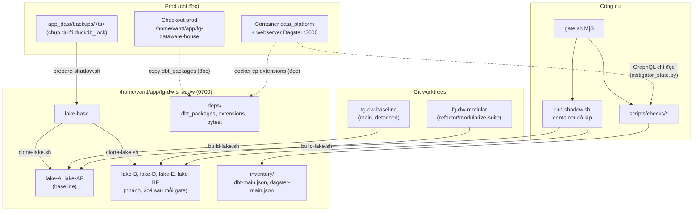
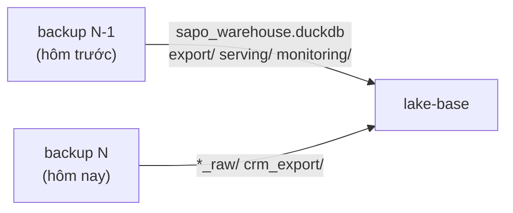
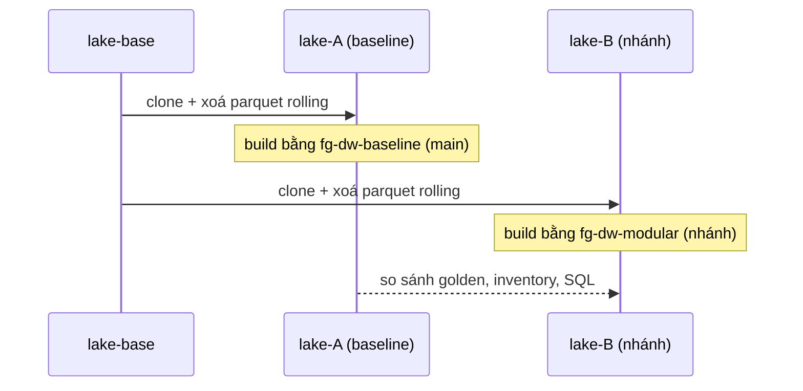
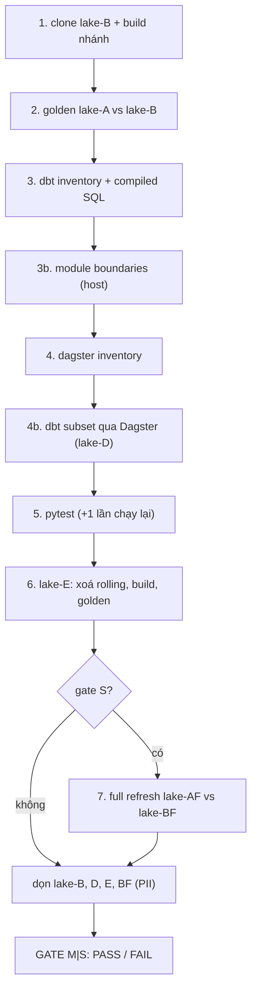

# Refactor Safety Harness (shadow gate)

> Bộ công cụ chứng minh bằng máy rằng một thay đổi cấu trúc (dời file, tách module, gom code) **không đổi một con số nào, không đổi tên bảng public, không đổi relation/config dbt và không đổi wiring Dagster**, trong khi hệ thống prod vẫn chạy hằng ngày và không bị đụng tới.
>
> Code: `scripts/shadow/` (môi trường và quy trình), `scripts/checks/` (các phép kiểm tra). Hướng dẫn lệnh ngắn: [scripts/shadow/README.md](../../scripts/shadow/README.md). Runbook đưa lên prod: [deployment.md § Refactor deploys](./deployment.md#refactor-deploys-shadow-verified).

## Mục lục

1. [Vì sao cần](#1-vì-sao-cần)
2. [Component làm gì](#2-component-làm-gì)
3. [Kiến trúc](#3-kiến-trúc)
4. [Cô lập khỏi prod bằng cách nào](#4-cô-lập-khỏi-prod-bằng-cách-nào)
5. [Dữ liệu dùng để so sánh](#5-dữ-liệu-dùng-để-so-sánh)
6. [Các phép kiểm tra và cách hoạt động](#6-các-phép-kiểm-tra-và-cách-hoạt-động)
7. [Gate: chạy cả quy trình bằng một lệnh](#7-gate-chạy-cả-quy-trình-bằng-một-lệnh)
8. [Đọc kết quả và xử lý khi fail](#8-đọc-kết-quả-và-xử-lý-khi-fail)
9. [Vận hành và bảo trì](#9-vận-hành-và-bảo-trì) (gồm vòng đời: dùng lâu dài sau module hoá, §9.4)
10. [Giới hạn: harness không chứng minh được gì](#10-giới-hạn-harness-không-chứng-minh-được-gì)
11. [Bằng chứng harness hoạt động](#11-bằng-chứng-harness-hoạt-động)

---

## 1. Vì sao cần

Hệ thống có ba đặc điểm làm cho refactor nguy hiểm hơn bình thường:

| Đặc điểm | Hệ quả nếu không có harness |
|---|---|
| Checkout `/home/vantt/app/fg-dataware-house` được bind-mount vào container `data_platform` | Sửa một file là sửa prod ngay lập tức; không có môi trường thử |
| Lịch realtime chạy mỗi 3 phút, incremental mỗi 10 phút, nightly lúc 03:00 | Không có khung giờ "yên tĩnh"; lỗi lan ra dashboard trong vài phút |
| 83 bảng public được Metabase, Evidence, Rill, CRM, detailView đọc theo tên | Đổi tên, đổi schema hoặc đổi số là hỏng người dùng cuối, thường không báo lỗi |

Refactor kiểu module hoá (dời 134 model, tách package) có rất nhiều cách hỏng âm thầm: model không được build lại nhưng file cũ vẫn còn, tag mất làm job chọn sai model, thư mục output không được tạo, selection của Dagster rỗng mà job vẫn "xanh". Harness biến mỗi rủi ro này thành một phép kiểm tra tự động.

## 2. Component làm gì

**Đầu vào:** một nhánh code (worktree `fg-dw-modular`) và một bản baseline (worktree `fg-dw-baseline`, là `main` chưa sửa).

**Đầu ra:** `GATE M: PASS` hoặc `GATE S: PASS` (hoặc `FAIL` kèm danh sách khác biệt chính xác đến bảng, cột, model, job).

**Bất biến được chứng minh:**

| # | Bất biến | Phép kiểm tra |
|---|---|---|
| 1 | Dữ liệu 83 bảng public giống hệt (số dòng, schema, giá trị, cả vị trí giá trị theo dòng) | Golden snapshot |
| 2 | Mọi relation dbt giữ nguyên tên, schema, alias, materialization, toàn bộ config, ref, test | dbt inventory |
| 3 | SQL dbt thực sự chạy giống hệt (khi phase không định đổi SQL) | Compiled SQL diff |
| 4 | Không có phụ thuộc mới vượt ranh giới module | Module boundaries |
| 5 | Asset, check, job (kèm tập model mỗi job chọn), schedule, sensor, SLA của Dagster giữ nguyên | Dagster inventory |
| 6 | Đường chạy thật của prod (op Dagster gọi dbt) vẫn chạy được | Dagster subset run |
| 7 | Code Python hiện có không vỡ | pytest |
| 8 | Hệ thống tự dựng lại được từ lake trống (thư mục output được tạo đúng) | Empty-lake build |
| 9 | Nhánh xử lý incremental cho kết quả giống hệt khi tính lại từ đầu | Full-refresh pass (gate S) |
| 10 | Trạng thái bật/tắt schedule/sensor trên prod không đổi sau deploy | Instigator state (runbook) |

## 3. Kiến trúc



| File | Vai trò |
|---|---|
| `scripts/checks/guard_not_prod.py` | Chặn mọi đường dẫn nằm trong checkout prod |
| `scripts/shadow/prepare-shadow.sh` | Dựng `lake-base` từ backup và các phụ thuộc offline |
| `scripts/shadow/clone-lake.sh` | Tạo một lake làm việc từ `lake-base`, xoá parquet rolling |
| `scripts/shadow/run-shadow.sh` | Chạy một lệnh trong container cô lập dựng từ image prod |
| `scripts/shadow/build-lake.sh` | Build một lake theo đúng trình tự prod |
| `scripts/shadow/pytest-shadow.sh` | Chạy pytest trong container shadow |
| `scripts/shadow/gate.sh` | Chạy toàn bộ phép kiểm tra, trả PASS/FAIL |
| `scripts/shadow/move_models.py` | Công cụ dời model theo module (dùng cho refactor, không thuộc gate) |
| `scripts/shadow/cleanup.sh` | Xoá lake (chứa PII) |
| `scripts/checks/golden_snapshot.py` + `public_models.yaml` | So sánh dữ liệu |
| `scripts/checks/dbt_inventory.py` | So sánh relation/config/SQL dbt |
| `scripts/checks/dagster_inventory.py` | So sánh wiring Dagster |
| `scripts/checks/check_boundaries.py` | Ranh giới module ([scripts/checks/README.md](../../scripts/checks/README.md)) |
| `scripts/checks/instigator_state.py` | Trạng thái schedule/sensor trên prod trước/sau deploy |

## 4. Cô lập khỏi prod bằng cách nào

Mỗi lớp chặn một loại rủi ro cụ thể:

| Rủi ro | Cơ chế chặn | Ở đâu |
|---|---|---|
| Ghi nhầm vào code hoặc dữ liệu prod | `guard_not_prod.py` lấy `realpath` của mọi đường dẫn (code, lake, thư mục shadow) và từ chối nếu nằm dưới checkout prod. Đường dẫn prod viết cứng, không có biến môi trường để tắt | Mọi script `scripts/shadow/*` |
| Lake trỏ ra ngoài vùng shadow | `run-shadow.sh` chỉ nhận `lake_dir` nằm dưới `$SHADOW_ROOT` | `run-shadow.sh` |
| Gọi ra ngoài (Lark, Sapo API, CRM, Google) | `docker run --network none`; lệnh đầu tiên trong container thử phân giải `github.com` và **từ chối chạy** nếu thành công | `run-shadow.sh` |
| Lộ secret | Không bao giờ dùng `.env.docker`; chỉ truyền một danh sách biến đường dẫn cố định (lấy từ `.env.docker.example` và khối `environment:` của compose). Script từ chối tham số chứa `--env-file`, `app_data/secrets`, `agent_codex_config` | `run-shadow.sh` |
| File root-owned không xoá được, PII mở cho người khác đọc | Container chạy bằng uid/gid của user (`--user $(id -u):$(id -g)`); thư mục shadow mode `0700` | `run-shadow.sh`, `prepare-shadow.sh` |
| Bản sao dữ liệu lệch (chép lúc DuckDB đang ghi) | `lake-base` chỉ lấy từ `app_data/backups/<ts>`, do `maintain_backup_platform_job` chụp dưới `duckdb_lock`; không bao giờ chép lake đang chạy | `prepare-shadow.sh` |
| Môi trường shadow khác prod | Dùng **chính image prod** `fg-dataware-house-data_platform:latest`; mount code theo từng thư mục con y như `docker-compose.yml` (`transformation`, `ingestion`, `orchestration`, `scripts`, `webhook_consumer`); biến đường dẫn giống prod (`DBT_EXPORT_PATH=/app/var/data_lake/export/marts`, ...) | `run-shadow.sh` |
| Thiếu phụ thuộc khi không có mạng | `dbt_packages` chép từ checkout prod, DuckDB extensions (`parquet`, `httpfs`, `sqlite_scanner` v1.5.5) chép từ container prod, pytest 8.3.3 cài sẵn vào `deps/home/pylib` | `prepare-shadow.sh` |
| pytest che phụ thuộc của image | Cài với `--no-deps`, chỉ thêm `pytest`, `pluggy`, `iniconfig`; chỉ nạp vào `PYTHONPATH` khi chạy pytest | `prepare-shadow.sh`, `pytest-shadow.sh` |
| Tranh tài nguyên với prod | Container shadow giới hạn `--cpus=2 --memory=6g` (prod: 4 CPU, 8 GB); một lần build chỉ khoảng 20 giây | `run-shadow.sh` |
| Dagster shadow ghi vào instance prod | `DAGSTER_HOME` là tmpfs trong container | `run-shadow.sh` |

## 5. Dữ liệu dùng để so sánh

### 5.1 lake-base: một ngày load mới



`lake-base` ghép **trạng thái warehouse của hôm trước** với **dữ liệu raw của hôm nay**. Nhờ vậy, lần build đầu trên shadow có đúng một ngày load mới để các model incremental (16 model: 12 `src_*` + `dim_customers_base`, `int_customer_metrics`, `int_customer_entry_attributes`, `int_customer_discount_metrics`) thật sự đi vào nhánh xử lý dòng mới, thay vì không xử lý gì. Hai backup được chọn phải không có deploy xen giữa.

### 5.2 Baseline và nhánh build trên cùng dữ liệu



Cả hai bên đi từ cùng một `lake-base`, cùng image, cùng ngày, nên mọi khác biệt chỉ có thể đến từ code.

**Cùng ngày là bắt buộc.** Nhiều model tính theo ngày hiện tại (`recency_days`, `snapshot_date`, các hàng đợi hành động), nên baseline build hôm qua và nhánh build hôm nay sẽ khác ở những cột đó dù code không đổi (đã gặp ngày 14/10/2026: 8 bảng khác chỉ vì đổi ngày). Vì vậy `gate.sh` kiểm tra ngày build của lake-A theo giờ Việt Nam; nếu khác hôm nay, gate tự build lại lake-A từ worktree baseline, chụp lại golden, xuất lại hai inventory và xoá lake-AF trước khi so.

Trước mỗi build, `clone-lake.sh` **xoá toàn bộ file parquet rolling** (giữ trạng thái DuckDB), để một model không được build lại sẽ không có output và bị phát hiện, thay vì "giống hệt" nhờ file thừa kế từ prod.

### 5.3 Build giống prod

`build-lake.sh` chạy đúng trình tự của prod:

1. `scripts/ensure_dbt_directories.py` (bước của lệnh start container): tạo `rolling/<model>/`.
2. `dbt parse`, rồi `dbt build` (như op `sapo_dbt_assets`).
3. `scripts/provisioning/refresh_rolling.py` (như asset serving).
4. Lưu `manifest.json`, `run_results.json`, `build_start`, `build.log` vào `<lake>/_shadow_meta/`.

Kết quả baseline hiện tại: 633 node (76 external model, 16 incremental, 7 table, 63 view, 14 seed, 454 test), `PASS=629 WARN=1` (cảnh báo `assert_overhead_accounts_classified` có sẵn trên prod), khoảng 18 giây.

## 6. Các phép kiểm tra và cách hoạt động

### 6.1 Golden snapshot (`golden_snapshot.py`)

**Danh sách bảng:** `public_models.yaml` được sinh tự động từ manifest (`init`):

- 75 model `external` có location dùng `get_rolling_location()`: chính là các view trong `serving/olap.duckdb` mà Metabase, Evidence, Rill, CRM, detailView đọc.
- 8 relation không có rolling location nhưng CRM/tools đọc trực tiếp (`dim_customers_base`, `int_customer_metrics`, `int_customer_economics`, `int_customer_entry_attributes`, `int_customer_sku_supply_tracking`, `int_customer_discount_metrics`, `int_crm_outreach_effort_events`, `mart_hug_optin`).
- 48 bảng có khoá nghiệp vụ, lấy từ test `unique` / `unique_combination_of_columns`.

**Dấu vân tay mỗi bảng (`capture`):**

```text
rows                      = count(*)
columns                   = [(tên, kiểu), ...] theo đúng thứ tự
mỗi cột c (không volatile) = count(c), bit_xor(hash(c)), sum(hash(c)::HUGEINT)
mỗi dòng (không volatile)  = bit_xor(hash(c1, c2, ...)), sum(hash(c1, c2, ...)::HUGEINT)
cột volatile số            = sum(c)            (so với dung sai tương đối)
cột volatile khác          = count(c)
```

- Dấu vân tay **không phụ thuộc thứ tự dòng** (`bit_xor` và `sum` có tính giao hoán), vì DuckDB không giữ thứ tự (`preserve_insertion_order: false`).
- Cột số thực được làm tròn 6 chữ số trước khi hash.
- **Dấu vân tay cấp dòng** bắt được trường hợp mà dấu vân tay từng cột không thấy: hai giá trị bị hoán đổi giữa hai dòng (vd. join sai làm hai nhân viên đổi team cho nhau). Mỗi cột vẫn giữ cùng tập giá trị, nhưng bộ giá trị theo dòng đã khác.
- **Cột volatile** là cột ghi thời điểm build (`loaded_at`, `*_generated_at`, `metric_calculated_at`, `calculated_at`, `as_of_ict`, `last_modified_at`: 17 cột trong 17 bảng). Chúng được tìm bằng thực nghiệm: build cùng code, cùng dữ liệu hai lần (lake-A và lake-A2), và đó là những cột duy nhất khác nhau.

**Chặn kết quả "sạch giả" (staleness):** `capture` báo lỗi nếu một bảng public:

- có file parquet mới nhất cũ hơn `build_start`, hoặc
- có node trong `run_results.json` không ở trạng thái `success`.

**Đọc dữ liệu:** bảng rolling đọc file parquet mới nhất trong `export/marts/rolling/<tên>/`; model external không có location đọc `export/marts/<tên>.parquet` tương đối theo lake (view trong warehouse chứa đường dẫn tuyệt đối nên không dùng được); model incremental/table đọc qua `ATTACH ... (READ_ONLY)` vào warehouse.

**`compare`** in từng khác biệt: thiếu bảng, số dòng, schema, cột có giá trị khác, dấu vân tay dòng khác, cột volatile số lệch quá dung sai.

**`keyed-diff`** (dùng khi cần điều tra): `EXCEPT ALL` hai chiều trên các cột không volatile, in số dòng lệch và 5 khoá mẫu.

### 6.2 dbt inventory (`dbt_inventory.py`)

`export` đọc manifest và ghi lại, cho mọi model/seed/snapshot:

| Trường | Bắt được |
|---|---|
| `relation_name`, `schema`, `alias`, `database` | Đổi tên bảng, đổi schema (vd. dời model sang thư mục mất `+schema: marts`) |
| `config` đầy đủ (trừ danh sách bỏ qua: `packages`, `docs`) | Mất tag dùng cho selection, đổi materialization, mất `on_schema_change`, seed `column_types`, `enabled` |
| `depends_on` | Đổi ref |
| `checksum` | Đổi SQL nguồn |
| `tests` | Mất test khi tách file properties |
| `description` (đã strip), `columns` | Mất tài liệu khi tách file properties |

Các trường đường dẫn (`original_file_path`, `fqn`, `path`) **không** được so, vì dời file là mục đích của refactor. `location` được chuẩn hoá (bỏ hậu tố timestamp). `diff` có hai cờ: `--allow-new` (chấp nhận node mới) và `--allow-code-change` (chấp nhận đổi SQL; dữ liệu vẫn phải khớp golden). Khi có `--allow-code-change`, một thay đổi `depends_on` cũng được chấp nhận (in `INFO ... repointed dependency kept upstream: <dep cũ> -> via <dep mới>`) **chỉ khi mọi dependency bị bỏ vẫn là tổ tiên** của node trong đồ thị `depends_on` của nhánh, tức model đổi ref sang một view pass-through (`std_*`) mà lineage tới nguồn cũ không đổi. Dependency bị bỏ mà không còn là tổ tiên, hoặc không có cờ, vẫn là `DIFF`. Test: `scripts/tests/test_dbt_inventory.py`.

`compiled-diff` so **SQL dbt thực sự đã chạy** (`compiled_code` trong manifest do `dbt build` ghi), đã chuẩn hoá khoảng trắng, theo `unique_id` (không phụ thuộc đường dẫn). Đây là bằng chứng mạnh nhất cho các thay đổi kiểu "thay khối CASE bằng macro trả về đúng SQL đó".

### 6.3 Module boundaries (`check_boundaries.py`)

Kiểm tra ma trận phụ thuộc giữa các module, import chéo giữa component, seed trùng tên, URL cứng trong connector, và model nằm đúng thư mục module. Chạy bằng Python của host vì cần thấy cả `crm/` và `detailView/` (container `data_platform` không mount hai thư mục này; checker báo lỗi `py-scan` nếu thiếu, để không pass giả). Chi tiết: [scripts/checks/README.md](../../scripts/checks/README.md).

### 6.4 Dagster inventory (`dagster_inventory.py`)

Nạp `orchestration.definitions.defs` trong container shadow và ghi lại:

- asset key và group; asset check key (492);
- mỗi job: tập asset được chọn **và tập dbt `unique_id` mà các asset đó tương ứng** (qua `SapoDbtTranslator` + manifest);
- schedule: cron, job, timezone, trạng thái mặc định; sensor: target, trạng thái mặc định, interval;
- SLA đã resolve cho từng asset key trong `ingestion_sla.yaml`.

`export` trả lỗi nếu một job có asset dbt mà tập `unique_id` rỗng. `diff --allow-new` chấp nhận asset mới và job có selection **lớn thêm** (vd. thêm view `std_*` upstream), nhưng không chấp nhận selection bị mất phần tử.

### 6.5 Dagster subset run

Chép `lake-B` thành `lake-D` (giữ nguyên parquet upstream), rồi chạy thật:

```bash
dagster asset materialize -f orchestration/definitions.py --select "marts/fact_order_returns"
```

Đây là selection của job `_fact_order_returns` (file drop Shopee/MISA). Phép thử đi qua đúng đường chạy prod: op `sapo_dbt_assets` → `dbt parse` → tạo thư mục rolling → dagster-dbt dịch asset thành `dbt build --select <fqn>`. Nó bắt được lỗi mà inventory không thấy, vì dagster-dbt gửi selection bằng **`fqn` (có chứa thư mục)** lấy từ manifest mà code server đã nạp.

### 6.6 Empty-lake build

`clone-lake.sh lake-E --empty-rolling` xoá cả cây thư mục `rolling/`. Build phải tự tạo lại thư mục (DuckDB `COPY TO` lỗi nếu thư mục cha không tồn tại) và cho golden giống baseline. Phép thử này mô phỏng cài mới hoặc dựng lại volume, và bắt lỗi kiểu "code tạo thư mục đang quét theo tên thư mục cũ".

### 6.7 Full-refresh pass (chỉ gate S)

Build `lake-AF` (baseline, cache lại) và `lake-BF` (nhánh) với `dbt build --full-refresh`, rồi so golden. Lý do: model incremental chỉ xử lý dòng mới; nếu một thay đổi SQL làm sai logic incremental, các dòng cũ không được tính lại và lỗi chỉ lộ ra dần trên prod. Tính lại toàn bộ trên cả hai bên rồi so sẽ phơi bày ngay.

### 6.8 pytest

Chạy `ingestion/tests`, `orchestration` (các thư mục `__tests__`) và `scripts/tests` trong container shadow (hiện 189 test, gồm test của chính harness). Test `test_concurrent_writes_no_lock_error` chập chờn do timing SQLite (khoảng 1/4 số lần chạy, cả trên baseline), nên gate chạy lại pytest **một lần** khi fail và in `FLAKY` nếu lần sau pass. Test fail hai lần làm gate fail.

### 6.9 Instigator state (`instigator_state.py`, dùng trong runbook deploy)

Hỏi webserver Dagster prod qua GraphQL (truy vấn chỉ đọc) trạng thái thật của 17 schedule và 9 sensor, trước và sau deploy, rồi so. **Không** dùng `dagster schedule list -f ...`: CLI tự dựng code location riêng và báo mọi thứ STOPPED, trong khi webserver đang chạy cả 26 (đã kiểm chứng 13/10/2026).

## 7. Gate: chạy cả quy trình bằng một lệnh

```bash
cd /home/vantt/app/fg-dw-modular
scripts/shadow/gate.sh M                       # phase chỉ dời file
scripts/shadow/gate.sh S                       # phase đổi SQL
scripts/shadow/gate.sh S --allow-new --allow-code-change   # thêm model/asset mới và đổi SQL có chủ đích
```



| Bước | M | S | Thời gian ước tính |
|---|---|---|---|
| Build nhánh trên lake-B | ✓ | ✓ | ~25 s |
| Golden | ✓ | ✓ | ~5 s |
| dbt inventory + compiled SQL | ✓ | ✓ | ~5 s |
| Module boundaries | ✓ | ✓ | ~1 s |
| Dagster inventory | ✓ | ✓ | ~10 s |
| Dagster subset run | ✓ | ✓ | ~15 s |
| pytest | ✓ | ✓ | ~5 s |
| Empty-lake build + golden | ✓ | ✓ | ~30 s |
| Full refresh (lake-AF lần đầu, lake-BF) | | ✓ | ~60 s |

Gate M khoảng 2 phút, gate S khoảng 2–3 phút. Mọi bước đều chạy dù bước trước fail, để một lần chạy cho thấy toàn bộ vấn đề.

**Phase nào dùng gate nào:** phase chỉ dời file (dời model, dời package Python, dời hằng số cấu hình) dùng **M**. Phase thay đổi SQL (thêm `std_*` pass-through, thay CASE bằng macro) dùng **S**.

## 8. Đọc kết quả và xử lý khi fail

| Dòng FAIL | Ý nghĩa thường gặp | Cách điều tra |
|---|---|---|
| `dbt build (branch)` | Nhánh không build được | Đọc `<shadow>/lake-B/_shadow_meta/build.log` (gate xoá lake-B ở cuối; chạy lại `clone-lake.sh` + `build-lake.sh` thủ công để giữ lại) |
| `golden` với `STALE/ERROR ... predates build start` | Model không được build lại (mất tag, bị tắt, bị bỏ khỏi selection) | Tìm model trong `run_results.json`; so `dbt ls` hai bên |
| `golden` với `column values differ` | Giá trị một cột đổi | `golden_snapshot.py keyed-diff` để xem khoá nào lệch |
| `golden` với `row-level fingerprint differs` | Giá trị bị hoán đổi giữa các dòng (thường do join) | `keyed-diff` |
| `dbt inventory` với `schema`/`relation_name` | Model mất config của layer khi dời | Kiểm tra thư mục layer và anchor trong `dbt_project.yml` |
| `dbt inventory` với `tests` | Mất test khi tách file properties | So khối YAML cũ và mới |
| `compiled SQL` | SQL thực thi khác (macro sinh khác, ref khác) | Nếu thay đổi có chủ đích, dùng `--allow-code-change` và dựa vào golden |
| `module boundaries` | Phụ thuộc mới vượt ranh giới | Xem [scripts/checks/README.md](../../scripts/checks/README.md) § Adding a model |
| `dagster inventory` | Asset key, job selection, cron, SLA đổi | Đọc dòng `DIFF`; asset key đổi là mất SLA check âm thầm trên prod |
| `dagster dbt subset run` | Đường chạy op Dagster hỏng (selection theo fqn, tạo thư mục) | Đọc `/tmp/gate-dagster-subset.log`; chạy lại lệnh ở mục 6.5 |
| `pytest` (cả hai lần) | Test thật sự fail | Chạy `pytest-shadow.sh` với file test cụ thể |
| `dbt build on empty rolling` | Thư mục output không được tạo | Kiểm tra `transformation/scripts/rolling_dirs.py` và manifest |

**Không được** sửa harness để gate pass (thêm cột volatile, nới dung sai, thêm allowlist) mà không có bằng chứng thực nghiệm như cách đã làm với 17 cột volatile.

## 9. Vận hành và bảo trì

### 9.1 Dựng lần đầu

Các lệnh có trong [scripts/shadow/README.md § One-time setup](../../scripts/shadow/README.md#one-time-setup): tạo hai worktree, `prepare-shadow.sh <backup_mới> <backup_trước>`, build lake-A, sinh `public_models.yaml`, capture golden, export hai inventory baseline.

### 9.2 Khi nào phải làm mới baseline

| Sự kiện | Việc cần làm |
|---|---|
| Sang ngày mới | Không cần làm gì: gate tự build lại lake-A, golden và inventory baseline (mục 5.2) |
| Một phase vừa được chấp nhận (commit trên nhánh), hoặc `main` có commit mới | Baseline luôn là **commit được chấp nhận gần nhất**, không nhất thiết là `main`: nếu baseline cũ hơn, gate của phase sau thấy cả thay đổi của phase trước (đã gặp 14/10/2026). `git -C /home/vantt/app/fg-dw-baseline checkout --detach <commit chấp nhận gần nhất>`, rồi build lại lake-A bằng tay (`clone-lake.sh lake-A`, `build-lake.sh <baseline> lake-A`), capture golden, export lại `dbt-main.json` và `dagster-main.json` từ worktree baseline, xoá `lake-AF` |
| Muốn dữ liệu mới hơn | `prepare-shadow.sh` với hai backup mới hơn, rồi làm như dòng trên |
| Thêm bảng public mới | Chạy lại `golden_snapshot.py init` (giữ nguyên `volatile_columns`), rồi build hai lần (lake-A, lake-A2) để kiểm tra bảng mới có cột volatile không |
| Đổi image prod (rebuild `data_platform`) | Chạy lại `prepare-shadow.sh` để lấy extensions/phụ thuộc khớp image mới |

### 9.3 Dọn dẹp

Lake chứa PII khách hàng. Gate tự xoá lake của nhánh sau mỗi lần chạy; lake-A, lake-A2, lake-AF và `lake-base` được giữ trong suốt một đợt thay đổi và xoá bằng `scripts/shadow/cleanup.sh --all` khi đợt đó kết thúc, cùng với các worktree (`git worktree remove`). Lần sau cần dùng thì dựng lại từ backup mới nhất (mục 9.1), mất vài phút.

### 9.4 Vòng đời: công cụ dùng lâu dài, dữ liệu shadow dùng theo đợt

Harness **không chỉ dành cho đợt module hoá**. Code (`scripts/shadow/`, `scripts/checks/`) và tài liệu là một phần lâu dài của repo; chỉ dữ liệu shadow là tạm thời.

| Thành phần | Vòng đời |
|---|---|
| `scripts/shadow/*`, `scripts/checks/*`, tài liệu này | Lâu dài, được commit và bảo trì như code khác |
| `check_boundaries.py` + `model_buckets.yaml` + allowlist | Lâu dài, chạy ở **mọi** thay đổi dbt/Python (quy tắc trong `transformation/AGENTS.md`) |
| `instigator_state.py` + runbook deploy | Lâu dài, dùng ở mọi lần deploy cần dừng `data_platform` |
| `/home/vantt/app/fg-dw-shadow` (lake, deps) | Theo đợt: dựng khi bắt đầu một thay đổi cần gate, xoá khi xong |
| Worktree baseline / nhánh | Theo đợt |

Các tình huống nên chạy gate sau khi module hoá xong:

| Tình huống | Gate | Gate chứng minh gì |
|---|---|---|
| Refactor dbt hoặc orchestration (tách package, đổi tên thư mục, dọn code) | M hoặc S | Không đổi số, không đổi wiring |
| Nâng version `dbt-duckdb`, `duckdb`, `dagster`, `dagster-dbt`, `dlt` (rebuild image) | S, với `SHADOW_IMAGE` trỏ image mới | Version mới cho cùng số liệu; khác biệt (nếu có) chỉ đúng bảng/cột |
| Thêm connector mới (Haravan, Nhanh, ...) | S `--allow-new` | Thêm nguồn không làm đổi số liệu của nguồn cũ |
| Thay đổi **có chủ đích** làm đổi số (vd. thống nhất định nghĩa CROSSBORDER) | S, đọc khác biệt thay vì đòi PASS | Danh sách chính xác bảng/cột/khoá bị ảnh hưởng, dùng làm báo cáo tác động trước khi duyệt |
| Sửa lỗi trong một model | S | Chỉ đúng bảng mong đợi thay đổi, không lan sang bảng khác |

Khi dùng cho thay đổi không phải module hoá, các bước giống mục 9.1: dựng shadow từ hai backup mới nhất, tạo worktree baseline tại `main` và worktree nhánh, chạy gate.

## 10. Giới hạn: harness không chứng minh được gì

| Không được kiểm chứng | Vì sao | Bù đắp |
|---|---|---|
| Ingestion thật (gọi Sapo API, đọc Google Sheet, webhook D1, tải MISA) | Container không có mạng và không có secret | Thay đổi code ingestion phải giữ nguyên hàm/asset key (inventory bắt được) và được theo dõi sau deploy qua SLA freshness |
| Gọi HTTP sang CRM (`crm:8090`) và đọc SQLite CRM | Không có container CRM trong shadow | Theo dõi job CRM sau deploy |
| Gửi thông báo Lark | Không có mạng | `instigator_state.py` + failure sensor trên prod |
| Bảng không thuộc danh sách public (view staging, intermediate nội bộ) | Golden chỉ so 83 bảng public | dbt inventory + compiled SQL bảo đảm code của chúng không đổi; dữ liệu của chúng chảy vào bảng public |
| Kết quả test dbt mức warn | Không so số lượng cảnh báo | Đọc `build.log` khi cần |
| Dagster job ngoài selection `marts/fact_order_returns` chạy thật | Chỉ chạy một job con đại diện | Inventory so tập `unique_id` của mọi job |
| Hành vi theo thời gian (lịch chạy, chồng run, khoá DuckDB dưới tải) | Shadow chạy tuần tự | Runbook deploy: dừng container, theo dõi một vòng nightly |
| Seed CSV do job prod ghi lại sau khi deploy | Shadow dùng seed đã commit | Runbook bước "commit nội dung seed đang sống trước khi merge" |

## 11. Bằng chứng harness hoạt động

Đã chạy ngày 13/10/2026:

| Phép thử | Kết quả mong đợi | Kết quả |
|---|---|---|
| lake-A vs lake-A2 (cùng code, cùng dữ liệu) | Chỉ cột timestamp build khác | 17 cột ở 17 bảng; khai báo volatile xong thì 0 khác biệt |
| Compiled SQL lake-A vs lake-A2 | 0 khác biệt | 0/162 model |
| Sửa một dòng `ref_payment_methods.csv` | Golden báo đúng bảng, cột | `dim_payment_methods.payment_method_type`; keyed-diff chỉ đúng 1 khoá |
| Thêm `+schema: probe` cho `intermediate/` | dbt inventory báo | 42 khác biệt (schema, relation) |
| Đổi cron realtime `*/3` → `*/4` | Dagster inventory báo | Đúng schedule `pipeline_sapo_v2_realtime_schedule` |
| Asset key sai trong selection | Báo lỗi | Dagster tự từ chối nạp Definitions |
| Chèn `import orchestration...` vào `crm/` | Boundaries báo | `py-import crm/ops/hug_mint.py` (lần đầu pass giả vì container không mount `crm/` → đã thêm luật `py-scan`, chạy trên host) |
| Tạo seed trùng tên | Boundaries báo | `seed-duplicate ref_brands.csv` |
| Đường dẫn prod cho `run-shadow.sh` | Từ chối | Từ chối cả code và lake |
| Lake trống (xoá `rolling/`) | Build lại đủ, golden khớp | 94 thư mục (baseline), 75 (sau refactor, chỉ model rolling), golden khớp |
| Unit test của harness | Pass | `test_golden_snapshot.py` 5, `test_check_boundaries.py` 23, `test_rolling_dirs.py` 3 |
| Gate S trên nhánh chưa đổi dbt | PASS | PASS trong 2 phút 18 giây |
| Gate M sau khi dời 134 model | PASS | PASS |
