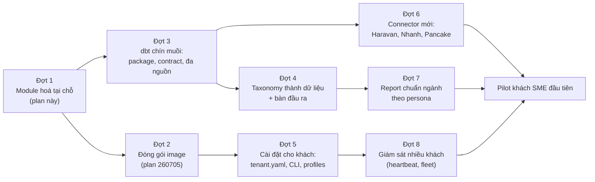

# Long-vision roadmap: từ suite Fine Japan đến sản phẩm module cho SME

> Tài liệu ghi nhớ hướng dài hạn. Chỉ **Đợt 1** (plan này) có phase chi tiết và được duyệt để làm. Các đợt sau là danh sách việc đã biết, mỗi đợt sẽ có plan riêng khi đến lượt. Kiến trúc đích: [research report](../reports/research-261013-1610-sme-commerce-data-platform-modularization.md).

## Nguyên tắc xuyên suốt mọi đợt

- **Hệ thống đang chạy vẫn vận hành hằng ngày như cũ.** Mọi đợt làm trên worktree + shadow; prod chỉ đổi khi merge có kiểm chứng; mỗi thay đổi đều có rollback.
- Không đổi số liệu dashboard trừ khi đó là quyết định nghiệp vụ được duyệt rõ ràng (vd. thống nhất định nghĩa CROSSBORDER).
- Không đổi tên bảng public nếu chưa có lộ trình chuyển đổi cho người tiêu thụ (Metabase, Evidence, Rill, CRM, detailView).

## Tổng quan các đợt

## Đợt 1 — Module hoá tại chỗ (plan này)

> ✅ **Đã đóng 14/10/2026 22:49** (main `8eb9920f`): phase 0–7 trên prod; đủ 6/6 tiêu chí nghiệm thu (nightly lịch 15/10 03:00 `ffb92b66` SUCCESS 55/55, 0 check đỏ mới).

Thư mục module cho dbt, CDM đóng rò, taxonomy gom về một module (SQL giữ nguyên), connector package cho orchestration, tenant overlay Fine Japan, kiểm tra ranh giới tự động. Xem [plan.md](plan.md).

## Đợt 2 — Đóng gói image (plan `260705-1704-modular-monorepo-boundary-hardening`)

| Việc | Ghi chú |
|---|---|
| Tái cơ cấu data volume (bind mount → named volume có chọn lọc) | 260705 phase 0 |
| Dockerfile theo component, thu hẹp build context | 260705 phase 1; loại `ingestion/.cookies` khỏi build context |
| Pin dependency (`dlt`, `duckdb`, `dagster`, `dagster-dbt`, `pandas`, `pyarrow`) và bỏ patch `sed` dlt | Điều kiện để build lại image an toàn |
| Image có version trên GHCR, rollback bằng tag | 260705 phase 4 |
| Tách stack dev/prod (prod chạy từ image, không bind-mount code) | 260705 phase 5; khi xong, deploy không còn "sửa file là sửa prod" |
| Bake `dbt_packages` và DuckDB extensions vào image | Bỏ phụ thuộc mạng lúc start |

**Bố cục thư mục (user 20/10/2026, chưa chốt; quyết trong thiết kế Đợt 2):**
- Phải bàn lại cùng cách đóng gói **theo bộ chức năng** (user nói rõ 20/10: kho dữ liệu, report, CRM, mỗi bộ là một gói): vẽ ranh giới các bộ trước, rồi mới chọn bố cục. User nghiêng về hướng (b). Hai hướng: (a) theo loại: `packages/` (thư viện), `apps/` (app độc lập) cộng nhóm riêng cho pipeline (`ingestion`, `transformation`, `orchestration`), nội dung report (`evidence`, `rill`, `analytics`) và cấu hình khách (`tenants`); (b) theo gói sản phẩm: `products/<gói>/` chứa app và cấu hình của gói, cộng thư mục thư viện dùng chung.
- Lý do chưa chốt `apps/`: repo không chỉ có app (pipeline, nội dung report, cấu hình khách không phải app); gói sản phẩm và app là hai trục khác nhau; dời thư mục tốn và rủi ro (compose, Dockerfile, bind mount prod, script, dbt) trong khi Dockerfile theo thành phần và image có phiên bản làm được mà không cần dời.
- Tạm thời: thư viện dùng chung đầu tiên đặt ở `packages/agent-codemode/` (tự đứng được, `pyproject.toml` và phiên bản riêng, luật chặn import ngược). Vị trí này có thể đổi theo quyết định Đợt 2; chỉ luật ranh giới và đường cài đặt trong image phụ thuộc đường dẫn. Khi có từ hai `pyproject.toml` trở lên: quản lý bằng uv workspace với một file khoá chung để các image không lệch phiên bản.
- App mới (nếu có) tạm đặt ở thư mục gốc như hiện nay. Không dời app hiện có trước khi Đợt 2 quyết.

## Đợt 3 — dbt chín muồi

| Việc | Vì sao | Phụ thuộc |
|---|---|---|
| Mỗi connector/pack thành **dbt local package** (`packages.yml: local:`) | Version riêng, bật/tắt bằng `packages.yml`, tiến tới tách repo | Đợt 1 (thư mục đã đúng ranh giới) |
| Đổi tên tầng `std_*` → `cdm_*` (giữ view alias `std_*` một thời gian) | Tên phản ánh vai trò canonical | Đợt 1 phase 3 |
| Bật `contract: enforced` cho `cdm_*` (nâng test warn lên enforce) | Schema chuẩn được cưỡng chế | Spike contract với dbt-duckdb; quy trình xử lý khi nightly dừng |
| Khoá chuẩn `*_key = hash(source_system, shop_id, natural_id)` + cột `shop_id` | Nhiều shop trong một nguồn | ADR-014 mở rộng |
| Macro union đa nguồn cho `cdm_*` theo `var('enabled_sources')` | Chuẩn bị nguồn thứ hai | Đợt 6 dùng |
| Tách `cdm-ledger` (MISA) khỏi `cdm-commerce`; đối soát là pack | Không đếm trùng doanh thu | — |
| Tách `fact_order_costs`: phí sàn → `packs/marketplace`, overhead → tenant | Đóng nợ kỹ thuật ghi ở Đợt 1 phase 3 | — |
| Giải các tenant hook (`dim_customers` CROSSBORDER, `dim_staff` ← CRM, `mart_data_quality` ← US shipment, `fact_order_economics` ← overhead) | Core sạch hoàn toàn | Quyết định nghiệp vụ cho từng hook |
| dbt `groups` + `access: protected/public` cho model | Ranh giới cưỡng chế ngay trong dbt | — |
| Cột `currency_code` trong contract các bảng có tiền | Sẵn sàng đa tiền tệ, không làm tỉ giá | — |
| Semantic layer (định nghĩa KPI một chỗ: GMV, NMV, CM1–CM3, MER, tỉ lệ mua lại) | Metabase và Evidence ra cùng số | `docs/analytics-handbook/semantic/` đã có mầm |
| Bổ sung test (unique/not_null/relationships) cho mọi bảng public | Chất lượng khi có nhiều nguồn | — |
| Dọn macro chết `get_parquet_location`, `get_versioned_location`, `add_fk_constraint`; sửa `scripts/testing/test_olap_queries.py` lỗi thời | Vệ sinh | — |

## Đợt 4 — Taxonomy thành dữ liệu (bàn cùng phần đầu ra)

> **Cập nhật 14/10/2026:** thiết kế bộ máy phân loại đã duyệt hướng: [taxonomy-engine-design.md](taxonomy-engine-design.md). Bộ máy (MVP + pilot `customer_type`, ~7–9 ngày) là **plan riêng chạy ngay sau Đợt 1**, trước các việc khác của Đợt 4; Đợt 4 dựa trên bộ máy đó (giao diện nhập luật, quy trình onboarding 6 bước, gói connector, thống nhất Known divergences). Chặn: cần dữ liệu doanh nghiệp thứ hai để chốt bộ mã chuẩn.

Taxonomy là nơi chứa sự khác biệt thật giữa các doanh nghiệp (giá trị phân loại trong từng domain); phần còn lại là chuẩn. Mô hình ba lớp (domain / giá trị / luật) và workflow thiết lập 6 bước (khung chuẩn → khảo sát dữ liệu thô → điền luật → xem trước tác động → áp dụng → giám sát `UNMAPPED`) được mô tả ở `phase-04-taxonomy-module.md` § "Đích sau phase này". Đầu vào bắt buộc: `TAXONOMY.md` do phase 4 tạo.

| Việc | Ghi chú |
|---|---|
| Quyết định nghiệp vụ cho Known divergences (CROSSBORDER, nhãn recency…) | Có thể đổi số → cần duyệt rõ |
| Luật thành dữ liệu: bảng luật exact / pattern có ưu tiên / threshold; macro đọc qua `ref()` (có cạnh DAG) | Thiết kế phải biểu diễn được `EXISTS`, điều kiện nhiều metric |
| Giao diện nhập luật cho khách (Google Sheet hay YAML do mình cấu hình) | Câu hỏi đang hoãn |
| `monitor_unmapped_*` cho mọi domain, cảnh báo qua notifier | — |
| Bộ giá trị mặc định cho khách mới | — |

## Thứ tự ưu tiên sau Đợt 1 (user chốt 14/10/2026)

1. ✅ (prod 15/10 11:28, main `9c25d02a`) **Cơ chế pack** (`pack_ref`, bật/tắt pack, khai báo "connector cung cấp gì") **+ lớp ánh xạ "nhãn hiện có → mã chuẩn"** (bảng `taxonomy_label` của thiết kế bộ máy phân loại) cho các domain report cần, ~1–2 ngày. Lớp này cho report chuẩn có cột `*_std` ngay mà chưa cần bộ máy luật.
2. **Report chuẩn theo persona** (Đợt 7 đưa lên trước; user chốt 14/10: report trước bộ máy phân loại và trước CRM/HUG). Danh mục report cho biết domain phân loại nào cần trước, và thử bộ mã chuẩn trên báo cáo thật.
3. 🟡 (prod 15/10 15:19 `d31d51f2`: chạy song song 7 đêm từ 16/10, sớm nhất ~22/10 chuyển cột) **Bộ máy phân loại** (MVP + pilot `customer_type`), ưu tiên các domain report đã dùng; có thể song song với phần hiện thực report.
3b. **Kiểm soát chất lượng phân loại** (user duyệt 15/10/2026; làm sau khi bộ máy chuyển xong `customer_type`; thí điểm FJ với khách sỉ ẩn và đơn nguồn "Other"). Tính năng sản phẩm dùng chung mọi khách, vì nhân viên luôn phân loại theo cảm tính và luật chuẩn không sửa được dữ liệu nhập sai:
   - **Độ phủ:** % `UNMAPPED`/"Khác" theo domain, kèm doanh thu bị ảnh hưởng.
   - **Nghi phân loại sai:** nhãn nhân viên nhập mâu thuẫn với tín hiệu hành vi (giảm giá thường xuyên > ngưỡng, mua lặp số lượng lớn, có đơn kênh US…) → danh sách cần xem. Ngưỡng là tham số mặc định của sản phẩm, khách chỉnh được.
   - **Biến động bất thường:** tỉ lệ một nhãn đổi đột ngột so với kỳ trước.
   - **Nguồn gây lỗi:** nhân viên/kênh tạo nhiều bản ghi phân loại sai (để đào tạo).
   - **Vòng xử lý:** danh sách cần xem → sửa trên nguồn, ghi đè có lý do, hoặc bổ sung luật → kiểm lại; có thể đẩy thành việc trong CRM hoặc tin Lark.
   - Dùng lại khung giám sát song song của bộ máy (bảng hằng ngày, cảnh báo) làm "xem trước tác động" khi sửa luật cho bất kỳ khách nào.
4. **Đóng gói image** (Đợt 2) để cài cho khách.
5. **Chuẩn hoá CRM và HUG: hoãn.** Sau phase 6 chúng đã có ranh giới riêng (pack), nên chưa cần thiết kế lại.

## Việc vận hành độc lập (user duyệt 14/10/2026)

> **Quyền deploy (user chốt 14/10):** session thực thi tự deploy prod theo runbook **sau khi user duyệt giờ**.

| Việc | Trạng thái |
|---|---|
| Ghim phiên bản Evidence (5 package + lockfile + `npm ci` + `node:20.20.2-slim`) | ✅ main `c2915881`; lần `docker compose build evidence` đầu tiên do user chọn giờ thấp điểm |
| Backup Metabase | ✅ main `82368d21` (deploy 14/10 21:58): xuất API hằng đêm trong `backup.sh` (lần thật đầu 15/10 01:04); chép H2 nguội hằng tuần CN 00:30 + trước mỗi deploy (timer user `metabase-cold-backup.timer`, giữ 7 bản, gián đoạn ~18 s); khôi phục thử khớp 43/888/23; runbook `deployment.md` §8 |
| `.env.docker` (secret) không nằm trong backup nào | User chốt 14/10: không chép bản rõ; giữ bản **mã hoá**, làm trong plan backup ngoài máy |
| Backup ra ngoài máy (mọi bản đang cùng ổ) + cân nhắc chuyển Metabase sang Postgres | Gộp vào mục "Backup, khôi phục và tái dựng hệ thống" |
| Sửa 2 lỗi số: Rill `scope_*` lệch mart; `channel_net_profit` coi thiếu giá vốn là 0 | Chưa làm (xếp hàng), qua gate S, user duyệt danh sách đổi |
| **Lộ dữ liệu Evidence:** cổng 3006 mở, không đăng nhập; bản build chứa PII và số tài chính | Commit `bf3f773e` (nhánh `chore/evidence-auth`): bỏ cổng host, `basic_auth` Caddy từ `EVIDENCE_BASIC_AUTH_USER/HASH` trong root `.env`. **Chờ user đặt biến** rồi mới merge (compose từ chối chạy khi thiếu biến). User 14/10 23:15: **để sau**; trong lúc chờ, dữ liệu vẫn lộ trên LAN/Tailscale |
| Dịch vụ khác mở không đăng nhập: **Dagster UI** (:3000 / etl.lan, chạy/dừng job được), Rill (:3002), detail_view (:3005), stack nu-* (:13000/13002/13004); host nghe trên LAN và Tailscale | User 14/10: **làm sau** (không khó). Khi làm: kiểm kê ai dùng cổng nào trước (vd. `instigator_state.py` gọi `127.0.0.1:3000`), bỏ cổng mở thẳng, đăng nhập qua Caddy, ghi vào runbook và tài liệu cài cho khách (an toàn mặc định ở Đợt 5) |
| Sensor `ingest_sheets_modified_sensor` chưa từng phát hiện sheet đổi (400 tick "cold start, baseline rỗng" từ 13/10) | Đã rõ nguyên nhân: link CSV công khai trả 401 (sheet không còn public), sensor nuốt lỗi; lịch sync bằng service account vẫn chạy. User 14/10: **hoãn**; khi làm, đề xuất bỏ sensor (chỉ dùng lịch) trừ khi cần cập nhật tức thì. Báo cáo: `plans/reports/investigation-261014-2320-sheets-sensor-never-fires.md` |
| **RAM Evidence:** container giới hạn 2 GiB, build cần ~3,5 GiB; swap host gần đầy (~8,1/8,2 GB). Recreate/restart Evidence lúc này dễ OOM. `serve` tải qua `npx` lúc khởi động, không nằm trong lock | Đề xuất: `mem_limit` Evidence 4g gộp vào nhánh evidence-auth trước khi recreate; ghim `serve` vào lock; kiểm (chỉ đọc) tiến trình nào đang chiếm swap host |
| Lỗi gắn tag không tất định (28 dòng `ref_tag_categories` cùng priority) | Ghi nhận, chưa duyệt |

Plan report chi tiết: [report-product-design.md](report-product-design.md) (v2, mọi quyết định đã chốt).

## Backup, khôi phục và tái dựng hệ thống (user yêu cầu 15/10/2026: đánh giá và xem xét lại)

**Mục tiêu:** khách nào (kể cả Fine Japan) mất máy hoặc hỏng ổ cũng dựng lại được hệ thống trong thời gian biết trước, với dữ liệu mất tối đa biết trước, và việc đó **đã được thử thật**, không chỉ có script.

**Hiện trạng (14–15/10):** `backup.sh` chạy trong `data_platform` mỗi đêm 01:04, chép `data_lake`, `dagster_home`, `input_source` và (từ 14/10) xuất Metabase qua API; Metabase H2 chép nguội hằng tuần + trước mỗi deploy (timer host); CRM có `crm/ops/backup_crm.py` riêng. **Mọi bản backup nằm cùng ổ với dữ liệu gốc**; `.env.docker` (secret) không được backup; chưa có quy trình khôi phục toàn hệ thống đã thử, chưa có mục tiêu RPO/RTO.

**Phạm vi đánh giá rồi lập plan:**

| Mảng | Câu hỏi cần trả lời |
|---|---|
| Đẩy ra dịch vụ ngoài | Dễ triển khai cho SME: **Google Drive** (qua `rclone`, xác thực OAuth hoặc service account / Shared Drive); phương án khác: Backblaze B2, S3-compatible, NAS. Chạy thế nào trên **Docker** (container sidecar `rclone`/`restic` theo lịch) và trên **Linux thuần** (systemd timer). Giới hạn của Google Drive (dung lượng, quota API, file lớn như DuckDB). |
| Mã hoá và gom | Mã hoá phía máy trước khi đẩy (`restic`/`kopia` với backend rclone, hoặc `age`); khử trùng lặp để bản DuckDB lớn không đẩy đầy đủ mỗi đêm; bản **mã hoá** của `.env.docker` và secret khác; quản lý khoá (khoá ở đâu, ai giữ, mất khoá thì sao). |
| Phạm vi dữ liệu | Danh sách đầy đủ cái gì phải backup và cái gì dựng lại được từ git/nguồn (code, image, bản build Evidence, serving DB dựng lại từ lake); dữ liệu nhập tay không có ở nguồn (CRM, Google Sheet, seed tenant, cấu hình tenant). |
| Giữ bản và tần suất | Lịch giữ (ngày/tuần/tháng), RPO (mất tối đa bao nhiêu giờ dữ liệu) và RTO (dựng lại trong bao lâu) đề xuất cho SME. |
| **Kiểm tra khôi phục** | Tự động định kỳ (vd. hằng tuần): lấy bản backup từ dịch vụ ngoài, khôi phục vào môi trường cách ly, kiểm đọc được + đếm số (bảng chính, Metabase 43/888/23, CRM), so golden; cảnh báo khi backup hoặc kiểm tra khôi phục hỏng. |
| **Tái dựng cho khách** | Runbook "dựng lại từ con số 0 trên máy mới": cài Docker, lấy code đúng phiên bản, khôi phục secret, dữ liệu, Metabase, CRM, khởi động, kiểm (instigator, serving, nightly). Diễn tập thật ít nhất một lần cho Fine Japan; gắn với Đợt 5 (cài cho khách) để bộ cài và bộ khôi phục dùng chung. |
| Giám sát | Trạng thái backup/khôi phục đi vào cảnh báo (Lark) và sau này vào giám sát nhiều khách (Đợt 8). |

**Liên quan:** việc "backup ra ngoài máy" và "bản mã hoá `.env.docker`" ở mục "Việc vận hành độc lập" gộp vào đây; cân nhắc chuyển Metabase sang Postgres (backup bằng `pg_dump`) trước khách thứ hai.

**Đã có (15/10/2026):** đánh giá hiện trạng `plans/reports/assessment-261015-1045-backup-restore-current-state.md`; nghiên cứu `plans/reports/research-261015-1040-offsite-backup-restore-dr.md` (đề xuất restic + rclone → Google Drive; S3 trong nước/NAS cho khách dữ liệu nhạy cảm hoặc ≥ 100.000 người).

**User chốt 15/10:** khách điển hình dùng **Gmail cá nhân** → đường mặc định là OAuth (FG tạo và publish OAuth app, scope `drive.file`); **FG không bán dịch vụ backup có quản lý** → khách sở hữu kho backup và giữ khoá (bản in niêm phong + máy chủ); FG không vận hành backup thay khách, giảm rủi ro bị coi là bên xử lý dữ liệu. Luật sư (3 việc: backup lên Google Drive, tag sức khoẻ CRM, MCP gửi số tổng hợp lên Claude API): **user hoãn 15/10, làm chức năng trước** với mặc định an toàn (khách nhạy cảm/≥100.000 người dùng S3 trong nước hoặc NAS; MCP chỉ gửi số tổng hợp, chặn cột PII); Fine Japan: **có Google Workspace** (15/10) → triển khai đầu tiên cho Fine Japan bằng service account + Shared Drive (không phụ thuộc OAuth hết hạn); đường OAuth cho khách Gmail làm sau và thử trên khách thứ hai.

**Plan:** [plans/261015-1140-backup-restore-dr](../261015-1140-backup-restore-dr/plan.md) (design + 9 phase, ~9 ngày công + 14 ngày quan sát + 1 ngày diễn tập; thay plan 260624). Trạng thái: user duyệt 15/10; phase 0 (chỉ đọc) đang làm; các phase sau chờ trả lời câu hỏi mở và giờ duyệt.

## Lịch sử giá và tồn kho theo ngày (user 15/10/2026: cần, plan riêng)

Hiện `fact_variant_prices_snapshot` / `fact_inventory_snapshot` chỉ giữ 3 ảnh chụp gần nhất (GC), nên không có lịch sử giá/tồn kho. Cần plan riêng: sửa model để tích luỹ ảnh chụp theo ngày (SCD hoặc bảng snapshot append), quyết định độ sâu lưu, đưa phần tích luỹ vào backup ngoài máy (vì không dựng lại được), và report dùng nó (biến động giá, xu hướng tồn kho). **Plan:** [plans/261015-1730-price-inventory-history](../261015-1730-price-inventory-history/plan.md) (4 phase, ~2,5 ngày; chụp hằng đêm từ Sapo vào raw chỉ-thêm, không chụp từ model dbt vì model đang dùng payload cũ). User duyệt 15/10 (theo đề xuất). **Phase 1 lên prod 15/10 18:52** (main `b0931f33`): chụp 560/560 SP; chụp theo lịch đầu tiên nightly 16/10 03:00. Phase 2 đang code; gate S sớm nhất sau backup 17/10 01:04 (cần ≥ 2 đêm raw). **Việc kế tiếp (Q6):** [plans/261015-1815-inventory-dashboards-on-snapshots](../261015-1815-inventory-dashboards-on-snapshots/plan.md) (5 phase, ~2,5 ngày; bắt đầu code sau D2 của plan lịch sử, deploy sau 7 đêm chụp). **Phát hiện:** card "hôm nay" lọc `MAX(snapshot_date)` (= ngày sửa sản phẩm gần nhất) nên Tổng giá trị tồn kho hiện 2,1 tr thay vì ~1.025 tr, SKU có hàng 1 thay vì 97; card xu hướng 90 ngày chỉ có 1 ngày. Chờ user: QĐ-TK-01..07, N = 7 đêm.

## Đồng hồ đo tài nguyên (user 16/10/2026)

Công cụ Rust siêu nhẹ chạy ngoài container, đo RAM/CPU/đĩa theo container, bước Dagster và model dbt, chạy liên tục, tự in tóm tắt, không cài thêm gì; khoá cứng 32 MB RAM và 2% CPU. Ra đời từ báo động nhầm `memory.peak` 8,01 GiB khi xét điều kiện dừng 4 của bộ máy phân loại (RAM thật trong nightly 17/10 đỉnh 3,53 GiB). **Plan:** [plans/261016-1543-resource-meter](../261016-1543-resource-meter/plan.md) (5 phase, ~3 ngày + 7 đêm). User duyệt 17/10, làm song song.

## Module sản phẩm từ Fine Japan (quyết định 14/10/2026)

Phase 6 đặt các phần sau thành pack (chỉ dời file). Chuẩn hoá thành sản phẩm là các plan riêng, không phụ thuộc ngành:

| Module | Mục đích | Hướng chuẩn hoá | Thời điểm |
|---|---|---|---|
| CRM | Chăm sóc, bán lại cho khách | Chuẩn hoá cấu trúc dữ liệu, entity, quyền; thân thiện agent (API, CLI, MCP chuẩn); UI là lớp trên, sinh theo từng doanh nghiệp và khẩu vị | Sau Đợt 1, cần thiết kế riêng |
| HUG (pack `hug`, "ôm" khách về) | Nối lại khách từ sàn TMĐT về mua trực tiếp với shop (quầy, website) | Agent friendly: data model chuẩn cho mọi trường hợp, chuẩn phân quyền, API/CLI/MCP chuẩn; giao diện build on top, người dùng tự làm được. Hai loại giao diện: **admin** và **landing page** | Sau Đợt 1 |
| Pack finance: chi phí, lợi nhuận, chi phí chung, sổ cái, dòng tiền/ngân sách | Lợi nhuận đơn/khách/kênh, kế hoạch dòng tiền | Nguồn chi phí cắm được (Sapo giá vốn bình quân, MISA, sàn, **bảng giá vốn nhập tay** cho shop không có nguồn); đầu vào kế toán là "sổ cái chuẩn" (MISA hôm nay; sau có thể sổ quỹ Sapo, Excel); tách giảm giá khỏi dòng chi phí | Sau Đợt 1 |
| Kịch bản bán hàng (pack `sales_playbook`) | Hàng đợi hành động, kịch bản tiếp cận | Đáng tiền nhưng **hoãn** chuẩn hoá theo quyết định user | Để sau |
| US shipment | — | Riêng Fine Japan, không thành sản phẩm | — |

**Cơ chế pack (ngay sau Đợt 1, ~0.5–1 ngày):** dbt không có khái niệm pack sẵn; pack là quy ước ghép từ thư mục + config `enabled`, biến `enabled_packs` (lấy từ `modules.yaml`), macro điểm cắm `pack_ref()` (pack bật → `ref()`, pack tắt → bảng rỗng đúng cột; danh sách cột là hợp đồng lõi–pack) — cùng kiểu biến `using_xxx` của các dbt package Fivetran. Áp cho 2 hook còn lại (`dim_customers` → lãi theo khách, `dim_staff` → user CRM). Kiểm trước: `ref()` trong khối `if` lúc parse của dbt; dự phòng là hai bản model bật/tắt bằng `enabled`. Kèm **khai báo "connector cung cấp gì"** (giá vốn, phí sàn, kho…) để lúc cài báo được "bật pack finance nhưng chưa có nguồn giá vốn". Tách pack thành dbt package thật là việc của Đợt 3 nếu cần. Cùng đợt này: tách đôi `mart_sku_economics_monthly` thành phần tốc độ/doanh thu theo SKU ở core và phần giá vốn/biên ở pack finance; `mart_product_health`, `mart_product_action_queue` lấy cột biên qua `pack_ref` (NULL khi tắt finance); bỏ việc job các connector import `crm_cache_refresh` từ pack crm (đảo chiều: pack crm tự đăng ký sau các job connector). Việc tồn đọng từ phase 6 (user chốt 14/10 18:05). **Nguyên tắc: số liệu do nguồn cung cấp thuộc lõi; chọn, đối chiếu, tính chi phí thuộc pack finance.** (1) Giữ ở lõi: `fact_inventory_movements.cogs_amount`/`moving_avg_cost` (định giá kho bình quân của Sapo, nghiệp vụ kho); `dim_price_lists` / `fact_variant_prices_snapshot` (giá nhập). Riêng hai cột `implied_gross_margin_pct`, `is_below_cost` vào danh sách tách cùng `mart_sku_economics_monthly`. `mart_customer_tier` (`lifetime_contribution_margin` qua `dim_customers`) vào danh sách dùng `pack_ref`: cột biên NULL khi tắt finance. (2) Seed tenant mà lõi đọc (`seed_channel_targets`, `seed_sku_regimen_config`, `seed_sku_alias_manual`): lối ra cùng `pack_ref` — lõi có seed mặc định rỗng đúng cột, tenant ghi đè; quy tắc chặn và allowlist làm ở phase 7. (3) URL Google Sheet trong `ingestion/src/gsheet_*.py`: làm ở phase 7.

## Đợt 5 — Cài đặt cho khách

| Việc | Ghi chú |
|---|---|
| `tenant.yaml` (connector, pack, persona, notifier, heartbeat) thay cho `modules.yaml` | Mở rộng từ Đợt 1 |
| CLI `init` / `doctor` / `upgrade` | Kiểm tra token, ổ đĩa, cổng trước khi cài |
| Compose profiles `lite` / `standard` | Lite: data-platform + Evidence; Standard: + Metabase |
| Benchmark phần cứng tối thiểu trên bản cài thật | Đưa vào báo giá |
| Cloudflare Worker + D1 trên tài khoản của khách (khi cần webhook) | — |
| Truy cập hỗ trợ: Tailscale + TeamViewer | Đã chốt |
| Backup ra đích do khách chọn | Mở rộng `maintain_backup_platform_job` |

## Đợt 6 — Connector mới

| Việc | Ghi chú |
|---|---|
| Hợp đồng connector hoàn chỉnh (manifest, extract, dbt adapter, SLA, reconciliation) | Nâng từ package Python Đợt 1 |
| Haravan (Admin API + webhook) | Nguồn thứ hai đầu tiên, phép thử cho CDM |
| Nhanh.vn (API v3), Pancake POS | Spike 2–3 ngày mỗi nguồn trước khi cam kết |
| Kích hoạt connector Facebook Ads/Messenger (đang dormant) | Chờ quyết định |
| Dagster Components cho connector (khai báo YAML) | Cân nhắc khi có ≥3 connector cùng mẫu |

## Đợt 7 — Report chuẩn ngành theo persona

> **Khung đã chốt (user, 14/10/2026):** báo cáo chuẩn xếp theo ô **chức năng × cấp quyết định**, không theo persona.
> - 7 chức năng (do sản phẩm định nghĩa): Điều hành chung, Bán hàng, Marketing, Tài chính, Hàng hoá và tồn kho, Giao vận, Khách hàng.
> - 3 cấp: Chiến lược (tháng), Quản lý (tuần), Tác nghiệp (ngày).
> - Persona là người cụ thể của từng doanh nghiệp, được gán một hay nhiều ô; sản phẩm kèm vài persona mẫu theo cỡ doanh nghiệp (vd. "Chủ shop" cho shop nhỏ).
> - Phân quyền đi theo ô, dùng chung một mô hình cho report, CRM và HUG.
> - Báo cáo mở khoá theo dữ liệu/pack khách có. Nguồn: `references/reports/` (kiểm kê handbook, rà soát skill, tham chiếu ngoài).

| Việc | Ghi chú |
|---|---|
| Chốt bộ report lõi (đề xuất 12 report, CEO/CFO/Marketer + Vận hành) | Câu hỏi đang hoãn |
| Report template = design spec tool-agnostic + bản hiện thực Evidence/Metabase theo từng report | Quyết định "theo report, không theo engine" |
| Mở khoá report theo dữ liệu khách có (POS / + sàn / + MISA / + quảng cáo) | — |
| Trang "Chủ shop" cho cá nhân bán hàng | — |
| Tách playbook FJ-only ra overlay | — |

## Đợt 8 — Giám sát nhiều khách

| Việc | Ghi chú |
|---|---|
| Notifier port nhiều backend (Lark, Telegram, Zalo OA, email) | Làm khi có backend thứ hai |
| SLA theo connector (file riêng mỗi connector) | Khi số connector tăng |
| Heartbeat (version, last_success, failed checks, dung lượng đĩa), chỉ khi khách đồng ý, không mang dữ liệu kinh doanh | — |
| Fleet dashboard phía mình | — |
