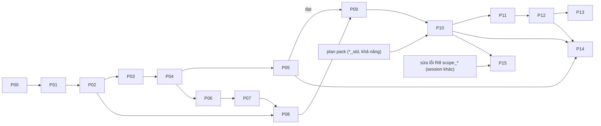

# Đóng gói report thành sản phẩm

## Tổng quan

Plan này hiện thực §8 của [report-product-design.md](../261013-1751-modularize-data-platform-suite/report-product-design.md) (v2). Mọi quyết định ở §11 của thiết kế đã được user chốt ngày 14/10/2026 và được áp nguyên văn; plan không mở lại quyết định nào. Plan thay thế plan `260528-1325-tool-agnostic-design-spec` (đã đánh dấu superseded) và kế thừa D1–D8 của plan đó theo §10 thiết kế.

Mục tiêu của sản phẩm là cài bộ report chuẩn cho bất kỳ khách nào và làm được report riêng cho từng khách bằng cùng bộ công cụ. Fine Japan (FJ) là khách đầu tiên và đang dùng dashboard hằng ngày, nên mọi bước chạm prod đều đi qua runbook, bản sao lưu và so số.

Đầu vào đã đọc: thiết kế v2, 5 báo cáo hội đồng (`../261013-1751-modularize-data-platform-suite/reports/report-council/`), 3 tài liệu tham chiếu (`../261013-1751-modularize-data-platform-suite/references/reports/`), [roadmap](../261013-1751-modularize-data-platform-suite/roadmap.md) (Đợt 7 và "Việc vận hành độc lập"), plan 260528 (D1–D8, định dạng spec), và mã nguồn thật của `.skills/{analytics-design,metabase-automation,evidence-automation}`, `evidence/`, `rill/`, `docs/operations/deployment.md` §"Metabase: backup and restore".

## Yêu cầu thiết kế và tài liệu hoá (bắt buộc ở mọi phase)

**Làm tới đâu, thiết kế và tài liệu hoá chi tiết tới đó** (yêu cầu của user 13/10/2026). Mỗi phase cập nhật mục "Analytics (report)" mới trong `docs/architecture/modules.md` và README của module `analytics/` trước khi viết code, và tài liệu đi cùng commit với code. Phase file liệt kê tài liệu phải cập nhật ở đầu file.

## Quy tắc vận hành prod (bắt buộc)

1. Dashboard Metabase và trang Evidence được dùng hằng ngày. Không làm trên checkout prod; mọi thay đổi code đi qua nhánh và runbook `docs/operations/deployment.md` §"Refactor deploys (shadow-verified)". Session thực thi tự deploy prod theo runbook **sau khi user duyệt giờ** (roadmap, user chốt 14/10).
2. Không deploy trong khung nightly 02:30–04:00, không deploy khi nightly đang đỏ vì lý do khác (quy tắc đóng băng), và tránh sáng thứ Hai 07:00–10:00 (giờ xem báo cáo tuần).
3. **Không bao giờ ghi vào Metabase prod** nếu chưa có bản sao H2 nguội ngay trước đó (`scripts/backup/metabase_cold_backup.sh pre-deploy`, runbook `deployment.md` §"Before a deploy that writes to Metabase") và một kế hoạch `--plan` đã được duyệt. Từ phase 07 deployer tự chặn điều này bằng máy.
4. Container Evidence chỉ được tạo lại (recreate) hay build lại image vào giờ thấp điểm do user chọn. Lần `docker compose build evidence` đầu tiên sau khi ghim phiên bản (main `c2915881`) vẫn chờ user chọn giờ; plan này không cần build lại image Evidence (chỉ đổi `command` và volume trong compose).
5. Không đổi tên bảng/view/cột public. Không đổi một con số nào trên dashboard FJ, trừ các thay đổi đã được user duyệt riêng (phase 00 và 09).
6. Không đặt ID plan, số phase, mã finding vào comment code, tên test, tên migration hay commit message; mô tả bất biến hoặc hành vi trực tiếp.
7. Không đọc `.env*` hay secret. Webhook, API key, mật khẩu chỉ đọc qua biến môi trường hoặc file trong `app_data/secrets/` (không vào git).
8. Mọi tiến trình dài (Metabase tạm, container thử Evidence) dùng cổng cố định, kiểm cổng trước khi chạy và dừng trong `finally` theo `.claude/rules/process-management.md`.

## Phụ thuộc ngoài plan

| Phụ thuộc | Trạng thái | Phase cần |
|---|---|---|
| Đợt 1 phase 7 (`scripts/checks/run-all.sh`, ADR, dọn shadow) | Chưa xong; phase 6 đã deploy | Phase 00 bắt đầu sau khi phase 7 đóng |
| Ghim Evidence (main `c2915881`) | ✅ | 03, 04 |
| Backup Metabase: xuất API hằng đêm + bản sao H2 nguội trước mỗi deploy (main `82368d21`) | ✅ | 07 trở đi |
| Hai lỗi số (Rill `scope_*`; `channel_net_profit` coi thiếu giá vốn là 0) | Session thực thi sửa riêng sau Đợt 1, qua gate S | Plan này **không sửa lại**; phase 00 chỉ tham chiếu. Phase 15 (Rill) chờ lỗi Rill được sửa |
| Cơ chế pack + lớp ánh xạ nhãn → mã chuẩn (`plans/261014-2225-pack-mechanism/`, đang viết song song) | Chưa có | Chỉ phase 10 trở đi. **Thí điểm Weekly Pulse (00–05) không phụ thuộc** `*_std` hay khả năng dữ liệu |

## Phases

| # | Phase | File | Effort | Phụ thuộc | Đổi số? | Chạm prod |
|---|---|---|---|---|---|---|
| 00 | Bảng so sánh định nghĩa 3 nguồn; mỗi chỗ lệch là một quyết định riêng | [phase-00](phase-00-definitions-comparison.md) | 1.5d | Đợt 1 phase 7 | Không (chỉ quyết định) | Đọc |
| 01 | Registry tối thiểu (chỉ tiêu Weekly Pulse dùng) + JSON Schema + validator | [phase-01](phase-01-metric-registry-minimal.md) | 2d | 00 | Không | Không |
| 02 | Spec v2 + catalog tối thiểu cho Weekly Pulse | [phase-02](phase-02-spec-v2-weekly-pulse.md) | 1.5d | 01 | Không | Đọc |
| 03 | Spike tương lai Evidence + renderer Evidence | [phase-03](phase-03-evidence-spike-and-renderer.md) | 3d | 02 | Không | Không |
| 04 | Build theo lịch sau nightly + lớp đăng nhập + tin tóm tắt (kênh thử) | [phase-04](phase-04-evidence-scheduled-build-auth-summary.md) | 3d | 03 | Không | Có |
| 05 | **Thí điểm Weekly Pulse trên Evidence**, 4 chu kỳ tuần | [phase-05](phase-05-weekly-pulse-pilot.md) | 1d + 4 tuần lịch | 04 | Không (so số) | Có |
| 06 | Deployer Metabase an toàn I: sửa D1–D4, harness Metabase tạm | [phase-06](phase-06-metabase-deployer-guards.md) | 2d | 04 | Không | Không |
| 07 | Deployer Metabase an toàn II: sổ deploy, drift, `--plan`, snapshot, khoá, runbook | [phase-07](phase-07-metabase-deployer-ledger-drift.md) | 3.5d | 06 | Không | Đọc |
| 08 | Renderer Metabase + tra field + cài một lệnh | [phase-08](phase-08-metabase-renderer-one-command-install.md) | 3d | 02, 07 | Không | Không |
| 09 | Tham số doanh thu (preset, VAT, doanh thu đã giao, `fact_revenue_events`) + áp các quyết định đổi số đã duyệt | [phase-09](phase-09-revenue-parameters-and-definition-decisions.md) | 3d | 05 (đạt), 08 | **Có** (chỉ mục đã duyệt) | Có |
| 10 | Catalog chuẩn đầy đủ, mở khoá theo khả năng, registry toàn bộ, `metrics.md` sinh ra, `contract: enforced` | [phase-10](phase-10-catalog-capabilities-contracts.md) | 4d | 09, plan pack | Không | Có |
| 11 | Hồ sơ + overlay khách, collection "Tự làm", report riêng qua cùng đường, 2 report tiện ích, lần ghi Metabase prod đầu tiên | [phase-11](phase-11-tenant-overlay-utilities.md) | 3d | 10 | Không | Có |
| 12 | Report tác nghiệp trên Metabase, chuyển giao FJ giữ id, gộp bản trùng, phần riêng FJ sang overlay | [phase-12](phase-12-operational-reports-fj-cutover.md) | 4d | 11 | Không | Có |
| 13 | Trang chủ vai trò, phân quyền theo chức năng, cờ nhạy cảm chi phí, 2 bộ persona | [phase-13](phase-13-home-pages-permissions-personas.md) | 3d | 12 | Không | Có |
| 14 | Chuyển dần report định kỳ còn lại từ Metabase sang Evidence | [phase-14](phase-14-periodic-reports-to-evidence.md) | 5d | 05, 10, 12 | Không | Có |
| 15 | Rill sinh measure từ registry | [phase-15](phase-15-rill-from-registry.md) | 2.5d | 10, lỗi Rill đã sửa | Không (lệch còn lại cần user duyệt) | Có |

Thứ tự theo §8 thiết kế: thí điểm Evidence (00–05) đi trước deployer Metabase. Phase 06–08 bắt đầu sau khi phase 04 xong và chạy trong 4 tuần lịch của phase 05 (khác file: `.skills/metabase-automation/` so với `analytics/renderers/evidence*`, `orchestration/reports/`). **Catalog lớn, trang chủ, persona mẫu (10–14) chỉ bắt đầu sau khi thí điểm đạt** (thiết kế §8).



## Sở hữu file khi chạy song song (phase 05 với 06–08)

| Vùng | Chủ trong lúc thí điểm | Quy tắc cho phase chạy song song |
|---|---|---|
| `analytics/registry/**`, `analytics/specs/ceo_weekly_pulse.yml`, `analytics/renderers/evidence.py` | 05 | Phase 06–08 không sửa |
| `analytics/compiler/**` | 05 | Phase 08 chỉ thêm bảng ánh xạ relation cho Metabase; test golden render Evidence phải không đổi. Thay đổi nào làm đổi bản render Evidence thì đếm lại chu kỳ thí điểm từ đầu |
| `analytics/compare/harness.py` | 05 | Phase 08 thêm `--engine metabase` sau khi harness của 05 đã merge; chạy lại tự so (mốc với chính nó) trước khi dùng |
| `orchestration/reports/**`, `evidence/**`, `docker-compose.yml` | 04–05 | Phase 06–08 không sửa |
| `.skills/metabase-automation/**`, `analytics/renderers/metabase_ir.py`, `tenants/_test/**` | 06–08 | Phase 05 không sửa |

## Kiến trúc đích sau plan

```text
analytics/                                   # module code mới (Python), có phiên bản cùng sản phẩm
  README.md
  schema/*.schema.json                       # semantic model, metric, report spec v2, catalog, tenant profile/overlay, persona
  registry/semantic/*.yml                    # lớp ngữ nghĩa: mart, grain, trục thời gian, join một bước, measure, gate
  registry/metrics/*.yml                     # lớp chỉ tiêu: simple | ratio | derived | snapshot
  registry/presets/{nhu_sapo,theo_ke_toan}.yml
  catalog/catalog.yml                        # report: id, cell, primary_cell, engine, metrics, kpi_tiles, spec, status
  specs/<report_id>.yml                      # spec v2 (mỗi report một file)
  personas/{shop_nho,doanh_nghiep_vua}.yml
  compiler/                                  # nạp, kiểm, biên dịch metric → SQL DuckDB (giới hạn cứng)
  renderers/{evidence,metabase_ir,docs,message,rill}.py
  compare/                                   # so số theo card trên cùng bản chụp DuckDB
  tests/                                     # pytest: schema, golden SQL, tất định
tenants/fine_japan/analytics/                # hồ sơ, overlay, report riêng, sổ deploy (tạm trong repo; sẽ sang repo cấu hình riêng)
evidence/areas/<area>/                       # trang + source sinh ra cho từng khu vực quyền
evidence/scripts/build-areas.sh              # builder: build khi có yêu cầu, đổi bản build nguyên tử
evidence/site/Caddyfile                      # sinh ra: basic_auth theo khu vực
orchestration/reports/                       # Dagster: yêu cầu build sau nightly, theo dõi kết quả, tin tóm tắt, so số thí điểm
.skills/metabase-automation/                 # deployer an toàn (deployConfig, sổ deploy, drift, plan, snapshot, khoá, tra field)
scripts/checks/check_analytics_registry.py   # validator, chạy trong run-all.sh
docs/analytics-handbook/semantic/metrics.md  # sinh ra từ registry (từ phase 10)
```

Luồng dữ liệu: mart dbt (giữ dữ liệu thô) → registry + hồ sơ khách (tham số ghi tường minh) → compiler sinh SQL theo spec → (a) renderer Evidence ghi trang + source vào `evidence/areas/`, builder build sau nightly thành trang tĩnh sau lớp đăng nhập; (b) renderer Metabase sinh IR JSON đúng dạng `markdown_parser` trả về → deployer an toàn ghi qua API; (c) renderer tin nhắn chạy SQL thẻ KPI, gửi Lark kèm link; (d) renderer docs sinh `metrics.md` và chú giải.

## Quyết định áp dụng (từ §11 thiết kế, không mở lại)

| # | Quyết định | Phase hiện thực |
|---|---|---|
| 1 | `net_revenue` hiện tại → `net_sales` (alias, không đổi số); `net_revenue` = `net_sales` − hàng hoàn | 01 (id, alias), 09 (`net_revenue` mới) |
| 2 | Mặc định doanh thu §4 ①; 2 preset "Như Sapo" (mặc định) / "Theo kế toán"; tham số VAT; chỉ tiêu "doanh thu đã giao" | 09 |
| 3 | Evidence cho report định kỳ (build sau nightly), Metabase cho report tương tác; thí điểm Weekly Pulse trên Evidence; lớp đăng nhập | 03–05, 14 |
| 4 | Phân quyền theo chức năng (≤ 7 nhóm) + cờ `cost_sensitive`; không phân quyền theo dòng ở v1 | 01 (cờ), 04 (khu vực), 13 |
| 5 | Chuyển FJ (Metabase): chạy song song, so số, ghi đè vào dashboard/card cũ để giữ id | 12 |
| 6 | Tin tóm tắt (Lark/Zalo/Telegram qua notifier sẵn có) làm cùng thí điểm | 04, 05 (chỉ Lark: notifier hiện chỉ có Lark) |
| 7 | 2 bộ persona: "shop nhỏ" (Chủ shop + Nhân viên), "doanh nghiệp vừa" (Giám đốc, Kế toán, Marketing, Trưởng bán hàng, Kho/vận hành, CSKH) | 13 |
| 8 | Backup Metabase | ✅ đã làm (main `82368d21`); phase 07 cưỡng chế bằng máy |
| 9 | `contract: enforced` chỉ cho mart mà registry/report chuẩn dựa vào | 10 |
| 10 | Plan 260528 superseded | ✅ đã đánh dấu; phase 02 sửa các tài liệu skill còn trỏ tới nó |

Kế thừa plan 260528: D1 (spec → API trực tiếp; IR trong bộ nhớ thay blueprint file), D2 (`metric_ref` + `inline_sql` có khai báo cột), D3 (capture-first: mốc là dashboard đang chạy), D4 (`spec_version`), D5 (deployer theo công cụ), D7 (JSON Schema từ đầu), D8 (`analytics-design` sở hữu định dạng spec), D6 (badge portability, ưu tiên thấp: renderer báo `native | fallback | unsupported` cho từng viz).

## Acceptance Criteria (đo được)

1. **Cài một lệnh lên Metabase mới:** `python -m analytics install --tenant <t> --target <metabase tạm mới tạo>` cài toàn bộ report có `engine: metabase` trong catalog của khách, không thao tác tay; exit 0; mọi card chạy `POST /api/card/:id/query` không lỗi. Kiểm trong harness Metabase tạm (phase 08, lặp lại ở phase 11 với catalog đầy đủ).
2. **Chạy lại không đổi gì:** lần chạy thứ hai `--plan` in 0 thay đổi; `--apply` không gửi PUT/POST nào; id và `updated_at` của mọi object giữ nguyên.
3. **Report riêng qua cùng đường:** một report riêng của khách (spec trong `tenants/<t>/analytics/reports/`) đi qua đúng lệnh ở (1), qua cùng validator, cùng so số, cùng `--plan`.
4. **Thí điểm Weekly Pulse:** cả 30 card của bản Evidence mới khớp blueprint đang chạy trên 4 chu kỳ tuần đã đóng liên tiếp, có ít nhất một lần qua ranh giới tháng; kết quả so số tự động lưu cho từng ngày.
5. **Bảo mật trang tĩnh:** mọi trang và mọi file dữ liệu trích của từng khu vực trả 401 khi không đăng nhập hoặc đăng nhập sai khu vực; không còn cổng host nào phục vụ Evidence bỏ qua lớp đăng nhập; build của khu vực không có quyền xem chi phí không chứa id metric `cost_sensitive` nào (kiểm bằng grep bản build).
6. **An toàn Metabase prod:** mọi lần ghi có bản sao H2 nguội và kế hoạch đã duyệt (ghi trong sổ deploy); kiểm kê trước/sau cho thấy không object nào ngoài collection được phép bị đổi; drift được chặn đúng một lần thử trên Metabase bóng.
7. `scripts/checks/check_analytics_registry.py` chạy trong `scripts/checks/run-all.sh`; sinh lại `metrics.md` không có diff.
8. Số liệu FJ không đổi, trừ danh sách đổi số đã được user duyệt ở phase 00/09.

## Rủi ro chính

| Rủi ro | Khả năng × Tác động | Giảm thiểu |
|---|---|---|
| Deployer ghi đè dashboard FJ đang dùng (D1, D2) | Cao × Cao | Phase 06 sửa trước mọi lần ghi; phase 07 chỉ đụng object trong sổ deploy và collection được phép |
| Lộ dữ liệu qua trang tĩnh (file dữ liệu trích tải về trình duyệt, cổng 3006 mở trên host) | Cao × Cao | Phase 04: một build riêng cho mỗi khu vực, basic_auth theo khu vực ở `report_site`, bỏ cổng host, source chỉ chứa kết quả card |
| Registry phình thành semantic layer tự chế | Trung bình × Cao | Giới hạn cứng của compiler (phase 01); vượt giới hạn thì làm trong dbt |
| Lệch số do định nghĩa ngầm (`is_active_order`, `count(*)` vs distinct, `current_date`) | Cao × Trung bình | So số theo từng card trên cùng bản chụp, thay `current_date` bằng `as_of` cố định (phase 05) |
| Build Evidence hỏng sau nightly, trang cũ hiển thị như mới | Trung bình × Trung bình | Builder giữ bản trước, ghi `status.json`; Dagster cảnh báo; trang có dải "dữ liệu đến hết ngày …" |
| Evidence legacy ngừng phát triển | Trung bình × Trung bình | Phase 03 spike, ghi quyết định; spec v2 không phụ thuộc engine nên đổi engine không phải viết lại |
| `contract: enforced` làm nightly dừng khi cột lệch | Thấp × Cao | Chỉ mart registry dựa vào; gate M; rollback = gỡ config |
| Tin tóm tắt lộ lợi nhuận vào nhóm chat rộng | Trung bình × Cao | Kênh có cờ `can_view_cost`; thẻ `cost_sensitive` không vào kênh không có quyền |

**Điều kiện dừng thí điểm** (thiết kế §7, áp cho Evidence): một lần builder hoặc job ghi ra ngoài thư mục build/kết quả của nó, hoặc bất kỳ ghi nào vào Metabase trong lúc thí điểm; một chỉ tiêu vẫn lệch sau 2 vòng sửa mà không giải thích được bằng quyết định đã duyệt; > 30% card cần `inline_sql`; công sức phase 00–05 vượt 2 lần ước lượng (ước lượng 12 ngày công, dừng ở 24); một sự cố prod truy được về việc này; render hay build lại trên cùng bản chụp vẫn ra kết quả khác. Khi dừng: FJ giữ blueprint và trang hiện tại, công cụ mới chỉ dùng cho khách mới.

## Rollback chung

Mỗi phase có mục Rollback riêng. Nguyên tắc: code revert theo runbook; Metabase khôi phục bằng snapshot JSON của lần deploy (phase 07) rồi tới bản sao H2 nguội; Evidence quay lại bản build trước bằng symlink `current`; dbt relation mới thì xoá view serving trong khung có dừng Metabase.

## Liên kết

- [Thiết kế v2](../261013-1751-modularize-data-platform-suite/report-product-design.md) · [Roadmap](../261013-1751-modularize-data-platform-suite/roadmap.md) · [Hội đồng](../261013-1751-modularize-data-platform-suite/reports/report-council/) · [Tham chiếu](../261013-1751-modularize-data-platform-suite/references/reports/)
- [Plan 260528 (superseded)](../260528-1325-tool-agnostic-design-spec/plan.md) · Plan cơ chế pack: `../261014-2225-pack-mechanism/` (đang viết)
- Runbook: `docs/operations/deployment.md` §"Refactor deploys (shadow-verified)", §"Metabase: backup and restore"

## Câu hỏi còn mở cho user

1. **Giá trị cụ thể của hai preset.** Thiết kế chốt tên và mặc định §4 ①, nhưng chưa chốt VAT trong preset "Như Sapo" (Sapo hiển thị giá gồm VAT; mart FJ tách VAT) và trục ghi nhận của "Theo kế toán" (ngày giao thành công?). Phase 09 đề xuất: "Như Sapo" = ngày tạo đơn, giá gồm VAT; "Theo kế toán" = ngày giao thành công, chưa VAT. FJ không bị ảnh hưởng vì hồ sơ FJ ghi tường minh tham số hôm nay. Cần user xác nhận trước phase 09.
2. **Tài khoản đăng nhập trang Evidence:** mỗi người một tài khoản (thu hồi được từng người, đề xuất) hay một tài khoản chung cho mỗi nhóm chức năng?
3. **Truy cập từ điện thoại ngoài LAN:** link trong tin tóm tắt chỉ mở được trong mạng nội bộ (`*.lan.fwg.vn`). Có mở truy cập từ xa cho người xem (Cloudflare Tunnel đang có sẵn trong compose nhưng tắt) không, hay tin nhắn tự đủ thông tin?
4. **Nhóm chat nhận tin tóm tắt Weekly Pulse** là nhóm nào, và nhóm đó có được xem lợi nhuận không (quyết định thẻ Net Profit, Gross Margin có vào tin hay không)?
5. **Repo cấu hình riêng cho hồ sơ/overlay khách:** tạm đặt ở `tenants/fine_japan/analytics/` trong repo này; user muốn tạo repo riêng ngay (phase 11) hay đợi khách thứ hai?
6. **Vị trí file JSON Schema của spec v2:** D8 nói `analytics-design` sở hữu định dạng spec (plan 260528 đặt file ở `.skills/analytics-design/schemas/`). Plan này đặt mọi schema trong `analytics/schema/` để validator và sản phẩm đóng gói cùng nhau, còn skill `analytics-design` sở hữu hướng dẫn, template và giữ liên kết tới schema. User có đồng ý cách hiểu D8 này không?
7. **Bộ 7 report ngày đầu cho khách mới** (thiết kế §6) ánh xạ sang mã catalog: đề xuất SAL-D, EXE-W, SAL-W, SAL-M, CUS-M, INV-W, FIN-M (lãi gộp theo giá vốn Sapo, cờ chi phí) + UTL-1, UTL-2. Cần user chốt ở phase 10.
8. **Trần công sức thí điểm:** thiết kế ghi "vượt 2 lần ước lượng (~10 ngày)". Plan ước lượng phase 00–05 là 12 ngày công (thêm lớp đăng nhập, build theo lịch, tin tóm tắt) và đặt điểm dừng ở 24 ngày công. User có đồng ý không?


## Đã chốt (user, 14/10/2026 ~22:46)

- Preset "Như Sapo" = ghi nhận ngày tạo đơn, giá gồm VAT; "Theo kế toán" = ghi nhận ngày giao thành công, chưa VAT. Hồ sơ FJ ghi tường minh tham số hôm nay.
- Hồ sơ khách tạm trong repo này (`tenants/`), tách repo cấu hình riêng khi có khách thứ hai.
- Schema ở `analytics/schema/`; skill `analytics-design` giữ hướng dẫn và template (cách hiểu D8).
- 7 report ngày đầu: SAL-D, EXE-W, SAL-W, SAL-M, CUS-M, INV-W, FIN-M + 2 report tiện ích.
- Điểm dừng công sức thí điểm: 24 ngày công.
- Tin tóm tắt: chỉ Lark trước; Zalo/Telegram để Đợt 8.
- Chặn lộ dữ liệu Evidence (bỏ cổng host 3006, basic_auth qua Caddy) làm **ngay** như việc vận hành độc lập, trước plan này; phase 04 của plan vẫn làm phần thu nhỏ dữ liệu trong bản build và phân khu theo chức năng.
- Truy cập trang Evidence: **chỉ LAN + Tailscale** (ai cần xem từ xa cài app Tailscale); không mở ra Internet.
- Tin tóm tắt Weekly Pulse: gửi **nhóm Lark ban lãnh đạo, có đủ lợi nhuận/biên**. Tên nhóm Lark cụ thể: hỏi user khi làm phase 04 (hoặc tạo nhóm mới).
- Tài khoản đăng nhập Evidence: **mỗi người một tài khoản** (basic_auth Caddy theo khu vực chức năng; thu hồi theo người; log biết ai xem). Mật khẩu do user tự đặt bằng lệnh `!`, không hiển thị trong chat.
