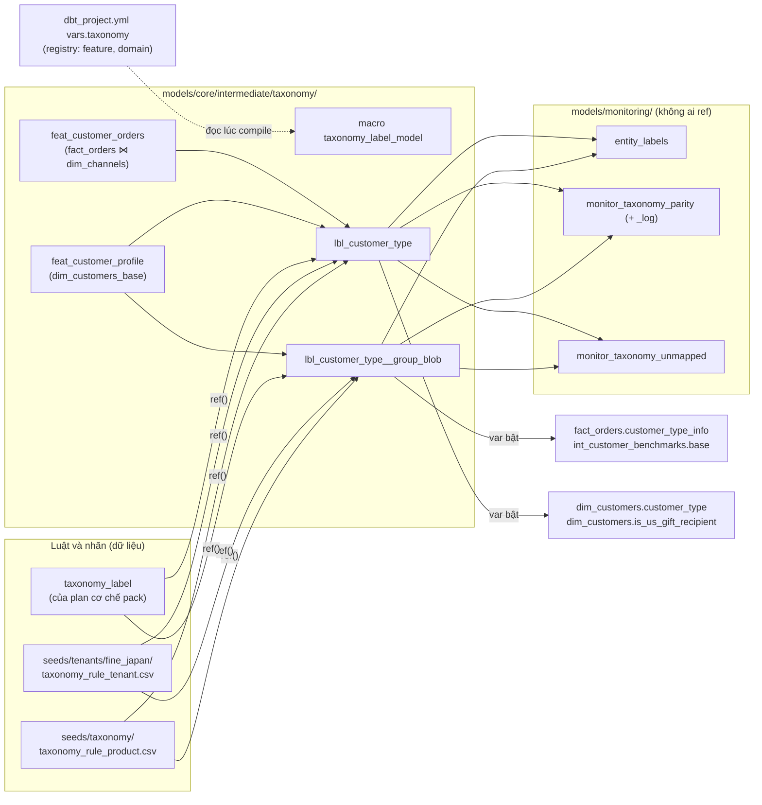

# Bộ máy phân loại: MVP + thí điểm `customer_type`

## Kết quả mong muốn

Sau plan này, `customer_type` của Fine Japan (hai logic: bản `dim_customers` và bản dùng chung của `fact_orders`/`int_customer_benchmarks`) được tính bằng **luật dạng dữ liệu** (seed CSV trong thư mục tenant) qua một macro chung, thay cho ba khối `CASE` viết tay. Mọi bảng public cho ra **đúng từng giá trị như hôm nay** (golden 83/83, 0 khác biệt), kể cả `is_us_gift_recipient` có thể NULL. Bộ máy hỗ trợ ba hit policy FIRST/UNIQUE/COLLECT, hai lớp luật (mặc định sản phẩm + riêng doanh nghiệp), chế độ restate, và có truy vấn liệt kê giá trị thô chưa phân loại kèm doanh thu. Đường SQL cũ được giữ sau một biến `var` 30 ngày rồi mới xoá.

Nguồn quyết định (bắt buộc tuân theo): [taxonomy-engine-design.md](../261013-1751-modularize-data-platform-suite/taxonomy-engine-design.md) §6, §7, §8 (v2, đã duyệt 14/10/2026); tổng hợp phản biện [synthesis.md](../261013-1751-modularize-data-platform-suite/reports/taxonomy-review/synthesis.md); bản phản biện kỹ sư dữ liệu [review-data-architect.md](../261013-1751-modularize-data-platform-suite/reports/taxonomy-review/review-data-architect.md) (phác thảo SQL §A.4) và vận hành [review-ops-risk.md](../261013-1751-modularize-data-platform-suite/reports/taxonomy-review/review-ops-risk.md) (cổng G1–G4 §e).

## Phụ thuộc và thứ tự

| Phụ thuộc | Vì sao | Trạng thái 14/10/2026 |
|---|---|---|
| Đợt 1 đóng ([plan 261013](../261013-1751-modularize-data-platform-suite/plan.md), phase 7 xong) | Thiết kế §7 và §8 #2: bộ máy là plan riêng sau Đợt 1; phase 7 xoá worktree và shadow, plan này dựng lại từ backup mới | Phase 6 đã commit trên nhánh (`64103e50`), phase 7 chưa làm |
| Plan cơ chế pack ([261014-2225-pack-mechanism](../261014-2225-pack-mechanism/)) đã deploy | Roadmap "Thứ tự ưu tiên sau Đợt 1" mục 1: bảng ánh xạ nhãn → mã chuẩn `taxonomy_label` do plan đó tạo; bộ máy **đọc lại bảng đó**, không tạo bảng nhãn thứ hai | Đang viết song song, chưa có file khi lập plan này |
| Report chuẩn (roadmap mục 2) | Không chặn. Bộ máy chạy song song với phần hiện thực report; sau pilot, domain tiếp theo chọn theo danh mục report | — |

**Mốc dự phòng (thiết kế §7):** khoảng 6 tuần sau khi Đợt 1 đóng mà `customer_type` chưa chạy song song trên prod (phase 6 của plan này chưa bắt đầu) thì quay lại phương án tách các khối `CASE` thành macro nguyên văn. Với ước lượng dưới đây, phase 6 bắt đầu khoảng 1,5–2 tuần sau ngày khởi động plan, nên plan phải khởi động trong khoảng 4 tuần sau khi Đợt 1 đóng.

## Ràng buộc bắt buộc (từ thiết kế §6–§7)

1. Mỗi domain một model dbt `lbl_<domain>`, nội dung sinh từ một macro chung. Dữ liệu luật đọc qua `ref()` và join trong SQL; **không** `run_query` lúc compile. Registry domain là YAML đọc lúc compile (không phải seed, vì seed vỡ trên lake trống và trong `dbt parse`).
2. `entity_labels` là view `UNION ALL` các `lbl_*`; **không mart nào `ref` nó**.
3. Pilot là **hai domain**: `customer_type` (logic `dim_customers`: mã/tên nhóm đã parse + tín hiệu đơn kênh `US`) và `customer_type__group_blob` (logic `fact_orders` ≡ `int_customer_benchmarks`: `LIKE` trên blob JSON, không có tín hiệu US).
4. Giữ nguyên ngữ nghĩa cũ: toán tử `like` thật (`_` là wildcard), đặc trưng thô chưa chuẩn hoá, mặc định `RETAIL` (không phải `UNKNOWN`), logic SQL ba giá trị (không `bool_and`), `is_us_gift_recipient` có thể NULL, thứ tự ưu tiên WHOLESALE > PARTNER > STAFF > KOL > CROSSBORDER > RETAIL, CROSSBORDER qua đặc trưng "có đơn trên nguồn `US`".
5. Không thêm cột vào mart public trong pilot (golden so thứ tự cột). `label_std` chỉ sống trong `lbl_*` và `entity_labels`.
6. Golden 83/83 phải 0 khác biệt; compiled SQL **sẽ** khác (gate dùng `--allow-code-change`), nên bù bằng dbt unit test cho ca biên.
7. MVP: FIRST/UNIQUE/COLLECT; hai lớp luật; chỉ restate; luật là seed CSV trong thư mục tenant, đi qua git + gate. Restate phải kèm full-refresh các model incremental phía sau.
8. Lộ trình prod: shadow → 14 đêm chạy song song trên prod chưa nối mart → chuyển cột mart, giữ đường SQL cũ sau `var` 30 ngày → xoá đường cũ.

## Kiến trúc tóm tắt

Luồng dữ liệu: `std_*` → `dim_customers_base` / `fact_orders` → model đặc trưng (cột thô, không chuẩn hoá) → `lbl_<domain>` (đánh giá điều kiện ba giá trị, chọn luật theo hit policy, gắn `label_std`, `rule_id`, `source_layer`, `ruleset_version`) → mart đọc khi `var('taxonomy_engine_customer_type')` bật; khi tắt, mart chạy nguyên SQL cũ và `lbl_*` không phải tổ tiên của mart.

Quyết định kỹ thuật chốt trong plan (lý do ở từng phase):

| Quyết định | Chọn | Phase |
|---|---|---|
| Registry YAML đọc lúc compile | Khoá `vars.taxonomy` trong `transformation/dbt_project.yml` (dbt không đọc được file YAML tuỳ ý trong Jinja; `vars` có sẵn lúc parse nên `ref()` sinh ra được ghi vào DAG; validator Python đọc cùng file) | 1 |
| Bảng luật | Một seed dạng dài mỗi lớp (`taxonomy_rule_product`, `taxonomy_rule_tenant`); nhiều dòng cùng `rule_id` = AND; dòng không có `feature` = luật luôn đúng (dùng làm mặc định `RETAIL`); `enabled=false` trên một `rule_id` = tắt luật đó ở mọi lớp | 1 |
| Thứ tự trộn lớp | Lớp tenant xét trước lớp sản phẩm; trong lớp theo `priority`, rồi `rule_id` (tất định) | 2 |
| Materialization `lbl_*`, `feat_*` | `table` (tiền lệ `int_customer_benchmarks`), không để layer `intermediate` biến thành `external` | 2–3 |
| `entity_labels` và các monitor | Bucket `monitoring`: `check_boundaries.py` cấm core/pack đọc monitoring, nên "không mart nào ref" được cưỡng chế bằng công cụ có sẵn | 3–4 |
| Hai đường SQL | ``; khi `false`, `ref('lbl_*')` không được ghi vào DAG nên lỗi của bộ máy không thể làm SKIP mart trong 14 đêm chạy song song | 4 |
| Đối chiếu song song | `monitor_taxonomy_parity` giữ bản sao **đúng từng ký tự** của các khối cũ (cùng sha256, ghi vào `taxonomy_inventory.yaml`) để tiếp tục so trong 30 ngày sau khi chuyển cột | 4 |

## Phases

| # | Phase | File | Effort | Phụ thuộc | Gate | Deploy prod | Đổi số |
|---|---|---|---|---|---|---|---|
| 1 | Nền: registry, schema luật, validator, dựng lại shadow | [phase-01](phase-01-registry-rule-schema-validator.md) | 0.75d | Đợt 1, plan pack | M `--allow-new` | Không | Không |
| 2 | Macro bộ máy: FIRST/UNIQUE/COLLECT, ba giá trị, lớp, `ruleset_version`, selftest | [phase-02](phase-02-engine-macro.md) | 2d | 1 | S `--allow-new` + unit test selftest | Không | Không |
| 3 | Pilot: đặc trưng, luật Fine Japan, hai domain `customer_type`, unit test ca biên | [phase-03](phase-03-customer-type-domains.md) | 1.25d | 2 | S `--allow-new` + đối chiếu trên shadow | Không | Không |
| 4 | Nối mart sau `var` (mặc định tắt), monitor đối chiếu và giá trị chưa phân loại, golden với `var` bật | [phase-04](phase-04-mart-wiring-behind-var.md) | 1d | 3 | S `--allow-new` (var tắt) và S `--allow-new --allow-code-change` (var bật, commit nháp) | Không | Không |
| 5 | Quy trình restate (đổi luật → full-refresh phía sau) | [phase-05](phase-05-restate-procedure.md) | 0.5d | 4 | M (chỉ tài liệu) | Không | Không |
| 6 | Chạy song song trên prod 14 đêm (var tắt) | [phase-06](phase-06-prod-parallel-run.md) | 0.75d công + 14 đêm | 5 | Gate S của phase 4 trên commit deploy | **Có** (lần 1) | Không |
| 7 | Chuyển cột mart sang bộ máy (bật var), giữ đường cũ 30 ngày | [phase-07](phase-07-cutover.md) | 0.5d công + 30 ngày | 6 | S `--allow-code-change` | **Có** (lần 2) | Không |
| 8 | Xoá đường SQL cũ, monitor đối chiếu và `var` | [phase-08](phase-08-remove-legacy-path.md) | 0.75d | 7 | S `--allow-code-change` | **Có** (lần 3) | Không |

Các phase làm **tuần tự** (mỗi phase dùng kết quả phase trước, nhiều phase cùng sửa `dbt_project.yml` và `model_buckets.yaml`), nên không có hai phase song song nào đụng cùng file. Phase 1–5 nằm trên nhánh, chỉ lên prod cùng nhau ở phase 6.

**Công sức:** 7.5 ngày công, nằm trong khoảng 7–9 ngày của thiết kế. Thời gian lịch tối thiểu khoảng 8 tuần (1,5 tuần làm phase 1–5, 14 đêm, 30 ngày giữ đường cũ, rồi phase 8). Đồng hồ của tiêu chí dừng "quá 5 ngày công chưa đạt golden 0 khác biệt" tính từ đầu phase 1 tới cuối phase 4; ước lượng phase 1–4 là đúng 5 ngày, **không có dư**. Vì vậy cuối phase 3 (4 ngày) phải đối chiếu `lbl_*` với SQL cũ trên shadow; nếu còn khác biệt chưa rõ nguyên nhân thì báo user ngay thay vì chờ chạm mốc.

## Lộ trình lên prod (bốn cổng của thiết kế §7)

| Cổng | Phase | Điều kiện qua cổng |
|---|---|---|
| G1 Shadow | 1–5 | Unit test pass; đối chiếu `lbl_*` với SQL cũ = 0 dòng trên hai bộ dữ liệu khác ngày; golden 83/83 0 khác biệt với `var` bật (commit nháp) |
| G2 Song song trên prod | 6 | 14 đêm liên tiếp `monitor_taxonomy_parity_log` không có khác biệt; có đêm khác biệt thì đếm lại từ 0; reset hai lần thì quay về G1. Thời gian và RAM trong ngưỡng |
| G3 Chuyển cột | 7 | Gate S 0 khác biệt; deploy theo runbook; theo dõi 30 ngày |
| G4 Dọn | 8 | 30 ngày không quá một sự cố quy cho bộ máy |

Mọi lần đụng prod theo runbook `docs/operations/deployment.md` § "Refactor deploys (shadow-verified)" (thay tên nhánh `refactor/modularize-suite` trong lệnh bằng nhánh của plan này): chụp trạng thái schedule, dừng `data_platform`, commit seed đang sống, fast-forward, start, kiểm tra, theo dõi nightly. **Không deploy trong khung 02:30–04:00** và không deploy khi nightly đang đỏ vì lý do khác.

## Ma trận kiểm thử

| Mức | Cái gì | Ở đâu | Phase |
|---|---|---|---|
| Validator luật (trước khi nạp) | Domain, đặc trưng, toán tử theo kiểu, nhãn đã khai báo, `rule_id`/priority trùng, luật tắt trỏ đúng, luật không điều kiện trong COLLECT | `scripts/checks/check_taxonomy_rules.py` + pytest (gate bước 5) | 1 |
| dbt unit test bộ máy | Từng toán tử và NULL, AND ba giá trị, FIRST/UNIQUE/COLLECT, UNMAPPED/UNKNOWN, lớp và luật tắt, `matched__<nhãn>`, `ruleset_version` đổi khi luật đổi | Domain selftest, bật bằng `var('taxonomy_selftest')` | 2 |
| dbt unit test pilot | Ca biên với **luật thật** của Fine Japan (danh sách ở phase 3) | `lbl_customer_type`, `lbl_customer_type__group_blob` | 3 |
| Test dữ liệu lúc build | Một dòng mỗi khách (error), phủ đủ khách của `dim_customers_base` (error), nhãn thuộc `taxonomy_label` (error), đối chiếu song song (warn), tỉ lệ mặc định/UNMAPPED (warn) | `_taxonomy__models.yml`, `monitoring/schema.yml` | 3–4 |
| Tích hợp (shadow) | Golden 83 bảng, dbt inventory, Dagster inventory + subset run, lake trống, full-refresh | `scripts/shadow/gate.sh` | 1–8 |
| Đầu cuối (prod) | 14 đêm đối chiếu, nightly xanh, `row_trend_checks`, hai action queue CRM giữ số dòng | Runbook + `monitor_taxonomy_parity_log` | 6–8 |

## Tiêu chí nghiệm thu

1. Golden 83/83 **0 khác biệt** ở mọi gate, kể cả gate với `var` bật (phase 4, 7) và sau khi xoá đường cũ (phase 8).
2. `dim_customers.customer_type`, `dim_customers.is_us_gift_recipient` (gồm số dòng NULL), `fact_orders.scope_retail`, `fact_orders.scope_b2b`, `int_customer_benchmarks.benchmark_status` giống hệt trước plan; số dòng `mart_customer_action_queue` và `mart_customer_sku_action_queue` không đổi.
3. `monitor_taxonomy_parity_log` ghi 14 ngày liên tiếp với `n_label_diff = 0` và `n_flag_diff = 0` cho cả hai domain trước khi bật `var` trên prod.
4. Mọi unit test (selftest + pilot) pass; validator luật pass trên seed đã commit; `check_boundaries.py` pass; `check_taxonomy_inventory.py` không có `WARN changed`/`WARN new` ngoài những thay đổi đã cập nhật trong cùng commit.
5. Không có khối `CASE` nào gán `customer_type` trong `transformation/models/` sau phase 8; luật `customer_type` chỉ còn là dòng trong `seeds/tenants/fine_japan/taxonomy_rule_tenant.csv`.
6. Không mart nào phụ thuộc `entity_labels` hay model `monitoring` (`check_boundaries.py`).
7. Nightly không chậm thêm quá 10% hoặc 10 phút (mức nhỏ hơn), RAM đỉnh không tăng quá 20% so với số nền 7 đêm.
8. Tài liệu cập nhật cùng commit với code ở mỗi phase: `transformation/docs/TAXONOMY.md`, `docs/architecture/taxonomy-engine.md`, `docs/architecture/modules.md` (và các tài liệu phụ ghi trong từng phase).
9. Commit theo conventional commit, không có mã plan/phase trong comment, tên test hay commit message.

## Điều kiện dừng thí điểm (thiết kế §7, nguyên văn)

Rơi về SQL/macro nguyên văn nếu xảy ra bất kỳ điều nào:

1. Quá **5 ngày công** chưa đạt 0 khác biệt golden.
2. Cần **quá 3 đặc trưng** chỉ Fine Japan dùng. (Pilot dự kiến 0: `group_blob`, `group_code`, `group_name`, `channels_ordered_on` đều là đặc trưng chung.)
3. Phải dùng **SQL tự do** trong luật.
4. Nightly chậm thêm **quá 10% hoặc 10 phút** (mức nhỏ hơn), hoặc **RAM đỉnh tăng quá 20%**.
5. Sau khi chuyển cột có **hai sự cố trong 30 ngày**.
6. Tỉ lệ `UNMAPPED` + `UNKNOWN` cao hơn tỉ lệ rơi vào `ELSE` của SQL cũ.

Quy tắc đếm của G2: một đêm có khác biệt thì đếm lại 14 đêm; reset hai lần thì quay về shadow (phase 3–4) điều tra. Khi dừng: revert theo runbook về đường SQL cũ (phase 6–7) hoặc bỏ nhánh (phase 1–5), rồi làm phương án macro nguyên văn ghi ở `TAXONOMY.md` §10.

## Rủi ro chính

| Rủi ro | Khả năng × Tác động | Giảm thiểu |
|---|---|---|
| Ngữ nghĩa NULL/`LIKE` lệch trên giá trị chưa có trong dữ liệu hôm nay | Trung bình × Cao | Unit test ca biên với luật thật (phase 3); 14 đêm đối chiếu; bản sao khối cũ tiếp tục so 30 ngày sau chuyển cột |
| Lỗi bộ máy làm SKIP `dim_customers` trên prod | Thấp × Cao | Khi `var` tắt, `lbl_*` không là tổ tiên mart (kiểm trong manifest, phase 4); test mức `error` chỉ cho tính một dòng/phủ đủ/nhãn hợp lệ, còn lại `warn` |
| Hợp đồng `taxonomy_label` của plan cơ chế pack khác giả định | Trung bình × Trung bình | Phase 1 đọc plan pack và chốt tên/cột trước khi viết macro; bộ máy chỉ cần `(domain hoặc label_set, label, label_std)` |
| Nhánh sống lâu va chạm hotfix trên `main` ở `dim_customers.sql`, `fact_orders.sql`, `int_customer_benchmarks.sql` | Trung bình × Trung bình | Phase 4 sửa tối thiểu; rebase lên `main` trước mỗi gate; trước deploy chạy `git log main -- <3 file>` |
| Jinja `if` làm compiled SQL lệch khoảng trắng khi `var` tắt | Cao × Thấp | Dùng ``; nếu vẫn lệch, chạy với `--allow-code-change` và đính kèm diff chỉ gồm khoảng trắng |
| Unit test chạy trong mỗi `dbt build` của prod (mỗi 3 phút) | Trung bình × Thấp | Đo thời gian ở phase 2–3; nếu đáng kể, loại unit test khỏi prod bằng `DBT_EXCLUDE_RESOURCE_TYPES=unit_test` (đổi env, đi qua runbook) |
| Khi Đợt 2 chạy prod từ image, seed luật bị đóng gói vào image | Thấp (sau plan này) × Trung bình | Ghi vào `taxonomy-engine.md` và roadmap: thư mục seed tenant phải mount ngoài image |
| Đổi luật sau này không restate model incremental | Trung bình × Cao | Phase 5: runbook đổi luật bắt buộc full-refresh `lbl_<domain>+`; kiểm trong gate S |

## Rollback

| Phase | Rollback |
|---|---|
| 1–5 | Chưa lên prod. Bỏ hoặc revert commit trên nhánh. |
| 6 | Revert theo runbook. Còn sót bảng `lbl_*`, `feat_*`, `monitor_taxonomy_parity_log` trong DuckDB prod; không serving view nào đọc chúng nên vô hại, xoá bằng `DROP TABLE` ở lần dừng container kế tiếp. Seed luật bị revert cùng commit. |
| 7 | Đổi `taxonomy_engine_customer_type` về `false` (commit một dòng, deploy theo runbook) hoặc revert commit. Đường cũ đã chứng minh nên không cần gate mới ngoài gate M. |
| 8 | Revert commit theo runbook (đường cũ và `var` quay lại, `var` mặc định `true`). |

## Ngoài phạm vi

- Thống nhất hai logic `customer_type` (CROSSBORDER cấp đơn, `scope_retail`): đổi số, cần user duyệt riêng và cần `int_orders_resolved` trước (thiết kế §6).
- Đưa `*_std` lên mart public; chốt bộ mã chuẩn (cần dữ liệu doanh nghiệp thứ hai).
- PRIORITY, LONGEST_PREFIX, gói connector, gán tay theo đối tượng (`taxonomy_override`), Google Sheet, phân vị, chuẩn hoá chuỗi tiếng Việt, ảnh chụp tháng, `freeze_after_close`, các domain khác.
- **Ghi nhận, không sửa:** 28 dòng `ref_tag_categories` cùng priority 10 và `int_order_tags` không có quy tắc phá hoà nên nhãn tag có thể không tất định (`TAXONOMY.md` §8). Đây là việc độc lập, có thể đổi số, đi qua gate S và chờ user duyệt sau; plan này không đụng `ref_tag_categories` hay `int_order_tags`.

## Liên kết

- Thiết kế: [taxonomy-engine-design.md](../261013-1751-modularize-data-platform-suite/taxonomy-engine-design.md); bản trên nhánh `docs/architecture/taxonomy-engine.md`.
- Đặc tả hiện trạng: `transformation/docs/TAXONOMY.md` (mục `customer_type`, `is_us_gift_recipient`, §7, §10).
- Roadmap: [roadmap.md](../261013-1751-modularize-data-platform-suite/roadmap.md) "Thứ tự ưu tiên sau Đợt 1".
- Harness: `docs/operations/refactor-safety-harness.md`; runbook: `docs/operations/deployment.md#refactor-deploys-shadow-verified`.
- Plan cơ chế pack: [261014-2225-pack-mechanism](../261014-2225-pack-mechanism/).

## Đối chiếu với plan cơ chế pack (controller, 14/10/2026)

Plan `261014-2225-pack-mechanism` phase 08 làm trước plan này và đã chốt các điểm sau; plan này phải theo:

- `taxonomy_canonical` ở `transformation/seeds/taxonomy/taxonomy_canonical.csv` (`domain, code, parent_code, name_vi, name_en, is_reserved`); `taxonomy_label` ở `transformation/seeds/tenants/fine_japan/taxonomy_label.csv` (`domain, label, label_std, note`), lõi đọc qua `tenant_ref('taxonomy_label')`, seed mặc định chỉ có tiêu đề.
- **Trùng tên model:** plan pack tạo `lbl_customer_type` (grain `customer_key`, cột `customer_type` + `customer_type_std`, theo `dim_customers`) tại `transformation/models/core/marts/labels/` bằng macro `label_std_model`. Plan này **không tạo file `lbl_customer_type` thứ hai** (dbt không cho trùng tên): phase 3 **thay nội dung** chính file đó bằng `taxonomy_label_model('customer_type')`, giữ nguyên grain, tên cột và cột `customer_type_std` (join `taxonomy_label` như cũ), để người đọc `lbl_customer_type` không phải đổi. `lbl_customer_type__group_blob` là model mới, đặt cùng thư mục `labels/`.
- Nhãn neo tạm (RETAIL→CONSUMER, PARTNER→TRADE, CROSSBORDER→OTHER) do plan pack đưa vào `taxonomy_label`; plan này dùng lại, không khai báo lần hai.
- Câu hỏi mở số 1 bên dưới coi như đã trả lời bằng các điểm trên.

## Đã chốt (user, 14/10/2026 ~22:46)

- Tên nhánh `feat/taxonomy-engine`.
- Mốc dự phòng nới từ 6 lên **10 tuần** sau khi Đợt 1 đóng (phía trước còn plan pack và thí điểm report).
- Nhãn neo tạm dùng chung với plan pack (CROSSBORDER → OTHER, PARTNER → TRADE, RETAIL → CONSUMER).
- **Luật tầng sản phẩm gán thẳng mã chuẩn** của `taxonomy_canonical` (vd. `CONSUMER`); tenant ghi đè bằng nhãn riêng. Validator kiểm luật sản phẩm theo `taxonomy_canonical`. Làm ở phase 5. (user, 15/10)
- **Unit test dbt không chạy trên prod:** `DBT_EXCLUDE_RESOURCE_TYPES=unit_test` trong `environment` của `data_platform` (`docker-compose.yml`); gate và `run-all.sh` vẫn chạy unit test. Deploy phase 6 phải `docker compose up -d data_platform` (tạo lại container) thay vì chỉ start. (user, 15/10)
- **Khách chưa có tenant khi bật bộ máy (trước phase 7): phương án (a).** Thêm luật mặc định tầng sản phẩm `customer_type` → `CONSUMER`; `int_customer_benchmarks` lọc theo `customer_type_std` (mã chuẩn) thay vì nhãn `'RETAIL'` của FJ. FJ không đổi số vì `RETAIL` là nhãn duy nhất neo về `CONSUMER`; gate S chứng minh. Làm ở phase 7. (user, 15/10)
- ~~Còn mở: báo cáo nào của Fine Japan đã dùng để chốt thưởng~~ **User trả lời 15/10/2026:** hiện chưa có báo cáo nào dùng để chốt thưởng, nên restate chưa đụng kỳ thưởng nào. Hỏi lại khi FJ bắt đầu dùng một báo cáo để chốt thưởng.

## Nhật ký thực thi (controller)

- **15/10/2026 15:19:** deploy lần 1 (phase 1–5 + chuẩn bị phase 6), user duyệt 15:12. `main` = `d31d51f2`; `data_platform` tạo lại với `DBT_EXCLUDE_RESOURCE_TYPES=unit_test`; biến `taxonomy_engine_customer_type = false` (mart chạy SQL cũ, không đổi số). Gate S so với prod: golden 83/83 kể cả full refresh; 3 khác biệt đã chấp nhận (checksum 3 mart, nội dung `lbl_customer_type`, 3 job file-drop không còn chọn `lbl_customer_type`). Sau deploy: nightly tay `93ad3580` 55/55, 562 check, 0 đỏ mới; parity 15/10 cả 2 domain đạt, 0 diff, 0 `UNMAPPED`.
- **Số nền cho điều kiện dừng (nightly chậm thêm >10%, RAM đỉnh tăng >20%):** lịch sử Dagster chỉ còn 1 nightly theo lịch (run cũ đã bị dọn), nên số nền lấy **trung vị 8 run nightly gần nhất** (kể cả chạy tay): thời gian 5,2 phút, RAM đỉnh 6,54 GiB. Lần đo đầu sau deploy: 5,3 phút (+2%), 6,66 GiB (+2%).
- **Rút còn 7 đêm chạy song song liên tiếp không lệch** (user chốt 15/10 16:50, thay 14 đêm): đếm từ 16/10, sớm nhất ~22/10; đêm nào lệch thì đếm lại. Sau đó phase 7 (chuyển cột mart) cần user duyệt giờ; vẫn giữ đường SQL cũ sau biến 30 ngày.

## Câu hỏi mở

1. **Hợp đồng `taxonomy_label`:** plan cơ chế pack chưa có file khi lập plan này. Plan này giả định bảng có ít nhất `(domain, label, label_std)` và một bảng mã chuẩn có `parent_code`; nếu tên hoặc khoá khác, phase 1 theo plan pack. Plan pack có phủ `customer_type` không, hay plan này thêm dòng?
2. **Neo tạm thời của nhãn Fine Japan:** đề xuất RETAIL → `CONSUMER`, WHOLESALE → `WHOLESALE`, PARTNER → `TRADE` (nút cha, vì gồm cả ký gửi), STAFF → `STAFF`, KOL → `KOL`, CROSSBORDER → `OTHER`. Chỉ nằm trong `lbl_*`/`entity_labels`, không lên mart. User có đồng ý làm neo tạm không?
3. **Cách đo RAM đỉnh và đọc bảng log trên prod:** repo chưa có số đo RAM đỉnh nightly, và bảng DuckDB bị khoá ghi khi job chạy. Phase 6 đề xuất `memory.peak` của cgroup container và đọc log trong khoảng giữa hai lần chạy; user có công cụ giám sát sẵn nào muốn dùng thay không?
4. **Báo cáo đã dùng để chốt thưởng** (thiết kế §8 còn mở): không chặn pilot vì pilot không đổi giá trị, nhưng phải có câu trả lời trước lần **đổi luật** đầu tiên sau pilot (restate sẽ đổi số các kỳ đã chốt).
5. **Tên nhánh** `feat/taxonomy-engine` có đúng quy ước user muốn không (Đợt 1 dùng `refactor/modularize-suite`)?
6. **Thời điểm khởi động:** nếu phần report kéo dài làm plan khởi động muộn hơn khoảng 4 tuần sau khi Đợt 1 đóng thì mốc dự phòng 6 tuần sẽ bị chạm. User muốn dời mốc hay giữ?
