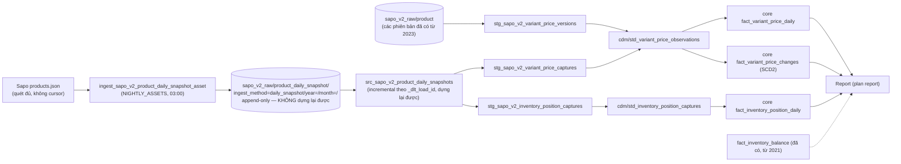

# Thiết kế: lịch sử giá và tồn kho theo ngày

> Ngày 15/10/2026. Đầu vào: mục "Lịch sử giá và tồn kho theo ngày" trong [roadmap](../261013-1751-modularize-data-platform-suite/roadmap.md) (dòng 136–138), phát hiện F-Q2 trong [phase-00-findings của plan DR](../261015-1140-backup-restore-dr/reports/phase-00-findings.md). Mọi số đo dưới đây lấy ngày 15/10/2026 bằng truy vấn tổng hợp chỉ đọc (DuckDB trong bộ nhớ, đọc parquet) trong container `data_platform`, không ghi gì.

## 1. Kết luận chính

1. **Ghi lại ảnh chụp từ model hiện có thì chỉ ghi lại số cũ.** Cả `fact_variant_prices_snapshot` lẫn `fact_inventory_snapshot` đọc payload sản phẩm mới nhất trong `src_sapo_v2_products`. Bảng này chỉ cập nhật khi Sapo đổi `modified_on` của sản phẩm, vì batch sản phẩm lấy theo `modified_on DESC` và dừng sớm (`ingestion/src/sapo/products.py:84-96,192,238`). Không job nào đặt tag `full_refresh=true` (tag chỉ được đọc ở `orchestration/connectors/sapo_v2/assets.py`, không có chỗ nào ghi). Số đo:
   - `fact_inventory_snapshot` (2.052 dòng) có `source_timestamp` trải từ 05/01/2023 đến 15/09/2026. Như vậy mỗi dòng là tồn kho tại lần cuối sản phẩm được sửa, không phải tồn kho hôm nay.
   - So với sổ kho (`fact_inventory_balance`, `is_current`): 1.285 cặp (variant, kho) có ở cả hai bảng, trong đó **25 cặp lệch `on_hand`**. Ngoài ra 767 cặp chỉ có ở snapshot và 209 cặp chỉ có ở sổ kho.
   - Giữa hai lần tải đủ trong raw (28/05/2026, 558 sản phẩm và 13/06/2026, 560 sản phẩm): **45 sản phẩm đổi `inventories` mà không đổi `modified_on`**, và **3 sản phẩm đổi giá mà không đổi `modified_on`**. Có 33 lần đổi giá đi kèm `modified_on` mới.
2. **Vì vậy, chỗ cần chụp hằng ngày là nguồn Sapo, không phải model dbt.** Thiết kế thêm một bước ingestion hằng đêm, quét đủ danh sách sản phẩm (khoảng 560 sản phẩm, khoảng 12 trang 50 dòng) vào một bảng raw mới, chỉ thêm (append-only). Lịch sử là **bảng raw này**: nó là nguồn sự thật không dựng lại được, nằm trong `sapo_v2_raw` mà plan DR đã đưa lên off-site hằng ngày. Mọi model dbt phía sau đều dựng lại được từ raw.
3. **Lịch sử `on_hand` đã có và dựng lại được.** `fact_inventory_balance` (`transformation/models/core/marts/inventory/fact_inventory_balance.sql:1-27`) là sổ số dư theo ngày có biến động, lấy từ sổ giao dịch kho Sapo, với dữ liệu từ **20/05/2021** (18.025 dòng, 572 variant). Plan này không dựng lại bảng đó. Plan chỉ thêm các trường mà sổ kho không có: `available`, `committed`, `incoming`, `onway`, `min_value`, `max_value`, `mac` theo kho.
4. **Không đổi số của bảng public hiện có.** `fact_variant_prices_snapshot`, `fact_inventory_snapshot`, `mart_inventory_health` giữ nguyên. Riêng comment sai trong hai model snapshot sẽ được sửa: SQL biên dịch đổi checksum nhưng dữ liệu không đổi, và gate S chứng minh golden không có khác biệt. Còn việc làm `fact_inventory_snapshot` tươi lại (đọc từ ảnh chụp mới) sẽ đổi số, nên đó là quyết định riêng của user (câu hỏi mở Q6).

## 2. SCD2 hay ảnh chụp hằng ngày

| Tiêu chí | Ảnh chụp hằng ngày (append) | SCD2 (chỉ ghi khi đổi) |
|---|---|---|
| Ghi nhận được gì | Giá trị quan sát mỗi ngày; ngày thiếu thì hiện ra là thiếu | Khoảng hiệu lực; không phân biệt được "không đổi" với "không quan sát được" |
| Idempotent | Ghi lại cùng ngày thì thay đúng một ngày | Phải so với trạng thái trước; chạy lại hay chạy muộn dễ tách hoặc gộp sai khoảng |
| Dung lượng (đo 15/10) | Giá: 1.460 dòng/ngày, khoảng 533 nghìn dòng/năm. Vị trí tồn: 2.052 dòng/ngày, khoảng 749 nghìn dòng/năm. Parquet ước khoảng 5–15 MB/năm mỗi bảng [ước tính, phase 2 đo thật] | Giá đổi khoảng 2–3 sản phẩm/ngày, rất nhỏ |
| Đọc "as of" | `WHERE as_of_date = D` (chính xác), hoặc ASOF lấy ngày ≤ D | `WHERE D BETWEEN valid_from_date AND valid_to_date` |

**Chọn:** lưu trữ gốc là **ảnh chụp hằng ngày ở tầng raw** (append, không bao giờ sửa). Bảng **SCD2 giá** là model phái sinh, dựng lại được từ raw. SCD2 phục vụ nhật ký đổi giá và đọc "as of" trước ngày bắt đầu chụp. Không dùng dbt snapshot hay incremental `full_refresh=false` cho lịch sử, vì cả hai sẽ sinh ra một bảng phái sinh không dựng lại được, nằm trong `sapo_warehouse.duckdb` vốn không lên off-site (DR design D2).

Phương án đã loại:
- **(A) Biến hai model snapshot thành incremental `full_refresh=false`** (như `monitor_taxonomy_parity_log`). Rẻ nhất, nhưng ghi lại số cũ (mục 1), tạo bảng không dựng lại được trong warehouse, và phải thêm vào `duckdb_snapshot.py --tables`.
- **(B) Chạy batch sản phẩm hiện có với `--reset-cursor` hằng đêm vào bảng `product`.** Code ít hơn, nhưng `src_sapo_v2_products` khử trùng theo `modified_on` (`src_sapo_v2_products.sql:51-63`). Bản tải lại có cùng `modified_on` mà tồn kho khác, nên sẽ hoà ngẫu nhiên giữa bản cũ và bản mới, và số `fact_inventory_snapshot`/`mart_inventory_health` sẽ đổi. Phương án này vi phạm ràng buộc không đổi số.

## 3. Luồng dữ liệu

Dữ liệu vào, biến đổi, ra:

| Thành phần | Vào | Biến đổi | Ra |
|---|---|---|---|
| Asset capture | `products.json` từ trang 1 đến trang rỗng, `page_size` 50 | Một `captured_at` (UTC, giờ bắt đầu run) và `capture_run_id` cho cả run; khử trùng `entity_id` trong run (giữ `modified_on` lớn nhất); payload gọn: `id`, `modified_on`, `variants[].{id, sku, variant_prices, inventories}` (Q3) | Một file parquet mỗi run; metadata: số sản phẩm, số trang, tổng Sapo (`api_count.py`) |
| `src_sapo_v2_product_daily_snapshots` | Raw mới | Chỉ thêm theo `_dlt_load_id`; bỏ payload sau khi tách cột | Bảng warehouse, dựng lại được |
| `stg_*_captures` | src | Unnest giá theo bảng giá; unnest tồn theo kho | View |
| `stg_sapo_v2_variant_price_versions` | `source('sapo_v2_raw','product')` (mọi phiên bản) | Unnest giá; `observed_at = event_timestamp`; hoà thì xếp theo `_dlt_load_id` | View (backfill) |
| `std_*` | stg | Pass-through, thêm `source_system`, `evidence_source` | View |
| `fact_variant_price_daily` | std (chỉ ảnh chụp) | `as_of_date` (mục 4); giữ ảnh chụp mới nhất trong ngày | Rolling parquet, public |
| `fact_variant_price_changes` | std (phiên bản + ảnh chụp) | Gộp các quan sát liên tiếp cùng giá thành một khoảng; `valid_to_date` = ngày trước lần đổi kế tiếp | Rolling parquet, public |
| `fact_inventory_position_daily` | std | `as_of_date`; ảnh chụp mới nhất trong ngày | Rolling parquet, public |

**Ranh giới module:** raw chỉ connector `sapo_v2` đọc (luật `dbt-source`). Core đọc `cdm/std_*` (ma trận ở `docs/architecture/modules.md` §3). Mọi model mới thuộc bucket `connector:sapo_v2`, `cdm` hoặc `core`. **Cột chi phí:** hàng `GIANHAP` (`is_cost`) và `mac` là số liệu do nguồn cung cấp, nên ở core theo quyết định 14/10 ("số liệu do nguồn cung cấp thuộc lõi", `roadmap.md:152`). Bảng mới **không** có cột biên (`implied_gross_margin_pct`, `is_below_cost`, giá trị tồn theo `mac`). Pack finance dựng các phép tính đó trên bảng lõi khi cần.

## 4. Grain, khoá, ngày "as of", trùng và muộn

- **`as_of_date`** = ngày ICT của `captured_at − history_day_cutoff_hour` (biến dbt, mặc định 6). Ảnh chụp lúc 03:01 ngày D+1 thì ghi cho ngày D (tức tồn và giá cuối ngày D). Ảnh chụp chạy tay lúc 10:00 ngày D cũng ghi cho ngày D (chụp giữa ngày), rồi bị bản 03:01 ngày D+1 thay. Quy tắc nằm trong dbt, không nằm trong raw, nên đổi quy tắc chỉ cần build lại.
- **Grain và khoá:**
  - `fact_variant_price_daily`: (`variant_id`, `price_list_id`, `as_of_date`).
  - `fact_inventory_position_daily`: (`variant_id`, `location_id`, `as_of_date`).
  - `fact_variant_price_changes`: (`variant_id`, `price_list_id`, `valid_from_at`).
  - Mỗi bảng có test `unique_combination_of_columns`. Riêng SCD2 có thêm singular test bảo đảm các khoảng không chồng nhau.
- **Nhiều ảnh chụp cùng `as_of_date`:** giữ `captured_at` lớn nhất. Nhờ vậy chạy lại là idempotent, và không có run nào ghi đè raw.
- **Trùng trong một run** (Sapo dời trang khi có sản phẩm bị sửa giữa lúc quét): khử trùng `entity_id`, giữ `modified_on` lớn nhất.
- **Thiếu trong một run:** so số sản phẩm quét được với tổng của Sapo. Thiếu quá 2% thì asset check báo WARN, metadata ghi số thiếu. Bảng daily chỉ chứa giá trị đã quan sát, không tự lấp.
- **Ngày bị lỡ** (nightly hỏng và không chạy lại trước 06:00): ngày đó **mất vĩnh viễn** với giá và vị trí tồn. `on_hand` vẫn có nhờ sổ kho. Đọc "as of" kiểu ASOF sẽ lấy ngày gần nhất ≤ D và trả cột `days_since_capture`.
- **Giá = 0:** model hiện có bỏ giá 0 (`fact_variant_prices_snapshot.sql:50`). Bảng lịch sử **giữ** giá 0 kèm cột `is_configured`, để thấy được việc một kênh bị tắt giá.
- **Variant hoặc sản phẩm bị xoá:** không còn trong ảnh chụp. SCD2 đóng khoảng ở ngày quan sát cuối (`valid_to_date`), `is_current = false`.

## 5. Dung lượng và bố cục

| Lớp | Ước lượng | Căn cứ |
|---|---|---|
| Raw, payload đầy đủ | khoảng 0,75 MB/run, tức khoảng 275 MB/năm | File tải đủ hiện có: 744–757 KB cho 558–560 sản phẩm |
| Raw, payload gọn (đề xuất) | [ước tính] 0,2–0,4 MB/run, tức 70–150 MB/năm | Phase 0 đo trên file tải đủ 13/06 |
| `fact_variant_price_daily` | khoảng 533 nghìn dòng/năm | 1.460 dòng × 365 |
| `fact_inventory_position_daily` | khoảng 749 nghìn dòng/năm | 2.052 dòng × 365 |
| `fact_variant_price_changes` | vài nghìn dòng/năm | 33–36 lần đổi giá ở mức sản phẩm trong 16 ngày |

- **Bố cục raw:** theo `layout` chung của dlt (`ingestion/.dlt/config.toml:6`): `product_daily_snapshot/ingest_method=daily_snapshot/year=YYYY/month=M/<file_id>.parquet`. `year`/`month` lấy theo `captured_at` (ICT). Một file mỗi run, không bao giờ sửa file cũ. Restic chỉ phải đẩy file mới mỗi đêm.
- **Ổ đĩa:** `/` còn trống 210 GB (F-Q7), nên không cần nén lại theo tháng.
- **Bảng phái sinh:** model `external` rolling như các model public khác. Mỗi lần build ghi toàn bộ lịch sử vào một file, GC giữ 3 file. Model nằm trong `NIGHTLY_ONLY_ASSETS`, nên chỉ build mỗi đêm một lần, không build ở các job `*/3`.

## 6. Retention

- **Raw ảnh chụp:** giữ mãi (mặc định đề xuất), vì giá trị của nó là độ sâu lịch sử. Q2 hỏi user.
- **Bảng phái sinh:** luôn dựng lại toàn bộ từ raw. Không có retention riêng.
- **Bản sao lưu cục bộ 7 bản** (`backup.sh`) và off-site (plan DR) lo việc giữ bản sao.

## 7. Backfill: làm được gì

| Dữ liệu | Lấp được từ | Nguồn | Giới hạn |
|---|---|---|---|
| `on_hand` theo variant × kho | **20/05/2021** | Sổ kho, `fact_inventory_balance` (đã có, dựng lại được) | Khoảng 4,4% cặp có bước nhảy không giải thích được (Sapo sửa không ghi log). Số dư đầu kỳ trước 05/2021 nằm trong dòng đầu tiên |
| `moving_avg_cost` (MAC) | 20/05/2021 | Sổ kho (`fact_inventory_movements.moving_avg_cost`) | Chỉ ở ngày có giao dịch |
| Giá theo bảng giá | **28/05/2026** chắc chắn (lần tải đủ đầu tiên), sau đó theo từng phiên bản sản phẩm | `sapo_v2_raw/product`: 1.138 dòng batch cho 560 sản phẩm, 9 lần tải; cộng 148 dòng `history_log` cho 20 sản phẩm (18/03 → 10/07/2026) | Bỏ sót lần đổi giá không kèm `modified_on` (3 trên 575 cặp phiên bản). Từ 16/09/2026 tới nay không có phiên bản nào. Khoảng hiệu lực trước 28/05 (lùi về `modified_on`) chỉ là suy luận, gắn `evidence_source = 'sapo_product_version'` |
| `available`, `committed`, `incoming`, `onway`, `min/max`, `mac` theo kho | **Không lấp được** | Chỉ có ở thời điểm gọi API | Bắt đầu từ lần chụp đầu tiên sau deploy phase 1 |
| 7 bản backup cục bộ | Không thêm gì | Chứa cùng raw và 3 file rolling phái sinh từ cùng nguồn cũ | — |
| Sapo API: lịch sử bảng giá hoặc tồn | [UNVERIFIED] Phase 0 kiểm | Chưa thấy endpoint trong repo. `history_log` của Sapo bị cắt theo thời gian (`freshness.md:142`) | Nếu có endpoint thì lập plan riêng |
| Giá nhập thực tế theo phiếu nhập | Có trong raw `purchase_order` | Thuộc phép tính chi phí, tức pack finance | Ngoài phạm vi; ghi để plan finance dùng |

## 8. Người dùng (chỉ liệt kê; plan report sở hữu việc dựng)

| Report | Bảng dùng | Có từ |
|---|---|---|
| Nhật ký đổi giá (theo SKU, bảng giá) | `fact_variant_price_changes` | 28/05/2026 (backfill) |
| Giá "as of" một ngày | `fact_variant_price_changes` (khoảng) hoặc `fact_variant_price_daily` | như trên / từ lần chụp đầu |
| Xu hướng tồn kho (`on_hand`) | `fact_inventory_balance` | 2021 |
| Xu hướng khả dụng / đang giữ / đang về | `fact_inventory_position_daily` | lần chụp đầu |
| Lịch sử số ngày đủ hàng | `on_hand` as-of D (`fact_inventory_balance`) ÷ tốc độ bán (`int_sku_sales_monthly` / `fact_sales`) | 2021 |
| Số ngày hết hàng | `on_hand ≤ 0` (sổ kho, nối khoảng với `dim_date`); `available ≤ 0` (position daily) | 2021 / lần chụp đầu |
| Bán dưới giá vốn theo thời gian | Hàng `GIANHAP` trong bảng giá lịch sử; tính biên ở **pack finance** | 28/05/2026 |

Plan report: `plans/261014-2225-report-productization/`.

## 9. Backup (phối hợp plan DR)

- **Đánh dấu không dựng lại được:** `app_data/data_lake/sapo_v2_raw/product_daily_snapshot/`. Nó nằm trong `sapo_v2_raw`, thư mục mà DR `design.md:83` (§4) đã xếp là nguồn sự thật, lên off-site hằng ngày, nên **không cần** `duckdb_snapshot.py --tables`.
- **Việc cần làm ở plan DR** (phase 3 của plan này mở việc và sửa tài liệu chung):
  1. Thêm một dòng vào bảng phân loại (DR `design.md` §4, cạnh dòng 83 và dòng 96 về hai bảng snapshot) và vào `docs/operations/backup-and-recovery.md` (nếu đã có): nguồn sự thật, không dựng lại được, Sapo không có lịch sử.
  2. T2 đọc mọi file parquet (đã có), nên tự phủ thư mục mới.
  3. T3 so số dòng các bảng trong `public_models.yaml` (sinh tự động), nên tự gồm ba bảng mới.
  4. Thêm câu "không được xoá" vào hướng dẫn dọn raw (nếu có).
- **Trong lúc off-site chưa chạy:** lịch sử chỉ có trên cùng ổ, cộng 7 bản backup cục bộ. Rủi ro này được ghi lại và chấp nhận tạm, cho tới khi DR phase 5 xanh.
