# Thiết kế: lõi dữ liệu CRM chuẩn ngành, agent-native

Ngày: 19/10/2026 (Asia/Saigon) · Người viết: planner · Trạng thái: đề xuất, chờ user duyệt cùng [plan.md](plan.md)

Nguồn nội bộ đã đọc (chỉ đọc, không mở `crm.db`): `crm/AGENTS.md`, `crm/README.md`, `crm/docs/crm-database-schema-reference.md` (chỉ cập nhật tới 0014, phần sau đọc thẳng từ migration), 47 file `crm/migrations/*.up.sql` (0001–0046, có hai file số 0030), `crm/sync/cache_schema.sql`, `crm/sync/reverse_etl_warehouse_to_crm.py`, `crm/src/composition.py`, `crm/src/adapters/**`, `crm/src/application/**`, `orchestration/packs/crm/*`, `docs/decisions/017-packs-and-tenants.md`, `docs/architecture/modules.md`, `docs/operations/deployment.md`, `crm/docs/backup-restore-runbook.md`, ba báo cáo `plans/reports/research-261014-2333-*.md` và `review-261019-1413-crm-plans-triage.md`. Tài liệu này không chứa dữ liệu khách.

---

## 0. Kết luận

1. **Lõi CRM = 9 nhóm entity dùng chung cho mọi mảng kinh doanh**: Party (cá nhân/tổ chức) với PartyRole và PartyRelationship; ContactPoint; PartyIdentifier (khoá của khách ở hệ khác) cùng merge có undo; ConsentEvent (sổ cái consent có bằng chứng) và phân loại dữ liệu nhạy cảm; Interaction, Note, Task; Engagement (khung chung cho đơn hàng, hợp đồng, lịch hẹn, gói thành viên); Tag, Segment, Campaign, CustomField; User/Principal, phân quyền, AuditEvent, Proposal. Mỗi mảng (bán lẻ, bán sỉ, lịch hẹn, thành viên) là một **module** khai báo thêm loại vai trò, loại quan hệ, loại engagement, loại tín hiệu và bảng chi tiết riêng, không sửa lõi.
2. **CRM không tính lại số.** Kho dữ liệu xuất bản bốn hợp đồng chuẩn vào `cache.db` (nguồn khách, tóm tắt thương mại, giao dịch có loại, tín hiệu) cộng bảng riêng của module; CRM chỉ đọc. Chiều ngược lại, CRM xuất bản các sự thật do người nhập (tương tác, task, tag không nhạy cảm, consent hiện hành, vai trò đã xác nhận, ánh xạ party) qua `crm_export`.
3. **Agent-native** nghĩa là mọi lệnh đi qua một tầng ứng dụng duy nhất (`CommandBus` + query service) với ngữ cảnh lệnh bắt buộc (actor, on_behalf_of, kênh, request_id, idempotency key); ba adapter mỏng REST `/api/v1` (OpenAPI), CLI và MCP gọi cùng tầng đó. MCP chạy theo **code mode**: chỉ hai tool `search_api` và `execute`, do một code-mode host dùng chung (repo riêng, sandbox Pydantic Monty, agent viết Python) chạy ở container sidecar; mỗi hàm agent gọi là một route REST `/api/v1` của CRM (§5.9). Lệnh ghi luôn có audit. Thao tác nguy hiểm đi qua `crm_proposal` và chỉ người duyệt mới thực thi. Agent không gửi tin cho khách ở v1.
4. **Làm theo kiểu expand → chuyển đọc → contract**, mỗi bước deploy độc lập: thêm bảng mới và ghi song song, so khớp bằng công cụ parity, chuyển đọc, rồi mới dọn bảng cũ (giữ view tương thích cho người đọc cũ như export dbt). Không có bước nào đổi hành vi người dùng mà chưa được user duyệt.
5. **Thứ tự**: an toàn pháp lý và CSRF trước, rồi nền agent (danh tính, quyền, audit), rồi agent đọc, rồi agent ghi an toàn, rồi mới tới hợp đồng kho và tái cấu trúc dữ liệu sâu (identity, consent, vai trò, engagement, campaign).

---

## 1. Hiện trạng đã kiểm (những điểm quyết định thiết kế)

| # | Sự thật | Bằng chứng | Hệ quả cho thiết kế |
|---|---|---|---|
| H1 | Ba bảng identity chồng nhau: `crm_party_identity` trộn kênh liên hệ (phone, email, zalo_uid, psid) với khoá hệ khác (sapo_customer, customer_code); `crm_party_external_id` không ai ghi; `crm_identity_link` thực ra là nhật ký giải quyết quét tem Hug | `crm/migrations/0002_party_identity_golden_record.up.sql:27-38` (UNIQUE `(identity_type, identity_value)`), `0009_party_external_id.up.sql:11`, `0022_hug_identity_link.up.sql`, `crm/src/application/tag_acl_sync_service.py:9-12` (ghi rằng reconcile trên `crm_party_external_id` bỏ qua 100% dòng) | Tách thành ContactPoint + PartyIdentifier; Hug giữ bảng module riêng |
| H2 | `crm_party_identity` được 19 file ngoài test tham chiếu, gồm cả export sang kho | Kết quả `grep -rln crm_party_identity` (liệt kê ở mục 7.2); `orchestration/packs/crm/crm_writeback_assets.py:44-60` join `identity_type = 'sapo_customer'` cho mọi bảng export | Không đổi tên bảng một lần; đi theo expand/contract, giữ view tương thích |
| H3 | Consent hiện là `consent_enum` ở cấp party (NULL/allowed/denied), không bằng chứng | `0026_consent_contact_enum.up.sql`; đọc ở `crm/src/adapters/outbound/sqlite/campaign_repository.py:203` (`fetch_consent_map`) | Thay bằng sổ cái consent; giữ cột cũ trong lúc chuyển |
| H4 | "Không liên hệ" thực tế được suy ra từ hoạt động **gần nhất** có `outcome_reason='do_not_contact'`, không nằm trong consent | `crm/src/adapters/outbound/sqlite/activity_repository.py:71-78,200-201`; `crm/src/application/worklist_query_service.py:54-65` | Nếu có hoạt động mới hơn thì lệnh cấm tự mất. Sổ cái consent sẽ đổi ngữ nghĩa này (lệnh rút lại có hiệu lực tới khi khách đồng ý lại). Đây là **thay đổi hành vi**; user đã chốt 19/10 (Q6): lệnh rút lại có hiệu lực tới khi khách đồng ý lại, bật sau khi user xem số khách bị ảnh hưởng (§6.3) |
| H5 | Đã có khoảng 40 route `/api/*` (không phải 5): segment, campaign, dedup/merge, activity, task, tag, note, profile, custom field, 360, insight, approach script, conversation | `crm/src/adapters/inbound/http/*_handler.py` (ví dụ `segment_handler.py:55-134`, `campaign_handler.py:56-164`, `customer360_handler.py:30,117-224`, `dedup_handler.py:21-98`, `task_handler.py:44-99`) | REST không phải làm lại từ đầu; cần **chuẩn hoá** (v1, schema, lỗi, idempotency, actor) và trỏ về cùng service |
| H6 | Lệnh ghi `/api/*` chỉ kiểm một token chung `CRM_API_TOKEN`, không biết ai gọi; token rỗng thì bỏ qua kiểm | `crm/src/adapters/inbound/http/auth_dependency.py:26-50` | Cần principal theo từng người/agent, token băm, phạm vi quyền |
| H7 | `AuthorizationService` chỉ so assignee; role (sales/care/manager/admin) chỉ mang tính thông tin, chỉ có `require_admin` | `crm/src/application/authorization_service.py:1-31`; `crm/src/domain/entities/app_user.py:13-17`; `auth_dependency.py:53-71` | Một policy duy nhất (role → quyền) cho UI, REST, CLI, MCP; v1 mã hoá đúng hành vi hiện tại cho người dùng |
| H8 | CSRF guard đang log-only và miễn trừ mọi đường `/api/*`, trong khi 4 route `/api/*` được trình duyệt gọi bằng cookie | `crm/src/adapters/inbound/http/csrf_guard.py:38,53`; `crm/src/adapters/inbound/web/screens/customer360/screen_customer_360_activity.py:534,644,707`; `script_nav_handler.py:67-69`; báo cáo triage mục 2 | Bật chặn và bỏ miễn trừ cho request có Origin, trước khi mở thêm API cho agent |
| H9 | Tag sức khoẻ: `health_concern` (8 tag, 0 lần gắn) và `health_domain` (8 tag, 2 lần gắn); không có lớp chặn; export ra kho mang `category` | `0042_seed_health_concern_tags.up.sql`; `crm_writeback_assets.py:150-157`; báo cáo triage mục 3 | Đưa "loại dữ liệu" vào lõi; phương án C + B đã chốt 19/10 (§6.2): tag "quan tâm nhóm sản phẩm" làm mặc định, tag sức khoẻ chỉ gắn khi có đồng ý riêng, giới hạn người xem, audit, lọc khỏi export và agent |
| H10 | CRM đọc kho theo **hai kênh**: `cache.db` (reverse-ETL, 11 bảng `wh_*`) và đọc thẳng `serving/olap.duckdb` lúc request (6 repo: đơn của khách, timeline, chỉ số dim, RFM danh sách, data quality, chi tiết đơn) | `crm/sync/reverse_etl_warehouse_to_crm.py:176-232`; `crm/sync/duckdb_reader.py` (`main_marts.dim_customers`, `mart_customer_action_queue`, `mart_customer_sku_action_queue`, `mart_customer_tier`, `dim_action_scenario_registry`, `dim_products`, `mart_product_health`, `mart_deadstock_target_queue`, `fact_orders`); `crm/src/composition.py:254-302` | Hợp đồng có hai mặt: bảng cache (dùng để lọc, join) và view serving công khai (dùng để xem chi tiết) |
| H11 | Ba bảng cache không ai đọc ngoài bộ sync: `wh_product`, `wh_product_insight`; `wh_order_cogs_summary` có DDL nhưng không được nạp | `grep` chỉ thấy ở `crm/sync/*` và tài liệu; `reverse_etl_warehouse_to_crm.py` không có bước cho `wh_order_cogs_summary` | Bỏ khỏi hợp đồng v1 (xác nhận lại ở phase 0) |
| H12 | `wh_contactable` không phải bảng: đó là tên biến trong `crm/src/hug/customer_push.py:141` (đọc `wh_customer_tier.is_contactable`) | `customer_push.py:138-152` | Hợp đồng chỉ cần cột `is_contactable_source` trong tóm tắt thương mại |
| H13 | Migration runner chỉ chạy file `.up.sql`, theo dõi bằng `schema_migrations`; không có lệnh chạy file down; mỗi file chạy trong một SAVEPOINT | `crm/src/adapters/outbound/sqlite/migrations.py:30-150` | Thêm công cụ ops chạy down (xoá dòng `schema_migrations` tương ứng) để "migration có down" thực sự dùng được |
| H14 | Code và migration CRM được bind-mount từ checkout prod; migration chạy lúc container khởi động và lỗi thì container dừng (hard-fail); thư viện Python nằm trong image | `docker-compose.yml:285-296`; `crm/entrypoint.sh` bước 1; `crm/src/requirements.txt` | Phase thêm thư viện phải build lại image; nhờ code-mode host chạy ở sidecar riêng, kế hoạch hiện tại không phải build lại image `crm` (chỉ thêm service `crm_codemode`); các phase khác chỉ cần dừng và khởi động lại container |
| H15 | Merge hiện chỉ chuyển identity của party bị gộp sang party còn lại, có snapshot để undo | `crm/src/application/merge_service.py:52-115` | Merge mới phải chuyển cả contact point, identifier, vai trò, quan hệ; giữ undo |
| H16 | Sqlite trên host là 3.46.1; image dùng `python:3.12-slim` (phiên bản sqlite trong image **[chưa kiểm]**) | `Dockerfile.crm:4` | Phase 0 kiểm phiên bản trong image (cần ≥ 3.35 cho `RETURNING`, ≥ 3.25 cho window function) |

---

## 2. Nguyên tắc và chuẩn tham chiếu

| Chuẩn | Lấy gì | Không lấy gì |
|---|---|---|
| Party model (Silverston, *The Data Model Resource Book* tập 1; OMG Party Management) | Party là siêu kiểu của Person và Organization; vai trò (PartyRole) tách khỏi danh tính; quan hệ giữa hai party có loại và thời hạn (PartyRelationship); ContactMechanism tách khỏi Party | Mô hình địa chỉ đa cấp và PartyRoleType phân cấp sâu: quá nặng cho SME |
| Salesforce (Account, Contact, Person Account; Data Cloud: Individual, Party Identification, Contact Point Phone/Email/Address, Contact Point Consent) | Khách lẻ là "Person Account" (một party cá nhân đóng vai khách hàng); khách sỉ là Account tổ chức có nhiều Contact; consent theo contact point × mục đích, có thời điểm và nguồn | Tách cứng Lead/Contact/Account: với bán lẻ, một người đi từ "chưa mua" sang "khách" chỉ là đổi vai trò |
| Microsoft Common Data Model (Account, Contact, Connection, Appointment, Contract) | Connection có vai trò hai đầu ≈ PartyRelationship; Appointment và Contract là "activity/engagement" gắn vào party | Hàng trăm thuộc tính mặc định |
| schema.org (Person, Organization, ContactPoint, Order, Reservation, ProgramMembership, Invoice) | Tên khái niệm và cách nói về bốn mảng: Order (bán lẻ, bán sỉ), Reservation (lịch hẹn), ProgramMembership (thành viên/gói) | Không dùng làm schema lưu trữ |

**Nguyên tắc riêng của thiết kế này:**

- **P1. CRM giữ sự thật do người nhập hoặc người quyết định; kho giữ mọi thứ tính ra được.** Giữ nguyên R2/R3 của PRD.
- **P2. Đổi tên chỉ khi đổi nghĩa.** `crm_activity_log`, `crm_task`, `crm_note`, `crm_tag` giữ tên vật lý; tên logic trong API là Interaction, Task, Note, Tag. Đổi tên bảng chỉ làm ở chỗ nghĩa thật sự khác (identity).
- **P3. Loại do code định nghĩa, nhãn do tenant cấu hình.** Loại vai trò, quan hệ, engagement, tín hiệu, mục đích consent được khai báo trong manifest của module (code) và đồng bộ vào bảng registry lúc khởi động để có khoá ngoại và nhãn tiếng Việt. Cột kiểu "loại" không dùng `CHECK` (SQLite không sửa được CHECK nếu không dựng lại bảng); `CHECK` chỉ dùng cho trạng thái vòng đời do lõi định nghĩa.
- **P4. Mỗi CSDL là một tenant.** Không thêm cột `tenant_id`. Sản phẩm cài on-prem theo từng doanh nghiệp; Postgres sau này dùng một database (hoặc schema) mỗi tenant.
- **P5. Mọi lệnh ghi có ngữ cảnh lệnh, có audit; lệnh ghi qua API có idempotency key.**
- **P6. Dữ liệu nhạy cảm được đánh dấu ở định nghĩa (loại tag, trường tuỳ biến, loại ghi chú), không ở từng dòng.** Quyền xem và lọc export dựa trên dấu đó.

---

## 3. Mô hình dữ liệu lõi

### 3.1 Quy ước

| Mục | Quy ước | Ghi chú khả chuyển Postgres |
|---|---|---|
| Tên bảng | Lõi: `crm_<entity>`; module: `crm_<module>_<entity>` (ví dụ `crm_b2b_contract`, `crm_appt_appointment`); registry: `crm_<thing>_type`; cache hợp đồng: `wh_<entity>`; cache riêng module: `wh_<module>_<entity>` | Postgres: `crm` và `wh` thành hai schema, bỏ tiền tố được nhưng không bắt buộc |
| Định danh (đã chốt 19/10: **UUIDv7**) | Mọi id mới do ứng dụng sinh bằng **một helper duy nhất** `crm/src/domain/ids.py::new_id()` (UUIDv7 theo RFC 9562, tự viết khoảng 20 dòng vì `uuid.uuid7()` chỉ có từ Python 3.14 còn image là 3.12; không thêm thư viện). Lưu `TEXT` dạng chuẩn 36 ký tự chữ thường, cùng định dạng với uuid4 hiện có. Áp cho PK, `request_id`, `execution_id`, `idempotency_key` do hệ thống sinh, `proposal_id`, `audit_id`, `run_id` của sync. Cấm `uuid.uuid4()` mới (test quét mã nguồn). Không dùng `INTEGER AUTOINCREMENT` ở bảng mới. Chi tiết: §3.1.1 | Postgres: cột kiểu `uuid`; id vẫn sinh ở ứng dụng (không dùng `uuidv7()` của PG18) để một code chạy được trên cả hai |
| Thời gian | `TEXT` ISO-8601 UTC có `Z`; ứng dụng đặt giá trị (`shared/timestamps.py`), DDL chỉ có default làm lưới an toàn; không thêm trigger `*_touch` mới | Postgres: `timestamptz`; trigger touch là đặc thù SQLite |
| Tiền | `INTEGER` đơn vị nhỏ nhất (`amount_minor`) + `currency` (mặc định `VND`) ở bảng mới; bảng cũ giữ `*_vnd` | Không phụ thuộc dialect |
| Boolean | `INTEGER` 0/1, repository chuyển sang `bool` | Postgres: `boolean` |
| JSON | `TEXT` chứa JSON; chỉ đọc/ghi qua repository; không dùng hàm JSON1 trong view mới | Postgres: `jsonb` |
| Upsert | `INSERT ... ON CONFLICT (...) DO UPDATE/DO NOTHING`; không dùng `INSERT OR IGNORE/REPLACE` ở code mới | Cùng cú pháp trên hai CSDL |
| Ràng buộc duy nhất có điều kiện | Partial unique index (`WHERE ...`) | Cả hai đều hỗ trợ |
| Xoá | Xoá mềm (`deleted_at`) cho dữ liệu người nhập; bảng sổ cái (consent, audit) chỉ thêm | — |
| Tham chiếu sang `cache.db` | Giá trị, không khoá ngoại (R3); mọi truy cập qua `CacheRepository`/`ContractReader` với tiền tố schema là một hằng số | Postgres: schema `wh` cùng database, vẫn không khoá ngoại |

#### 3.1.1 UUIDv7: phạm vi và những gì giữ nguyên

| Loại id | Quyết định | Lý do |
|---|---|---|
| Id uuid4 đã có (party, identity, activity, note, task, tag tạo tay, …) | **Giữ nguyên, không viết lại** | Là khoá tham chiếu giữa bảng, nằm trong export về kho (`stg_crm__*`), URL, ánh xạ Hug; viết lại không có lợi mà rủi ro cao |
| Dòng mới của bảng cũ | UUIDv7 ngay khi helper vào (phase 2; 19 file đang gọi `uuid.uuid4()` trong `crm/src`, `crm/sync`, `crm/ops`, đã đếm 19/10) | Bảng sẽ có cả uuid4 và UUIDv7; cùng kiểu `TEXT` 36 ký tự nên không ai phải đổi. **Không sắp theo id** khi cần thứ tự thời gian, luôn dùng `created_at`/`occurred_at` |
| Bảng mới của lõi | UUIDv7 | Sắp theo thời gian tự nhiên, index B-tree chèn cuối, tốt cho Postgres |
| Id suy ra từ dữ liệu (tất định) | **Giữ cơ chế**: `action_id` = md5(`customer_key`, loại, ngày bắt đầu) của tín hiệu kho (`crm/sync/sqlite_upsert.py:193-217,256-287`), `customer_key` (khoá thay thế MD5 của kho), id seed cố định trong migration (`tag-00000000-000N`, `tag-health-00NN`) | Tính tất định là có chủ đích: action state và dismissal dựa vào `action_id` ổn định theo đợt; seed phải cùng id ở mọi bản cài. Seed mới cũng dùng id cố định đọc được, không dùng UUIDv7 |
| `INTEGER AUTOINCREMENT` hiện có | Chỉ `crm_hug_campaign_history.id` (`0024`). **Giữ** | Bảng lịch sử chỉ thêm, không ai tham chiếu id; đổi phải dựng lại bảng mà không có lợi. Phase 10 không đổi nó |
| Token bí mật (credential, Hug token) | **Không** dùng UUIDv7 | UUIDv7 có 48 bit thời gian, ít ngẫu nhiên hơn; token dùng `secrets.token_urlsafe(32)` |

UUIDv7 để lộ thời điểm tạo (độ chính xác mili giây) trong id. Id của CRM xuất hiện ở URL giao diện, export về kho và phản hồi cho agent. Thời điểm tạo khách, task, ghi chú không phải dữ liệu nhạy cảm và hầu hết đã hiển thị qua `created_at`, nên **chấp nhận**; ràng buộc kèm theo: không dùng id làm bí mật hay làm bằng chứng quyền truy cập, và không đưa id của dữ liệu nhạy cảm (tag sức khoẻ) ra ngoài (đã bị lọc theo §6).

### 3.2 Sơ đồ

```mermaid
erDiagram
  crm_party ||--o| crm_person : "là"
  crm_party ||--o| crm_organization : "là"
  crm_party ||--o{ crm_party_role : "đóng vai"
  crm_party ||--o{ crm_party_relationship : "từ"
  crm_party ||--o{ crm_party_relationship : "tới"
  crm_party ||--o{ crm_contact_point : "liên hệ qua"
  crm_party ||--o{ crm_party_identifier : "được biết ở hệ khác bằng"
  crm_party ||--o{ crm_consent_event : "đồng ý/rút lại"
  crm_contact_point ||--o{ crm_consent_event : "áp cho kênh"
  crm_party ||--o{ crm_activity_log : "Interaction"
  crm_party ||--o{ crm_task : "Task"
  crm_party ||--o{ crm_note : "Note"
  crm_party ||--o{ crm_party_tag : "gắn"
  crm_tag }o--|| crm_tag_category : "thuộc loại (data_class)"
  crm_engagement ||--o{ crm_engagement_party : "các bên"
  crm_party ||--o{ crm_engagement_party : "tham gia"
  crm_engagement ||--o| crm_module_detail : "bảng chi tiết của module"
  crm_campaign ||--o{ crm_campaign_target : "đối tượng (arm)"
  crm_app_user ||--o{ crm_api_credential : "token"
  crm_app_user ||--o{ crm_audit_event : "actor"
  crm_app_user ||--o{ crm_proposal : "đề xuất / duyệt"
```



`crm_module_detail` là ký hiệu chung cho bảng chi tiết của module, không phải bảng thật. Interaction, Task, Note có cột `engagement_ref` (mục 3.5).

### 3.3 Entity lõi: cột, khoá, trường bắt buộc

Chữ **(có)** nghĩa là bảng đã có, **(mới)** là bảng thêm. Chỉ liệt kê cột quan trọng; cột kỹ thuật `created_at`, `updated_at`, `created_by` có ở mọi bảng mới.

#### Party và hai kiểu con

| Bảng | Cột (bắt buộc in đậm) | Khoá, ràng buộc | Nguồn từ hiện trạng |
|---|---|---|---|
| `crm_party` (có) | **party_id**, **party_type** (`person`/`org`, giữ giá trị cũ), **display_name**, **status** (`active`/`inactive`/`blocked`), is_merged, merged_into; `primary_phone`, `primary_email`, các cột địa chỉ (0007) giữ làm **bản sao tiện dụng** do service tính từ contact point ưu tiên | PK `party_id`; FK `merged_into` → `crm_party` | Giữ nguyên |
| `crm_person` (mới) | **party_id**, birth_date, gender | PK = FK `party_id` | `crm_customer_profile.birthday`, `gender` |
| `crm_organization` (mới) | **party_id**, legal_name, tax_code, org_kind (`company`/`household_business`/`clinic`/…) | PK = FK; UNIQUE `tax_code` khi khác NULL | Mới (khách sỉ) |

#### PartyRole

| Bảng | Cột | Khoá |
|---|---|---|
| `crm_role_type` (mới, registry) | **role_type**, **module_id**, **label_vi**, applies_to (`person`/`org`/`both`) | PK `role_type` |
| `crm_party_role` (mới) | **party_role_id**, **party_id**, **role_type**, **status** (`active`/`inactive`), valid_from, valid_to, owner_user_id, lifecycle_stage, acquisition_source, source (`seed`/`manual`/`proposal`) | PK; FK `party_id`, `role_type`, `owner_user_id`; UNIQUE (`party_id`, `role_type`) WHERE `valid_to IS NULL` |

Vai trò lõi: `customer`, `prospect`, `contact` (người đại diện cho một tổ chức). `owner_user_id`, `lifecycle_stage`, `acquisition_source` chuyển từ `crm_customer_profile` sang vai trò `customer`, vì "ai phụ trách" là thuộc tính của quan hệ kinh doanh, không phải của con người. `crm_customer_profile` vẫn tồn tại trong lúc chuyển (mục 7).

#### PartyRelationship

| Bảng | Cột | Khoá |
|---|---|---|
| `crm_relationship_type` (mới, registry) | **relationship_type**, **module_id**, **label_vi** (chiều từ → tới), **inverse_label_vi**, from_party_type, to_party_type | PK |
| `crm_party_relationship` (mới) | **relationship_id**, **from_party_id**, **to_party_id**, **relationship_type**, **status** (`proposed`/`active`/`ended`/`rejected`), valid_from, valid_to, title (chức danh khi là `contact_of`), is_primary, source (`manual`/`inferred`/`import`), confidence, evidence_json | PK; UNIQUE (`from_party_id`, `to_party_id`, `relationship_type`) WHERE `status IN ('proposed','active')`; CHECK `from_party_id <> to_party_id` |

Loại lõi: `contact_of` (người → tổ chức), `buys_for` (người mua hộ), `gift_recipient_of`, `household_member_of`, `referred_by`. Module `b2b_lite` thêm `reseller_of`.

#### ContactPoint

| Bảng | Cột | Khoá |
|---|---|---|
| `crm_contact_point` (mới) | **contact_point_id** (giữ đúng `identity_id` cũ khi tách), **party_id**, **kind** (`phone`/`email`/`zalo`/`messenger`/`address`/`social_other`), **value_normalized** (E.164 với phone, chữ thường với email; với address là chuỗi ghép để tìm), value_display, label, **is_preferred**, **status** (`active`/`invalid`/`unreachable`), **quality** (bậc liên hệ được: `masked`/`unverified`/`verified`/`zalo_follower`/`real`), source_quality (bất biến từ nguồn: `real`/`masked`), address_line, ward, district, province, country_code (chỉ khi `kind='address'`), source_system, source_ref (ví dụ page_id của PSID), verified_at | PK; FK `party_id`; **partial UNIQUE (`kind`, `value_normalized`) WHERE `kind <> 'address'`** |

Ràng buộc duy nhất giữ đúng hành vi hiện tại (`0002...up.sql:27`: một số điện thoại thuộc đúng một party). Số tổng đài công ty trong mảng sỉ đặt ở party tổ chức nên không đụng ràng buộc. Số dùng chung trong gia đình vẫn bị chặn như hôm nay; nới ràng buộc này là quyết định riêng, không làm trong plan.

#### PartyIdentifier (khoá của khách ở hệ khác)

| Bảng | Cột | Khoá |
|---|---|---|
| `crm_party_identifier` (mới) | **identifier_id** (giữ `identity_id` cũ khi tách), **party_id**, **source_system** (theo ADR-014: `sapo_v2`, `shopee`, `hug`, …), **id_type** (`customer_id`, `customer_code`, `buyer_id`, …), **external_key**, **status** (`proposed`/`confirmed`/`rejected`/`superseded`), confidence, **method** (`seed_sync`/`manual`/`hug_scan`/`rule_exact_phone`/`import`), evidence_json, proposed_by, confirmed_by, confirmed_at | PK; FK `party_id`; **partial UNIQUE (`source_system`, `id_type`, `external_key`) WHERE `status='confirmed'`** |

Quy tắc phân loại: **cái gì dùng để liên lạc được thì là ContactPoint; cái gì là khoá bản ghi ở hệ khác thì là PartyIdentifier.** Zalo UID và PSID dùng để nhắn tin nên là ContactPoint (`zalo`, `messenger`); mã khách Sapo và mã người mua trên sàn là PartyIdentifier.

#### Merge và dedup (có, mở rộng)

`crm_dedup_candidate` và `crm_party_merge_log` giữ nguyên. Snapshot của merge mở rộng để chứa danh sách `contact_point_id`, `identifier_id`, `party_role_id`, `relationship_id` đã chuyển, nên undo vẫn trả đúng trạng thái. Merge chỉ thực thi qua proposal đã duyệt khi người đề xuất là agent; người dùng có quyền `party.merge` vẫn merge trực tiếp như hôm nay (lệnh vẫn có audit).

#### Consent và phân loại dữ liệu: xem mục 6.

#### Interaction, Note, Task (có, bổ sung)

| Bảng | Bổ sung | Ghi chú |
|---|---|---|
| `crm_activity_log` (Interaction) | `engagement_ref`, `contact_point_id` (kênh đã dùng), `data_class` mặc định `basic` | `related_order_code` cũ được ánh xạ sang `engagement_ref` (mục 3.5); giữ cột cũ |
| `crm_note` | `engagement_ref`, `data_class` | Loại ghi chú có `data_class` mặc định |
| `crm_task` | `engagement_ref` | `source`/`source_ref` (idempotent theo R8) giữ nguyên |
| `crm_action_state`, `crm_action_dismissal`, `crm_last_contact` | Giữ nguyên | Quyết định của người về tín hiệu kho |

#### Tag, Segment, Campaign, CustomField

| Bảng | Thay đổi |
|---|---|
| `crm_tag_category` (mới, registry) | `category_code`, `label_vi`, `data_class` (`basic`/`sensitive`), `sensitive_kind` (`health`, …), `requires_consent_purpose` (NULL hoặc mã mục đích consent bắt buộc trước khi gắn, ví dụ `sensitive_profile`), `audit_reads` (0/1) |
| `crm_tag`, `crm_party_tag`, `crm_ext_tag*` | Giữ; `crm_tag.category` trỏ (giá trị) tới `crm_tag_category` |
| `crm_custom_field_def` | Thêm `data_class`; `entity_type` mở rộng thành `party`, `party_role:<role_type>`, `engagement:<engagement_type>`, `interaction` |
| `crm_segment`, `crm_segment_member` | Giữ |
| `crm_campaign` | Thêm `campaign_type` (`outreach`/`hug`/…), `holdout_pct`, `conversion_rule_json`; `crm_hug_campaign` gộp vào (phase 10) |
| `crm_campaign_target` | Thêm `arm` (`treatment`/`holdout`), `assigned_at`, `first_success_contact_at` |

#### Người dùng, principal, quyền, audit, proposal: xem mục 5.

### 3.4 Registry và cách module mở rộng

Mỗi module là một package `crm/src/modules/<module_id>/` có `manifest.py` khai báo:

| Khai báo | Ví dụ (module `retail`) | Đi vào đâu |
|---|---|---|
| `role_types` | (dùng `customer` của lõi) | `crm_role_type` |
| `relationship_types` | `gift_recipient_of` (lõi) | `crm_relationship_type` |
| `engagement_types` | `retail_order` (system_of_record = `warehouse`) | `crm_engagement_type` |
| `consent_purposes` mặc định | `service_care`, `marketing` | `crm_consent_purpose` (tenant sửa nhãn, không xoá) |
| `signal_types` → hành động | `REORDER_NUDGE` → task kind `contact` | Đối chiếu với `wh_signal_type` |
| `permissions` | `retail.deadstock.read` | Bảng quyền trong code |
| `cache_tables` | `wh_retail_deadstock_target` | Hợp đồng cache |
| `detail_tables` + migration | (không có ở v1) | Chuỗi migration chung, tên file `00NN_<module>_...` |
| Hàm agent thêm (route REST v1 của module có `x-agent-function`) | (không có ở v1) | Danh mục hàm code mode và `search_api` |

Module bật theo cấu hình tenant (biến môi trường `CRM_MODULES`, mặc định Fine Japan: `retail,b2b_lite`), đúng tinh thần ADR-017 (logic là pack/module, cấu hình là tenant). Lõi luôn bật. Lúc khởi động, app đồng bộ manifest của module đang bật vào bảng registry bằng upsert (idempotent). Module tắt thì loại của nó vẫn còn trong registry với `is_enabled=0`, dữ liệu cũ không mất.

### 3.5 Engagement: khung chung

| Bảng | Cột | Ghi chú |
|---|---|---|
| `crm_engagement_type` (registry) | **engagement_type**, **module_id**, **label_vi**, **system_of_record** (`crm`/`warehouse`/`external`), **statuses_json** (trạng thái hợp lệ và chuyển trạng thái), detail_table | Ví dụ `retail_order` (warehouse), `b2b_contract` (crm), `appointment` (crm hoặc external), `membership` (crm hoặc external) |
| `crm_engagement` | **engagement_id**, **engagement_type**, **primary_party_id**, **status**, title, starts_at, ends_at, amount_minor, currency, owner_user_id, source_system, external_ref, custom (JSON) | UNIQUE (`source_system`, `external_ref`) WHERE `external_ref IS NOT NULL` |
| `crm_engagement_party` | **engagement_id**, **party_id**, **role** (`buyer`, `recipient`, `bill_to`, `attendee`, `practitioner`, `member`, `beneficiary`, `signatory`) | PK (`engagement_id`, `party_id`, `role`) |

**Vì sao đơn bán lẻ không thành dòng `crm_engagement`:** đơn hàng là sự thật của POS/sàn, kho đã có. Nếu chép vào CRM thì CRM thành nơi thứ hai giữ số (trái quyết định số 3). Vì vậy:

- Engagement có `system_of_record`. Loại `warehouse` chỉ tồn tại trong hợp đồng cache `wh_transaction`; API Engagement trả về **hợp** của `crm_engagement` và `wh_transaction` cho một party (read model).
- Interaction, Task, Note tham chiếu engagement bằng `engagement_ref` dạng chuỗi: `crm:<engagement_id>` hoặc `wh:<transaction_id>`. Không khoá ngoại qua ranh giới `cache.db` (R3). `related_order_code` cũ được backfill thành `wh:<transaction_id>` khi tra được.
- Khi CRM cần giữ trạng thái riêng của một đơn (ví dụ khiếu nại), module tạo engagement loại khác (`service_case`) có `engagement_party` trỏ người mua và `custom.transaction_ref`. Không có ở v1.

### 3.6 Bốn mảng trên cùng lõi (ví dụ cụ thể)

| Mảng | Party và vai trò | Quan hệ | Engagement | Hợp đồng kho | Consent và dữ liệu nhạy cảm | Tín hiệu và việc |
|---|---|---|---|---|---|---|
| **Bán lẻ B2C** (Fine Japan, làm ở v1) | Một party `person`, vai trò `customer`; contact point phone (`real` hoặc `masked`), zalo; identifier `sapo_v2/customer_id`, `shopee/buyer_id` | `gift_recipient_of`, `buys_for` (kho đề xuất, người xác nhận) | `retail_order` (warehouse) qua `wh_transaction` | `wh_customer_summary` (RFM, tier, CLV, ngày mua kế), `wh_signal` (REORDER_NUDGE, WIN_BACK, theo SKU), `wh_retail_deadstock_target` | `service_care`, `marketing` theo kênh; mặc định gắn tag `product_interest` (basic); tag sức khoẻ thật là `sensitive/health`, chỉ gắn khi có đồng ý `sensitive_profile` (§6.2) | Worklist từ `wh_signal`; task `contact`; kết quả cuộc gọi là Interaction |
| **Bán sỉ B2B** (v1 chỉ làm "khách sỉ ẩn") | Party `org` "Công ty X" vai trò `wholesale_customer`; party `person` vai trò `contact`; số tổng đài ở party tổ chức | `contact_of` (người → công ty, `title`="Kế toán"); `reseller_of` (đại lý) | `b2b_contract` (crm): bảng chi tiết `crm_b2b_contract` (hạn mức, kỳ thanh toán, bảng giá); `wholesale_order` (warehouse) | `wh_customer_summary.receivable_balance_vnd` (công nợ do kho tính); khi làm đủ: `wh_b2b_receivable_aging` | Consent theo người liên hệ, không theo công ty | Tín hiệu "hợp đồng sắp hết hạn", "công nợ quá hạn" (kho tính) |
| **Dịch vụ có lịch hẹn** (spa, phòng khám; chưa làm) | Party `person` vai trò `client` (hoặc `patient`); người làm dịch vụ là `crm_app_user` hoặc party vai trò `practitioner` | `household_member_of`, `guardian_of` (module thêm) | `appointment` (crm hoặc hệ đặt lịch): `crm_appt_appointment` (dịch vụ, địa điểm, tài nguyên, giờ bắt đầu/kết thúc, `no_show`); `engagement_party`: `attendee`, `practitioner` | `wh_transaction` loại `service_visit`, `prepaid_package_sale` | Phòng khám: hồ sơ sức khoẻ là `sensitive/health`, bắt buộc consent `sensitive_profile` có bằng chứng trước khi ghi | "Đến hạn tái khám/liệu trình" → task nhắc lịch |
| **Thành viên/thuê bao** (chưa làm) | Party `person` vai trò `member` | `household_member_of` (thẻ gia đình), engagement_party `beneficiary` | `membership` (crm hoặc hệ thanh toán): `crm_mbr_membership` (gói, kỳ, `renews_at`, tự gia hạn, trạng thái `trial`/`active`/`past_due`/`cancelled`/`expired`, lý do huỷ) | `wh_transaction` loại `subscription_charge`, `refund`; `wh_customer_summary` thêm MRR qua `extra_json` hoặc bảng module `wh_mbr_member_summary` | `marketing` tách khỏi `service_care` (thông báo gia hạn là chăm sóc) | "Sắp gia hạn", "thanh toán lỗi", "nguy cơ rời" |

Lõi không cần sửa cho ba mảng chưa làm: mỗi mảng chỉ thêm manifest, bảng chi tiết và (nếu cần) bảng cache riêng.

---

## 4. Hợp đồng warehouse ↔ CRM

### 4.1 Hai mặt của hợp đồng

1. **Bảng cache** (`cache.db`, ATTACH chỉ đọc): dữ liệu cần để lọc, xếp hạng, join với dữ liệu CRM (worklist, danh sách, segment). Bộ sync là writer duy nhất.
2. **View serving công khai** (`olap.duckdb`, chỉ đọc, theo yêu cầu): xem chi tiết (dòng đơn, thanh toán, trả hàng, lịch sử trạng thái). Hiện có 6 repo DuckDB (H10). Hợp đồng v1 **ghi danh sách view này vào `scripts/checks/public_models.yaml`** với ghi chú "CRM đọc"; không chép chúng vào cache (chép thì tốn và trái KISS). Chuyển các đọc này sang cache là việc sau, không thuộc plan.

### 4.2 Bảng hợp đồng v1

Tất cả có `refreshed_at`. Bên sản xuất: model dbt của pack `crm` dưới `transformation/models/packs/crm/contract/` (tên `crm_contract__<entity>`), vì pack `crm` phía kho là chủ ngữ nghĩa (ADR-017). Bộ sync `crm/sync` chỉ chép 1:1, không biến đổi. Nếu phase 0 thấy đưa model mới lên serving quá tốn, phương án thay là file SQL có phiên bản trong `crm/sync/contract/` (xem phase 5).

| Bảng cache | Grain, khoá | Cột chính | Tần suất | Thay cho |
|---|---|---|---|---|
| `wh_contract_meta` | `contract_name` | `version`, `published_at`, `data_as_of`, `row_count`, `source_systems` | Mỗi lần sync | `wh_sync_run` giữ làm nhật ký chạy |
| `wh_party_source` | (`source_system`, `source_customer_id`) | `customer_key`, `party_type_hint`, `display_name`, `birth_date`, `gender`, `source_status`, `source_group_ids` (JSON, cho tag ACL), `first_seen_at` | Mỗi lần sync | `wh_party_seed` + phần hồ sơ của `wh_customer_base` |
| `wh_party_source_contact` | (`source_system`, `source_customer_id`, `kind`, `value_normalized`) | `quality` (`real`/`masked`), `is_primary`, các cột địa chỉ khi `kind='address'` | Mỗi lần sync | `phone`, `email`, địa chỉ trong `wh_customer_base`; `source_contact_quality` của `wh_party_seed` |
| `wh_customer_summary` | `customer_key` | Ngày mua đầu/cuối, `order_count`, `recency_days`, `lifetime_revenue_vnd`, `avg_order_value_vnd`, `avg_days_between_orders`, `predicted_next_purchase_date`, `next_purchase_signal`, `value_group`, `lifecycle_status`, `strategic_tier`, `tier_reason`, `customer_type`, `suspected_wholesale`, `channel_preference`, `discount_sensitivity`, `cancel_rate`, `top_affinity_product`, `second_affinity_product`, `last_purchased_sku`, `lifetime_margin_vnd` + `margin_level` (NULL khi tắt pack finance), `is_margin_negative`, `receivable_balance_vnd`, `loyalty_points`, `is_contactable_source`, `extra_json` (8 chỉ số chiết khấu) | Mỗi lần sync | `wh_customer_insight` + `wh_customer_tier` + phần thương mại của `wh_customer_base` |
| `wh_transaction` | `transaction_id` | `transaction_type` (`retail_order`, `return`, `wholesale_order`, …), `customer_key`, `source_system`, `source_ref` (mã đơn), `date_key`, `channel`, `status_norm`, `net_amount_vnd`, `item_count`, `extra_json` | Tăng dần theo `date_key` (giữ HWM hiện có) | `wh_order_hdr` |
| `wh_signal` | `signal_id` (ổn định theo đợt, như `action_id` hiện tại) | `signal_type`, `source_mart`, `customer_key`, `subject_kind` (`customer`/`sku`), `subject_key`, `priority`, `value_at_stake_vnd`, `rationale_vi`, `pending_since`, `generated_date`, `detail_json` (ngày cạn hàng, mã đơn gần nhất, giá ròng, …) | Mỗi lần sync | `wh_action_queue` + `wh_sku_action_queue`; UNIQUE (`customer_key`, `signal_type`, `source_mart`, `subject_key`) |
| `wh_signal_type` | (`signal_type`, `source_mart`) | `enabled`, `scenario_group`, `description_vi` | Mỗi lần sync | `wh_action_scenario_registry` (đổi tên, cùng cột) |
| `wh_retail_deadstock_target` (module) | (`product_key`, `customer_key`) | Như `wh_deadstock_target` | Mỗi lần sync | `wh_deadstock_target` |

`signal_id` và `source_mart` giữ đúng giá trị cũ nên `crm_action_state` (khoá `action_id`) và `crm_action_dismissal` (khoá `party_id`, `action_type`, `source_mart`, `0046...up.sql`) không phải migrate.

Bảng bỏ khỏi hợp đồng: `wh_product`, `wh_product_insight`, `wh_order_cogs_summary` (H11).

### 4.3 Tương thích trong lúc chuyển

- Phase 5 ghi **song song** bảng cũ và bảng mới trong cùng một lần sync; CRM vẫn đọc bảng cũ. Công cụ parity so từng khoá giữa cũ và mới.
- Khi khớp, `CacheRepository` chuyển sang đọc bảng mới (một commit, đảo lại được bằng cờ `CRM_CACHE_CONTRACT=v0|v1`).
- Sau 7 ngày ổn định (phase 11), bộ sync ngừng ghi bảng cũ. `cache.db` dựng lại được nên không cần migration down; rollback là bật lại cờ và chạy sync.

### 4.4 Chiều CRM → kho

Giữ cơ chế `crm_export` (parquet do pack `crm` ghi, `orchestration/packs/crm/crm_writeback_assets.py`). Hợp đồng v1:

| Bảng export | Nội dung | Thay đổi |
|---|---|---|
| `crm_party_map` (mới) | `party_id`, `source_system`, `id_type`, `external_key` (identifier `confirmed`), `is_merged`, `merged_into` | Một bảng ánh xạ thay cho join `crm_party_identity` lặp ở mọi query export (DRY); query cũ chuyển sang dùng nó |
| `crm_interaction` = `crm_activity_log` hiện tại | Như cũ | Lọc dòng `data_class='sensitive'` |
| `crm_task`, `crm_last_contact`, `crm_action_state`, `crm_app_user`, `crm_campaign_target` | Như cũ; `campaign_target` thêm `arm` | Thêm cột là thay đổi tương thích |
| `crm_tag`, `crm_party_tag`, `crm_note`, `crm_party_insight`, `crm_customer_profile` (custom) | Như cũ | **Lọc mọi thứ thuộc `data_class='sensitive'`** (phase 1 với tag; phase 7 với note và trường tuỳ biến) |
| `crm_consent_current` (mới) | `party_id`, `channel`, `purpose_code`, `decision`, `effective_at` | Không có bằng chứng, không có contact point value |
| `crm_party_role` (mới) | `party_id`, `role_type`, `status`, `valid_from`, `valid_to` | Cho kho loại khách sỉ đã xác nhận khỏi tệp bán lẻ |

Tên và cột của 11 export hiện có không đổi; source dbt `crm_export` và `stg_crm__*` chỉ nhận thêm bảng hoặc cột.

### 4.5 Ai ghi gì

| Dữ liệu | Writer duy nhất | Reader |
|---|---|---|
| `cache.db` | `crm/sync/reverse_etl_warehouse_to_crm.py` (trong container `crm`, gọi qua `/admin/refresh`) | App CRM |
| `crm.db` | App CRM (một process; mọi lệnh qua CommandBus; job sync bên trong process cũng là principal `system:sync`) | App CRM; export của pack `crm` (chỉ đọc, `READ_ONLY`) |
| `crm_export/*.parquet` | Asset `crm_*_export` của pack `crm` | dbt `stg_crm__*` |
| Model hợp đồng `crm_contract__*` | dbt pack `crm` | Bộ sync CRM |

---

## 5. Kiến trúc agent-native

### 5.1 Tầng

```text
                         ┌───────────────────────────────┐
 UI Jinja2/HTMX ────────►│                               │
 REST /api/v1 (OpenAPI) ►│  CommandBus  /  QueryService  │──► Policy (quyền, che PII, dữ liệu nhạy cảm)
 REST /api/* cũ ────────►│  (crm/src/application/)       │──► Idempotency store
 CLI crmctl (qua REST) ─►│  CommandContext bắt buộc      │──► AuditEvent
 Code-mode host (sidecar crm_codemode, repo riêng):     │
   search_api, execute → worker Monty → REST /api/v1 ──►│──► Proposal (lệnh nguy hiểm)
                         └──────────────┬────────────────┘
                                        ▼
                         domain services hiện có (TaskService, ActivityService, ...)
                                        ▼
                         ports → adapters SQLite (crm.db, cache.db) / DuckDB (serving)
```

- **MCP server là code-mode host chạy ở container sidecar `crm_codemode`** (transport streamable HTTP), không mở DB; mọi hàm agent gọi là một route REST `/api/v1` của CRM. Process CRM vẫn là writer SQLite duy nhất (app dùng một connection, `crm/src/adapters/outbound/sqlite/connection.py:1-8`), và worker sandbox nằm dưới `mem_limit` riêng nên không thể làm CRM bị OOM (§5.9.1).
- **CLI là client REST mỏng** (`crm/ops/crmctl.py`, đúng quy tắc đặt CLI ở `crm/ops/` của `crm/AGENTS.md`), vì CLI chạy được từ máy khác và không được mở `crm.db`.
- **Adapter không chứa logic.** Mọi kiểm quyền, kiểm idempotency, ghi audit nằm trong CommandBus; test của bus là test cho cả ba adapter.

### 5.2 CommandContext và principal

```python
@dataclass(frozen=True)
class CommandContext:
    principal_id: str          # crm_app_user.user_id của người, agent hoặc hệ thống
    principal_type: str        # human | agent | system
    on_behalf_of: str | None   # user người thật mà agent phục vụ
    channel: str               # web | rest | cli | mcp | sync | system
    request_id: str            # sinh ở adapter, lặp lại trong log và audit
    idempotency_key: str | None
```

- `crm_app_user` thêm `principal_type` (mặc định `human`). Agent và hệ thống là dòng `crm_app_user` loại `agent`/`system` (`system:sync`, `system:legacy_api`, `agent:claude_desktop_ceo`, `agent:lark_bot`).
- `crm_api_credential` (mới): `credential_id`, `principal_user_id`, `bound_user_id` (NULL nếu principal được phép uỷ quyền theo Lark ID), `token_hash` (SHA-256), `scopes_json` (danh sách tool/lệnh được phép), `expires_at`, `revoked_at`, `last_used_at`. Token chỉ hiện một lần lúc tạo.
- `CRM_API_TOKEN` cũ được ánh xạ thành principal `system:legacy_api` với đúng quyền hiện tại, nên người gọi cũ (Dagster, script) không phải đổi.
- `crm_app_user` thêm `agent_kind` (`assistant` cho Claude Desktop/bot Lark của nhân viên, `chat` cho chat agent xử lý hội thoại, §5.9.3); preset scope theo loại.
- Bot Lark phục vụ nhiều nhân viên: `on_behalf_of` tra từ `crm_app_user.lark_user_id` (đã có, `0029_app_user_lark_user_id.up.sql`); chỉ credential có scope `delegate_by_lark_id` mới được truyền giá trị này.
- Quyền hiệu lực của agent = **giao** của scope credential và quyền của `on_behalf_of`.

### 5.3 Idempotency

- REST: header `Idempotency-Key`, **bắt buộc** với lệnh ghi và đề xuất của agent; code-mode host tự điền khoá tất định nếu code không truyền (§5.9.2); CLI tự sinh nếu không truyền.
- `crm_idempotency_record`: PK (`principal_id`, `idempotency_key`), `command`, `request_hash`, `status` (`in_progress`/`completed`/`failed`), `response_json`, `created_at`, `expires_at` (24 giờ).
- Cùng khoá, cùng nội dung: trả lại kết quả cũ. Cùng khoá, khác nội dung: lỗi 409 `idempotency_conflict`. Ghi bản ghi idempotency trong **cùng transaction** với lệnh.
- Các khoá tự nhiên đã có vẫn giữ (R8: task theo `source_ref`; action state theo `action_id`).

### 5.4 Audit

`crm_audit_event` (chỉ thêm): `audit_id` (UUIDv7), `occurred_at`, `request_id`, `channel`, `principal_id`, `principal_type`, `on_behalf_of`, `command` (ví dụ `interaction.log`, `party.merge`, `proposal.approve`, `read.party_360`), `entity_type`, `entity_id`, `party_id`, `outcome` (`ok`/`denied`/`error`/`proposed`), `idempotency_key`, `proposal_id`, `diff_json` (trước/sau, đã che trường nhạy cảm), `reason`.

- Ghi cho **mọi lệnh ghi** từ mọi kênh, kể cả UI.
- Ghi cho **lệnh đọc của agent** (mọi lời gọi REST từ code-mode host, gắn `execution_id`; cộng một dòng `mcp.execute` cho mỗi lần chạy code) và cho đọc đặc biệt của người (xem dữ liệu nhạy cảm, xem SĐT đầy đủ khi sau này có che, xuất hàng loạt). Đọc thường của người qua UI không ghi (khối lượng lớn, không cần).
- Có cột `party_id` để trả lời "ai đã xem, sửa gì về khách này" khi khách yêu cầu theo Luật 91/2025.
- Lưu giữ: mặc định 24 tháng **[đề xuất, câu hỏi mở]**; dọn bằng job theo `occurred_at`.

### 5.5 Đề xuất → người duyệt

`crm_proposal`: `proposal_id`, `command`, `target_entity_type`, `target_entity_id`, `party_id`, `payload_json`, `preview_json` (kết quả chạy thử, diff), `rationale` (lý do do agent viết), `evidence_json`, `status` (`pending`/`approved`/`rejected`/`applied`/`failed`/`expired`/`cancelled`), `proposed_by`, `on_behalf_of`, `proposed_at`, `expires_at` (mặc định 7 ngày), `reviewed_by`, `reviewed_at`, `review_note`, `applied_at`, `result_json`, `idempotency_key`.

Luồng:

```text
agent ──crm.proposals.*() trong execute──► REST ──► CommandBus: kiểm quyền "được đề xuất", chạy thử (dry-run), ghi crm_proposal(pending) + audit(proposed)
người duyệt (UI "Hàng chờ duyệt" hoặc crmctl) ──approve──► CommandBus chạy lệnh thật với actor = người duyệt,
     ghi audit(ok, proposal_id), proposal → applied (hoặc failed + lý do); trước khi chạy kiểm lại điều kiện
     (dữ liệu có thể đã đổi từ lúc đề xuất: nếu preview khác thì yêu cầu duyệt lại)
```

| Lệnh | Agent | Người (quyền tương ứng) |
|---|---|---|
| Merge, unmerge party | Chỉ đề xuất | Thực thi trực tiếp (như hôm nay) |
| Xác nhận identifier, contact point từ nguồn khác | Chỉ đề xuất | Trực tiếp |
| Ghi consent | Chỉ đề xuất, bắt buộc có bằng chứng | Trực tiếp, bắt buộc có bằng chứng |
| Thao tác hàng loạt (gắn tag, tạo task, chuyển chủ khách, > 1 party) | Chỉ đề xuất, `dry_run` mặc định | Trực tiếp có xem trước; > 200 party phải qua đề xuất |
| Tạo quan hệ, xác nhận khách sỉ | Chỉ đề xuất | Trực tiếp |
| Gửi tin cho khách | Không có | Ngoài phạm vi v1 |
| Duyệt đề xuất | Không bao giờ | Manager, admin (**đã chốt 19/10**); đề xuất hết hạn sau 7 ngày |

### 5.6 Phân quyền

Một bảng quyền trong code (`crm/src/domain/policy.py`), dùng bởi mọi kênh. Vai trò chuẩn ánh xạ từ vai trò hiện có, **không đổi giá trị trong DB**:

| Vai trò chuẩn | Giá trị hiện có | Quyền v1 |
|---|---|---|
| owner | `admin` | Tất cả, kể cả xem dữ liệu nhạy cảm của mọi khách, quản trị credential, duyệt |
| manager | `manager` | Mọi nghiệp vụ; duyệt đề xuất; xem dữ liệu nhạy cảm của mọi khách (đã chốt 19/10) |
| staff | `sales`, `care` | Như hôm nay (đọc mọi khách, ghi tương tác/task/ghi chú/tag, merge qua màn dedup nếu hôm nay được); gắn tag sức khoẻ khi khách đã có đồng ý riêng; **xem** dữ liệu nhạy cảm chỉ với khách mình phụ trách (§6.2) |
| viewer | (mới) | Chỉ đọc, không PII |
| agent | (mới, `principal_type='agent'`) | Giao của scope và quyền người được uỷ quyền; không bao giờ có `data.sensitive.read`, `proposal.approve`, `party.merge.execute`, `export.bulk` |

**Nguyên tắc tương thích:** v1 mã hoá **đúng hành vi hiện tại** cho người dùng (không che SĐT, không giới hạn theo chủ khách). Chỉ có hai thắt chặt, cả hai user đã đồng ý: dữ liệu sức khoẻ (theo phương án C + B ở §6.2, không phá quy trình gắn của sales/CS) và quyền của agent. Che SĐT với staff cho khách không thuộc mình (research §5) là thay đổi hành vi, để user quyết sau (câu hỏi mở).

### 5.7 REST `/api/v1`

- Router mới dưới `crm/src/adapters/inbound/api_v1/`, schema Pydantic, OpenAPI tự sinh ở `/api/docs` (đã bật, `composition.py:208`).
- Quy ước: tài nguyên số nhiều (`/api/v1/parties/{party_id}/interactions`); lỗi `{"error": {"code", "message", "details", "request_id"}}`; phân trang theo cursor; header `Idempotency-Key`, `X-Request-Id`; xác thực `Authorization: Bearer <token>`; mọi phản hồi đọc có `data_as_of` khi dùng dữ liệu cache.
- Route `/api/*` cũ giữ nguyên hành vi, gọi lại cùng service (đi qua CommandBus với principal `system:legacy_api` hoặc người dùng CF Access); đánh dấu deprecated trong OpenAPI, chưa xoá.

### 5.8 CLI

`python -m crm.ops.crmctl <nhóm> <lệnh> [--json]`, đọc `CRM_URL` và `CRM_TOKEN` từ môi trường. Nhóm lệnh trùng tên nhóm hàm code mode (§5.9.4): `parties search|get`, `worklist list`, `tasks list|create|update`, `interactions log`, `notes add`, `tags set`, `proposals list|show|approve|reject` (chỉ token của người). Mã thoát khác 0 khi lỗi; `--json` in đúng body REST.

### 5.9 MCP theo code mode (server `fg-crm`)

**Quyết định của user:** MCP chạy theo "code mode" cho nhẹ (19/10/2026 16:13). Sandbox dùng **Pydantic Monty** (`pydantic-monty` 1.2.0, MIT), agent viết **Python** (tập con Monty); không dùng Deno, không tự viết sandbox Rust/QuickJS; dự phòng `quickjs-rs` sau cùng interface (20/10/2026 ~13:10). Lớp "code-mode host" là **repo git riêng** dùng chung cho MCP CRM, MCP phân tích và dự án khác, lập plan riêng ở [`plans/261020-1310-agent-codemode-host/`](../261020-1310-agent-codemode-host/plan.md). Căn cứ: `plans/reports/research-261019-1905-agent-code-sandbox-options.md`.

Thay vì lộ khoảng 21 tool riêng (mỗi tool nạp schema vào context, mỗi kết quả trung gian đi qua model), server chỉ lộ **hai tool**: agent tìm đúng hàm, viết một đoạn Python gọi các hàm CRM có kiểu, và chỉ kết quả cuối quay về model. Đây là mẫu Cloudflare gọi là Code Mode và Anthropic mô tả trong "Code execution with MCP" (nguồn ở §10).

| Tool | Input | Output | Annotation |
|---|---|---|---|
| `search_api` | `query` (tiếng Việt hoặc Anh, có/không dấu), `limit` ≤ 5 | Stub Python (chữ ký hàm có kiểu, `TypedDict` input/output, docstring tiếng Việt: làm gì, quyền cần, lưu ý), tối đa khoảng 2.000 token; **chỉ các hàm principal được phép gọi** | `readOnlyHint=true` |
| `execute` | `code` (Python tập con Monty; giá trị biểu thức cuối là kết quả), `idempotency_scope` tuỳ chọn | `{result, calls: [{fn, status, request_id}], data_as_of, warnings, execution_id}`; `result` tối đa 32 KB JSON | Không readOnly (có thể ghi) |

Không có tool thứ ba: trạng thái đề xuất đọc bằng hàm `proposals_get()` trong `execute`. Server `instructions` (tiếng Việt, khoảng 300 token): múi giờ Asia/Ho_Chi_Minh; CRM không tính số mà lấy từ kho, luôn nêu "dữ liệu tới"; SĐT và tên khách luôn bị che; gọi `search_api` trước khi viết code; viết Python tập con (không kế thừa class, không generator); thao tác nguy hiểm chỉ tạo đề xuất; không gửi tin cho khách.

#### 5.9.1 Phân vai: host dùng chung và CRM

| Phần | Ở đâu | Làm gì |
|---|---|---|
| Code-mode host (repo riêng, ghim phiên bản) | Container sidecar `crm_codemode` dựng từ một phiên bản cố định của host | MCP `search_api`/`execute`; interface `Runner` (Monty mặc định); pool worker Monty; sinh stub từ danh mục hàm; giới hạn (timeout tổng, timeout từng hàm host, số lời gọi, kích thước kết quả, cắt và che log); audit hook; RAM trần bằng cgroup của container |
| Danh mục hàm CRM | Trong CRM: chính các route REST `/api/v1` có đánh dấu `x-agent-function` trong OpenAPI (tên hàm, nhóm, docstring tiếng Việt, loại đọc/ghi/đề xuất) | Host đọc `/api/v1/openapi.json` lúc khởi động, sinh hàm host và stub. Mỗi hàm host chỉ là một lời gọi HTTP tới đúng route đó, nên CRM chỉ khai báo, không có code riêng cho agent |
| Mọi policy | CRM: CommandBus và query service | Quyền, che SĐT/tên, lọc dữ liệu nhạy cảm, idempotency, đề xuất → duyệt, rate limit, giới hạn theo lần chạy, audit từng lời gọi |

**Vì sao sidecar gọi REST thay vì nhúng host vào process CRM:** `max_memory` của Monty không chặn RSS của worker (tài liệu Monty khuyên thêm giới hạn OS); đặt worker trong container riêng có `mem_limit` thì cgroup chặn cứng và một worker hỏng không thể làm container `crm` (writer duy nhất của SQLite) bị OOM. REST v1 đã có đủ policy và audit nên không cần cầu nối thứ hai vào process CRM. Host cũng dùng lại được nguyên cho MCP phân tích. Cái giá là một bước HTTP nội bộ mỗi lời gọi (mạng docker, vài mili giây) và cơ chế token theo lần chạy.

#### 5.9.2 Luồng và ranh giới cưỡng chế

```text
model ──search_api("worklist hôm nay")──► host: stub của các hàm principal được phép (host hỏi CRM `GET /api/v1/whoami`)
model ──execute(code)──► host (container crm_codemode):
     1. POST crm:8090/api/v1/agent-executions bằng token Bearer của agent (chuyển tiếp từ request MCP)
        → CRM sinh execution_id (UUIDv7) và token con: giữ trong bộ nhớ process CRM, hết hạn 60 giây,
          quyền = quyền credential cha, gắn execution_id; ghi audit `mcp.execute.start` với hash SHA-256 của code
     2. Runner Monty chạy code; mỗi hàm host gọi crm:8090/api/v1/... bằng token con (timeout riêng mỗi hàm 10 giây)
          REST v1 ─► CommandBus / QueryService: quyền, che PII, lọc dữ liệu nhạy cảm, idempotency, đề xuất,
                     rate limit, đếm lời gọi theo execution_id, audit mỗi lời gọi (kèm execution_id)
     3. Host cắt kết quả, che PII trong log, gọi POST .../agent-executions/{id}/finish (kích thước kết quả,
        thời gian, outcome); CRM thu hồi token con, ghi audit `mcp.execute` (hash code, danh sách lệnh tra theo execution_id)
model ◄── result (chỉ kết quả cuối)
```

**Không có gì lách được qua code:** code của agent chạy trong interpreter Monty không có file, mạng, biến môi trường; nó chỉ gọi được các hàm host mà host đăng ký, và mỗi hàm host chỉ là một route REST v1. Mọi kiểm tra nằm ở CommandBus và query service của CRM, giống hệt khi gọi REST trực tiếp. Code chỉ thấy đúng những dữ liệu REST trả cho principal đó, nên code mode **không mở rộng** phạm vi dữ liệu agent được thấy. Lệnh ghi qua code mode đi qua **cùng lệnh và cùng đề xuất** như REST (ví dụ `proposals_merge()` gọi `POST /api/v1/proposals`, không có đường merge trực tiếp). Host bị lỗi hay bị chiếm cũng chỉ có token của principal agent, không có quyền hơn.

**Giới hạn** (CRM cưỡng chế theo `execution_id` và credential; host cưỡng chế thêm một lớp, không tin lẫn nhau):

| Giới hạn | Mặc định | Nơi cưỡng chế | Vượt thì |
|---|---|---|---|
| Lời gọi hàm mỗi lần `execute` | 200 | CRM (đếm theo token con) và host (`max_suspensions` của Monty) | `execution_call_limit` |
| Lệnh ghi mỗi lần `execute` | 20 | CRM | `use_bulk_proposal`: việc hàng loạt phải dùng `proposals_bulk_operation()` |
| Lệnh ghi mỗi phút mỗi credential | 30 | CRM | 429 |
| Đề xuất mỗi giờ mỗi credential | 20 | CRM | 429 |
| Thời gian một lần chạy | 20 giây tổng; 10 giây mỗi hàm host (thời gian chờ hàm host không tính vào giới hạn của Monty) | Host | Huỷ, worker bị thay |
| RAM | `max_memory` của Monty + `mem_limit` container sidecar (đề xuất 384 MiB, chốt theo số đo) | Host + cgroup | Worker bị giết, session huỷ |
| Kết quả, log | 32 KB, 4 KB, che chuỗi giống SĐT/email | Host | Cắt kèm cảnh báo |
| Chạy đồng thời | Pool 2 worker, hàng đợi 4 | Host | `busy` |

**Idempotency trong code:** mọi hàm ghi nhận `idempotency_key`; nếu code không truyền, host điền khoá tất định `hash(idempotency_scope hoặc hash code, thứ tự lời gọi, hash tham số)`, nên chạy lại cùng đoạn code không tạo bản ghi trùng.

**Lỗi không làm lộ dữ liệu:** lỗi trả về model chỉ gồm loại lỗi, thông điệp và mã lỗi chuẩn hoá của REST (không chứa PII) và dòng lỗi trong code; không có stack của host hay CRM, không có body request.

#### 5.9.3 Principal cho "chat agent" (chưa làm, thiết kế sẵn)

Hiện chưa có người ngoài dùng MCP. Về sau có thể nối một **chat agent** (bot chat làm việc trên hội thoại) mà nội dung đầu vào (tin nhắn khách, ghi chú) là dữ liệu không tin cậy, nên rủi ro **prompt injection** cao hơn hẳn agent của nhân viên.

| Biện pháp | Nội dung |
|---|---|
| Principal riêng | `principal_type='agent'`, `agent_kind='chat'`, credential riêng mỗi bot; không dùng chung credential với Claude Desktop |
| Phạm vi hẹp | Preset scope `chat_agent`: chỉ đọc khách gắn với hội thoại đang xử lý (party được ràng buộc theo phiên, server kiểm `party_id` khớp), ghi tương tác và ghi chú cho khách đó, tạo task cho người, đề xuất không hàng loạt; không tìm kiếm toàn bộ khách, không worklist của người khác, không đề xuất hàng loạt, không merge |
| Không hành động ra ngoài | Không có hàm gửi tin; mọi việc có hậu quả đi qua đề xuất do người duyệt |
| Dữ liệu là dữ liệu | Host đánh dấu trường văn bản tự do trong kết quả (ghi chú, nội dung tin nhắn) là nội dung không tin cậy trong `instructions`; giới hạn ghi theo lần chạy và theo phút thấp hơn (5 lệnh ghi mỗi lần, 10 mỗi phút) |
| Cô lập mạnh hơn khi cần | Interface `Runner` của host cho phép thay Monty bằng runner micro-VM (hyperlight-sandbox, microsandbox) cho principal loại `chat` mà không đổi CRM |

#### 5.9.4 Danh mục hàm (giữ ngữ nghĩa 21 thao tác cũ)

Tên hàm là tên phẳng có tiền tố nhóm (hình dạng cuối cùng, ví dụ module `crm.` hay tên phẳng, theo API hàm ngoài của Monty chốt ở phase 0 của plan host). Mỗi hàm tương ứng đúng một route REST v1 có `x-agent-function`.

| # | Hàm | REST v1 | Loại | Guardrail (cưỡng chế ở CRM) | Phase CRM |
|---|---|---|---|---|---|
| 1 | `whoami()` | `GET /whoami` | đọc | Principal, người uỷ quyền, quyền hiệu lực, module bật, `data_as_of` | 3 |
| 2 | `parties_search(q, filters=None, limit=20, cursor=None)` | `GET /parties` | đọc | SĐT và tên che; `limit` ≤ 50 | 3 |
| 3 | `parties_get_360(party_id)` | `GET /parties/{id}` | đọc | Không trường/tag nhạy cảm; tóm tắt thương mại từ cache | 3 |
| 4 | `parties_timeline(party_id, kinds=None, limit=50, cursor=None)` | `GET /parties/{id}/timeline` | đọc | Không ghi chú/tương tác nhạy cảm | 3 |
| 5 | `worklist_list(assignee=None, date=None, limit=50)` | `GET /worklist` | đọc | "Hôm nay gọi ai, vì sao, đáng bao nhiêu"; `limit` ≤ 100 | 3 |
| 6 | `approach_script_get(party_id)` | `GET /parties/{id}/approach-script` | đọc | `recommended=False` kèm cảnh báo (R14) | 3 |
| 7 | `tasks_list(filters)` | `GET /tasks` | đọc | | 3 |
| 8 | `segments_members(segment_id, limit=100, cursor=None)` | `GET /segments/{id}/members` | đọc | Che PII; `limit` ≤ 200 | 3 |
| 9 | `campaigns_results(campaign_id)` | `GET /campaigns/{id}/results` | đọc | Lift so với holdout khi có (phase 10) | 3 |
| 10 | `proposals_get(proposal_id)`, `proposals_list_mine()` | `GET /proposals/...` | đọc | Chỉ đề xuất của chính principal hoặc người uỷ quyền | 4 |
| 11 | `interactions_log(party_id, channel, outcome, reason=None, body=None, followup_at=None, idempotency_key=None)` | `POST /parties/{id}/interactions` | ghi | Đi qua executor side-effects hiện có | 4 |
| 12 | `tasks_create(..., idempotency_key=None)` | `POST /tasks` | ghi | Người được giao mặc định là `on_behalf_of` | 4 |
| 13 | `tasks_update(task_id, ..., idempotency_key=None)` | `PATCH /tasks/{id}` | ghi | Kiểm chủ task | 4 |
| 14 | `notes_add(party_id, body, note_type="general", idempotency_key=None)` | `POST /parties/{id}/notes` | ghi | Không cho ghi chú nhạy cảm | 4 |
| 15 | `parties_set_tags(party_id, add=(), remove=(), idempotency_key=None)` | `PUT /parties/{id}/tags` | ghi | Tag nhạy cảm luôn bị từ chối với agent; `product_interest` được | 4 |
| 16 | `actions_update_state(action_id, state, until=None, idempotency_key=None)` | `POST /actions/{id}/state` | ghi | R15, dismiss TTL | 4 |
| 17 | `proposals_identity_link(...)` | `POST /proposals` | đề xuất | Không đổi dữ liệu tới khi duyệt | 4 |
| 18 | `proposals_merge(...)` | `POST /proposals` | đề xuất | Kèm preview | 4 |
| 19 | `proposals_consent_change(...)` | `POST /proposals` | đề xuất | Thiếu bằng chứng thì từ chối | 4 |
| 20 | `proposals_party_relationship(...)` | `POST /proposals` | đề xuất | Gồm xác nhận khách sỉ | 8 |
| 21 | `proposals_bulk_operation(op, selector, params)` | `POST /proposals` | đề xuất | Luôn chạy thử, mẫu ≤ 20, tối đa 2.000 party | 4 |
| + | `parties_engagements(party_id)` | `GET /parties/{id}/engagements` | đọc | | 9 |

Không có hàm: duyệt đề xuất, thực thi merge/unmerge, xoá, export, gửi tin, xem dữ liệu nhạy cảm, xem SĐT/tên đầy đủ. `search_api` không trả stub hàm principal không có quyền; nếu code vẫn gọi được đường đó (không thể, vì hàm không được đăng ký) thì CRM vẫn trả 403.

**Phiên bản:** CRM ghim host bằng tag git và digest image (`Dockerfile.crm_codemode` cài host theo tag kèm hash). OpenAPI của CRM mang `x-agent-catalog-version`; host từ chối khởi động nếu phiên bản danh mục ngoài dải nó hỗ trợ.

### 5.10 Chung nền với MCP phân tích cho CEO

Research `research-261014-2333-adhoc-query-ceo-mcp.md` chọn MCP tự viết trên registry chỉ tiêu, Claude Desktop và bot Lark, "lợi nhuận" mặc định CM2. **MCP phân tích dùng cùng code-mode host** (repo riêng): hai tool `search_api` và `execute`, danh mục hàm đọc là `metrics_list()`, `metrics_describe()`, `dimension_values()`, `metrics_query()`, `verified_answers_search()`, `freshness_get()` do API nội bộ của server phân tích khai báo; compiler vẫn chèn bộ lọc bắt buộc và kiểm `cost_sensitive` phía server; sandbox không đọc DuckDB. Tính toán nặng kiểu pandas không làm trong sandbox (Monty không hợp), mà ở DuckDB phía server. **"Lợi nhuận" mặc định CM2** giữ nguyên: là mặc định trong registry (`ai.ambiguity`) và trong `metrics_query`, câu trả lời luôn nêu bậc CM.

| Điểm chung | Quy ước |
|---|---|
| Kiểu MCP | Code mode qua cùng code-mode host; agent viết Python (tập con Monty); stub sinh từ OpenAPI có `x-agent-function` |
| Sandbox | Runner Monty, cùng giới hạn; mỗi server một container host riêng có `mem_limit` |
| Transport và client | Streamable HTTP; Claude Desktop qua `mcp-remote` trong LAN/Tailscale (đã chốt Q8); bot Lark gọi Claude API với cả hai server |
| Danh tính | Token theo người → vai trò; bot Lark uỷ quyền theo `lark_user_id`; chat agent là principal riêng (§5.9.3) |
| Audit | Cùng trường lõi (`ts`, principal, on_behalf_of, `execution_id`, hash code, danh sách lệnh, kết quả, `request_id`) |
| Phản hồi | Phong bì `{data, data_as_of, applied_defaults, warnings, request_id}`; câu trả lời tiếng Việt luôn nêu "dữ liệu tới" |
| Chỉ tiêu | CRM không định nghĩa chỉ tiêu riêng; con số trong `parties_get_360` lấy nguyên từ `wh_customer_summary` và mang nhãn của kho (`margin_level`; phase 0 xác minh `lifetime_contribution_margin` là bậc CM nào) |
| Khác biệt | Analytics chỉ trả số tổng hợp; CRM trả dữ liệu từng khách nên **đã chốt 19/10 (Q2):** SĐT và tên luôn che khi tới agent |

Quy ước chung được ghi thành ADR-020 (phase 2, cập nhật ở phase 3) để server phân tích dùng lại.

---

## 6. Dữ liệu nhạy cảm và sổ cái consent

### 6.1 Phân loại dữ liệu

- Hai lớp theo Nghị định 356/2025: `basic` và `sensitive`; lớp `sensitive` có `sensitive_kind` (`health`, `biometric`, `financial_account`, `location_precise`, … tenant thêm).
- Gắn ở **định nghĩa**: `crm_tag_category.data_class`, `crm_custom_field_def.data_class`, loại ghi chú (`note_type` có `data_class` mặc định), `crm_activity_log.data_class` (người ghi chọn khi nội dung chứa thông tin sức khoẻ).
- Chính sách chung trong `policy.py` (một hàm `can_view_sensitive(principal, party)` và một hàm `can_write_sensitive(principal, party, category)` cho mọi kênh):
  - **Xem:** `admin` và `manager` xem với mọi khách; `sales`/`care` chỉ xem với khách mình **phụ trách** (`owner_user_id` của khách; từ phase 8 là `owner_user_id` của vai trò `customer`), hoặc, khi khách chưa có người phụ trách, nếu chính họ đã ghi nhận đồng ý riêng đang hiệu lực (Q12); `viewer` không xem; **agent không bao giờ xem**.
  - **Ghi:** loại có `requires_consent_purpose` chỉ ghi được khi khách đã có đồng ý riêng cho mục đích đó (§6.2). Agent không bao giờ ghi.
  - **Audit:** mọi lần gắn, gỡ và **mọi lần hiển thị** dữ liệu nhạy cảm cho một người dùng (C360, API, danh sách tag) đều có một dòng audit.
  - **Không đi ra ngoài:** loại khỏi export về kho, mọi báo cáo dựng từ export, mọi phản hồi REST v1/MCP/CLI cho agent, và khỏi `diff_json` của audit (chỉ ghi `tag_id`, không ghi nhãn).

### 6.2 Tag sức khoẻ: phương án C + B (đã chốt 19/10/2026)

Sales/CS là người thường ghi nhận nhu cầu sức khoẻ của khách khi tư vấn, nên quy trình gắn tag không được bị phá. Hai lớp:

**C. Mặc định: tag "quan tâm nhóm sản phẩm" (không phải dữ liệu sức khoẻ).**

- Loại tag mới `product_interest` (`data_class='basic'`), ví dụ "Quan tâm nhóm hỗ trợ giấc ngủ" thay cho "Mất ngủ", "Quan tâm nhóm tim mạch" thay cho "Huyết áp cao". Nó ghi **nhu cầu mua của khách**, không ghi tình trạng cơ thể.
- **Danh mục do sales/CS tự đặt ngay trong CRM** (đã chốt 19/10, Q11), không phải cấu hình do dev sửa. Migration chỉ tạo loại, không seed tên; deploy với danh mục rỗng là được.
  - Tạo: nút "+ Thêm nhóm sản phẩm" ngay trong picker M03/S14 và trang quản lý nhỏ "Nhóm sản phẩm khách quan tâm" (sales, care, manager, admin đều vào được). Lệnh `product_interest.create(label)`.
  - Sửa tên, lưu trữ: người tạo hoặc manager/admin (`product_interest.rename`, `product_interest.archive`); gắn trên khách giữ nguyên khi đổi tên (cùng `tag_id`).
  - Chống trùng: so tên đã chuẩn hoá (chữ thường, bỏ dấu, gộp khoảng trắng, bỏ tiền tố "quan tâm nhóm") với mọi tag `product_interest` kể cả đã lưu trữ; trùng thì gợi ý dùng tag sẵn có. Ràng buộc ở DB: partial unique index trên `crm_tag(name)` WHERE `category='product_interest'` (`name` là slug của tên chuẩn hoá).
  - Giữ ranh giới với dữ liệu sức khoẻ: tên hiển thị theo mẫu "Quan tâm nhóm …"; tên khớp (sau chuẩn hoá) với nhãn của tag sức khoẻ hoặc danh sách từ chỉ bệnh/triệu chứng do tenant cấu hình thì bị từ chối kèm gợi ý đặt theo nhóm sản phẩm. Manager xem được danh sách và người tạo.
  - Audit: mọi lần tạo, đổi tên, lưu trữ (phase 1 ghi vào nhật ký tạm `crm_interim_audit_log`, phase 2 chuyển sang audit chung).
- Trên picker M03, S14 inline và hàng gợi ý S14, `product_interest` là lựa chọn hiển thị đầu tiên cho mọi người. Không cần đồng ý riêng, được export và dùng cho segment, worklist, agent như tag thường.

**B. Tag sức khoẻ thật (`health_concern`, `health_domain`) giữ lại, có điều kiện.**

| Khía cạnh | Quy tắc |
|---|---|
| Gắn | `sales`/`care`/`manager`/`admin` gắn được **chỉ khi** khách đã có đồng ý riêng cho mục đích `sensitive_profile` (có bằng chứng). Chưa có thì picker không hiện loại sức khoẻ cho khách đó, chỉ hiện nút "Ghi nhận khách đồng ý cho lưu thông tin sức khoẻ" (chọn cách thu thập, bằng chứng) và gợi ý dùng `product_interest`. Lớp chặn cuối ở DB: trigger từ chối insert `crm_party_tag` thuộc loại có `requires_consent_purpose` khi khách chưa có đồng ý |
| Xem | Người phụ trách khách, `manager`, `admin` (§6.1). Người khác không thấy tag, không thấy số lượng. Khách **chưa có người phụ trách**: người đã ghi nhận đồng ý riêng đang hiệu lực của khách đó cũng được xem (đã chốt 19/10, Q12), có audit |
| Audit | Mọi lần gắn, gỡ, xem; mọi lần ghi nhận hoặc rút đồng ý riêng |
| Ra ngoài | Không export về kho (`crm_tag` và `crm_party_tag` lọc `data_class='sensitive'`), không vào báo cáo (`health_concern_tags_new` trong `mart_staff_performance_weekly` sẽ luôn bằng 0), không bao giờ tới agent/MCP/REST v1 của agent |
| Dữ liệu cũ | Không xoá (hiện có 2 lần gắn `health_domain`). Khách chưa có đồng ý thì tag **ẩn theo quyền** với mọi người trừ `admin`, `manager` và người phụ trách; không bị xoá, không bị gỡ |
| Rút đồng ý | Khi khách rút đồng ý `sensitive_profile`, tag sức khoẻ không bị xoá tự động nhưng bị ẩn với mọi người trừ `admin` và cấm gắn thêm; xoá theo yêu cầu của khách là thao tác của `admin` có audit |

**Thứ tự triển khai (vì sổ cái consent nằm ở phase 7):**

| Phase | Nơi lưu "đồng ý riêng" | Ghi chú |
|---|---|---|
| 1 (tạm) | Bảng `crm_sensitive_consent_flag` (`party_id` PK, `purpose_code='sensitive_profile'`, `status` `granted`/`withdrawn`, `method`, `evidence_type`, `evidence_ref`, `captured_by`, `captured_at`, `note`); lịch sử thay đổi nằm trong `crm_interim_audit_log` (chỉ thêm), cùng với nhật ký gắn/gỡ/xem | Audit chung chưa có ở phase 1, nên `crm_interim_audit_log` là nhật ký tạm (cho cả tag sức khoẻ và danh mục nhóm sản phẩm) |
| 2 | Không đổi nơi lưu cờ; `crm_interim_audit_log` được chép sang `crm_audit_event` và từ đó mọi sự kiện ghi vào audit chung; bảng log tạm ngừng ghi, giữ lại chỉ đọc | |
| 7 | Mỗi cờ thành một `crm_consent_event` (`purpose_code='sensitive_profile'`, giữ `method`, bằng chứng, người ghi, thời điểm); `can_write_sensitive` và trigger đọc `crm_consent_current`; giao diện ghi nhận đồng ý ghi vào sổ cái. Cờ tạm ghi song song tới phase 11 rồi thành view chỉ đọc | |

### 6.3 Sổ cái consent

| Bảng | Cột | Ghi chú |
|---|---|---|
| `crm_consent_purpose` (registry, tenant cấu hình) | **purpose_code**, **label_vi**, description, legal_basis (`consent`/`contract`/`legal_obligation`), is_sensitive, requires_evidence, default_when_unknown (`allow`/`deny`) | Lõi: `service_care`, `marketing`, `sensitive_profile` (`is_sensitive=1`, `requires_evidence=1`, `default_when_unknown='deny'`), `third_party_sharing` |
| `crm_consent_event` (chỉ thêm) | **consent_event_id**, **party_id**, contact_point_id (NULL = mọi kênh của party), **channel** (`phone_call`/`sms`/`zalo`/`email`/`messenger`/`any`), **purpose_code**, **decision** (`granted`/`withdrawn`/`denied`), **effective_at**, expires_at, **method** (`verbal_call`/`web_form`/`qr_scan`/`zalo_follow`/`paper_form`/`in_store`/`import_legacy`/`import_interim_flag`/`outcome_do_not_contact`), **evidence_type** (`interaction`/`file`/`url`/`hug_token`/`none_legacy`), evidence_ref, notice_version (phiên bản thông báo xử lý dữ liệu cá nhân), **captured_by**, **recorded_at**, source_system, supersedes_event_id, note | Trigger chặn UPDATE/DELETE (SQLite); repository chỉ có `append` |
| `crm_consent_current` (VIEW) | Dòng mới nhất theo (`party_id`, `contact_point_id`, `channel`, `purpose_code`) dùng `ROW_NUMBER()` | Window function chạy được trên SQLite ≥ 3.25 và Postgres |

Hàm quyết định duy nhất `ConsentPolicy.can_contact(party_id, channel, purpose) -> Decision(allow|deny|unknown, reason, event_id)`: lấy dòng cụ thể nhất (contact point + kênh), rồi party + kênh, rồi party + `any`; không có thì dùng `default_when_unknown` của mục đích. Worklist, segment, campaign, tool agent và kiểm gắn tag sức khoẻ đều gọi hàm này.

**Ánh xạ dữ liệu cũ (phase 7):**

| Hiện trạng | Thành sự kiện | Ghi chú |
|---|---|---|
| `consent_enum='denied'` | `withdrawn`, `channel='any'`, mọi mục đích, `method='import_legacy'`, `evidence_type='none_legacy'` | Giữ đúng hiệu ứng chặn |
| `consent_enum='allowed'` | `granted`, `service_care`, `channel='any'`, `import_legacy`, `none_legacy` | Không suy ra `marketing`, không suy ra `sensitive_profile` |
| `consent_enum` NULL | Không tạo sự kiện | `unknown` |
| `crm_sensitive_consent_flag` (phase 1) | `granted`/`withdrawn`, `sensitive_profile`, `channel='any'`, `method='import_interim_flag'` + method gốc trong `note`, bằng chứng và người ghi giữ nguyên | Không mất bằng chứng đã thu |
| Hoạt động có `outcome_reason='do_not_contact'` | `withdrawn`, `channel` theo hoạt động, mọi mục đích trừ `sensitive_profile`, `method='outcome_do_not_contact'`, `evidence_type='interaction'`, `evidence_ref=activity_id` | Ngữ nghĩa mới (H4), đã chốt Q6 |

**Ngữ nghĩa "không liên hệ" (đã chốt 19/10, Q6):** lệnh rút lại có hiệu lực **tới khi khách đồng ý lại** (một sự kiện `granted` mới có bằng chứng), không còn mất đi khi có hoạt động mới hơn. Trước khi bật (cờ `CRM_DNC_SOURCE=ledger`), phase 7 đưa user xem **số khách bị ảnh hưởng** (số party hiện đang được gọi lại nhưng sẽ bị chặn, và ngược lại nếu có), user duyệt rồi mới bật.

Mặc định khi chưa có consent: phase 7 đặt `default_when_unknown='allow'` cho `service_care` và `marketing` của Fine Japan (đúng hành vi hôm nay). Chặn tiếp thị khi chưa có consent vẫn là câu hỏi mở (Q7), đổi được bằng cấu hình.

---

## 7. Ánh xạ schema Fine Japan sang lõi

### 7.1 Bảng `crm.db`

| Bảng hiện có | Quyết định | Đích | Phase |
|---|---|---|---|
| `crm_app_user` | Giữ, thêm `principal_type` | User/Principal | 2 |
| `crm_party` | Giữ | Party | — |
| `crm_party_identity` | **Tách** thành `crm_contact_point` + `crm_party_identifier`; sau đó thành VIEW tương thích chỉ đọc | ContactPoint, PartyIdentifier | 6 (tách), 11 (thành view) |
| `crm_party_external_id` | **Bỏ** (không ai ghi; xác minh 0 dòng ở phase 0) | PartyIdentifier | 6 |
| `crm_identity_link` | **Đổi tên** thành `crm_hug_scan_resolution` (bảng của module `hug`), giữ view tên cũ; kết quả quét sinh proposal identifier/contact point | Module hug | 10 |
| `crm_dedup_candidate`, `crm_party_merge_log` | Giữ; snapshot merge mở rộng | Merge | 6 |
| `crm_party_search` (FTS5) | Giữ; nạp thêm từ contact point | Search port (Postgres: `tsvector`/`pg_trgm`) | 6 |
| `crm_customer_profile` | **Chia**: `birthday`, `gender` → `crm_person`; `owner_user_id`, `lifecycle_stage`, `acquisition_source` → `crm_party_role(customer)`; `consent_enum`/`consent_contact` → sổ cái; `address` (JSON cũ) → bỏ; `custom`, `preferences` giữ. Bảng giữ làm hồ sơ khách bán lẻ cho tới phase 11 | Person, PartyRole | 7, 8 |
| `crm_custom_field_def` | Giữ, thêm `data_class`, mở rộng `entity_type` | CustomField | 7 |
| `crm_tag`, `crm_party_tag`, `crm_ext_tag`, `crm_ext_tag_map` | Giữ; thêm `crm_tag_category` | Tag | 1 |
| `crm_note`, `crm_party_insight` | Giữ; note thêm `engagement_ref`, `data_class` | Note | 7, 9 |
| `crm_activity_log` | Giữ tên; thêm `engagement_ref`, `contact_point_id`, `data_class` | Interaction | 7, 9 |
| `crm_task`, `crm_action_state`, `crm_action_dismissal`, `crm_last_contact` | Giữ; task thêm `engagement_ref` | Task, quyết định tín hiệu | 9 |
| `crm_conversation`, `crm_message` | Giữ, ngoài phạm vi chuẩn hoá (inbox hoãn theo research) | — | — |
| `crm_segment`, `crm_segment_member` | Giữ | Segment | — |
| `crm_campaign`, `crm_campaign_target` | Giữ, thêm `campaign_type`, `arm`, quy tắc chuyển đổi | Campaign | 10 |
| `crm_hug_campaign`, `crm_hug_campaign_history` | **Gộp** vào `crm_campaign` (`campaign_type='hug'`) + bảng chi tiết module `crm_hug_campaign_rule` (targeting, destination, quota) giữ cột như edge D1; view tên cũ | Campaign + module hug | 10 |
| `crm_hug_voucher` | Giữ (bảng module hug, tên đã đúng quy ước) | Module hug | — |
| View `crm_party_360`, `v_hug_voucher_attribution` | Giữ; `crm_party_360` lọc tag hạn chế (phase 1) | — | 1 |
| `hug.db` (`hug_token`, `hug_customer_push_state`) | Giữ ngoài lõi | Module hug | — |

### 7.2 Ví dụ gộp ba bảng identity

Hiện tại một khách bán lẻ có thể có các dòng `crm_party_identity` (giá trị minh hoạ, không phải dữ liệu thật):

| identity_id | identity_type | identity_value | source_system | contact_quality |
|---|---|---|---|---|
| I1 | `sapo_customer` | `100001` | `sapo_v2` | `real` |
| I2 | `customer_code` | `CUZN000001` | `sapo_v2` | `real` |
| I3 | `phone` | `+84900000001` | `sapo_v2` | `verified` |
| I4 | `phone_secondary` | `+84900000002` | `manual` | `unverified` |
| I5 | `zalo_uid` | `z-abc` | `hug` | `zalo_follower` |

Cộng một dòng `crm_identity_link` (quét tem Hug, `status='linked'`, `scanner_phone=0900000001`), và không có dòng `crm_party_external_id`.

Sau phase 6:

| Bảng đích | id (giữ nguyên) | Dữ liệu |
|---|---|---|
| `crm_party_identifier` | I1 | `sapo_v2` / `customer_id` / `100001`, `confirmed`, `method='seed_sync'` |
| `crm_party_identifier` | I2 | `sapo_v2` / `customer_code` / `CUZN000001`, `confirmed` |
| `crm_contact_point` | I3 | `phone`, `+84900000001`, `is_preferred=1`, `quality='verified'` |
| `crm_contact_point` | I4 | `phone`, `+84900000002`, `is_preferred=0`, `label` lấy từ `display_label`, `quality='unverified'` |
| `crm_contact_point` | I5 | `zalo`, `z-abc`, `quality='zalo_follower'`, `source_system='hug'` |
| `crm_hug_scan_resolution` (phase 10) | — | Dòng quét giữ nguyên làm bằng chứng; `evidence_json` của I5 trỏ tới token |

Danh sách 19 file đọc/ghi `crm_party_identity` (ngoài test) cần chuyển qua port `IdentityRepository` trước khi tách: `crm/src/application/segment_service.py`, `crm/src/sync_party_tags.py`, `crm/src/application/tag_acl_sync_service.py`, `crm/src/application/task_service.py`, `crm/src/hug/identity_resolver.py`, `crm/src/hug/identity_resolver_io.py`, `crm/src/adapters/outbound/sqlite/party_repository_queries.py`, `.../action_state_repository.py`, `.../campaign_repository.py`, `.../dedup_repository_queries.py`, `.../party_repository.py`, `.../cache_repository.py`, `crm/src/adapters/inbound/web/screens/hug/screen_hug_review_data.py`, `crm/src/domain/entities/cache_insight.py`, `crm/ops/backfill_claim_tasks.py`, `crm/sync/reverse_etl_warehouse_to_crm.py` (chỉ comment), `crm/sync/duckdb_reader.py` (chỉ comment), `crm/sync/search_index.py`, `orchestration/packs/crm/crm_writeback_assets.py`. Phase 0 kiểm lại từng file (đọc hay ghi, SQL hay comment).

### 7.3 Bảng `cache.db`: xem mục 4.2.

---

## 8. Chiến lược thay đổi từng bước

### 8.1 Khuôn mẫu cho mọi thay đổi dữ liệu

1. **Expand**: migration chỉ thêm (bảng, cột, index, view). Có file down. Code cũ không bị ảnh hưởng.
2. **Backfill**: migration dữ liệu idempotent (`INSERT ... SELECT ... ON CONFLICT DO NOTHING`), giữ nguyên id cũ khi có thể.
3. **Ghi song song**: repository ghi cả cũ và mới trong cùng transaction. Một lệnh `crm/ops/parity_snapshot.py` (phase 0) so cũ với mới trên bản sao.
4. **Chuyển đọc** sau cờ cấu hình (`CRM_READ_<X>=old|new`), mặc định đổi khi parity bằng 0 khác biệt.
5. **Contract**: chỉ sau ≥ 7 ngày ổn định; bảng cũ thành VIEW chỉ đọc tên cũ (cho export và người đọc chưa chuyển) hoặc bị bỏ nếu đã không còn người đọc.

Backup trước mọi migration dữ liệu: `docker exec crm python -m crm.ops.backup_crm --data-dir /data --dest /backups --keep 7` (runbook `crm/docs/backup-restore-runbook.md` mục 1), xác minh bằng `restore_verify_crm.py --backup <ts>`, rồi sao bản đó sang thư mục an toàn để vòng xoay `--keep 7` không xoá.

### 8.2 Điểm phải giữ trung lập để chuyển Postgres

| Điểm | Giữ trung lập bằng cách | Chỗ còn đặc thù SQLite (chấp nhận, ghi danh sách) |
|---|---|---|
| Port | `domain/ports/*` không có kiểu sqlite; service chỉ nhận Protocol | — |
| Định danh | UUIDv7 sinh ở ứng dụng (`domain/ids.py`), lưu `TEXT` 36 ký tự ở SQLite, cột `uuid` ở Postgres (chuyển bằng cast khi di chuyển dữ liệu; id uuid4 cũ hợp lệ với kiểu `uuid`) | Id seed cố định dạng `tag-...` không phải UUID: khi chuyển Postgres, các cột chứa chúng giữ kiểu `text` hoặc đổi seed sang UUID cố định trong bộ migration Postgres (quyết định lúc chuyển) |
| SQL | Chỉ ở `adapters/outbound/sqlite/`; câu mới dùng tập con chung (CTE, window, `ON CONFLICT`, partial index) | Placeholder `?`; Postgres adapter viết lại SQL, không hứa chạy nguyên văn |
| Transaction | Unit of work rõ ràng (`CRMDatabase.transaction()`), không dựa vào autocommit ngầm | — |
| Kiểu dữ liệu | Mục 3.1 | — |
| Default và trigger | Ứng dụng đặt timestamp; không trigger touch mới | Trigger chặn tag hạn chế, trigger chỉ-thêm cho consent và audit (Postgres viết lại bằng trigger hoặc GRANT) |
| Tìm kiếm | Port `PartySearch` | FTS5 (`crm_party_search`) |
| Cache | Tiền tố schema `cache.` là hằng số trong một module | `ATTACH ... ?mode=ro` |
| JSON trong view | Không dùng `json_group_array` ở view mới | View cũ `crm_party_360` |
| Migration | File SQL tập con chung; khi chuyển Postgres sẽ sinh bộ migration riêng từ schema đích | Runner hiện tại; `ALTER TABLE ADD COLUMN` lặp được nhờ runner bỏ qua lỗi trùng cột |

Một kiểm tra tự động (phase 11): script `crm/ops/check_sql_portability.py` quét migration mới (từ 0047) và SQL trong adapter mới, báo các mẫu `INSERT OR`, `AUTOINCREMENT`, `strftime(`, `json_group_array`, `datetime('now'` ngoài danh sách cho phép.

---

## 9. Phương án đã loại

| Phương án | Lý do loại |
|---|---|
| **Big bang**: dựng schema mới hoàn toàn và chuyển một lần | Trái quyết định số 4; 19 file phụ thuộc `crm_party_identity`, export dbt công khai, không rollback được từng phần |
| Đổi tên mọi bảng sang tên chuẩn (`crm_interaction`, …) | Chỉ đổi tên mà không đổi nghĩa thì tốn và rủi ro (export, dbt, test) mà không thêm giá trị; tên chuẩn đặt ở API |
| Chép đơn hàng vào `crm_engagement` | Biến CRM thành nơi thứ hai giữ số; trái quyết định số 3 |
| Một bảng Party "khổng lồ" có mọi cột của bốn mảng | Không mở rộng được; cột NULL tràn lan; mỗi mảng mới phải sửa lõi |
| EAV toàn phần (mọi thuộc tính là dòng) | Truy vấn và kiểm kiểu khó; JSON `custom` + định nghĩa trường đã đủ |
| `tenant_id` trên mọi bảng | Sản phẩm cài theo doanh nghiệp; thêm phức tạp và rủi ro rò dữ liệu mà không cần |
| MCP là process riêng ghi thẳng `crm.db` | Writer thứ hai trên SQLite; bỏ qua policy trong process chính |
| Khoảng 21 tool MCP riêng | Mỗi tool nạp schema vào context từ đầu, mọi kết quả trung gian đi qua model; tốn token và chậm khi danh mục lớn dần theo module. Thay bằng code mode (user chốt 19/10 16:13) |
| Nhúng code-mode host vào process CRM (hàm host gọi thẳng service) | `max_memory` của Monty không chặn RSS; worker vượt RAM có thể làm container `crm` (writer SQLite duy nhất) bị OOM; mở thêm một đường vào process ngoài REST dễ lọt policy. Sidecar có `mem_limit` và gọi REST v1 an toàn hơn (§5.9.1) |
| Sandbox Deno (TypeScript) | Thay bằng Monty theo quyết định 20/10: host Python gốc, hàm host async, đủ giới hạn, type-check bằng stub, đã qua chương trình săn lỗi công khai; không phải thêm runtime ~100 MB vào image CRM |
| Tự viết sandbox Rust + QuickJS + bubblewrap | Phải tự gánh CVE của QuickJS-ng (ít nhất 5 CVE năm 2026), pool, giao thức, đóng gói; Monty đã làm và đã bị tấn công thử (research 19/10) |
| Python đầy đủ trong subprocess hoặc container (CPython) | CPython không có sandbox trong process; container mỗi lần chạy tốn RAM (research 19/10) |
| quickjs-rs (QuickJS trong wasmtime) làm mặc định | Còn Alpha; giữ làm dự phòng sau cùng interface `Runner` nếu Monty trượt bài kiểm |
| Dùng CRM nguồn mở (Twenty) hoặc CRM VN | Research §8.1: lệch domain (B2B), mất worklist từ kho, lock-in |
| CHECK cho các cột loại | SQLite phải dựng lại bảng mỗi khi module thêm loại (như `0023`, `0046` đã phải làm) |
| Consent là cờ trên contact point | Không có lịch sử, không có bằng chứng; không đạt Nghị định 356 |
| Chuyển ngay sang Postgres | Một tenant, ~10 người dùng, SQLite WAL đủ; chuyển CSDL cùng lúc tái cấu trúc làm tăng rủi ro; giữ trung lập là đủ (**đã chốt 19/10, Q1**: giữ SQLite cho Fine Japan, code trung lập Postgres) |
| SQLAlchemy/ORM để khả chuyển | Thay toàn bộ tầng adapter, không cần cho một CSDL; port + SQL tập con chung đạt mục tiêu với ít thay đổi hơn |
| Che SĐT với staff ngay trong plan này | Thay đổi hành vi người dùng chưa được yêu cầu; để user quyết |

---

## 10. Nguồn tham khảo ngoài

- Len Silverston, *The Data Model Resource Book, Vol. 1* (Wiley, 2001), chương Party, Party Role, Party Relationship, Contact Mechanism (kiến thức nền, không trích nguyên văn).
- OMG, Party Management Facility Specification (kiến thức nền).
- Salesforce Data Cloud: Contact Point Phone DMO, Contact Point Consent DMO, Party Identification (nguồn [S12] của research 14/10); Person Accounts: https://help.salesforce.com/s/articleView?id=sf.account_person.htm
- Microsoft Common Data Model, Account, Contact, Connection (Dataverse): https://learn.microsoft.com/power-apps/developer/data-platform/reference/entities/connection
- schema.org: https://schema.org/Person, https://schema.org/Organization, https://schema.org/ContactPoint, https://schema.org/Order, https://schema.org/Reservation, https://schema.org/ProgramMembership
- Cloudflare, "Code Mode: the better way to use MCP" (2025): https://blog.cloudflare.com/code-mode/ ; "Code Mode: give agents an entire API in 1,000 tokens" (20/02/2026, server chỉ lộ `search()` và `execute()`): https://blog.cloudflare.com/code-mode-mcp/
- Anthropic Engineering, "Code execution with MCP: Building more efficient agents" (04/11/2025): https://www.anthropic.com/engineering/code-execution-with-mcp (số liệu giảm token cụ thể của bài chưa đối chiếu nguyên văn)
- Pydantic Monty: https://github.com/pydantic/monty ; giới hạn tài nguyên (max_memory không chặn RSS): https://pydantic.dev/docs/monty/concepts/resource-limits/ ; bảo mật: https://pydantic.dev/docs/monty/concepts/security/ ; postmortem "Hack Monty": https://pydantic.dev/articles/hack-monty-postmortem
- quickjs-rs (LangChain): https://github.com/langchain-ai/quickjs-rs ; hyperlight-sandbox: https://github.com/hyperlight-dev/hyperlight-sandbox
- Báo cáo nội bộ `plans/reports/research-261019-1905-agent-code-sandbox-options.md` (so sánh 11 ứng viên sandbox)
- Model Context Protocol spec 2025-06-18, Tools (annotation là gợi ý không tin cậy, server phải kiểm quyền): nguồn [S16] của research 14/10.
- Pháp lý (Luật 91/2025/QH15, Nghị định 356/2025): chỉ qua phân tích thứ cấp ([S15], [S20] của research 14/10); chưa đọc nguyên văn.
