# Đóng gói Data Warehouse thành sản phẩm module cho SME bán hàng online

> **Ngày nghiên cứu:** 2026-10-13 16:10 (Asia/Saigon) · **Phạm vi:** quét `ingestion/`, `transformation/`, `orchestration/`, `docker-compose.yml`, ADR, plan boundary-hardening; tra cứu Dagster Components, mô hình package dbt của Fivetran, API Haravan/Nhanh/Pancake.
> **Loại:** research + đề xuất kiến trúc (chưa phải implementation plan).

## Mục lục

1. [Kết luận](#1-kết-luận)
   - [Quyết định đã chốt (13/10/2026)](#quyết-định-đã-chốt-13102026)
2. [Hiện trạng: cái gì tái dùng được, cái gì đang dính chặt](#2-hiện-trạng)
3. [Kiến trúc đích: bản đồ module](#3-kiến-trúc-đích-bản-đồ-module)
4. [Authority boundary: ai được ghi cái gì](#4-authority-boundary)
5. [Canonical Data Model (CDM)](#5-canonical-data-model-cdm)
6. [Module Phân loại (Taxonomy): nơi chứa độ phức tạp thật](#6-module-phân-loại-taxonomy)
7. [Hợp đồng Connector](#7-hợp-đồng-connector)
8. [Dòng dữ liệu qua các tầng](#8-dòng-dữ-liệu-qua-các-tầng)
9. [Metrics chuẩn ngành và report tuỳ biến theo đối tượng](#9-metrics-và-report)
10. [Monitoring](#10-monitoring)
11. [Đóng gói và cài đặt](#11-đóng-gói-và-cài-đặt)
12. [Lộ trình chuyển đổi](#12-lộ-trình-chuyển-đổi)
13. [Rủi ro](#13-rủi-ro)
14. [Bước tiếp theo](#14-bước-tiếp-theo)
15. [Câu hỏi còn mở](#15-câu-hỏi-còn-mở)

---

## 1. Kết luận

Nền tảng hiện tại **đã có đúng xương sống** cho sản phẩm: landing zone Parquet bất biến theo nguồn, tầng `std_*` đóng vai trò chuẩn hoá, DuckDB một máy, Dagster với SLA/health-db/asset checks, và serving read-only. Không cần viết lại. Việc cần làm là **biến các quy ước ngầm thành hợp đồng tường minh** ở ba chỗ:

1. **Tầng `std_*` phải trở thành Canonical Data Model (CDM) có contract**, không phụ thuộc Sapo. Hiện 13/14 model `std_*` chỉ đọc từ `stg_sapo_v2_*`, nghĩa là "chuẩn" hiện nay thực chất là "schema của Sapo được đổi tên".
2. **Mỗi nguồn (Sapo, MISA, Shopee, sau này Haravan, Nhanh, Pancake) là một connector package tự chứa** gồm extract + dbt adapter + Dagster assets + SLA, được nạp theo cấu hình thay vì import cứng trong `definitions.py` (835 dòng, import tĩnh 13 module asset).
3. **Tách lõi chuẩn ngành khỏi phần riêng của Fine Japan** (HUG, US shipment, cashflow budget, CRM) thành "pack" tuỳ chọn và "tenant overlay".
4. **Tách luật phân loại ra khỏi SQL thành dữ liệu cấu hình (module Taxonomy).** Độ phức tạp thật của Fine Japan nằm ở các giá trị phân loại trong từng domain: loại khách, kênh, loại đơn/giá, vòng đời khách, brand, tài khoản kế toán. Hiện chúng nằm rải rác ở 14 seed, 4 Google Sheet và các khối `CASE WHEN` viết cứng trong SQL, có chỗ lặp ở hai model. Khung domain thuộc sản phẩm; giá trị và luật thuộc từng khách.

Khuyến nghị triển khai: **một stack cho mỗi doanh nghiệp (single-tenant per install)**, chạy Docker Compose trên một VPS nhỏ, với cấu hình `tenant.yaml` chọn connector, pack và report. Đây là cách đơn giản nhất để giữ DuckDB (không chia sẻ ghi đồng thời), cô lập dữ liệu khách hàng, và cài đặt không cần hạ tầng phức tạp. Monitoring đa khách hàng giải quyết bằng heartbeat đẩy về một trung tâm, không bằng multi-tenant database.

### Quyết định đã chốt (13/10/2026)

| # | Câu hỏi | Quyết định | Hệ quả lên thiết kế |
|---|---|---|---|
| 1 | Mô hình kinh doanh | **Mình cài giúp, chạy trên hạ tầng của khách** | Image tải từ registry riêng bằng token chỉ-đọc cấp cho từng khách; secret nằm trên máy khách; Cloudflare Worker (nếu cần webhook) đặt trên tài khoản của khách; heartbeat về phía mình chỉ bật khi khách đồng ý. Xem mục 11.3. |
| 2 | CRM có thuộc sản phẩm | **Không** | CRM và các mart phục vụ CRM (`mart_customer_action_queue`, `mart_crm_*`, `int_crm_*`) chuyển vào tenant overlay của Fine Japan; bỏ CRM khỏi các profile cài đặt. |
| 3 | Report engine | **Cả hai, chọn theo report chứ không theo engine** (bàn thêm) | Template report định nghĩa theo persona và câu hỏi; mỗi report chọn engine phù hợp. Khớp kiến trúc 2 skill hiện có (design tool-agnostic trước, dịch sang công cụ sau). |
| 4 | Contract dbt với `external` | Câu hỏi kỹ thuật, không cần anh quyết | Em tự kiểm tra trên dbt-duckdb 1.10.1 đang chạy. |
| 5 | Sapo v3 | **Chưa làm** | Ưu tiên chuẩn hoá mô hình hiện tại từng bước theo module. |
| 6 | Đa tiền tệ | Chưa có case | Giữ cột `currency_code` trong CDM (đã có `'VND' as currency_code` trong `std_orders`), chưa làm tỉ giá. Chi phí thay đổi sau này: mục 5.4. |
| 7 | Hỗ trợ từ xa | **VPN/Tailscale, kèm TeamViewer** | Tailscale cho truy cập máy chủ (SSH, Dagster UI); TeamViewer khi cần thao tác cùng khách trên máy của họ. |

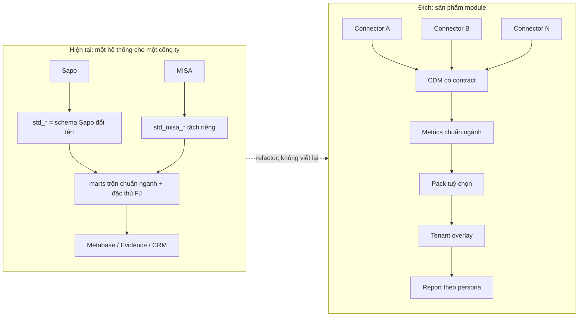

---

## 2. Hiện trạng

### 2.1 Kiến trúc đang chạy

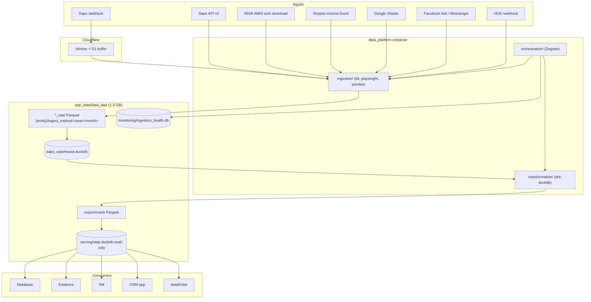

### 2.2 Đánh giá độ sẵn sàng module hoá (đo từ code)

| Khía cạnh | Bằng chứng | Mức sẵn sàng |
|---|---|---|
| Landing zone theo nguồn | `data_lake/{sapo_v2,misa,shopee,hug,gsheet}_raw/` với layout hive `ingest_method=/year=/month=` | ✅ Tốt, giữ nguyên |
| Raw bất biến, dedup 3 lớp | ADR-002, ADR-003 | ✅ Tốt |
| Định danh nguồn | ADR-014: `source_system = '{system}_{version}'` | ✅ Tốt, mở rộng thêm `shop_id` |
| Tầng chuẩn hoá `std_*` | 14 model; 13 model chỉ `ref('stg_sapo_v2_*')`; MISA có `std_misa_*` riêng, không hợp vào `std_orders` | ⚠️ Có khung, chưa trung lập nguồn |
| Marts không phụ thuộc nguồn | 6 model đọc thẳng `stg_sapo_*` (`dim_customer_addresses/contacts/notes/tags`, `fact_order_transitions`, `int_order_tags`); 32 file trong `marts/` có chữ "sapo" | ❌ Rò rỉ |
| Contract schema | Không model nào có `contract: enforced` | ❌ Chưa có |
| Plugin hoá orchestration | `definitions.py` 835 dòng, import tĩnh mọi asset module | ❌ Monolith |
| Dữ liệu riêng công ty | `ref_order_sources.csv` (46 kênh FJ/JPC), `ref_brands`, `seed_cashflow_budget`, `seed_sku_regimen_config`, HUG, US shipment | ❌ Trộn vào lõi |
| Monitoring | `ingestion_health.db`, `config/ingestion_sla.yaml`, freshness/trend/cursor/reconciliation checks, morning digest, stuck-run alerter | ✅ Mạnh; ⚠️ cứng Lark |
| Ingestion runner | `pipeline_runner.run_pipeline()` dùng chung, nhưng mặc định `dataset_name="sapo_v2_raw"` | ⚠️ Gần chung, cần tham số hoá |
| Ranh giới component | Plan `260705-1704-modular-monorepo-boundary-hardening` (DRAFT): import-linter, GHCR, dev/prod split | ⚠️ Đã lên kế hoạch, chưa làm |

### 2.3 Chỗ rò rỉ cụ thể

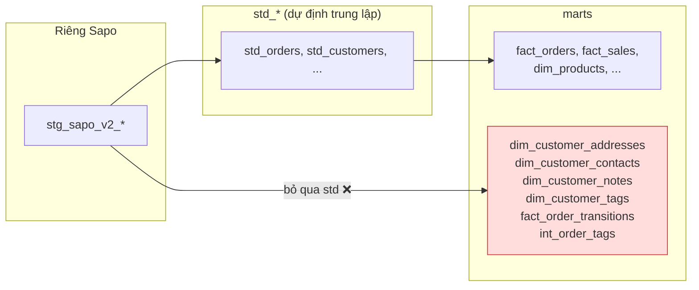

Ngoài 6 model trên, nhiều mart dùng chuỗi `'sapo_v2'` trong điều kiện lọc. Khi thêm Haravan, các model này sẽ âm thầm bỏ sót dữ liệu thay vì lỗi, đây là rủi ro lớn nhất về độ đúng số liệu.

---

## 3. Kiến trúc đích: bản đồ module

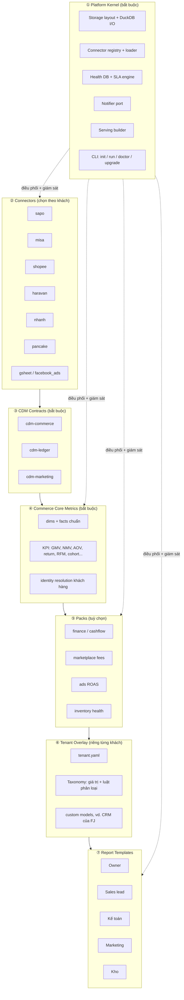

| # | Module | Trách nhiệm | Mặc định | Nguồn trong code hiện tại |
|---|---|---|---|---|
| ① | Platform Kernel | Chạy, lưu trữ, giám sát, cài đặt | Bắt buộc | `orchestration/` (sensors, ops, asset_checks), `pipeline_runner.py`, `scripts/provisioning/` |
| ② | Connector | Lấy dữ liệu 1 nguồn và ánh xạ sang CDM | Chọn | `ingestion/src/{sapo,misa_amis,shopee}`, `staging/src_*`, `stg_*`, `orchestration/assets/*_assets.py` |
| ③ | CDM Contracts | Định nghĩa schema chuẩn, không có logic | Bắt buộc | `staging/standard/schema.yml` (cần nâng cấp) |
| ④ | Core Metrics | Dim/fact/KPI chuẩn ngành TMĐT | Bắt buộc | `marts/core`, `marts/sales`, `marts/inventory`, một phần `marts/customer` |
| ⑤ | Packs | Bài toán chuyên sâu, bật/tắt | Chọn | `marts/finance`, `intermediate/shopee`, `marts/facebook_*`, `intermediate/cogs` |
| ⑥ | Tenant Overlay | Cấu hình và logic riêng một khách | Riêng | seeds + Google Sheet phân loại, `CASE WHEN` phân loại trong SQL, HUG, US shipment, overhead allocation, CRM |
| ⑦ | Report Templates | Dashboard theo persona | Chọn | `docs/analytics-handbook/blueprints/`, `evidence/pages/` |

---

## 4. Authority boundary

Nguyên tắc: **mỗi tầng dữ liệu chỉ có một module được ghi**, các module khác chỉ đọc qua contract. Đây là điều kiện để nâng cấp một module mà không phá module khác.

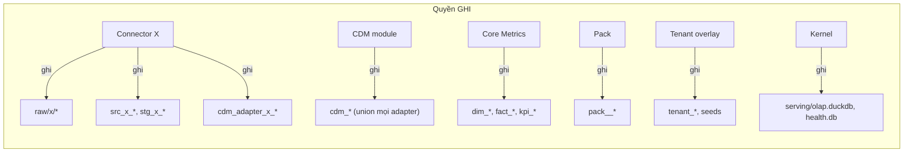

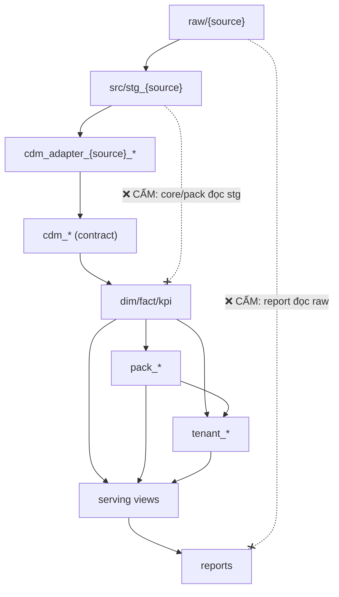

| Tầng | Owner (ghi) | Được đọc bởi | Cấm |
|---|---|---|---|
| `raw/{source}/` | Connector | Chính connector đó | Mọi module khác |
| `src_*`, `stg_*` | Connector | Adapter của chính connector | Core, Pack, Tenant, Report |
| `cdm_adapter_{source}_*` | Connector (theo contract của CDM) | CDM union | Ai khác |
| `cdm_*` | CDM module | Core, Pack, Tenant | Connector ghi trực tiếp |
| `dim_*`, `fact_*`, `kpi_*` | Core Metrics | Pack, Tenant, Serving | Pack sửa đè |
| `pack_*` | Pack tương ứng | Tenant, Serving | Pack khác phụ thuộc chéo (trừ khi khai báo) |
| `tenant_*`, seeds | Tenant overlay | Serving | Core đọc ngược tenant |
| `serving/`, `health.db` | Kernel | Report, CRM, BI | Ai ghi ngoài Kernel |

Cưỡng chế bằng máy, không bằng quy ước: dbt `access: protected/public` + `group` cho model, kiểm tra CI "model trong `core/` không được `ref` tới `stg_*`" (một script grep đơn giản hoặc `dbt-project-evaluator`), và `import-linter` cho Python như plan 260705 đã đề xuất.

---

## 5. Canonical Data Model (CDM)

### 5.1 Ba contract tách biệt, không trộn

MISA là sổ kế toán, Sapo/Haravan/Nhanh/Pancake là hệ vận hành bán hàng, Shopee income là đối soát sàn. Gộp chúng vào cùng `cdm_orders` sẽ đếm trùng doanh thu. Vì vậy CDM tách ba miền và đối soát giữa chúng là một pack riêng (đã có mầm ở `reconciliation_checks.py`).

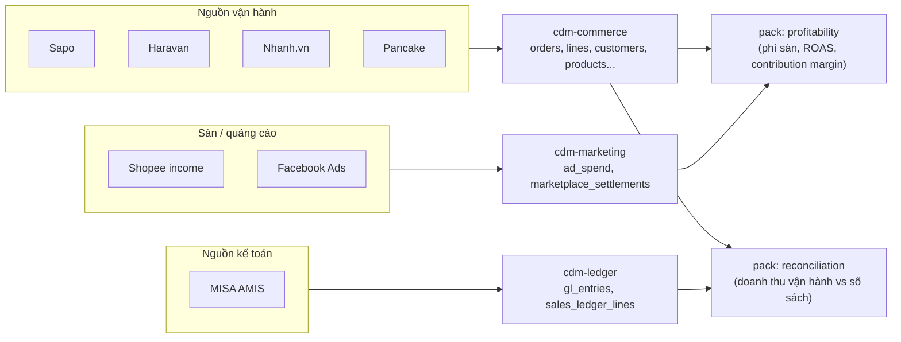

### 5.2 cdm-commerce (lõi)

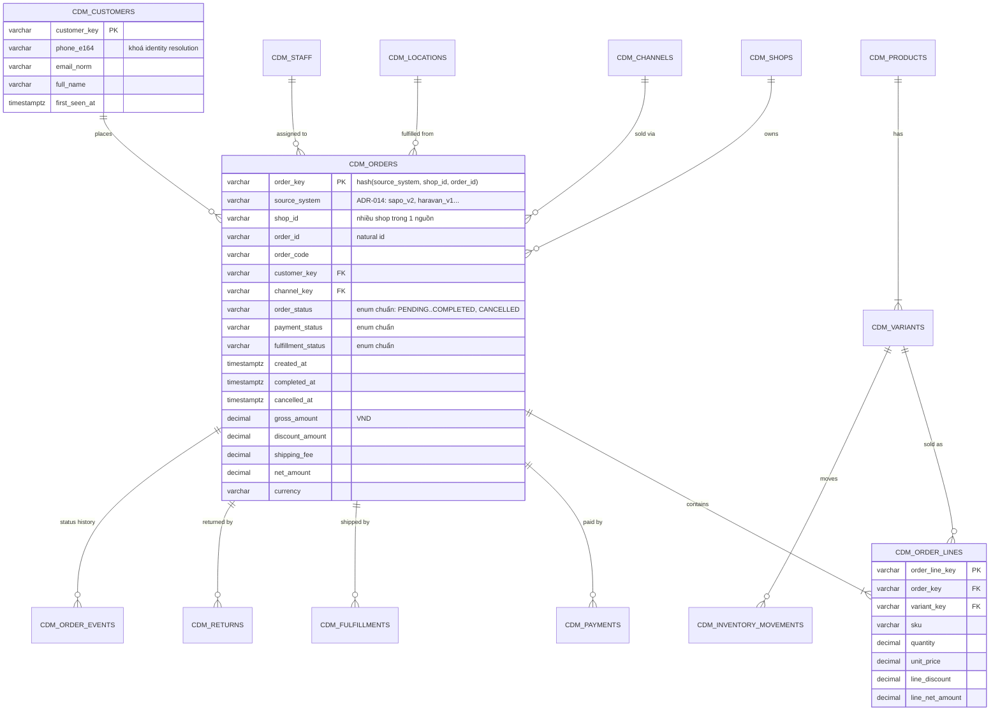

Quy tắc của CDM:

- **Khoá chuẩn** `*_key = hash(source_system, shop_id, natural_id)`. Mở rộng ADR-014 bằng cột `shop_id`, vì một khách có thể có nhiều shop Haravan hoặc nhiều page Pancake.
- **Enum chuẩn** cho trạng thái đơn, thanh toán, giao hàng. Mỗi adapter có một seed `map_{source}_order_status.csv`; giá trị chưa map sẽ rơi vào `UNMAPPED` và bị `monitor_unmapped_*` cảnh báo (cùng tinh thần `monitor_uncategorized_tags.sql` đang có).
- **Cột mở rộng** `attributes JSON` cho trường riêng nguồn, để CDM không phình theo từng connector.
- **Contract enforced**: khai báo `contract: {enforced: true}` trên các model `cdm_*`. Lưu ý: project đang dùng materialization `external` của dbt-duckdb; cần kiểm tra contract có áp dụng cho `external` không. Nếu không, đặt `cdm_*` là `view`/`table` có contract và để tầng core xuất Parquet như hiện nay (xem câu hỏi mở).

### 5.3 Ánh xạ hiện trạng sang CDM

| `std_*` hiện tại | CDM đích | Ghi chú |
|---|---|---|
| `std_orders` | `cdm_orders` | Tách phần Sapo-specific (`final_source_id`, mapping tag) vào adapter Sapo |
| `std_order_items`, `std_order_discount_items` | `cdm_order_lines` (+ `cdm_order_discounts`) | |
| `std_customers` | `cdm_customers` | Thêm `phone_e164` chuẩn hoá cho identity resolution |
| `std_products`, `std_variants`, `std_variant_prices` | `cdm_products`, `cdm_variants`, `cdm_price_lists` | |
| `std_payments`, `std_fulfillments`, `std_order_returns` | cùng tên `cdm_*` | |
| `std_inventory_movements` | `cdm_inventory_movements` | |
| `std_accounts` | `cdm_staff` | Sapo "account" = nhân viên |
| `std_misa_sales_lines`, `std_misa_account_ledger` | `cdm-ledger` | Miền kế toán, không vào `cdm_orders` |
| (chưa có) | `cdm_order_events` | Thay cho `fact_order_transitions` đang đọc thẳng Sapo |
| (chưa có) | `cdm_customer_contacts/addresses/tags/notes` | Thay 4 dim đang đọc thẳng Sapo |

### 5.4 Đa tiền tệ: thay đổi sau này có khó không

Không khó, **nếu ngay bây giờ giữ một quy tắc**: mọi cột tiền trong CDM luôn đi kèm `currency_code` và lưu theo tiền gốc của giao dịch. `std_orders` đã có `'VND' as currency_code`; chỉ cần đưa cột này vào contract của các bảng có tiền (order, line, payment, return).

Khi có case thật, phần thêm vào chỉ nằm ở Core: một bảng tỉ giá theo ngày (seed hoặc connector) và cột quy đổi `amount_base` trong các fact. Connector và report không phải sửa. Ước lượng vài ngày công.

Việc khó chỉ xảy ra nếu bỏ cột tiền tệ bây giờ: khi đó phải lần ngược mọi model đang cộng tiền để biết đơn nào là ngoại tệ.

---

## 6. Module Phân loại (Taxonomy)

### 6.1 Hiện trạng: luật phân loại nằm ở ba nơi

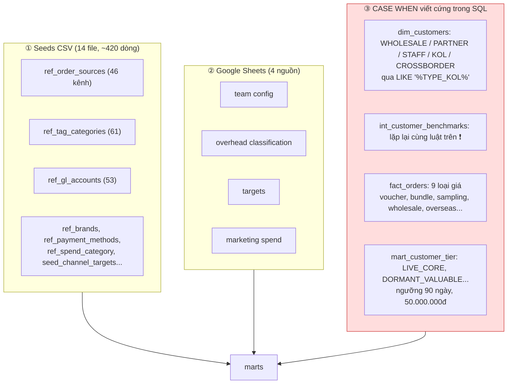

Nhóm ① và ② đã là dữ liệu, chỉ cần gom và chuẩn hoá. Nhóm ③ là vấn đề chính: giá trị phân loại, mẫu nhận diện (`LIKE '%TYPE_KOL%'`) và ngưỡng (90 ngày, 50 triệu) là quyết định kinh doanh của Fine Japan nhưng nằm trong code dùng chung. Một khách SME khác sẽ có nhóm khách, cách gắn tag và ngưỡng VIP khác. Hai model đang tự phân loại loại khách theo cùng một luật, nên sửa một chỗ sẽ lệch chỗ kia.

### 6.2 Tách ba thứ: khung, giá trị, luật

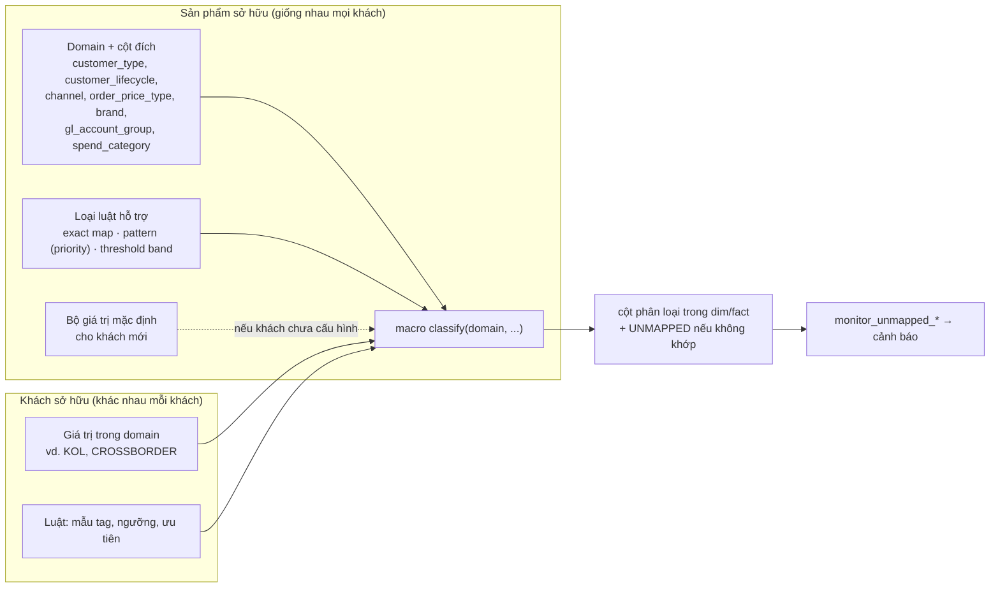

Ba loại luật đủ phủ toàn bộ code hiện có:

| Loại luật | Ví dụ hiện tại | Dạng cấu hình |
|---|---|---|
| Exact map | `source_id` → kênh/brand/thị trường (`ref_order_sources`) | `domain, input_value, output_value` |
| Pattern có ưu tiên | `customer_group LIKE '%TYPE_KOL%'` → `KOL`; tag đơn → loại giá | `domain, priority, field, pattern, output_value` |
| Threshold band | `recency_days <= 90`, `monetary >= 50.000.000` → tier | `domain, metric, min, max, output_value` |

```yaml
# tenants/fine-japan/taxonomy/customer_type.yaml (minh hoạ)
domain: customer_type
rules:
  - { priority: 10, field: customer_group, pattern: "%WHOLESALE%",  value: WHOLESALE }
  - { priority: 20, field: customer_group, pattern: "%TYPE_PARTNER%", value: PARTNER }
  - { priority: 21, field: customer_group, pattern: "%KY_GUI%",      value: PARTNER }
  - { priority: 30, field: customer_group, pattern: "%TYPE_STAFF%",  value: STAFF }
  - { priority: 40, field: customer_group, pattern: "%TYPE_KOL%",    value: KOL }
default: RETAIL
```

Kernel biên dịch các file YAML này thành seed bảng luật; macro `classify()` sinh SQL join theo priority. Khi đó:

- Đổi luật là sửa dữ liệu, không sửa model, không cần build lại image.
- Mỗi domain chỉ phân loại ở một chỗ, hết lặp luật giữa `dim_customers` và `int_customer_benchmarks`.
- Giá trị lạ rơi vào `UNMAPPED` và được cảnh báo, giống `monitor_uncategorized_tags.sql` hiện nay nhưng áp dụng cho mọi domain.
- Report và KPI chỉ dựa vào **cột đích** (domain) chứ không dựa vào **giá trị cụ thể**. Một chart "doanh thu theo customer_type" chạy được cho mọi khách, dù khách A có `KOL` còn khách B có `ĐẠI LÝ CẤP 1`.
- Google Sheet vẫn dùng được làm giao diện nhập luật cho người không viết code; nó chỉ là một nguồn khác ghi vào cùng bảng luật.

### 6.3 Ranh giới quyền

| Thành phần | Owner | Ghi chú |
|---|---|---|
| Danh sách domain, cột đích, loại luật, macro | Sản phẩm (Core) | Thêm domain mới là thay đổi phiên bản Core |
| Bộ giá trị mặc định | Sản phẩm | Để khách mới chạy được ngay |
| Giá trị và luật của từng khách | Tenant overlay | YAML hoặc Google Sheet |
| Kiểm tra `UNMAPPED` | Kernel monitoring | Cảnh báo qua notifier |

---

## 7. Hợp đồng Connector

### 7.1 Một connector là một thư mục tự chứa

```text
connectors/
└── haravan/
    ├── connector.yaml          # manifest: id, version, cdm_version, entities, auth, schedules
    ├── extract/                # Python: dlt source(s), webhook consumer, file-drop parser
    │   ├── source.py
    │   └── webhook.py
    ├── dbt/                    # dbt package riêng
    │   ├── dbt_project.yml
    │   ├── models/src/         # src_haravan_*   (JSON extract + dedup)
    │   ├── models/stg/         # stg_haravan_*   (flatten)
    │   ├── models/cdm_adapter/ # cdm_adapter_haravan_orders ... (đúng contract CDM)
    │   └── seeds/              # map_haravan_order_status.csv, map_haravan_channels.csv
    ├── sla.yaml                # freshness/trend cho asset của connector
    ├── checks.py               # reconciliation: đếm đơn API vs raw
    └── tests/                  # fixture payload thật đã ẩn danh
```

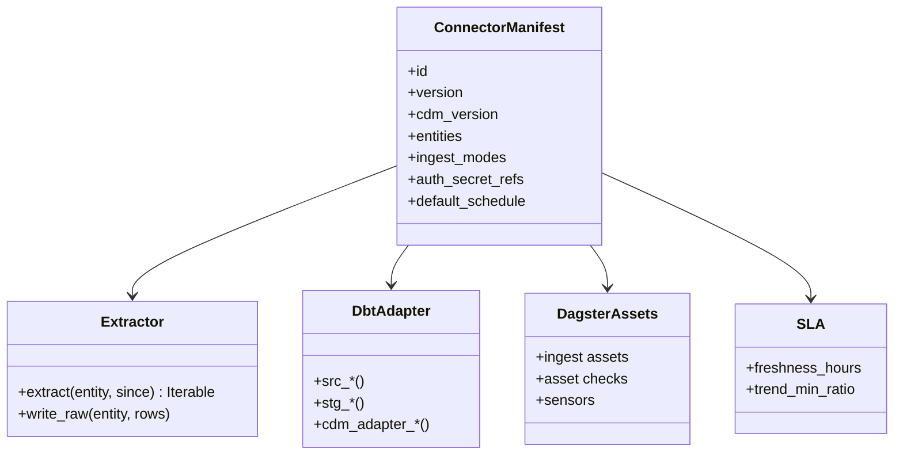

### 7.2 Kernel nạp connector như thế nào

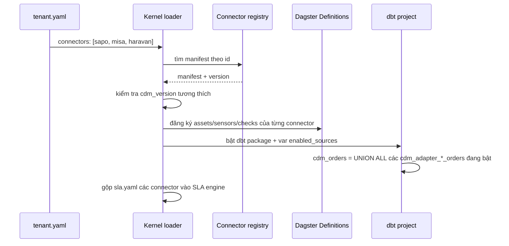

Hai cơ chế cụ thể:

- **Dagster:** thay import tĩnh trong `definitions.py` bằng vòng lặp đọc `tenant.yaml` và gọi factory của từng connector. Dagster Components (stable từ 1.11, GA 9/2025, có sẵn component cho dbt và dlt) là lựa chọn tự nhiên để mỗi connector khai báo bằng YAML. Không bắt buộc phải dùng ngay; một factory Python đơn giản cũng đủ.
- **dbt:** mỗi connector là local package (`packages.yml: - local: ../connectors/haravan/dbt`), model bật/tắt bằng `enabled: "{{ 'haravan' in var('enabled_sources') }}"`. `cdm_orders` dùng một macro union đọc `var('enabled_sources')`, giống mẫu `union_data` mà Fivetran dùng cho các source package (cột `source_relation` để biết dòng đến từ đâu).

### 7.3 Bản đồ nguồn và chế độ ingest

| Connector | Trạng thái | Cách lấy | CDM nhận | Ghi chú |
|---|---|---|---|---|
| Sapo | Đang chạy | API batch + webhook (Cloudflare D1) + history log | commerce | Mẫu tham chiếu để tách đầu tiên |
| MISA AMIS | Đang chạy | Playwright tải file + file drop Excel | ledger | Không vào `cdm_orders` |
| Shopee income | Đang chạy | File drop Excel | marketing (settlement) | |
| Haravan | Mới | Admin API (Bearer token, private app) + webhook | commerce | Có tài liệu chính thức, có rate limit |
| Nhanh.vn | Mới | Open API v3 (`/order` list/history) | commerce | Tài liệu mỏng, cộng đồng báo khó gọi; dự trù thời gian thử |
| Pancake POS | Mới | API key shop + webhook đơn hàng | commerce | Chưa thấy tài liệu chính thức công khai đầy đủ |

---

## 8. Dòng dữ liệu qua các tầng

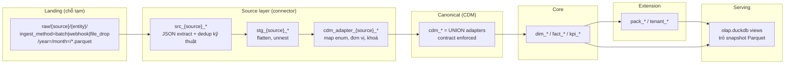

So với 7-hop hiện tại (ADR-001), chỉ thêm một bước rõ ràng là `cdm_adapter` và đổi `std_*` thành `cdm_*` có contract. Landing, dedup, export Parquet, serving snapshot giữ nguyên.

---

## 9. Metrics và report

### 9.1 Bộ KPI chuẩn ngành trong Core

| Nhóm | KPI | Có sẵn trong code |
|---|---|---|
| Doanh thu | GMV, NMV (sau huỷ/hoàn), AOV, số đơn, items/đơn | `fact_orders`, `fact_sales` |
| Kênh | Doanh thu theo kênh/sàn/shop, tỉ trọng | `dim_channels` (cần bỏ phụ thuộc seed FJ) |
| Khách hàng | Khách mới/quay lại, RFM tier, cohort retention, LTV | `mart_customer_tier`, `mart_cohort_retention`, `mart_retention_waterfall_monthly` |
| Vận hành | Tỉ lệ huỷ, tỉ lệ hoàn, thời gian xử lý đơn, giao thành công | `fact_order_returns`, `fact_fulfillments`, `fact_order_transitions` |
| Sản phẩm | Top SKU, sell-through, hàng chậm bán | `mart_product_health`, `mart_inventory_health` |
| Lợi nhuận | COGS, gross margin, contribution margin sau phí sàn/quảng cáo | `fact_order_economics`, `mart_sku_economics_monthly` (cần pack marketplace + ads) |
| Chất lượng dữ liệu | Đơn chưa map kênh, trạng thái lạ, lệch đối soát | `mart_data_quality`, `monitor_uncategorized_tags` |

Mỗi KPI nên có định nghĩa một chỗ (semantic layer dạng YAML trong `docs/analytics-handbook/semantic/` đã có mầm) để Metabase và Evidence dùng cùng công thức.

### 9.2 Report tuỳ biến theo đối tượng

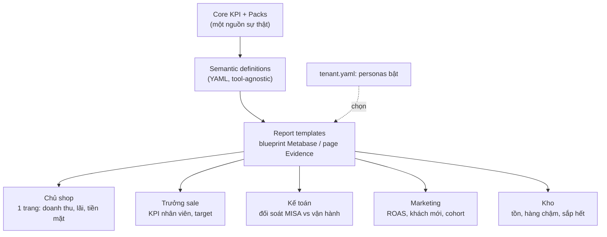

Theo quyết định số 3, đơn vị đóng gói là **report**, không phải engine. Mỗi report template gồm một design spec tool-agnostic (persona, câu hỏi, KPI, bộ lọc) và một bản hiện thực cho engine phù hợp nhất với report đó:

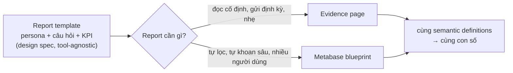

Quy trình 2 skill hiện có (`analytics-design` tool-agnostic → `metabase-automation` / `deploy-evidence-page`) chính là "report factory" cho cách làm này. Khi cài cho khách, chỉ deploy các report thuộc persona khách chọn. Vì report chỉ dựa vào cột đích của Taxonomy (mục 6), cùng một template chạy được cho mọi khách.

### 9.3 Bộ report chuẩn ngành (đề xuất)

Bộ 33 playbook hiện tại được làm cho chính Fine Japan dùng, nên nó vừa thừa vừa thiếu so với một SME bất kỳ. Đề xuất không chuyển nguyên 33 playbook, mà rút ra **12 report lõi** theo bốn nguyên tắc:

1. **Mỗi persona chỉ có một report "nhịp" và tối đa hai report đào sâu.** Report nhịp là một trang ngắn, đẩy định kỳ (qua Lark/Telegram/email) và trả lời câu "có ổn không?". Report đào sâu dùng khi report nhịp báo có vấn đề.
2. **Report trả lời câu hỏi, không liệt kê số liệu** (ADR-010). Mỗi report bắt đầu từ 2–3 câu hỏi của người xem.
3. **Report được mở khoá theo dữ liệu khách có.** Khách chỉ có POS vẫn có bộ report dùng được; thêm dữ liệu sàn, MISA hoặc quảng cáo thì mở thêm report.
4. **Report chỉ dựa vào cột đích của Taxonomy**, nên chạy được cho mọi khách mà không phải sửa.

#### Persona

CEO, CFO và Marketer là ba persona đã chốt. Em đề xuất thêm **Vận hành** vì với shop bán online, tiền mất hằng ngày nằm ở đơn bị bom/hoàn, đơn xử lý chậm và hàng hết kho. Thêm vào đó là một trang **Data health** luôn được cài, dành cho mình khi hỗ trợ khách.

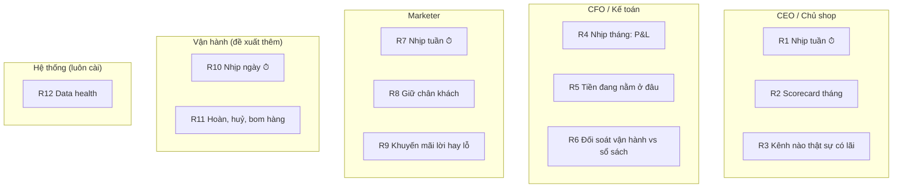

#### Danh mục 12 report lõi

| # | Report | Câu hỏi chính | KPI chính | Nhịp | Tái dùng playbook FJ | Dữ liệu cần |
|---|---|---|---|---|---|---|
| R1 | CEO nhịp tuần | Tuần này tốt hay xấu, vì sao? | NMV, số đơn, AOV, biên gộp, khách mới/quay lại; so tuần trước và cùng kỳ | Tuần, đẩy tin | `ceo_weekly_pulse` | POS |
| R2 | CEO scorecard tháng | Có đạt mục tiêu không, tăng trưởng đến từ đâu? | NMV so với target, mix kênh, mix sản phẩm, tăng trưởng YoY | Tháng | `ceo_monthly_scorecard`, `sales_monthly_review` | POS (+ target) |
| R3 | Kênh nào thật sự có lãi | Bán ở đâu thì giữ lại được tiền? | CM1, CM2, CM3 theo kênh | Tháng | `channel_profitability_monthly`, `finance_channel_pl` | POS + phí sàn (+ quảng cáo) |
| R4 | CFO nhịp tháng: P&L | Lãi/lỗ tháng này bao nhiêu? | Doanh thu thuần, giá vốn, biên gộp, chi phí, lãi ròng | Tháng | `finance_pl` | POS + giá vốn (+ MISA) |
| R5 | Tiền đang nằm ở đâu | Bao nhiêu tiền chưa về tay? | COD chưa đối soát, tiền sàn chưa thanh toán, công nợ, tồn kho theo giá vốn | Tuần | Một phần `finance_cashflow` (cần viết mới) | POS + thanh toán sàn |
| R6 | Đối soát vận hành vs sổ sách | Số POS và số kế toán có khớp không? | Chênh lệch doanh thu theo tháng/kênh | Tháng | `finance_accounting_recon` | POS + MISA |
| R7 | Marketer nhịp tuần | Khách mới đến từ đâu, chi tiêu có hiệu quả? | Khách mới, MER, ROAS theo kênh, chi phí/khách mới | Tuần, đẩy tin | `marketing_weekly_tracker`, `marketing_roi` | POS (+ quảng cáo) |
| R8 | Giữ chân khách | Khách có quay lại không? | Tỉ lệ mua lại, thời gian đến đơn thứ 2, cohort, RFM | Tháng | `customer_retention_cohorts`, `customer_intelligence` | POS |
| R9 | Khuyến mãi lời hay lỗ | Giảm giá có kéo thêm doanh thu thật không? | Độ sâu giảm giá, tỉ trọng đơn có KM, biên sau KM | Theo chiến dịch | `sales_promotion_analysis` | POS |
| R10 | Vận hành nhịp ngày | Hôm nay có gì cần xử lý? | Đơn chờ xử lý quá hạn, đơn giao thất bại, SKU sắp hết | Ngày, đẩy tin | `sales_daily_operation`, `logistics_operations` | POS |
| R11 | Hoàn, huỷ, bom hàng | Mất bao nhiêu vì đơn không thành? | Tỉ lệ hoàn/huỷ theo kênh, vùng, sản phẩm; chi phí hoàn | Tuần | `finance_return_impact`, `logistics_shipping` | POS |
| R12 | Data health | Dữ liệu có mới và đúng không? | Độ tươi, số dòng, giá trị `UNMAPPED`, lệch đối soát | Ngày | `ingestion_health` | Kernel |

**Cá nhân bán hàng** thường kiêm mọi vai trò, nên gộp R1, R3, R8 và R10 thành **một trang "Chủ shop"** thay vì bốn bộ report.

#### Khung KPI chuẩn nên thống nhất ngay

| KPI | Định nghĩa | Vì sao quan trọng với SME bán online |
|---|---|---|
| GMV / NMV | GMV là tổng giá trị đơn đặt; NMV là phần còn lại sau huỷ, hoàn, giảm giá | GMV đẹp nhưng NMV mới là tiền thật, nhất là khi tỉ lệ bom hàng COD cao |
| CM1 | NMV − giá vốn | Biên gộp sản phẩm |
| CM2 | CM1 − phí sàn − phí vận chuyển − phí thanh toán − chi phí hoàn | Biên sau chi phí bán hàng; đây là chỗ kênh sàn thường lộ ra lỗ |
| CM3 | CM2 − chi phí marketing | Lãi thật của kênh; nền cho R3 |
| MER | NMV ÷ tổng chi phí marketing | Dễ hiểu và ít tranh cãi hơn ROAS khi chạy nhiều nền tảng quảng cáo |
| Tỉ lệ mua lại | % khách có từ 2 đơn trong 90/180 ngày | Chỉ số sống còn của giữ chân khách |

Các định nghĩa này đặt trong `docs/analytics-handbook/domains/` (đang có) và trong semantic layer, để Evidence và Metabase ra cùng một con số.

#### Report mở khoá theo dữ liệu

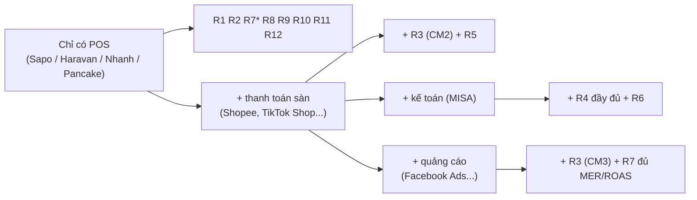

\* R7 khi chưa có dữ liệu quảng cáo chỉ hiển thị phần khách mới; phần chi phí nhập tay qua sheet (giống `gsheet_marketing_spend` hiện có).

#### Playbook của Fine Japan không vào bộ lõi

| Playbook | Đi đâu | Lý do |
|---|---|---|
| `b2b_orders_tracking`, `b2b_sales_daily` | Tenant overlay FJ (sau này có thể thành pack B2B) | Không phải SME nào cũng có kênh sỉ |
| `customer_daily_action_queue`, `customer_support_social_commerce` | Tenant overlay FJ | Phục vụ CRM, đã loại khỏi sản phẩm |
| `us_crossborder_operations`, `finance_services_revenue` | Tenant overlay FJ | Mô hình kinh doanh riêng |
| `shopee_channel_economics` | Pack marketplace | Tổng quát hoá cho mọi sàn, cấp số cho R3/R5 |
| `finance_cost_ledger`, `finance_cashflow` | Pack finance | Cần MISA và ngân sách; dùng cho khách có kế toán bài bản |
| `order_listing`, `order_revenue_explorer`, `order_profitability_all` | Công cụ tra cứu tuỳ chọn | Dành cho người phân tích, không phải report theo persona |

**Thứ tự làm:** R1 → R10 → R8 → R3 → R4, sau đó đến phần còn lại. R1, R10 và R8 chỉ cần dữ liệu POS nên chạy được với mọi khách ngay ngày đầu; R3 và R4 là lý do khách trả tiền nhưng cần thêm dữ liệu.

---

## 10. Monitoring

Hiện trạng monitoring là điểm mạnh nhất để đóng gói. Cần làm ba việc: để SLA đến từ connector thay vì một file trung tâm, thay Lark cứng bằng notifier port, và thêm heartbeat để nhà cung cấp theo dõi nhiều khách.

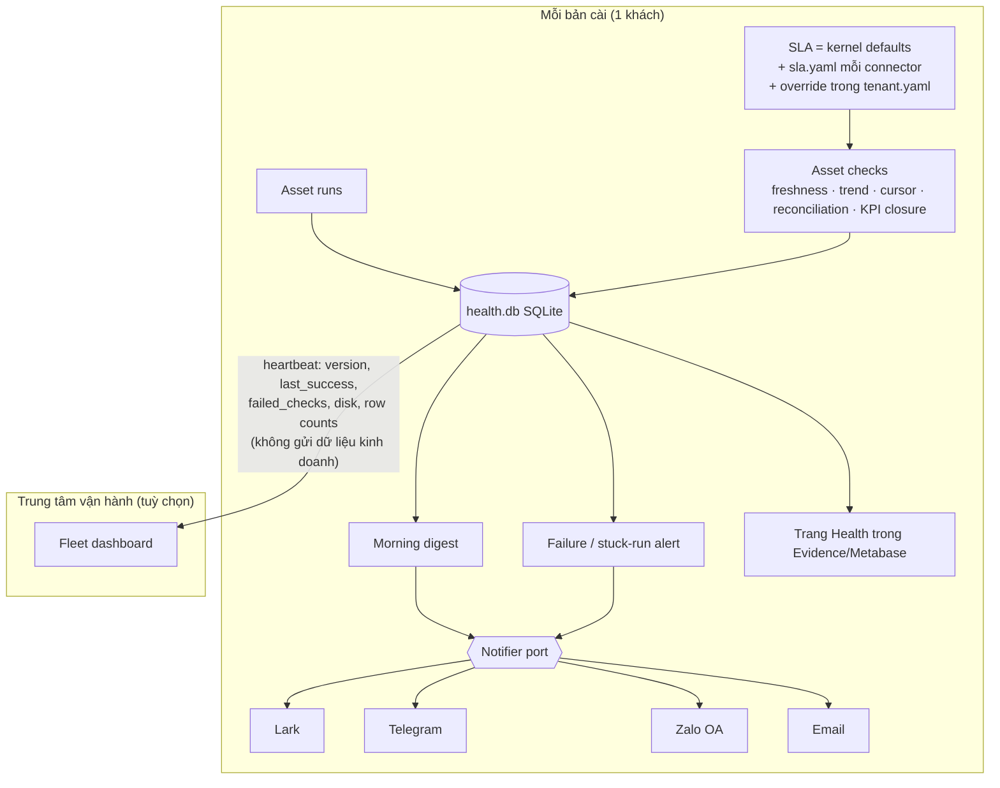

| Tín hiệu | Nguồn hiện có | Bổ sung |
|---|---|---|
| Asset có chạy đúng hạn | `freshness_checks.py` + SLA YAML | SLA theo connector |
| Khối lượng bất thường | `row_trend_checks.py` | — |
| Cursor/incremental bị kẹt | `cursor_checks.py` | — |
| Số liệu lệch nguồn | `reconciliation_checks.py` | Chuẩn hoá thành interface mỗi connector tự cài |
| Run treo, pool kẹt | `stuck_run_alerter`, `concurrency_pool_janitor` | — |
| Health DB hỏng | `health_db_watchdog_sensor` | — |
| Map thiếu (trạng thái, kênh) | `monitor_uncategorized_tags` | `monitor_unmapped_*` cho mọi enum CDM |
| Đĩa, dung lượng lake | Chưa có | Đưa vào heartbeat |
| Nhiều khách | Chưa có | Heartbeat push |

---

## 11. Đóng gói và cài đặt

### 11.1 Một khách một stack

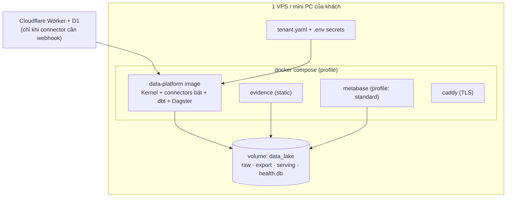

| Profile | Thành phần | Dành cho | Cấu hình ước tính (cần đo) |
|---|---|---|---|
| `lite` | data-platform + Evidence + Caddy | Cá nhân, shop nhỏ | 2 vCPU, 4 GB RAM, 40 GB SSD |
| `standard` | + Metabase | SME có nhiều người xem | 4 vCPU, 8 GB RAM |

Profile chỉ quyết định engine nào được bật; report nào dùng engine nào do template quyết định. Con số trên là ước lượng từ đặc tính thành phần (Metabase là JVM, Dagster webserver + daemon, DuckDB in-process) và dung lượng lake hiện tại 1.3 GB; cần benchmark trên bản cài thật trước khi đưa vào báo giá.

### 11.2 Trải nghiệm cài đặt

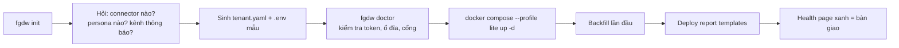

```yaml
# tenant.yaml (minh hoạ)
tenant:
  id: shop-abc
  timezone: Asia/Ho_Chi_Minh
  currency: VND
connectors:
  - id: haravan
    version: "^1.0"
    shops: [main-store]
    secrets: { token: env:HARAVAN_TOKEN }
  - id: misa
    version: "^1.0"
packs: [inventory, marketplace_fees]
taxonomy: ./taxonomy/          # giá trị + luật phân loại của khách (mục 6); thiếu domain nào dùng mặc định
reports:
  personas: [owner, sales_lead] # engine do từng report template quyết định
  engines: [evidence, metabase] # engine được bật trên máy khách
notify:
  channel: telegram
  target: env:TELEGRAM_CHAT_ID
heartbeat:
  enabled: true                # chỉ khi khách đồng ý
```

### 11.3 Cài trên hạ tầng của khách

Theo quyết định số 1, mình là người cài và hỗ trợ, nhưng máy và dữ liệu thuộc khách.

```mermaid
flowchart LR
    subgraph US["Phía mình"]
        REG["Registry image riêng<br/>(GHCR, theo plan 260705)"]
        HUB["Fleet dashboard"]
        REPO["tenants/<khách>/<br/>taxonomy + tenant.yaml (không secret)"]
    end
    subgraph CUST["Hạ tầng khách"]
        HOST["VPS / mini PC"]
        SEC[".env: token POS, MISA, notifier"]
        CF["Cloudflare của khách<br/>(nếu cần webhook)"]
        BK["Backup local + bản sao ra ổ/cloud của khách"]
    end
    REG -- "pull bằng token chỉ-đọc riêng mỗi khách" --> HOST
    REPO -- "deploy cấu hình" --> HOST
    SEC --> HOST
    CF --> HOST
    HOST --> BK
    HOST -. "heartbeat (khách đồng ý), không có dữ liệu kinh doanh" .-> HUB
```

| Việc | Cách làm |
|---|---|
| Phân phối | Image có version, khách pull bằng token chỉ-đọc riêng; thu hồi token khi ngừng hợp đồng |
| Nâng cấp | Đổi tag trong `.env` rồi `docker compose up -d`; rollback bằng tag cũ (đã có trong plan 260705) |
| Cấu hình | `tenant.yaml` và taxonomy của từng khách lưu ở repo phía mình để tái tạo được bản cài; secret chỉ nằm trên máy khách |
| Hỗ trợ từ xa | Tailscale cho truy cập máy chủ; TeamViewer khi cần thao tác cùng khách (quyết định số 7) |
| Backup | Dùng `maintain_backup_platform_job` hiện có, thêm đích sao lưu do khách chọn |

### 11.4 Bố cục repo đề xuất


Giữ monorepo (đúng hướng plan 260705), tổ chức lại theo module:

```text
platform/            # ① Kernel: loader, storage, health, notifier, serving builder, CLI
connectors/          # ② sapo/ misa/ shopee/ haravan/ nhanh/ pancake/
cdm/                 # ③ dbt package: cdm_* contracts + union macro + enum seeds
core/                # ④ dbt package: dim/fact/kpi chuẩn
packs/               # ⑤ finance/ marketplace_fees/ ads/ inventory/
tenants/fine-japan/  # ⑥ overlay: taxonomy FJ, HUG, US shipment, cashflow, CRM
reports/             # ⑦ templates theo persona (blueprint + evidence pages)
deploy/              # compose profiles, caddy, image build
```

Mỗi thư mục có version riêng (tag `connector-haravan-v1.2.0`, `core-v1.0.0`), image `data-platform` gom kernel và các connector, khách chỉ bật bằng cấu hình. Tách repo về sau chỉ là bước cơ học nếu ranh giới đã được cưỡng chế.

---

## 12. Lộ trình chuyển đổi

Thứ tự theo nguyên tắc: **dùng Fine Japan làm tenant đầu tiên**, mọi bước phải giữ số liệu dashboard hiện tại không đổi (so sánh trước/sau).

```mermaid
gantt
    title Lộ trình đề xuất (tuần, ước lượng)
    dateFormat  YYYY-MM-DD
    section Nền
    Boundary hardening theo plan 260705 :a1, 2026-10-19, 14d
    Golden snapshot số liệu hiện tại        :a2, 2026-10-19, 5d
    section CDM
    Thiết kế CDM v1 và contract :b1, after a2, 10d
    Sapo adapter sang CDM, std thành alias :b2, after b1, 10d
    Sửa 6 model đọc thẳng stg sapo :b3, after b2, 5d
    section Taxonomy
    Kiểm kê luật phân loại hiện có :t1, after a2, 5d
    Bảng luật và macro classify :t2, after t1, 10d
    Chuyển CASE WHEN sang taxonomy FJ :t3, after t2, 10d
    section Tách lớp
    Tách tenant overlay Fine Japan và CRM :c1, after b3, 10d
    Tách packs finance ads shopee :c2, after c1, 10d
    section Plugin
    Connector manifest và loader :d1, after b3, 10d
    SLA theo connector và notifier port :d2, after d1, 5d
    section Mở rộng
    Connector Haravan làm nguồn thứ hai :e1, after d2, 15d
    Packaging tenant yaml, CLI, profiles :e2, after d2, 10d
    Pilot khách SME đầu tiên                :e3, after e1, 10d
```

Taxonomy chạy song song với CDM vì nó độc lập về file và là nơi chứa phần lớn logic riêng của Fine Japan; làm sớm giúp thấy rõ phần nào thật sự là chuẩn ngành. Sapo v3 không nằm trong lộ trình (quyết định số 5). Haravan nên là connector mới đầu tiên vì có tài liệu Admin API chính thức; đây là phép thử thật cho CDM. Nhanh.vn và Pancake làm sau khi CDM đã chịu được hai nguồn.

---

## 13. Rủi ro

| Rủi ro | Tác động | Giảm thiểu |
|---|---|---|
| Đổi `std_*` sang `cdm_*` làm lệch số dashboard | Mất niềm tin số liệu | Golden snapshot KPI trước khi refactor, so sánh tự động sau mỗi bước |
| CDM thiết kế theo Sapo, không chịu được Haravan/Pancake | Phải sửa contract liên tục | Lấy payload mẫu của Haravan và Pancake trước khi chốt CDM v1; dùng `attributes JSON` cho trường riêng |
| Đếm trùng doanh thu khi khách dùng cả POS và MISA | Sai báo cáo | Tách `cdm-commerce` và `cdm-ledger`, đối soát là pack |
| Contract dbt không hỗ trợ materialization `external` | Không cưỡng chế được schema | Kiểm tra sớm; phương án: contract trên view/table, export Parquet ở tầng core |
| API Nhanh/Pancake thiếu tài liệu, rate limit | Trễ tiến độ connector | Spike 2–3 ngày mỗi nguồn trước khi cam kết |
| Webhook phụ thuộc Cloudflare của nhà cung cấp | Điểm chết chung, rủi ro dữ liệu khách | Worker đặt trên tài khoản Cloudflare của khách, hoặc chỉ dùng polling cho gói `lite` |
| Chuyển `CASE WHEN` sang taxonomy làm đổi kết quả phân loại | Lệch số theo nhóm khách/kênh | So sánh phân bố giá trị từng domain trước/sau trên golden snapshot |
| Máy khách yếu hoặc không ổn định | Chạy chậm, mất dữ liệu | `fgdw doctor` kiểm tra cấu hình tối thiểu; backup ra đích ngoài máy |
| Bí mật khách (token POS, MISA login) | Rò rỉ | Chỉ để trong `.env` của bản cài; heartbeat không mang dữ liệu kinh doanh hay secret |
| Playwright cho MISA dễ vỡ khi MISA đổi giao diện | Gián đoạn | Giữ file-drop làm đường dự phòng (đã có) |

---

## 14. Bước tiếp theo

1. Bàn tiếp quyết định số 3 (report template và tiêu chí chọn engine).
2. Hoàn tất plan `260705-1704-modular-monorepo-boundary-hardening` (đang DRAFT) vì nó là nền cưỡng chế ranh giới.
3. Chụp golden snapshot các KPI chính (doanh thu, số đơn, khách, COGS theo tháng/kênh) để làm chuẩn so sánh.
4. Viết ADR "Canonical Data Model v1" gồm danh sách thực thể, khoá, enum, và quy tắc union; thu thập payload mẫu Haravan và Pancake làm đầu vào.
5. Kiểm kê toàn bộ luật phân loại hiện có (14 seed, 4 Google Sheet, các `CASE WHEN`) thành danh sách domain → giá trị → luật; đây là đầu vào cho thiết kế Taxonomy.
6. Spike kỹ thuật: kiểm tra `contract: enforced` với dbt-duckdb 1.10.1 `external`, và thử Dagster Components cho một connector.
7. Sau đó lập implementation plan chi tiết bằng `/ak:plan` theo lộ trình mục 12.

## Nguồn tham khảo

- Dagster Components GA: [dagster.io/blog/dagster-components-ga](https://dagster.io/blog/dagster-components-ga), [Dagster 1.11 release](https://dagster.io/blog/dagster-1-11-build-me-up-buttercup), [Reusable component guide](https://docs.dagster.io/integrations/guides/multi-asset-integration)
- Mẫu source package + transform package, union nhiều connector: [Fivetran Shopify source](https://fivetran.com/docs/transformations/data-models/shopify-data-model/shopify-source-model), [Shopify transform](https://fivetran.com/docs/transformations/data-models/shopify-data-model/shopify-transform-model), [Customizing Fivetran dbt packages (Coalesce 2023)](https://www.getdbt.com/resources/coalesce-on-demand/using-and-customizing-fivetran-dbt-packages-from-coalesce-2023)
- dbt model contracts: [docs.getdbt.com model contracts](https://docs.getdbt.com/docs/mesh/govern/model-contracts), [contract config](https://docs.getdbt.com/reference/resource-configs/contract.md)
- Haravan: [Omni APIs](https://docs.haravan.com/docs/omni-apis/), [Get started](https://docs.haravan.com/docs/get-started/overview)
- Nhanh.vn: [API v3 order](https://apidocs.nhanh.vn/v3/order), [Hướng dẫn lấy đơn qua Open API (Viblo)](https://viblo.asia/p/huong-dan-su-dung-nhanhvn-open-api-de-lay-du-lieu-danh-sach-don-hang-bNVQGNP0JvR)
- Pancake POS (nguồn không chính thức): [Woku integration guide](https://woku.app/docs/en/integrations/pancake.md), [Pancake POS MCP](https://glama.ai/mcp/servers/k2j64o96gd)
- Nội bộ: `docs/decisions/001`, `002`, `003`, `014`; `plans/260705-1704-modular-monorepo-boundary-hardening/plan.md`; `plans/260624-1952-warehouse-app-boundary-hardening/plan.md`; `orchestration/config/ingestion_sla.yaml`

## 15. Câu hỏi còn mở

> **Cập nhật 13/10/2026 17:51:** hai câu dưới đây được **hoãn** theo yêu cầu. Ưu tiên trước mắt là module hoá suite đang vận hành (Fine Japan là tenant đầu tiên); bàn đầu ra sau khi phần lõi đã chuẩn. Implementation plan: `plans/261013-1751-modularize-data-platform-suite/`.

1. **Bộ report lõi (mục 9.3):** đồng ý 12 report và việc thêm persona Vận hành không? CFO trong SME mục tiêu thường là kế toán thuê ngoài hay kế toán nội bộ? Điều này quyết định R4–R6 dựa vào MISA hay chỉ dựa vào POS.
2. **Ai nhập luật phân loại (Taxonomy, mục 6) cho khách:** khách tự sửa trên Google Sheet, hay khách báo và mình cấu hình hộ bằng YAML trong repo?
