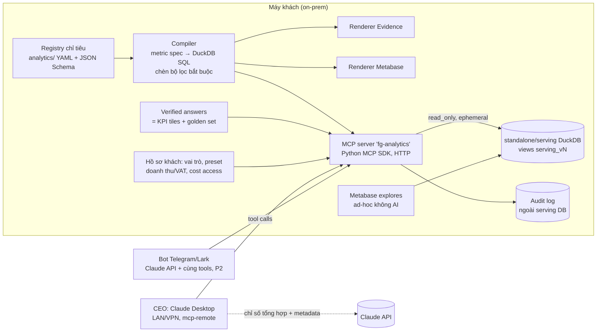

# Ad-hoc query cho user và MCP cho CEO

## TL;DR

1. **Đừng cho CEO một tool `run_sql` tự do.** Bằng chứng 2026 nhất quán: text-to-SQL đã khá hơn nhiều (dbt Labs: Sonnet 4.6 đạt 90%, GPT-5.3-Codex 84% trên 11 câu), nhưng khi sai thì ra **con số trông hợp lý mà sai**. Truy vấn qua semantic layer đạt 98–100% với câu trong phạm vi, còn câu ngoài phạm vi thì báo lỗi chứ không bịa số. Dữ liệu của mình đầy bẫy kiểu này (`scope_*`, `is_active_order`, CROSSBORDER, VAT, nghĩa của `net_revenue`), nên chênh lệch này càng lớn.
2. **Khuyến nghị số 1: một MCP server mỏng do mình viết, đọc thẳng registry chỉ tiêu** (đúng thiết kế đã duyệt). MCP là consumer thứ ba của **cùng bộ sinh truy vấn** (compiler) mà renderer Evidence/Metabase sẽ dùng: registry → compiler → SQL trên serving view chỉ đọc. Tool cho LLM là `list_metrics`, `describe_metric`, `get_dimension_values`, `query_metrics` (tham số có cấu trúc, đã kiểm hợp lệ), `search_verified_answers`, `get_freshness`. Bộ lọc bắt buộc (scope, trạng thái đơn, loại CROSSBORDER/nội bộ, preset VAT/doanh thu) do **compiler chèn vào**, LLM không bỏ được. Mỗi câu trả lời kèm SQL, các giả định đã áp và thời điểm dữ liệu.
3. **Thứ hạng các phương án:** (1) MCP tự viết trên registry. (2) Rill MCP cục bộ (`localhost:9009/mcp`, tool chạy trên metrics view) làm **spike nhanh, chỉ sau khi** Rill sinh từ registry và đã sửa lỗi lệch `scope_*`. (3) MCP có sẵn trong Metabase (0.60+, `/api/metabase-mcp`, OAuth, theo quyền Metabase) để bổ sung việc "tìm card/dashboard có sẵn". Tắt `execute_sql` của nó với user nghiệp vụ. **Loại bỏ** cho bối cảnh on-prem: các tool Semantic Layer của dbt MCP (cần API của dbt Platform), Cube/Wren AI (thêm một bản định nghĩa chỉ tiêu thứ hai, trái DRY), Vanna/text-to-SQL thuần (làm tool chính cho CEO), Cortex/Genie/Looker (gắn với cloud warehouse). Các sản phẩm này chỉ dùng làm **mẫu thiết kế**: verified queries, trusted assets, benchmark.
4. **Ad-hoc cho người không dùng AI:** Metabase question builder chạy trên vài **model "explore" đã tuyển** (bảng rộng, tên tiếng Việt, mô tả sinh từ registry, đã áp scope mặc định), ẩn bảng thô, tắt quyền native SQL với nhóm nghiệp vụ. Rill explore dành cho analyst nội bộ. Evidence không phải công cụ ad-hoc.
5. **Dữ liệu ra khỏi máy:** với tool semantic, thứ gửi lên Claude API chỉ là **số tổng hợp và metadata**. Không cung cấp chiều PII (tên, SĐT, địa chỉ khách), nên phần lớn trường hợp không đụng tới nghĩa vụ chuyển dữ liệu cá nhân ra nước ngoài theo Luật BVDLCN 91/2025/QH15 (hiệu lực 01/01/2026). Điều này **cần pháp chế xác nhận**. LLM chạy cục bộ không đáng làm ở v1 vì máy SME không có GPU, khả năng gọi tool bằng tiếng Việt yếu hơn, và cũng không cần nếu chỉ gửi số tổng hợp.
6. **MVP cho CEO Fine Japan:** khoảng 2 tuần sau khi registry phase 1 (bộ chỉ tiêu Weekly Pulse) xong. Phạm vi: Claude Desktop trên máy CEO, nối vào MCP qua LAN/VPN; DB standalone chỉ đọc; nhật ký kiểm toán; bộ **40 câu hỏi CEO bằng tiếng Việt có đáp án** làm regression test. Ngưỡng: ≥ 95% đúng với câu trong phạm vi, 100% từ chối đúng với câu bị cấm, chạy song song có người duyệt 2 tuần.

---

## 1. Bối cảnh ràng buộc (từ repo)

| Ràng buộc | Hệ quả cho thiết kế |
|---|---|
| DuckDB một writer; serving `data_lake/serving/olap.duckdb` là view trỏ tới Parquet; **standalone export** `sapo_export_*.duckdb` tự chứa, build hằng đêm, AGENTS.md ghi "Use for offline analysis, AI tools" | MCP đọc **standalone** hoặc serving ở `read_only`, kết nối ngắn hạn mỗi truy vấn |
| Đã duyệt: registry chỉ tiêu dạng MetricFlow 2 lớp, compiler giới hạn (sum/count/ratio, một trục thời gian, một join nhiều-một), tham số doanh thu áp lúc sinh truy vấn, `cost_sensitive`, phân quyền theo ≤ 7 chức năng | Registry là **nguồn tri thức duy nhất** của MCP. Không viết thêm định nghĩa riêng cho AI |
| Hôm nay một chỉ tiêu được định nghĩa ở 3 nơi và đang cho số khác nhau (Rill `scope_*`, `Total Orders` không lọc `is_active_order`) | MCP **không được** đi trước Phase 0 (bảng so sánh định nghĩa) của plan report; nếu đi trước, AI sẽ nhân bản chỗ lệch |
| `metrics.md` có 64 mục, dạng văn xuôi, có SQL mẫu | Dùng được làm ngữ cảnh tạm, nhưng là văn xuôi, không phải ràng buộc. Không đủ an toàn cho CEO |
| On-prem tại máy khách, SME Việt Nam | Không dùng dịch vụ semantic layer trên cloud; mạng nội bộ; người dùng có thể không có VPN |

---

## 2. Các cách làm NL→data và bằng chứng độ chính xác

### 2.1 Bằng chứng (đánh giá độ tin cậy)

| Nguồn | Kết quả | Tin cậy |
|---|---|---|
| dbt Labs, "Semantic Layer vs Text-to-SQL 2026" (07/04/2026) | Bộ ACME Insurance, 11 câu × 20 lần. Text-to-SQL: Sonnet 4.6 = 90,0%, GPT-5.3-Codex = 84,1%. Semantic layer: 98,2% / 100%. Câu ngoài phạm vi MetricFlow: 0% cho tới khi bổ sung modeling. Text-to-SQL ra số "hợp lý nhưng sai"; SL thì báo lỗi. Mức reasoning effort ít ảnh hưởng | Trung bình: tác giả là vendor bán SL, bộ câu nhỏ, phải nạp toàn schema vào context (lạc quan cho text-to-SQL). Có repo mở `dbt-labs/dbt-llm-sl-bench` |
| dbt Labs 2023 (cùng bộ) | GPT-4: text-to-SQL 16,7%, SL 83% trên 8 câu trong phạm vi | Cũ, dùng làm mốc so sánh |
| Google Looker | Semantic layer "giảm lỗi tới 2/3" so với truy vấn thẳng bảng thô | Thấp: thử nghiệm nội bộ, không công bố phương pháp |
| Spider 2.0 (632 task doanh nghiệp) | GPT-4o tụt từ 86,6% (Spider 1) xuống ~10%; top leaderboard tự công bố khoảng 80% trên Spider2-Snow nhờ pipeline agent phức tạp; leaderboard bị tạm dừng 08/2026 | Học thuật, tốt về xu hướng; số top không ổn định |
| BIRD | Top khoảng 80–82% EX (09/2026), người: 92,96% | Học thuật; có gợi ý dữ liệu (evidence) đi kèm |
| ViText2SQL (VinAI 2020) + ViR² (VJST 2026) | Tiếng Việt: 23,33% EM trên bản Spider dịch | Thấp về khả năng áp dụng: câu học thuật, không phải câu hỏi kinh doanh |
| Snowflake Cortex Analyst VQR, Databricks Genie, Lightdash | Mẫu chung: **verified query/trusted asset** (cặp câu–truy vấn đã duyệt được dùng lại và gắn nhãn "Trusted"), **benchmark 10–20+ câu** có SQL kỳ vọng để chấm, phạm vi bảng hẹp (Genie khuyên ≤ 5 bảng) | Tài liệu chính thức của vendor; dùng như best practice, không phải số đo |

**Kết luận:** chất lượng modeling và bộ lọc bắt buộc quan trọng hơn chọn model nào. Lớp định nghĩa đã tuyển chọn biến kiểu lỗi "sai im lặng" thành "từ chối/hỏi lại". Với CEO, kiểu lỗi thứ hai chấp nhận được, kiểu thứ nhất thì không.

### 2.2 Ma trận phương án (cho stack của mình)

Thang 1–5, 5 = tốt nhất.

| Phương án | Đúng số với dữ liệu nhiều bẫy | Hợp on-prem DuckDB | Nỗ lực | DRY với registry | Quản trị (vai trò, cost_sensitive) | Rủi ro áp dụng | Xếp hạng |
|---|---|---|---|---|---|---|---|
| **A. MCP tự viết trên registry + compiler** | 5 | 5 | 3 (~2 tuần sau registry) | 5 | 5 (mình kiểm soát) | Thấp (MCP Python SDK chính thức, ít phụ thuộc) | **1** |
| B. Rill MCP cục bộ (metrics view) | 4 (sau khi sinh từ registry) | 4 | 5 (gần như có sẵn) | 4 (nếu sinh từ registry) | 2 (không có vai trò, bản cục bộ không có auth) | Trung bình: Rill Developer là công cụ dev, không phải server nhiều người dùng | **2** (spike / phương án tạm) |
| C. MCP có sẵn của Metabase (0.60+) | 3 (chạy trên card/model; định nghĩa vẫn nằm trong SQL card) | 4 | 4 | 3 | 4 (quyền nhóm Metabase, OAuth) | Trung bình: tính năng mới, cần bật AI; cần `MB_SITE_URL` truy cập được | **3** (bổ sung) |
| D. MetricFlow OSS + `mf query` trên DuckDB | 5 | 3 (DuckDB không có trong ma trận hỗ trợ chính thức của dbt; ví dụ MotherDuck chạy được) | 2 | 4 (nếu registry xuất ra YAML MetricFlow) | 3 (tự bọc) | Trung bình: thêm một engine; thiết kế đã hoãn sang Đợt 3 | Phương án B cho compiler |
| E. dbt MCP Semantic Layer tools | 5 | 1 (gọi Semantic Layer API của dbt Platform) | 4 | 4 | 3 | Cao: phụ thuộc cloud và gói trả phí | Loại |
| F. Cube / Wren AI (MDL) | 4 | 3 (thêm service; Wren tái cấu trúc 05/2026) | 2 | 1 (định nghĩa thứ hai) | 4 / 3 | Trung bình–cao | Loại |
| G. Text-to-SQL có ngữ cảnh (Vanna, MotherDuck MCP `execute_query` + metrics.md) | 2–3 | 5 | 4 | 2 | 1 | Thấp về kỹ thuật, **cao về sai số** | Chỉ làm fallback cho analyst |

---

## 3. MCP: hiện trạng các server có sẵn (đã kiểm 14/10/2026)

| Server | Tool | Ghi chú quan trọng |
|---|---|---|
| **dbt MCP** (`dbt-labs/dbt-mcp`) | SL: `list_metrics`, `get_dimensions`, `get_entities`, `get_dimension_values`, `query_metrics`, `get_metrics_compiled_sql`, `list_saved_queries`; SQL: `execute_sql`, `text_to_sql`; Discovery, Admin, CLI | Bộ tool SL **gọi API của dbt Platform**, kể cả khi chạy server ở máy cục bộ. Đây là **mẫu thiết kế tool tốt nhất** để chép (list → dimensions → query, có compiled SQL) |
| **MotherDuck/DuckDB MCP** | `execute_query`, `list_databases`, `list_tables`, `list_columns` | Mặc định chỉ đọc; `--max-rows 1024`, `--max-chars 50000`, `--query-timeout`, `--init-sql`, ephemeral connections (không giữ khoá file). README: chỉ đọc **chưa đủ** cho bên thứ ba vì vẫn đọc được filesystem, phải khoá bằng `--init-sql` |
| **Metabase MCP có sẵn** (docs v0.60–v0.62) | `search`, `construct_query`, `query`, `execute_query`, `read_resource`, `visualize_query`, `render_drill_through`; ghi: `create_question/dashboard/collection`, `update_*`, `execute_sql` | Endpoint `/api/metabase-mcp`, OAuth 2.0 tích hợp, token theo quyền user. `execute_sql` tắt toàn instance bằng `mcp-execute-sql-enabled`. Không cần cấu hình AI provider nhưng phải bật AI features. Release 60 ghi "AI just went open source". **Chưa kiểm trên instance 0.62.3 của mình** |
| **Rill MCP** | `list_metrics_views`, `get_metrics_view`, `query_metrics_view_summary`, `query_metrics_view`, `list_skills`, `load_skill` | Rill Developer cục bộ: `http://localhost:9009/mcp` qua `mcp-remote`. Metrics view hỗ trợ `ai_instructions`; câu trả lời kèm link Explore để kiểm |
| **Cube MCP** | liệt kê cube/view, measure/dimension, truy vấn có lọc; RLS áp cho agent | Mạnh nhưng là service riêng; tài liệu phần lớn là marketing |
| Repo đang dùng `metabase-ai-assistant` (npx, cộng đồng) | Nhiều tool, phải `disabledTools` | Công cụ cho **dev agent**, không dùng cho CEO |

**Mẫu nền tảng (grounding) chung của các server tốt:** (1) catalog chỉ tiêu và chiều có mô tả; (2) bảng thuật ngữ/từ đồng nghĩa; (3) câu hỏi mẫu đã duyệt (verified/golden); (4) truy vấn có cấu trúc thay vì SQL; (5) trả lại SQL đã biên dịch và link về dashboard để người dùng tự kiểm.

---

## 4. Kiến trúc đề xuất



Luồng một câu hỏi: *"Doanh thu Shopee tháng 9 so với tháng 8 thế nào?"*

```
LLM → search_verified_answers("doanh thu theo kênh theo tháng")   # có mẫu → dùng spec mẫu
    → list_metrics(query="doanh thu")      → net_sales (mặc định, preset "Như Sapo"), net_revenue, delivered_revenue
    → get_dimension_values("channel_std", search="shopee") → "Shopee"
    → query_metrics(metrics=[net_sales], group_by=[month], filters=[channel_std = Shopee],
                    time={start:2026-08-01,end:2026-09-30,axis:order_date}, compare=null)
MCP → compiler: + scope_sales AND is_active_order (+ is_sales_channel đã loại CROSSBORDER/nội bộ), VAT theo preset
    → DuckDB read-only → rows
    → trả: rows, sql, applied_defaults[], data_as_of, coverage_warnings[], metric_definition_vi, query_id
LLM → trả lời CEO bằng tiếng Việt + 1 dòng "Cách tính: …, dữ liệu tới 03:00 14/10, phạm vi: kênh bán"
```

### 4.1 Danh sách tool (MVP gồm 1–6; số 7 chỉ dành cho vai trò analyst)

| # | Tool | Input | Output / hành vi |
|---|---|---|---|
| 1 | `list_metrics` | `query?` (tiếng Việt, có hoặc không dấu), `function?` | id, `label_vi`, từ đồng nghĩa, mô tả 1 dòng, đơn vị, trục thời gian hợp lệ. **Ẩn** chỉ tiêu `cost_sensitive` nếu vai trò không có quyền |
| 2 | `describe_metric` | `metric_id` | Công thức bằng lời, bộ lọc bắt buộc, scope cho phép (sales/retail/b2b), chiều cho phép, additivity, null_policy, độ phủ (vd. % đơn có giá vốn), chỉ tiêu dễ nhầm ("đừng nhầm với…") |
| 3 | `get_dimension_values` | `dimension`, `search?`, `limit≤50` | Giá trị chuẩn `*_std` + nhãn tenant, khớp không dấu (`strip_accents`). Chỉ cho chiều có `exposed_to_ai: true` |
| 4 | `query_metrics` | `metrics[]`, `group_by[]` (kể cả grain thời gian), `time{start,end,axis}`, `filters[{dim,op,values}]`, `scope?`, `compare_to?` (kỳ trước, cùng kỳ năm trước), `order_by`, `limit≤200` | Kiểm hợp lệ theo registry (chiều có join được không, metric có cùng grain không) → compiler → chạy → `{rows, sql, applied_defaults, data_as_of, warnings, query_id}`. Ngoài phạm vi thì trả lỗi có cấu trúc kèm gợi ý, **không fallback ngầm** |
| 5 | `search_verified_answers` | `question` | Top-k cặp (câu hỏi mẫu → spec `query_metrics`) lấy từ KPI tile của catalog và golden set; gắn nhãn "đã duyệt" |
| 6 | `get_freshness` | – | Mốc dữ liệu từng mart (theo `freshness.md`), run Dagster cuối, cảnh báo nếu quá SLA |
| 7 | `run_guarded_sql` (chỉ analyst, P2) | `sql`, `reason` | Chỉ trên view `ai_*`/explore đã tuyển; parse bằng sqlglot: chỉ một câu SELECT, không gọi hàm đọc file, không cột PII; tự thêm LIMIT; timeout; câu trả lời gắn nhãn **"không chuẩn"** |
| + | `log_gap` (ẩn, tự gọi khi ngoài phạm vi) | `question`, `reason` | Ghi yêu cầu chỉ tiêu mới, làm nguồn cho backlog L3 trong plan report |

MCP **resources/prompts:** `glossary-vi` (bảng thuật ngữ Việt–Anh sinh từ registry) và `instructions` của server, gồm: ngày hôm nay, múi giờ Asia/Ho_Chi_Minh, tuần ISO bắt đầu thứ Hai, quy ước "tháng này" = từ đầu tháng tới hôm qua, luôn nêu cách tính, scope và kỳ; không suy diễn nhân quả từ số.

Tham khảo thiết kế: tool SL của dbt MCP, Rill `query_metrics_view`, VQR của Cortex, trusted assets của Genie.

### 4.2 Registry trở thành tri thức của MCP như thế nào

Thêm vào schema registry đã duyệt (cùng file, không tách file "AI"):

| Trường | Mục đích |
|---|---|
| `label_vi`, `synonyms_vi[]` (vd. `net_sales`: "doanh thu", "doanh số", "DT", "tiền bán hàng") | Phân giải câu hỏi tiếng Việt |
| `ai.ambiguity` | Khi người dùng nói chung chung thì làm gì: `default:<id>` + nêu giả định, hoặc `ask` (vd. "lợi nhuận" → hỏi lại CM1/CM2/CM3, hoặc mặc định CM2 có nêu rõ — **[Quyết định]**) |
| `ai.not_to_confuse_with[]` | `net_sales` ≠ `net_revenue` (sau hoàn), `total_collected` (còn VAT) |
| `exposed_to_ai` trên chiều; `pii: true` | Chặn PII từ gốc |
| `required_filters` (đã có dạng cấu trúc) | Compiler chèn vào; LLM chỉ được chọn scope trong danh sách cho phép |
| `verified_examples[]` (câu hỏi → spec) | Nguồn của `search_verified_answers`, đồng thời là test case |

`metrics.md` và glossary **sinh từ registry** (đã có trong thiết kế), nên tài liệu cho người và cho AI không lệch nhau.

### 4.3 Hỏi lại hay mặc định

- **Mặc định có nêu rõ** cho các trường hợp đã có quy ước (kỳ thời gian, scope sales, preset doanh thu, trục ngày đơn). CEO ghét bị hỏi lại; Genie và Cortex cũng ưu tiên trả lời kèm giải thích.
- **Bắt buộc hỏi lại** khi registry đánh dấu `ask`, hoặc có ≥ 2 chỉ tiêu khớp mà khác nhau về bản chất (doanh thu đã giao vs ghi nhận lúc tạo đơn), hoặc chiều có ≥ 2 giá trị khớp ("HN" là kho Hà Nội hay tỉnh Hà Nội).
- Mỗi câu trả lời có 1 dòng **"Cách tính"** và 1 dòng **"Dữ liệu tới"**; khi hỏi thêm thì hiện SQL.

---

## 5. Guardrails

| Rủi ro | Biện pháp (cấu trúc trước, prompt sau) |
|---|---|
| Ghi/xoá dữ liệu | Mở `read_only=True`; compiler chỉ sinh SELECT; không có tool ghi |
| Đọc file/thoát filesystem qua SQL | Ưu tiên DB **standalone** tự chứa, rồi `SET enable_external_access=false; SET lock_configuration=true` ngay khi mở. Nếu dùng serving (view trỏ Parquet) thì cần `allowed_directories` thay cho tắt hẳn (**chưa xác minh** trên phiên bản DuckDB đang ghim) |
| Tranh chấp với Dagster | Kết nối ngắn hạn mỗi truy vấn (như ephemeral connection của MotherDuck MCP), không giữ khoá. Standalone được build xong mới thay, nên không đụng file đang ghi |
| Truy vấn nặng | Compiler chỉ cho aggregate, `limit≤200`, chiều nhiều giá trị (mã đơn, khách) không được group_by; `SET memory_limit`, `threads`. Timeout bằng `connection.interrupt()` từ luồng hẹn giờ (DuckDB không có statement_timeout như Postgres, **cần kiểm**) |
| PII | Không có chiều PII trong registry đối với AI; danh sách khách chỉ trả số đếm. Fallback SQL dùng explore đã bỏ cột PII |
| Lộ chi phí/lợi nhuận | Danh tính user lấy từ token, map sang vai trò rồi sang nhóm chức năng; `cost_sensitive` bị ẩn ở `list_metrics` và **bị từ chối ở `query_metrics`** (kiểm 2 lớp). Dùng chung hồ sơ quyền với deployer |
| Sai mà trông hợp lý | Bộ lọc bắt buộc do compiler chèn; cảnh báo độ phủ ("38% đơn thiếu giá vốn → biên để trống"); cảnh báo độ tươi dữ liệu; câu trả lời luôn nêu cách tính; verified answers ưu tiên trước |
| Prompt injection qua dữ liệu (tên sản phẩm, ghi chú đơn) | Không trả cột văn bản tự do; không có tool ghi hay mạng. Khuyến nghị Claude project của CEO **chỉ bật connector này** để cắt chân "đường rò rỉ" của lethal trifecta |
| Kiểm toán | Mỗi tool call ghi `{ts, user, role, tool, args, sql, rows, ms, result_hash, query_id}` (jsonl hoặc SQLite, ngoài serving DB, có xoay vòng); kèm phản hồi đúng/sai |
| Hồi quy khi đổi registry hoặc model | Golden set chạy trong CI (mục 7) |

---

## 6. Ad-hoc cho người không dùng AI

| Lớp | Cho ai | Phơi bày gì | Không phơi bày |
|---|---|---|---|
| **Metabase question builder** trên Metabase Models "explore" | Quản lý, kế toán, marketing | 4–6 explore rộng: `Đơn hàng`, `Dòng hàng`, `Khách hàng`, `Tồn kho`, `Chi phí quảng cáo` (+ `Lợi nhuận` cho nhóm có quyền chi phí). Cột tên tiếng Việt, mô tả sinh từ registry, đã lọc `is_active_order` + scope mặc định (hoặc có cột cờ rõ ràng), tiền đã tách VAT theo preset | Bảng `int_*`/`stg_*`, `fact_*` thô (để Hidden trong Data Model), quyền native SQL với nhóm nghiệp vụ |
| Collection "Tự làm" (đã có trong thiết kế) | Như trên | Lưu câu hỏi tự tạo; deployer không động vào | – |
| **Rill explore** | Analyst nội bộ | Metrics view sinh từ registry (phase 8 của plan report) | Khách hàng (v1) |
| Evidence | Mọi người, chỉ đọc | Report định kỳ | Không phải công cụ ad-hoc |

Explore dùng chung cho cả hai đường: người dùng qua Metabase và AI qua `run_guarded_sql` (DRY). Đây cũng là đúng việc "hẹp phạm vi bảng" mà Genie khuyến nghị.

---

## 7. Phương pháp đánh giá (eval)

- **Golden set v1: 40 câu tiếng Việt** viết cùng CEO/kế toán FJ. Tỷ lệ: 60% KPI quen thuộc (doanh thu, số đơn, AOV, theo kênh/tháng), 20% so sánh kỳ hoặc top-N, 10% phải hỏi lại (mơ hồ), 10% phải từ chối (vai trò không có quyền chi phí, chỉ tiêu chưa có như "tỷ lệ chuyển đổi web"). Có biến thể không dấu, viết tắt, lỗi chính tả ("dt shopee t9").
- **Mỗi câu ghi:** spec kỳ vọng (metrics, filters, grain, kỳ) + **số kỳ vọng** từ SQL chuẩn trên một **snapshot standalone đóng băng** + hành vi kỳ vọng (`answer` | `ask` | `refuse`).
- **Chấm điểm:** khớp spec (ít phụ thuộc vào dữ liệu), khớp số (sai số 0 với số đếm, ≤ 0,5% với tiền nếu có làm tròn), đúng hành vi. Chạy mỗi câu **5 lần** để đo độ ổn định (dbt chạy 20 lần).
- **Cổng:** ≥ 95% đúng với câu trong phạm vi; 100% đúng refuse/ask với câu cấm; **0 lần bỏ bộ lọc bắt buộc** (với `query_metrics` thì điều này đúng theo cấu trúc, nhưng vẫn cần test cho fallback SQL).
- **Khi nào chạy:** khi registry hoặc compiler đổi, khi đổi model, và hằng tuần trên snapshot mới chỉ để chấm spec. Mỗi câu CEO trả lời sai trong thực tế trở thành một test case mới (vòng lặp kiểu Genie benchmarks / Cortex evaluations).
- **Chạy song song 2 tuần:** analyst đọc toàn bộ audit log hằng ngày trước khi CEO dùng một mình.

---

## 8. Riêng về DuckDB và LLM

**DuckDB.** Tài liệu chính thức: chế độ read-only cho phép **nhiều process đọc nhưng không process nào ghi**, nghĩa là không thể đọc file đang được writer giữ. Vì vậy MCP đọc **file khác** với file dbt đang ghi: standalone (bản snapshot hằng đêm, khuyến nghị cho MVP) hoặc serving (thay atomically sau build). Quack (giao thức client-server) mới ở beta (1.5.2) nên không dùng. Hiệu năng không phải vấn đề: aggregate trên mart vài triệu dòng chạy dưới 1 giây. Độ trễ chủ yếu nằm ở LLM (khoảng 5–20 giây mỗi câu, ước lượng theo số liệu dbt).

**LLM: API hay cục bộ.**

| | Claude API / Claude Desktop | LLM cục bộ (Ollama, model cỡ Qwen) |
|---|---|---|
| Chất lượng gọi tool + tiếng Việt | Cao (đo được qua golden set) | Thấp hơn, **chưa có số đo cho tiếng Việt kinh doanh** |
| Phần cứng SME | Không cần | Cần GPU hoặc chấp nhận chậm trên CPU |
| Dữ liệu ra ngoài | Số tổng hợp + metadata; ZDR chỉ áp cho khách được duyệt; dữ liệu API không dùng để train nếu không cho phép | Không ra ngoài |
| Pháp lý VN (Luật 91/2025) | Số tổng hợp không phải dữ liệu cá nhân, nên nhiều khả năng không phải lập CBTIA. Nếu lộ PII qua fallback SQL thì phải lập (**cần pháp chế**) | Không phát sinh |

Khuyến nghị: API ở v1, chặn PII ở tầng tool. Giữ MCP **không phụ thuộc model** để sau này cắm model cục bộ vào cho khách khó tính (ví dụ Open WebUI + Ollama, cả hai đều có MCP client, **chưa kiểm**).

**Kênh truy cập của CEO.**
- *Claude Desktop* với cấu hình cục bộ: kết nối xuất phát **từ máy CEO**, nên LAN/VPN dùng được.
- *Custom connector trên claude.ai/mobile*: kết nối xuất phát **từ server của Anthropic**, nên MCP phải ra internet công khai + OAuth. Rủi ro hơn, để P3.
- Với điện thoại: **bot Telegram/Lark** (notifier sẵn có) gọi Claude API với cùng bộ tool. Không phải mở MCP ra internet.

---

## 9. Lộ trình

| Giai đoạn | Điều kiện vào | Việc | Ra (đo được) |
|---|---|---|---|
| **P0** (thuộc plan report) | – | Phase 0 so sánh định nghĩa; registry phase 1 (chỉ tiêu Weekly Pulse) + compiler; sửa 2 lỗi số; thêm trường AI (§4.2) vào schema | Registry pass validator; compiler cho ra cùng số với blueprint Weekly Pulse |
| **P1: MVP CEO FJ** (~2 tuần, **ước lượng**) | P0 xong | MCP server Python (SDK MCP chính thức), tool 1–6, chạy trên máy chủ FJ, HTTP trên LAN; Claude Desktop của CEO nối qua `mcp-remote`; DB standalone chỉ đọc; audit log; golden set 40 câu + CI; 2 tuần chạy song song có người duyệt | Đạt cổng §7; CEO dùng ≥ 3 lần/tuần; 0 sự cố sai số được báo |
| **P1b** (tuỳ chọn, 1–2 ngày) | Rill sinh từ registry | Spike Rill MCP cục bộ để so sánh UX và độ chính xác trên cùng golden set | Quyết định có cần giữ Rill MCP làm kênh analyst không |
| **P2** (~2 tuần) | P1 đạt | Đa người dùng (token theo user → vai trò → chức năng → `cost_sensitive`); `run_guarded_sql` cho analyst trên explore; bot Telegram/Lark; mỗi câu trả lời kèm link card Metabase hoặc trang Evidence; Metabase explores cho ad-hoc không AI; cân nhắc bật Metabase MCP (đã tắt `execute_sql`) cho tool "tìm dashboard" | Golden set mở rộng 80 câu, gồm cả các vai trò |
| **P3** | ≥ 2 khách | Đóng gói theo tenant (registry chuẩn + overlay, golden set chuẩn + golden riêng từng khách); connector công khai + OAuth nếu cần; tuỳ chọn LLM cục bộ; MetricFlow chỉ khi compiler chạm giới hạn | Cài cho khách mới không sửa code |

**Ghi chú về kích thước nhóm:** P1 dùng lại compiler, nên phần việc mới chỉ là lớp MCP (khoảng 300–600 dòng Python), audit và eval harness. Nếu P0 trễ, **không** làm MVP trên `metrics.md` văn xuôi cộng `execute_query` tự do cho CEO; nếu buộc phải có gì đó sớm, chỉ dùng nội bộ cho analyst.

---

## 10. Rủi ro

| Rủi ro | Khả năng | Tác động | Giảm thiểu |
|---|---|---|---|
| Registry/Phase 0 trễ khiến MCP bị chặn | Cao | Trung bình | MCP là consumer; không đi tắt. Analyst dùng MotherDuck MCP nội bộ trong lúc chờ |
| CEO hỏi ngoài phạm vi chỉ tiêu (mới đầu có thể 30–40%, **ước lượng**) | Cao | Trung bình (thất vọng) | `log_gap` → backlog; mở rộng registry theo tần suất câu hỏi; trả lời rõ "chưa có, đã ghi nhận" |
| LLM diễn giải quá mức ("doanh thu giảm vì…") | Trung bình | Cao | Instructions cấm suy diễn nhân quả; chỉ nêu số và phép so sánh |
| Hiểu sai kỳ ("tuần trước", Tết âm lịch) | Trung bình | Trung bình | Echo kỳ trong mọi câu trả lời; golden set có câu về kỳ; tool lịch âm để sau |
| Phá vỡ MCP SDK/spec (transport đổi sang Streamable HTTP 2025-11-25) | Trung bình | Thấp | Ghim phiên bản SDK; `mcp-remote` làm cầu nối |
| Metabase MCP thay đổi nhanh (OAuth phải đăng nhập lại ở 0.64) | Trung bình | Thấp | Chỉ dùng làm phần bổ sung |
| Lộ dữ liệu qua Claude client có connector/web khác | Thấp–Trung bình | Cao | Project riêng chỉ có connector này; không có tool ghi; không có cột văn bản tự do |
| Chi phí thuê bao Claude cho CEO/nhân viên ở mỗi khách | Chắc chắn | Thấp–Trung bình | Bot dùng API (trả theo lượng dùng) cho người dùng không cần Desktop |

---

## 11. Giới hạn của nghiên cứu này

- Không truy vấn DB hay Metabase đang chạy: chưa kiểm instance 0.62.3 có bật được Admin > AI > MCP trên bản OSS không (docs v0.62 có trang MCP, release 60 ghi "AI open source", nhưng trang MCP không ghi rõ edition).
- Không có benchmark độc lập cho NL→metric bằng tiếng Việt kinh doanh. Golden set của chính mình là bằng chứng duy nhất đáng tin.
- Số Spider 2.0/BIRD lấy từ nguồn thứ cấp; leaderboard Spider2 bị tạm dừng 08/2026.
- Chưa kiểm `allowed_directories`/`enable_external_access` và cơ chế interrupt trên phiên bản DuckDB đang ghim trong image.
- Ước lượng công (2 tuần) chưa qua planner.
- Pháp lý (CBTIA theo Luật 91/2025, Nghị định 356/2025) dựa vào bình luận của các hãng luật, không phải văn bản gốc.

## Nguồn (truy cập 14/10/2026)

- dbt Labs, Semantic Layer vs Text-to-SQL 2026: https://docs.getdbt.com/blog/semantic-layer-vs-text-to-sql-2026
- dbt MCP available tools: https://docs.getdbt.com/docs/dbt-ai/mcp-available-tools
- About MetricFlow: https://docs.getdbt.com/docs/build/about-metricflow · MotherDuck MetricFlow cookbook: https://motherduck.com/docs/cookbook/dbt-metricflow/
- Cube, semantic layer + AI: https://cube.dev/blog/semantic-layers-the-missing-piece-for-ai-enabled-analytics · https://cube.dev/articles/analytics-mcp-server
- Looker semantic layer + gen AI: https://cloud.google.com/blog/products/business-intelligence/how-lookers-semantic-layer-enhances-gen-ai-trustworthiness
- Spider 2.0: https://github.com/xlang-ai/Spider2 · BIRD (paper): https://huggingface.co/papers/2305.03111 · Gemini-SQL2 BIRD: https://aiweekly.co/alerts/googles-gemini-sql2-tops-bird-text-to-sql-at-8004 · Huawei BIRD: https://technologymagazine.com/news/huawei-datagallery-tops-benchmark-for-enterprise-text2sql-ai
- ViText2SQL: https://paperswithcode.com/paper/a-pilot-study-of-text-to-sql-semantic-parsing · ViR²: https://vietnamscience.vjst.vn/index.php/vjste/article/view/1364
- Snowflake Cortex Analyst VQR: https://docs.snowflake.com/user-guide/snowflake-cortex/cortex-analyst/verified-query-repository · Evaluations: https://docs.snowflake.com/de/user-guide/snowflake-cortex/cortex-analyst-evaluations
- Databricks Genie: https://docs.databricks.com/genie/index.html · https://www.databricks.com/blog/how-build-production-ready-genie-spaces-and-build-trust-along-way
- Metabase MCP: https://www.metabase.com/docs/v0.62/ai/mcp · https://www.metabase.com/docs/latest/ai/mcp · AI overview: https://www.metabase.com/docs/latest/ai/overview · Metabot v0.62: https://www.metabase.com/docs/v0.62/ai/metabot · Release 60: https://www.metabase.com/releases/metabase-60
- Rill MCP: https://docs.rilldata.com/guide/ai/mcp
- MotherDuck/DuckDB MCP: https://github.com/motherduckdb/mcp-server-motherduck
- Lightdash agents: https://docs.lightdash.com/agents
- Wren AI: https://pypi.org/project/wrenai/ · Vanna: https://pypi.org/project/vanna/0.0.31
- DuckDB concurrency: https://duckdb.org/docs/current/connect/concurrency
- MCP security (Supabase defense in depth): https://supabase.com/blog/defense-in-depth-mcp
- Claude custom connectors (remote MCP): https://support.claude.com/en/articles/11175166-get-started-with-custom-connectors-using-remote-mcp
- Anthropic API data retention / ZDR: https://platform.claude.com/docs/en/build-with-claude/api-and-data-retention · https://platform.claude.com/docs/en/build-with-claude/zero-data-retention
- Luật BVDLCN VN: https://connectontech.bakermckenzie.com/vietnam-decoding-vietnams-pdp-law-gdpr-inspired-rules-with-local-twists/ · https://assets.kpmg.com/content/dam/kpmg/vn/pdf/2025/07/exploring-vietnam-personal-data-protection-law.pdf

## Câu hỏi chưa giải quyết

> **User trả lời 15/10/2026:** câu 2 → làm **cả hai** (Claude Desktop và bot Lark). Câu 4 → dữ liệu hằng đêm **đủ**. Câu 1 (16/10) → "lợi nhuận" mặc định **CM2**, luôn nêu rõ bậc trong câu trả lời.

1. "Lợi nhuận" mơ hồ: mặc định CM2 và nêu rõ, hay luôn hỏi lại? Áp tương tự cho "doanh thu" (`net_sales` theo preset "Như Sapo")?
2. CEO FJ dùng Claude Desktop (cần thuê bao, VPN/LAN) hay bot Telegram/Lark ngay từ MVP?
3. Instance Metabase 0.62.3 (OSS) có bật được MCP/AI features không, và có muốn bật không (tắt `execute_sql`)?
4. MCP đọc standalone (dữ liệu hằng đêm) có đủ cho CEO không, hay cần serving (mới hơn trong ngày)?
5. Pháp chế: số tổng hợp gửi Claude API có cần CBTIA theo Luật 91/2025 không; nếu P2 bật fallback SQL cho analyst thì sao?
6. Ai sở hữu golden set (CEO/kế toán FJ viết câu, analyst viết đáp án) và ai duyệt khi đổi số?
