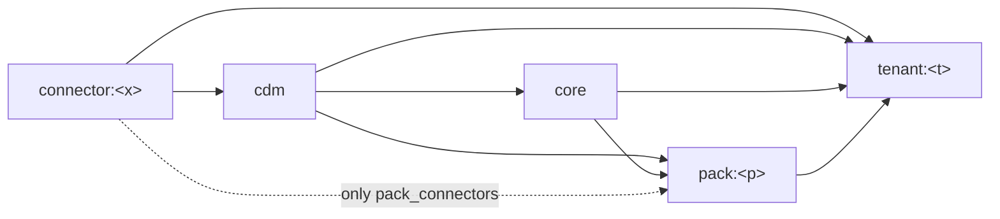

# scripts/checks — refactor and boundary checks

Checks that keep the module architecture ([docs/architecture/modules.md](../../docs/architecture/modules.md))
true in code. The shadow gate ([scripts/shadow/README.md](../shadow/README.md)) runs all of them;
`run-all.sh` runs the pre-commit subset in one command (below).

| File | Kind | Purpose |
|---|---|---|
| `run-all.sh` | pre-commit | dbt parse + `check_boundaries.py` + `dagster definitions validate` + pytest + classification engine selftest, in one command |
| `check_boundaries.py` | rule check | Module dependency matrix (core reads packs only through `pack_ref`), core reading tenant seeds, cross-component imports, duplicate seeds, hard-coded URLs in connectors and packs, pack switch declared consistently (`module-config`) |
| `check_taxonomy_inventory.py`, `taxonomy_inventory.yaml` | warn-only check + data | Classification `CASE` blocks and expressions still in dbt SQL match the inventory (hash per block); a new `CASE` assigning a known taxonomy column is reported |
| `check_taxonomy_rules.py` | rule check | Classification engine rules (seeds `taxonomy_rule_product`, `taxonomy_rule_tenant`) are valid against the registry `vars.taxonomy` and the label sets before they are loaded |
| `check_analytics_registry.py` | rule check | Metric registry (`analytics/registry/`) and tenant profiles: JSON Schema, references, compiler limits, cost flags, dbt manifest columns, generated docs up to date ([analytics/README.md](../../analytics/README.md)) |
| `model_buckets.yaml` | data | Bucket (module) of every dbt model; `pack_connectors` for packs |
| `boundary_allowlist.yaml` | data | Known violations, each with a reason and an exit |
| `golden_snapshot.py`, `public_models.yaml` | data equality | Public tables identical before/after a change |
| `dbt_inventory.py` | dbt contract | Relations, config, refs, tests, compiled SQL unchanged. With `--allow-code-change` SQL checksum and model description changes are INFO and a repointed ref is accepted only while the removed dependency stays an ancestor, or when the removed dependency now reads the added one (a model split: the reader moved to the extracted upstream part); INFO shows the route; `--allow-new` accepts added nodes, dependencies and tests. Nodes with `config.enabled = false` are ignored (dbt keeps a test whose model is disabled in `nodes`) |
| `dagster_inventory.py` | orchestration contract | Assets, checks, job selections, schedules, sensors, SLA unchanged; job selections resolve only to enabled dbt nodes |
| `instigator_state.py` | deploy | Live schedule/sensor on/off state before vs after a deploy |
| `guard_not_prod.py` | safety | Refuses paths inside the prod checkout |

## run-all.sh (mandatory before every commit)

```bash
scripts/checks/run-all.sh                 # checks the worktree that contains the script
scripts/checks/run-all.sh <worktree>      # or another worktree; the prod checkout is refused
```

| Step | Where | Fails when |
|---|---|---|
| 1. `dbt parse --no-partial-parse` | shadow container | the dbt project does not parse (writes `transformation/target/manifest.json` of the checked worktree) |
| 2. `check_boundaries.py --manifest <that manifest>` | host `python3` (needs `crm/`, `detailView/`) | a new boundary violation or a stale allowlist entry (below) |
| 3. `dagster definitions validate -f orchestration/definitions.py` | shadow container | the Dagster code location does not load |
| 4. `pytest ingestion/tests orchestration scripts/tests` | shadow container | a test fails twice (one re-run, printed as `FLAKY` when it passes) |
| 5. `dbt build --select +tag:taxonomy_selftest --indirect-selection cautious --vars '{taxonomy_selftest: true}'` | shadow container | a unit test of the classification engine macro fails (`models/core/intermediate/taxonomy/selftest/`, [taxonomy-engine.md §4b](../../docs/architecture/taxonomy-engine.md#4b-hiện-thực-mvp)); compiles to a scratch target path, so the manifest of step 1 stays the default one |
| 6. `check_analytics_registry.py` + `pytest analytics/tests` | prod image, worktree mounted read-only, no network | the registry has an ERROR (WARN lines do not fail) or an analytics test fails |

The container steps go through `scripts/shadow/run-shadow.sh` (prod image, `--network none`, no
secrets, no `SOURCES__*` variables) on an **empty** scratch lake created under `$SHADOW_ROOT`
(created if missing, mode 0700) and deleted on exit, so they never read customer data and work
after the shadow data is deleted. Only the offline tools are needed: `$SHADOW_DEPS` (default
`~/.cache/fg-dw-tools/deps`: `dbt_packages`, DuckDB extensions, pinned pytest), built by
`scripts/shadow/prepare-deps.sh`; set `SHADOW_ROOT` / `SHADOW_DEPS` to use other locations. All steps run; the script ends with `RUN-ALL: PASS` (exit 0)
or `RUN-ALL: FAIL` (exit 1). It does not prove data equality: a change that moves models or
edits SQL still needs `scripts/shadow/gate.sh M|S` before deploy.

## check_taxonomy_inventory.py

```bash
python3 scripts/checks/check_taxonomy_inventory.py          # compare code with the inventory (exit 0 always)
python3 scripts/checks/check_taxonomy_inventory.py --list   # print file:line, column and sha256 of every CASE block that assigns a taxonomy column
```

The spec is [transformation/docs/TAXONOMY.md](../../transformation/docs/TAXONOMY.md); this check keeps it from
drifting while the classification rules are still SQL. The machine-readable inventory is
`taxonomy_inventory.yaml` (chosen over parsing the markdown: the hashes stay exact and the test
can load it). Each domain lists its `columns` and its `blocks`:

| Block `kind` | Found by | Meaning of `sha256` |
|---|---|---|
| `case` | `CASE ... END [AS] alias` scan of `transformation/models` and `transformation/macros`; comments and string literals are skipped | sha256 of the block with comments removed and whitespace collapsed |
| `expr` | normalized `snippet` must occur in the normalized file | sha256 of the same snippet |

`columns` entries are a column name (any file) or `file.sql:column` (only that file, for generic names such as `status`).

| Output | Meaning | What to do |
|---|---|---|
| `WARN changed` | An inventoried block no longer matches its hash: the rule was edited | Update `TAXONOMY.md`, then the `line`/`sha256`/`snippet` in the inventory. A change of numbers belongs to an S gate |
| `WARN new` | A `CASE ... END AS <taxonomy column>` that is not inventoried | Add it to the inventory and `TAXONOMY.md`, or reuse the existing rule |
| `WARN missing` | An inventoried file is gone | Update the inventory (file moved or deleted) |
| `INFO moved` | Block unchanged, line number differs | Optional: refresh `line` |

It only warns: classification rules may change on purpose, but never silently. The shadow gate prints the
result in step 3c. Tests: `scripts/tests/test_check_taxonomy_inventory.py`.

## check_taxonomy_rules.py

```bash
python3 scripts/checks/check_taxonomy_rules.py              # exit 0: every rule valid; exit 1: prints ERROR <file:line> ...
python3 scripts/checks/check_taxonomy_rules.py --repo <dir> # another checkout or worktree
```

Validates the rule tables of the classification engine before they are loaded (design and
column semantics: [docs/architecture/taxonomy-engine.md §4b](../../docs/architecture/taxonomy-engine.md#4b-hiện-thực-mvp)).
It reads `vars.taxonomy` and `vars.tenant` from `transformation/dbt_project.yml`, the product
layer `seeds/taxonomy/taxonomy_rule_product.csv`, the tenant layer
`seeds/tenants/<tenant>/taxonomy_rule_tenant.csv` (no tenant: `seeds/defaults/taxonomy_rule_tenant__default.csv`)
the label sets in the matching `taxonomy_label` and the canonical codes in `seeds/taxonomy/taxonomy_canonical.csv`. Stdlib + PyYAML, no dbt and no data.

| Error | Example |
|---|---|
| Header differs from `rule_id,domain,priority,label,feature,op,value,value_to,enabled,note`; a core default rule seed has rows | a column renamed |
| Registry inconsistent: unknown `hit_policy`/`cardinality`, COLLECT without `multi` (or FIRST/UNIQUE without `single`), undeclared feature model or different `subject`, feature models of a domain with different `key`, a feature column declared by two models of a domain, unsupported DuckDB type (lists only as `<type>[]`), `required_features`/`survey.features` not a feature of the domain, `matched_flags` not in the label set | `hit_policy: PRIORITY` (not in the MVP) |
| `domain` not in the registry, or a selftest domain (`selftest: true`: its rules live in unit tests, and its `matched_flags` are not checked against `taxonomy_label`); `feature` not a column of the domain's feature models | a typo in `group_code` |
| `op` not allowed for the feature type (`like`/`starts_with`/`contains`/`regex` on strings, `between` on numbers and dates, `has` on lists, `is_null` on any) or unknown | `between` on a varchar |
| `value` not castable to the feature type (each `\|` item for `in`/`not_in`), empty value, invalid regex, `value_to` outside `between`, `is_null` value other than empty/`true`/`false` | `eq abc` on a double |
| `between` without either bound, or `value >= value_to` | both cells empty |
| `label` empty; a tenant rule's label not in `taxonomy_label` for the domain's `label_set`; a product rule's label not a code of `taxonomy_canonical` for the `label_set` (product rules assign canonical codes; `UNMAPPED`/`UNKNOWN` are reserved to the engine) | a label not anchored yet; `RETAIL` in the product layer |
| Rows of one `rule_id` disagree on `domain`, `priority`, `label` or `enabled`; `priority` not an integer; `enabled` not `true`/`false`; empty `rule_id`/`domain`; an unconditional row (no `feature`) mixed with conditions | two priorities for one rule |
| Two effective `rule_id`s share `(domain, layer, priority)` in a FIRST/UNIQUE domain (disabled rules do not count) | order would depend on `rule_id` |
| An unconditional rule in a COLLECT domain | it would label every subject |
| A disable row (`enabled=false`, no label) has a feature/op/value, points to a `rule_id` no layer defines, or to a rule of another domain; one `rule_id` defined in two layers | disabling a rule that was renamed |

Tests: `scripts/tests/test_check_taxonomy_rules.py`, one planted case per error and the committed
seeds, so the pytest step of `run-all.sh` and of the shadow gate fails on an invalid committed rule.

## check_boundaries.py

```bash
# from a full checkout on the host (crm/ and detailView/ must exist); needs a manifest from `dbt parse`
python3 scripts/checks/check_boundaries.py --manifest <path/to/manifest.json>
```

| Rule | Fails when |
|---|---|
| `py-import` | `crm/`, `detailView/` or `analytics/` imports `orchestration`, `ingestion` or `transformation`; `ingestion/` imports `orchestration` |
| `py-scan` | one of those trees is missing (prevents a silent pass inside a container) |
| `orch-import` | a file under `orchestration/connectors/<c>/` imports `orchestration.packs.*`, or a file under `orchestration/packs/<p>/` imports another pack (`orchestration.packs.<q>`, q ≠ p). The kernel loads packs from `modules.yaml`; `__tests__` and the loaders are not scanned |
| `dbt-bucket` | a dbt model (enabled or disabled) has no entry in `model_buckets.yaml` |
| `dbt-path` | a model's file is not under `models/<module folder of its bucket>/` |
| `dbt-ref` | an enabled model depends on a model its bucket may not read (matrix below). `core` → `pack:<p>` model `m` is accepted only when the core model's raw SQL calls `pack_ref('<p>', '<m>'` (positional, literal ids, single or double quotes), has no direct `ref('<m>')`, and `m` has a contract for pack `<p>` in `transformation/macros/packs/pack_contracts.sql` (read with a regex: one entry `'<m>': {'pack': '<p>', ...}` per model). Any other `core` → `pack:*` edge and every `core` → `tenant:*` edge exist only as allowlist entries. Disabled models keep the `dbt-bucket`/`dbt-path` rules but their edges are not checked (dbt does not resolve them), so run the check on the manifest of the default profile (no `--vars`) |
| `dbt-source` | a model outside `connector:*` / `tenant:*` reads a dbt source |
| `dbt-seed` | a model of `cdm` or a connector (or of another tenant) depends on a tenant seed, i.e. a seed under `transformation/seeds/tenants/<t>/`, or a `core` model does without calling `tenant_ref('<seed>')` literally (or also refs it directly). Packs, `monitoring` and `tenant:<t>` itself may read it (pack logic, tenant data). Taxonomy and other seeds are not concerned |
| `tenant-seed-contract` | a seed read through `tenant_ref('<seed>')` has no core default `transformation/seeds/defaults/<seed>__default.csv`; the enabled tenant (`tenants:` in `modules.yaml`) has no `seeds/tenants/<t>/<seed>.csv` or its header differs from the default's; or the default's `+column_types` (`dbt_project.yml`, `seeds: sapo_warehouse: defaults:`) does not list exactly its header columns. Never allowlisted |
| `seed-duplicate` | two CSVs under `transformation/seeds/` share a basename (dbt parse would fail and `data_platform` would not start) |
| `connector-url` | an `http(s)://` URL (any line) or a domain name inside a string literal (e.g. `"fwg.mysapogo.com"`; module paths and file names do not match) appears under `orchestration/connectors/**` |
| `pack-url` | the same under `orchestration/packs/**`. Tenant values go to `orchestration/tenants/<tenant>/config.py`, read with `orchestration.tenants.setting(name)` |
| `module-config` | the pack switch disagrees: `packs:` in `orchestration/config/modules.yaml` ≠ `vars.enabled_packs` in `transformation/dbt_project.yml`; a folder under `transformation/models/packs/` has no `+enabled` or one whose default list differs from `modules.yaml` (compared with the exact template `{{ ('<p>' in var('enabled_packs', [...])) \| as_bool }}`); a pack of `modules.yaml` has no folder; `pack_ids()` in `transformation/macros/packs/pack_enabled.sql` ≠ the pack folders; `tenants:` in `modules.yaml` has more than one id or differs from `vars.tenant` (`""` for none); `connectors:` in `modules.yaml` differs from `vars.enabled_connectors` (same ids, same order). Never allowlisted: the check prints the block to paste (design: `docs/architecture/modules.md` §8.1) |



| Bucket of the model | May depend on |
|---|---|
| `connector:<x>` | `connector:<x>`, seeds, sources |
| `cdm` | `connector:*`, `cdm`, seeds |
| `core` | `cdm`, `core`, seeds |
| `pack:<p>` | `cdm`, `core`, `pack:<p>`, connectors listed in `pack_connectors[<p>]` |
| `tenant:<t>`, `monitoring` | anything |

Seeds: every bucket may read `seeds/taxonomy/` and other shared seeds; seeds under
`seeds/tenants/<t>/` only as the `dbt-seed` rule allows.

Tests (each rule fails on a planted violation; `dbt-seed` and `module-config` also end to end
through `main()`; `pack_ref` accepted only in its literal form, with a contract of the same pack and
no direct `ref`; the same for `tenant_ref`; `tenant-seed-contract` per case; the committed pack switch and tenant seed contracts are in sync): `scripts/tests/test_check_boundaries.py`.
Inventories ignoring disabled nodes: `scripts/tests/test_dbt_inventory.py`,
`scripts/tests/test_dagster_inventory.py`.

### Adding a model

1. Put the model in the folder of its module.
2. Add `<model_name>: <bucket>` to `model_buckets.yaml`.
3. Run the check. A violation means the dependency crosses a module boundary: route it through
   the canonical layer (`std_*`), move the model to the right bucket, or, only when neither is
   possible yet, add an allowlist entry with a concrete reason and exit.

### Allowlist

- The check fails on any violation that is not listed **and** on any listed entry that no
  longer occurs, so fixed debt must be removed from the file in the same commit.
- `--write-allowlist` regenerates the file from the current violations and keeps existing
  reasons; new entries get `TODO: reason and exit plan` and must be edited before commit.
- Current entries (21, all generated from the manifest and the orchestration imports): 8 `dbt-ref` (no core → pack hook left: core reads packs through `pack_ref`; the tenant hook `mart_data_quality` → `fact_us_shipment_economics`, declared pack → pack and pack → connector edges), 12 `dbt-source` (CRM export read by packs `crm`/`hug`, the overhead sheet read by `finance`) and 1 `orch-import` (`sales_playbook` importing the crm pack; connectors reach pack assets through `job_support.after_serving_selection()`); no `dbt-seed` entry (core reads the three Fine Japan seeds through `tenant_ref`). Summary and exits: `docs/architecture/modules.md` §3 and §10. No `dbt-path` entry: every model sits in its module folder.
