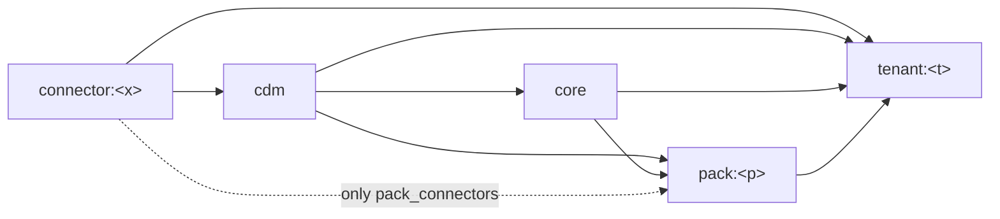

# scripts/checks — refactor and boundary checks

Checks that keep the module architecture ([docs/architecture/modules.md](../../docs/architecture/modules.md))
true in code. The shadow gate ([scripts/shadow/README.md](../shadow/README.md)) runs all of them.

| File | Kind | Purpose |
|---|---|---|
| `check_boundaries.py` | rule check | Module dependency matrix, cross-component imports, duplicate seeds, hard-coded URLs in connectors |
| `model_buckets.yaml` | data | Bucket (module) of every dbt model; `pack_connectors` for packs |
| `boundary_allowlist.yaml` | data | Known violations, each with a reason and an exit |
| `golden_snapshot.py`, `public_models.yaml` | data equality | Public tables identical before/after a change |
| `dbt_inventory.py` | dbt contract | Relations, config, refs, tests, compiled SQL unchanged |
| `dagster_inventory.py` | orchestration contract | Assets, checks, job selections, schedules, sensors, SLA unchanged |
| `instigator_state.py` | deploy | Live schedule/sensor on/off state before vs after a deploy |
| `guard_not_prod.py` | safety | Refuses paths inside the prod checkout |

## check_boundaries.py

```bash
# from a full checkout on the host (crm/ and detailView/ must exist); needs a manifest from `dbt parse`
python3 scripts/checks/check_boundaries.py --manifest <path/to/manifest.json>
```

| Rule | Fails when |
|---|---|
| `py-import` | `crm/` or `detailView/` imports `orchestration`, `ingestion` or `transformation`; `ingestion/` imports `orchestration` |
| `py-scan` | one of those trees is missing (prevents a silent pass inside a container) |
| `dbt-bucket` | a dbt model (enabled or disabled) has no entry in `model_buckets.yaml` |
| `dbt-path` | a model's file is not under `models/<module folder of its bucket>/` |
| `dbt-ref` | a model depends on a model its bucket may not read (matrix below) |
| `dbt-source` | a model outside `connector:*` / `tenant:*` reads a dbt source |
| `seed-duplicate` | two CSVs under `transformation/seeds/` share a basename (dbt parse would fail and `data_platform` would not start) |
| `connector-url` | an `http(s)://` literal appears under `orchestration/connectors/**` |



| Bucket of the model | May depend on |
|---|---|
| `connector:<x>` | `connector:<x>`, seeds, sources |
| `cdm` | `connector:*`, `cdm`, seeds |
| `core` | `cdm`, `core`, seeds |
| `pack:<p>` | `cdm`, `core`, `pack:<p>`, connectors listed in `pack_connectors[<p>]` |
| `tenant:<t>`, `monitoring` | anything |

### Adding a model

1. Put the model in the folder of its module.
2. Add `<model_name>: <bucket>` to `model_buckets.yaml`.
3. Run the check. A violation means the dependency crosses a module boundary: route it through
   the canonical layer (`std_*`), move the model to the right bucket, or, only when neither is
   possible yet, add an allowlist entry with a concrete reason and exit.

### Allowlist

- The check fails on any violation that is not listed **and** on any listed entry that no
  longer occurs, so fixed debt must be removed from the file in the same commit.
- `--write-allowlist` regenerates the file from the current violations and keeps existing
  reasons; new entries get `TODO: reason and exit plan` and must be edited before commit.
- Current entries: 24 dependency violations (summarized in `docs/architecture/modules.md` §3) and 37 `dbt-path` entries for Fine Japan tenant models not yet moved.
