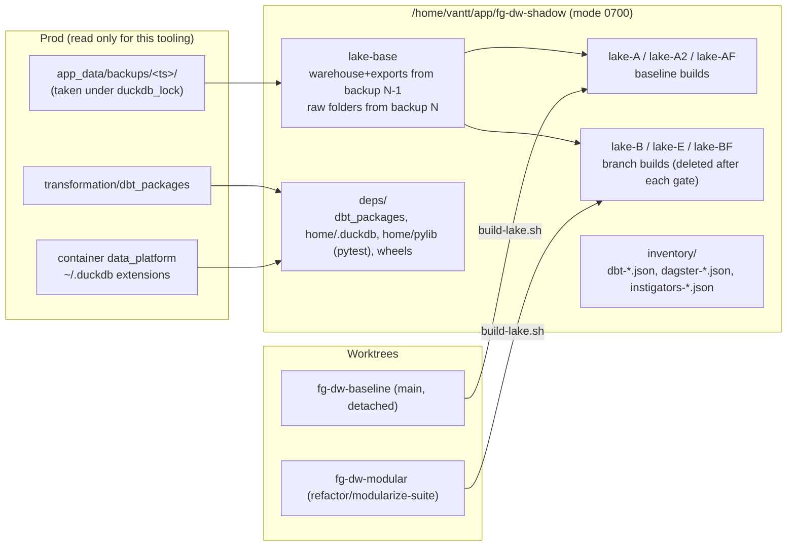

# Shadow environment and refactor gate

Design and full explanation (what each check proves, how it works, limits): [docs/operations/refactor-safety-harness.md](../../docs/operations/refactor-safety-harness.md). This README is the command reference.

Prove that a refactor changes no number, no public table name, no dbt relation/config and no
Dagster wiring, without touching production. Production keeps running daily; it changes only
through the deploy runbook in [docs/operations/deployment.md](../../docs/operations/deployment.md#refactor-deploys-shadow-verified).

## Layout



| Script | Purpose |
|---|---|
| `prepare-shadow.sh <backup_new> <backup_prev>` | Build `lake-base` from two backups and the offline deps (dbt_packages, DuckDB extensions, pinned pytest). |
| `clone-lake.sh <name> [--empty-rolling]` | Copy `lake-base` and delete rolling parquet files (or the whole `rolling/` tree) so every rolling model must be rebuilt. |
| `run-shadow.sh <code_dir> <lake_dir> <cmd...>` | Run a command in a one-off container from the prod image: `--network none`, current uid, env allowlist, code mounted per subdirectory exactly like `docker-compose.yml`. Refuses any path under the prod checkout. |
| `build-lake.sh <code_dir> <lake> [dbt args]` | Production build sequence: `ensure_dbt_directories.py`, `dbt parse`, `dbt build`, `refresh_rolling.py`. Saves `manifest.json`, `run_results.json`, `build_start` to `<lake>/_shadow_meta/`. |
| `pytest-shadow.sh <code_dir> <lake> [args]` | pytest in the shadow container (pytest is not in the prod image). |
| `gate.sh <M\|S> [--allow-new] [--allow-code-change]` | The refactor gate (below). |
| `move_models.py --manifest M --buckets <patterns> [--dry-run]` | Move dbt models to `models/<module>/<layer>/` from `scripts/checks/model_buckets.yaml`, splitting properties YAML by text blocks (comments kept) and moving connector sources. |
| `cleanup.sh <lake>... \| --all` | Delete shadow lakes. They hold customer PII; delete them after use and `--all` when the plan closes. |

Checks used by the gate live in `scripts/checks/`:

| Check | What it proves |
|---|---|
| `golden_snapshot.py` | Every public table (`public_models.yaml`: 75 rolling models + 8 non-rolling relations read by CRM/tools) has identical rows, schema, per-column and row-level fingerprints; stale outputs (parquet older than the build, node not `success`) fail. `keyed-diff` shows which keys differ. |
| `dbt_inventory.py` | Relation, schema, alias, full resolved config, refs, SQL checksum and attached tests of every model/seed are unchanged; file paths and `fqn` may change. `compiled-diff` compares the SQL dbt executed per model (whitespace-normalized). |
| `dagster_inventory.py` | Asset keys/groups, asset checks, job selections resolved to dbt unique_ids, schedules (cron, timezone, default status), sensors and resolved SLA are unchanged. |
| `instigator_state.py` | Live on/off state of schedules/sensors on the prod webserver, before vs after a deploy. |
| `check_boundaries.py` | Module dependency matrix, cross-component imports, duplicate seeds, hard-coded URLs in connectors (see `scripts/checks/README.md`). |
| `guard_not_prod.py` | Refuses paths inside `/home/vantt/app/fg-dataware-house`. |

## One-time setup

```bash
cd /home/vantt/app/fg-dataware-house
git worktree add /home/vantt/app/fg-dw-modular -b refactor/modularize-suite main
git worktree add --detach /home/vantt/app/fg-dw-baseline main

cd /home/vantt/app/fg-dw-modular
scripts/shadow/prepare-shadow.sh 20261013-010341 20261012-060506   # pick two backups with no deploy between them
scripts/shadow/clone-lake.sh lake-A
scripts/shadow/build-lake.sh /home/vantt/app/fg-dw-baseline lake-A
R=/home/vantt/app/fg-dw-shadow; M=/app/var/data_lake; mkdir -p $R/inventory
scripts/shadow/run-shadow.sh $PWD $R python scripts/checks/golden_snapshot.py init \
  --manifest $M/lake-A/_shadow_meta/manifest.json --out scripts/checks/public_models.yaml   # keeps existing volatile_columns
scripts/shadow/run-shadow.sh $PWD $R python scripts/checks/golden_snapshot.py capture \
  --lake $M/lake-A --models scripts/checks/public_models.yaml --out $M/lake-A/_shadow_meta/golden.json
scripts/shadow/run-shadow.sh $PWD $R python scripts/checks/dbt_inventory.py export \
  --manifest $M/lake-A/_shadow_meta/manifest.json --out $M/inventory/dbt-main.json
# run while the branch's orchestration/ still equals main
scripts/shadow/run-shadow.sh $PWD $R python scripts/checks/dagster_inventory.py export \
  --manifest $M/lake-A/_shadow_meta/manifest.json --out $M/inventory/dagster-main.json
```

`public_models.yaml` `volatile_columns` lists build-timestamp columns (`loaded_at`,
`*_generated_at`, `metric_calculated_at`, ...). They were found by building the same code on
the same data twice (lake-A vs lake-A2): only these columns differed. Re-run that check if a
new table appears.

## The gate

```bash
scripts/shadow/gate.sh M     # phases that only move files (1, 2, 5, 6)
scripts/shadow/gate.sh S     # phases that rewrite SQL (3, 4)
```

| Step | M | S |
|---|---|---|
| Build branch on fresh `lake-B` (rolling parquet cleared) | ✓ | ✓ |
| Golden lake-A vs lake-B | ✓ | ✓ |
| dbt inventory diff | ✓ | ✓ |
| Compiled SQL diff (what dbt executed, per model) | ✓ | ✓ |
| Module boundaries (`check_boundaries.py`, host python) | ✓ | ✓ |
| Dagster inventory diff (incl. job → dbt unique_ids) | ✓ | ✓ |
| dbt subset run through Dagster (`marts/fact_order_returns`, the `_fact_order_returns` job selection) | ✓ | ✓ |
| pytest `ingestion/tests orchestration scripts/tests` | ✓ | ✓ |
| Empty-rolling lake build + golden (catches directory pre-creation bugs) | ✓ | ✓ |
| `--full-refresh` on baseline (lake-AF) and branch (lake-BF) + golden | | ✓ |

A full S gate takes about 2–3 minutes (dbt build ≈ 20 s per lake). Branch lakes are deleted at
the end. `--allow-new` accepts added nodes/assets and grown job selections (printed as INFO);
`--allow-code-change` accepts SQL checksum changes in the dbt inventory while data equality is
still enforced by the golden snapshot.

## Facts established while building this (2026-10-13)

- dbt build has 633 nodes (76 external models, 16 incremental, 7 tables, 63 views, 14 seeds, 454 tests) and runs in ≈ 18 s on the shadow lake; baseline result `PASS=629 WARN=1` (`assert_overhead_accounts_classified`, also warns in prod).
- `config.location` in the manifest is the unrendered string `{{ get_rolling_location() }}`; rolling models are detected by that string plus `materialized == 'external'` (`stg_marketing_spend` is a view with a stray `location` and writes nothing).
- External models without a location write `<external_root>/<name>.parquet`; the warehouse view embeds an absolute path, so the golden reads the parquet file relative to the lake.
- `orchestration/ops/__tests__/test_ingestion_health_retry.py::test_concurrent_writes_no_lock_error` is flaky (SQLite lock timing, about 1 in 4 full-suite runs, on baseline too). The gate re-runs pytest once after a failure and prints `FLAKY` when the re-run passes; a test that fails twice fails the gate.
- dagster-dbt passes a subset selection to dbt as the model `fqn` from the manifest loaded by the code server (e.g. `--select sapo_warehouse.marts.sales.fact_order_returns`), so a folder move changes the selection string; the code server must load a manifest parsed from the new layout (the container start command does).
- Compiled SQL is deterministic: lake-A vs lake-A2 manifests give 0 differences over 162 models.
- `dagster schedule list -f orchestration/definitions.py` reports all instigators as STOPPED while the webserver runs all 17 schedules and 9 sensors; use `instigator_state.py`.

## Safety rules

- Never pass the prod checkout or `app_data/` to these scripts; the guard refuses it.
- Shadow containers never get `.env.docker`, `app_data/secrets` or network access.
- `lake-base` comes from backups only, never from the live lake.
- Delete branch lakes after each gate (the gate does it) and the whole shadow root when the plan closes (`cleanup.sh --all`).
