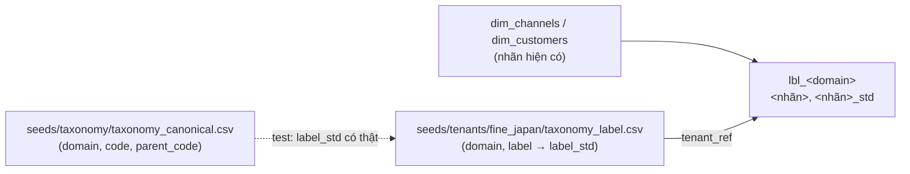

# TAXONOMY: kiểm kê và đặc tả các luật phân loại

> Trạng thái: bản đặc tả, viết ngày 14/10/2026, đối chiếu với code của nhánh `refactor/modularize-suite` (cùng nội dung model với commit đã deploy `b718befc`). Không có thay đổi SQL nào đi kèm tài liệu này.
> Tài liệu này mô tả **hiện trạng** (luật đang chạy thật ở Fine Japan, kể cả chỗ lệch) và là **đặc tả đầu vào** cho bộ máy phân loại ([docs/architecture/taxonomy-engine.md](../../docs/architecture/taxonomy-engine.md)). Các mục "thuộc tính bộ máy" và "mã chuẩn" là **đề xuất, chưa chốt** cho tới khi có dữ liệu của một doanh nghiệp thứ hai.

## 1. Mục đích và cách dùng

Phân loại là phần khác nhau nhất giữa các doanh nghiệp: cùng là đơn, khách, sản phẩm nhưng mỗi nơi gọi nhóm khách, nguồn đơn, loại giảm giá theo cách riêng. Ở Fine Japan mỗi luật hiện là một khối SQL nằm rải rác trong model, hoặc một seed. Tài liệu này gom chúng lại để:

- biết **mỗi luật nằm ở đâu** (file, dòng, hash), có **bao nhiêu biến thể thật**, và **nghĩa chính xác** (thứ tự ưu tiên, `LIKE` với `_`, giá trị `ELSE`, NULL);
- tách **luật đã là dữ liệu** (seed) khỏi **luật còn là SQL**;
- liệt kê **literal riêng của Fine Japan** (đầu vào cho tenant overlay và cho plan bộ máy);
- phát hiện sớm khi luật bị sửa hoặc mọc thêm: `scripts/checks/check_taxonomy_inventory.py` so code với `scripts/checks/taxonomy_inventory.yaml` (xem mục 2.3).

Đọc tài liệu này **trước khi** sửa hoặc thêm bất kỳ khối `CASE` nào gán nhãn nghiệp vụ, và cập nhật nó trong cùng thay đổi.

Liên quan: [docs/architecture/modules.md](../../docs/architecture/modules.md) §9 (module taxonomy), [docs/reference/taxonomy/](../../docs/reference/taxonomy/) (tham chiếu bên ngoài), [transformation/AGENTS.md](../AGENTS.md) (quy tắc làm việc), [scripts/checks/README.md](../../scripts/checks/README.md).

## 2. Quy ước

### 2.1 Cách tính hash và tìm khối

- Khối `CASE ... END` được tìm bằng bộ quét hiểu dấu nháy chuỗi và comment (dấu `END` trong chuỗi hoặc comment không làm lệch). Alias là từ đứng sau `END [AS]`.
- **Chuẩn hoá trước khi hash:** bỏ comment (`--` và `/* */`), gộp mọi khoảng trắng thành một dấu cách, giữ nguyên chuỗi trong nháy. Hash là **sha256** của văn bản đã chuẩn hoá (từ chữ `CASE` đến chữ `END`, không gồm `AS alias`). Vì vậy đổi định dạng, đổi comment thì không đổi hash; đổi ngưỡng, thêm/bớt nhánh, đổi giá trị thì đổi hash.
- Loại **biểu thức** (không phải `CASE`: `scope_*`, `is_sales_channel`, điều kiện `IN (...)`, phép nối): inventory lưu đoạn văn bản chuẩn hoá (`snippet`) và hash của nó; check tìm đoạn đó trong file.
- Bảng "Vị trí và hash" của từng domain dưới đây hiển thị **16 ký tự đầu** của sha256; hash đầy đủ ở `scripts/checks/taxonomy_inventory.yaml`. Test `scripts/tests/test_check_taxonomy_inventory.py` kiểm tra mọi hash trong tài liệu này khớp inventory.
- Hai khối **khác văn bản nhưng cùng logic** (ví dụ `value_group` có `COALESCE`) được ghi là một biến thể, kèm chứng minh. Hai khối **cùng văn bản** (cùng sha256) là một biến thể.

### 2.2 Sáu dạng luật

| Dạng | Ý nghĩa | Ví dụ ở Fine Japan |
|---|---|---|
| Ánh xạ trực tiếp | Giá trị đầu vào (hoặc một cột) đổi một-một sang nhãn | `channel_format` theo nguồn; `ref_misa_channel_codes` |
| Dò mẫu có ưu tiên | So khớp mẫu (`LIKE`, tiền tố, regex), nhiều luật có thể khớp, ưu tiên quyết định | `customer_type` (theo nhóm khách), `discount_type`, `ref_tag_categories` |
| Chia ngưỡng | Số chia khoảng | `value_group`, `lifecycle_stage`, `payment_behavior` |
| Tổ hợp (bảng quyết định) | Điều kiện kết hợp **giá trị của domain khác** | `scope_*`, `is_sales_channel`, `benchmark_status`, `strategic_tier` |
| Gán tay | Người đặt nhãn cho từng đối tượng, thắng luật | `seed_sku_alias_manual`; nhóm khách chỉnh tay ở Sapo; (đề xuất) `ref_customer_tags` |
| Phân cấp | Nhãn có cha con; luật ở tầng dưới gom lên tầng trên | cây kênh 4 tầng; 10 loại giảm giá gom thành 4 nhóm |

### 2.3 Kiểm tra tự động

```bash
python3 scripts/checks/check_taxonomy_inventory.py          # so code với inventory; luôn thoát 0
python3 scripts/checks/check_taxonomy_inventory.py --list   # in file:dòng, cột, sha256 của mọi CASE gán cột taxonomy
```

Chỉ cảnh báo: `WARN changed` (khối đã kiểm kê bị sửa), `WARN new` (có `CASE ... END AS <cột taxonomy>` mới chưa kiểm kê), `WARN missing` (file đã mất). Shadow gate in kết quả ở bước 3c. Chi tiết: [scripts/checks/README.md](../../scripts/checks/README.md#check_taxonomy_inventorypy).

Cách đọc mỗi domain: các trường theo đúng thuộc tính mà bộ máy cần ([thiết kế §3.2](../../docs/architecture/taxonomy-engine.md)): `cardinality` (single/multi), `hit_policy` (FIRST/UNIQUE/PRIORITY/COLLECT/LONGEST_PREFIX), `stickiness` (recompute/manual_wins), `time_semantics` (as_of_event/current/scd2), `versioning` (restate/freeze_after_close). Giá trị ghi là **cách hiểu hiện trạng đề xuất cho bộ máy**, không phải khai báo đã có trong code.

### 2.4 Domain đặt tên theo tên cột và tên trong scout cũ

Tên `customer_value_tier` và `recency_status` trong bản scout cũ không tồn tại trong code và đã bỏ. Các tên scout cũ còn lại ứng với cột thật như sau: `promo_dependency` là `discount_sensitivity` (khách) và `discount_dependency` (sản phẩm); `entry_basket` là `basket_size` và `entry_value_band`; `product_matrix` là `abc_class` và `health_class`; `product_lifecycle` là `lifecycle_stage` của `mart_product_health`; `dim_sku_alias VTS prefix` là `misa_join_key`; `dim_time buckets` là bốn cột của `dim_time`; "action-queue contact results" là `contact_result`. `gl_cashflow_line` không phải seed: đó là cột `cashflow_line` của `dim_gl_account`.


## 3. Bảng tổng quan

46 domain, 79 khối đã kiểm kê (CASE và biểu thức). Cột "Loại": **SQL** = luật còn viết trong model; **Dữ liệu** = đã là seed; **Lai** = một phần mỗi bên.

| Domain | Subject | Dạng luật | Loại | Biến thể | Số khối |
|---|---|---|---|---|---|
| **Kênh và gian hàng** | | | | | |
| [`channel_format`](#channel_format) | order_source | Ánh xạ trực tiếp | Dữ liệu | 1 | 0 |
| [`platform`](#platform) | order_source | Ánh xạ trực tiếp | Dữ liệu | 1 | 0 |
| [`source_type`](#source_type) | order_source | Ánh xạ trực tiếp | Dữ liệu | 1 | 0 |
| [`channel_brand`](#channel_brand) | storefront (gian hàng) | Ánh xạ trực tiếp | Dữ liệu | 1 | 0 |
| [`channel_category`](#channel_category) | order_source | Phân cấp | SQL | 1 | 1 |
| [`is_sales_channel`](#is_sales_channel) | order_source | Tổ hợp | SQL | 1 | 3 |
| [`channel_tree`](#channel_tree) | order_source | Phân cấp | Lai | 1 | 1 |
| [`storefront`](#storefront) | order_source | Dò mẫu | Lai | 1 (+2 bản chép khoá kênh) | 5 |
| [`branch_location`](#branch_location) | order_source (nguồn tổng quát POS) | Ánh xạ trực tiếp | Dữ liệu | 1 | 0 |
| **Đơn hàng** | | | | | |
| [`order_scope`](#order_scope) | order | Tổ hợp | SQL | 3 cột, mỗi cột 1 | 3 |
| [`order_status_family`](#order_status_family) | order, payment, fulfillment | Ánh xạ trực tiếp | SQL | 5 khối | 5 |
| [`order_tag`](#order_tag) | order (mỗi cặp đơn-tag một nhãn) | Dò mẫu có ưu tiên | Lai | 1 | 3 |
| [`team_assignment`](#team_assignment) | order (qua nhân viên bán) | Gán tay có lịch sử | Dữ liệu | 1 | 1 |
| [`payment_method_type`](#payment_method_type) | payment | Ánh xạ trực tiếp | Dữ liệu | 1 | 0 |
| **Khách hàng** | | | | | |
| [`customer_type`](#customer_type) | customer | Dò mẫu có ưu tiên | SQL | **2 logic** (3 khối) | 3 |
| [`value_group`](#value_group) | customer | Chia ngưỡng | SQL | **1 logic** (2 khối) | 2 |
| [`customer_lifecycle_stage`](#customer_lifecycle_stage) | customer | Chia ngưỡng | SQL | 1 | 1 |
| [`customer_status`](#customer_status) | customer | Chia ngưỡng | SQL | **3 logic** | 3 |
| [`next_purchase_signal`](#next_purchase_signal) | customer | Chia ngưỡng | SQL | **2 logic** | 2 |
| [`channel_preference`](#channel_preference) | customer | Ánh xạ trực tiếp áp lên kết quả dẫn xuất | SQL | 1 | 1 |
| [`product_affinity`](#product_affinity) | customer | Chia ngưỡng trên đặc trưng dẫn xuất | SQL | 1 | 1 |
| [`payment_behavior`](#payment_behavior) | customer | Chia ngưỡng | SQL | 1 | 1 |
| [`geo_region`](#geo_region) | customer | Ánh xạ trực tiếp | SQL | 1 | 1 |
| [`acquisition_source`](#acquisition_source) | customer | Dẫn xuất | SQL | 1 | 2 |
| [`is_us_gift_recipient`](#is_us_gift_recipient) | customer | Tổ hợp | SQL | 1 | 3 |
| [`benchmark_status`](#benchmark_status) | customer | Bảng quyết định có thứ tự trên domain khác | SQL | 1 | 1 |
| [`contact_quality`](#contact_quality) | customer | Ánh xạ trực tiếp trên đặc trưng điện thoại | SQL | 2 cột | 2 |
| [`strategic_tier`](#strategic_tier) | customer | Bảng quyết định có thứ tự trên nhiều domain | SQL | 1 | 2 |
| [`entry_basket`](#entry_basket) | customer | Chia ngưỡng | SQL | 1 | 2 |
| [`contact_result`](#contact_result) | customer (hoạt động CRM) | Ánh xạ trực tiếp + tập thành viên | SQL | **2 tập** | 6 |
| [`deadstock_route_channel`](#deadstock_route_channel) | customer (trong hàng đợi) | Ánh xạ trực tiếp trên `source_contact_quality` | SQL | 1 | 1 |
| **Giảm giá** | | | | | |
| [`discount_type`](#discount_type) | discount_line (nhãn) và order (nhãn chính) | Dò mẫu có ưu tiên | SQL | 1 logic (2 bản giống hệt) | 4 |
| [`discount_group`](#discount_group) | customer (gom 10 loại thành 4 nhóm) | Phân cấp | SQL | 1 | 3 |
| [`discount_cost_type`](#discount_cost_type) | discount_line | Dò mẫu có ưu tiên | SQL | 1 | 1 |
| [`promo_dependency`](#promo_dependency) | customer và product (hai subject) | Chia ngưỡng | SQL | 2 (hai subject) | 2 |
| **Sản phẩm** | | | | | |
| [`product_brand`](#product_brand) | product | Ánh xạ trực tiếp | Dữ liệu | 1 | 0 |
| [`product_lifecycle_stage`](#product_lifecycle_stage) | product | Bảng quyết định có thứ tự | SQL | 1 | 1 |
| [`product_velocity_momentum`](#product_velocity_momentum) | product | Chia ngưỡng | SQL | 1 | 1 |
| [`product_matrix`](#product_matrix) | product | Chia ngưỡng theo phân vị/lũy kế trong tập sản phẩm | SQL | 1 mỗi cột | 2 |
| [`sku_alias_vts_prefix`](#sku_alias_vts_prefix) | product (variant) | Ánh xạ theo tiền tố + gán tay | Lai | 1 | 1 |
| **Thời gian, kế toán, chi phí** | | | | | |
| [`time_bucket`](#time_bucket) | time | Chia ngưỡng theo giờ | SQL | 1 mỗi cột | 4 |
| [`gl_cashflow_line`](#gl_cashflow_line) | gl_account | Dò mẫu theo tiền tố mã tài khoản, có thứ tự | Lai | 1 | 1 |
| [`cost_account_group`](#cost_account_group) | gl_account | Dò mẫu theo tiền tố | SQL | 1 | 1 |
| [`voucher_source_hint`](#voucher_source_hint) | order (dòng bán hàng MISA) | Dò mẫu | SQL | 1 | 1 |
| [`misa_channel_group`](#misa_channel_group) | order (dòng bán hàng MISA) | Ánh xạ trực tiếp | Dữ liệu | 1 | 1 |
| [`spend_category`](#spend_category) | chi phí (không có model dbt đọc) | Ánh xạ trực tiếp | Dữ liệu | 1 | 0 |

## 4. Đặc tả từng domain

### Nhóm: Kênh và gian hàng

#### `channel_format`

**Kênh: `channel_format` (tầng 2)**

- **Subject:** order_source
- **Biến thể:** 1 (không có luật SQL; là cột của seed)
- **Dạng luật:** Ánh xạ trực tiếp
- **Đã là dữ liệu hay còn trong SQL:** **Dữ liệu**: `ref_order_sources.channel_format` (46 dòng). Không còn khối SQL nào suy ra giá trị này.
- **Đặc trưng cần dùng:** `source_id` của đơn (sau khi `storefront` đã quy về nguồn con); Phân loại kênh là dữ liệu của doanh nghiệp (chưa xác minh Sapo API có trả danh mục nguồn, thiết kế §10).
- **Ngữ nghĩa nguyên văn:** `dim_channels` đọc thẳng cột seed. `fact_orders` nối `ref_order_sources` theo `cast(source_id as varchar) = cast(id as varchar)` (chỉ để biết `is_generic_source`). Đơn không có hàng trong dim_channels rơi vào hàng `Unknown` với `channel_format = 'Other'` (literal trong `dim_channels.sql`, xem miền `is_sales_channel`).
- **Thuộc tính bộ máy (đề xuất):** `cardinality=single`, `hit_policy=UNIQUE (một dòng seed mỗi nguồn)`, `stickiness=recompute`, `time_semantics=current`, `versioning=restate`
- **Giá trị Fine Japan:** Marketplace 28, Social 5, System 3, Other 2, Direct 2, B2B 2, Web 2, CrossBorder Fulfillment 1, Retail 1 (đếm dòng seed).
- **Mã chuẩn đề xuất (chưa chốt):** MARKETPLACE, SOCIAL, WEB, RETAIL_STORE, B2B, DIRECT_SALES, NON_SALES (thiết kế §5.1; `NON_SALES` có thể bỏ khi có `order_purpose`). **Chưa chốt.**
- **Mã chuẩn (xem trước):** `lbl_channel_format.channel_format_std` (bảng `taxonomy_label` của Fine Japan, mục 5b): Marketplace → MARKETPLACE; Social → SOCIAL; Web → WEB; Retail → RETAIL_STORE; B2B → B2B; Direct → DIRECT_SALES; System → NON_SALES, CrossBorder Fulfillment → NON_SALES, Other → OTHER (ba neo tạm, user chốt 14/10/2026). Hàng `Unknown` của `dim_channels` mang `Other` nên ra OTHER. **Chưa chốt.**
- **Giá trị tenant viết cứng:** Toàn bộ nội dung seed là của Fine Japan; `CrossBorder Fulfillment` là khái niệm riêng của nguồn `US`.
- **Model incremental lưu nhãn:** Không.

**Vị trí và hash:**

Không có khối SQL: luật là dữ liệu (seed), xem ô "Đã là dữ liệu hay còn trong SQL".

#### `platform`

**Kênh: `platform` (tầng 3)**

- **Subject:** order_source
- **Biến thể:** 1 (cột của seed)
- **Dạng luật:** Ánh xạ trực tiếp
- **Đã là dữ liệu hay còn trong SQL:** **Dữ liệu**: `ref_order_sources.platform`.
- **Đặc trưng cần dùng:** `source_id`.
- **Ngữ nghĩa nguyên văn:** Đọc thẳng cột seed. Nguồn con của một sàn mang cùng `platform` với nguồn cha (`Shopee`, `Lazada`, `Tiki`). Hàng `Unknown` có `platform = 'Other'`. Nguồn sinh từ `sync_seeds.py` được gán `platform` bằng hàm đoán theo tên (`classify_platform`), đó là chỗ duy nhất Python còn suy luận nền tảng.
- **Thuộc tính bộ máy (đề xuất):** `cardinality=single`, `hit_policy=UNIQUE`, `stickiness=recompute`, `time_semantics=current`, `versioning=restate`
- **Giá trị Fine Japan:** 19 giá trị: Shopee 9 dòng, Lazada 8, Tiki 4, Facebook 3, Other 3, System 3, Direct 2, Wholesale 2, Website 2, và Leflair, Chiaki, TikTok, Selly, Grab, Instagram, US, Sendo, POS, Zalo mỗi giá trị 1.
- **Mã chuẩn đề xuất (chưa chốt):** SHOPEE, LAZADA, TIKTOK_SHOP, TIKI, FACEBOOK, ZALO, INSTAGRAM, WEBSITE, POS, OTHER (thiết kế §5.1). **Chưa chốt.**
- **Giá trị tenant viết cứng:** Danh sách nền tảng do Fine Japan đang dùng; `Leflair`, `Chiaki`, `Selly`, `Gosumo`, `POPS` là sàn/đối tác riêng của thị trường Việt Nam.
- **Model incremental lưu nhãn:** Không.

**Vị trí và hash:**

Không có khối SQL: luật là dữ liệu (seed), xem ô "Đã là dữ liệu hay còn trong SQL".

#### `source_type`

**Kênh: `source_type`**

- **Subject:** order_source
- **Biến thể:** 1 (cột của seed). Giá trị trộn năm khái niệm (xem ngữ nghĩa).
- **Dạng luật:** Ánh xạ trực tiếp
- **Đã là dữ liệu hay còn trong SQL:** **Dữ liệu**: `ref_order_sources.source_type`. Hàng `Unknown` viết cứng `'channel'`.
- **Đặc trưng cần dùng:** `source_id`.
- **Ngữ nghĩa nguyên văn:** `channel` 40 dòng, `purpose` 3 (Test Sản Phẩm, Ưu đãi Nhân Viên, Quà Tặng), `customer_type` 2 (Chợ sỉ, Đại Lý: nguồn ngầm chỉ ra loại khách), `arrangement` 1 (US). Hai nguồn **CS** và **Telesale** có `source_type = channel` trong seed, còn tài liệu `docs/context/data-model-overview.md` L113 và `sales-segmentation-guide.md` ghi là `team` (xem Known divergences).
- **Thuộc tính bộ máy (đề xuất):** `cardinality=single`, `hit_policy=UNIQUE`, `stickiness=recompute`, `time_semantics=current`, `versioning=restate`
- **Giá trị Fine Japan:** `channel`, `purpose`, `customer_type`, `arrangement`.
- **Mã chuẩn đề xuất (chưa chốt):** Không có mã chuẩn riêng: đề xuất tách thành các trục trực giao `order_purpose`, `customer_type` ngầm, `platform` (thiết kế §5.1). **Chưa chốt.**
- **Giá trị tenant viết cứng:** Cả bốn giá trị là cách Fine Japan dùng trường "nguồn đơn" của Sapo.
- **Model incremental lưu nhãn:** Không.

**Vị trí và hash:**

Không có khối SQL: luật là dữ liệu (seed), xem ô "Đã là dữ liệu hay còn trong SQL".

#### `channel_brand`

**Kênh: `channel_brand` (thương hiệu kênh)**

- **Subject:** storefront (gian hàng)
- **Biến thể:** 1 (cột của seed)
- **Dạng luật:** Ánh xạ trực tiếp (gán tay trong seed)
- **Đã là dữ liệu hay còn trong SQL:** **Dữ liệu**: `ref_order_sources.channel_brand`. `dim_channels` chuyển thẳng ở cả ba nhánh `specific_channels`, `generic_channels`, `generic_unknown` (L49, L70, L88); hàng `Unknown` là `NULL`. Không có luật SQL.
- **Đặc trưng cần dùng:** `source_id` (gian hàng).
- **Ngữ nghĩa nguyên văn:** Thương hiệu **hiển thị với khách của gian hàng**, khác `brand_name` của sản phẩm (`ref_brands`, domain `product_brand`). 23 dòng seed để trống (nguồn không thuộc thương hiệu nào). Không có test "mọi gian hàng đang bán đều có thương hiệu".
- **Thuộc tính bộ máy (đề xuất):** `cardinality=single`, `hit_policy=UNIQUE`, `stickiness=recompute`, `time_semantics=current`, `versioning=restate`
- **Giá trị Fine Japan:** 6 thương hiệu kênh: Fine World Group (7 dòng), JPC (6), Fine Japan Vietnam (4), The Healthy Us (2), FG Care (2), Fine Care (2).
- **Mã chuẩn đề xuất (chưa chốt):** Không có mã chuẩn: nhãn riêng của doanh nghiệp (thiết kế §5.1). Report chuẩn "doanh thu theo thương hiệu kênh" dùng nhãn riêng.
- **Giá trị tenant viết cứng:** Cả sáu tên thương hiệu là của Fine Japan. Cũng là điều kiện phạm vi gian hàng cho luật sau này.
- **Model incremental lưu nhãn:** Không.

**Vị trí và hash:**

Không có khối SQL: luật là dữ liệu (seed), xem ô "Đã là dữ liệu hay còn trong SQL".

#### `channel_category`

**Kênh: `channel_category` (tầng 1)**

- **Subject:** order_source
- **Biến thể:** 1
- **Dạng luật:** Phân cấp (cha của `channel_format`), viết bằng `CASE` đơn giản
- **Đã là dữ liệu hay còn trong SQL:** **Còn trong SQL**: `CASE channel_format` trong `dim_channels.sql`. Hàng `Unknown` viết cứng `'Internal'` ở L160.
- **Đặc trưng cần dùng:** `channel_format`.
- **Ngữ nghĩa nguyên văn:** So khớp bằng `=` (CASE đơn giản, phân biệt hoa/thường). Marketplace, Social, Web thành `Online-Ecommerce`; Retail, B2B, Direct thành `Offline`; System, `CrossBorder Fulfillment` thành `Internal`. **ELSE = `Internal`**: `Other` và mọi `channel_format` mới (hoặc `NULL`) đều thành `Internal`, nên một định dạng kênh mới được thêm vào seed sẽ thành `Internal` không báo lỗi.
- **Thuộc tính bộ máy (đề xuất):** `cardinality=single`, `hit_policy=FIRST (ánh xạ một-một, ELSE mặc định)`, `stickiness=recompute`, `time_semantics=current`, `versioning=restate`
- **Giá trị Fine Japan:** `Online-Ecommerce`, `Offline`, `Internal`.
- **Mã chuẩn đề xuất (chưa chốt):** ONLINE, OFFLINE, INTERNAL (thiết kế §5.1). `INTERNAL` có thể thôi là kênh mà thành mục đích đơn. **Chưa chốt.**
- **Mã chuẩn (xem trước):** `lbl_channel_category.channel_category_std` (bảng `taxonomy_label` của Fine Japan, mục 5b): Online-Ecommerce → ONLINE; Offline → OFFLINE; Internal → INTERNAL. **Chưa chốt.**
- **Giá trị tenant viết cứng:** Ánh xạ định dạng sang hạng mục cấp 1 phản ánh cách Fine Japan chia, kể cả `B2B` và `Direct` là `Offline`.
- **Model incremental lưu nhãn:** Không (`dim_channels` là `external`).

**Vị trí và hash:**

| Vị trí (file:dòng, gốc `transformation/`) | Khối | Loại | sha256 (16 ký tự đầu) |
|---|---|---|---|
| `models/core/marts/dim_channels.sql:115` | `channel_category` | CASE | `f3ac6821312db94d` |

#### `is_sales_channel`

**Kênh: `is_sales_channel`, `is_marketplace`, hàng `Unknown`**

- **Subject:** order_source
- **Biến thể:** 1 mỗi cờ
- **Dạng luật:** Tổ hợp (điều kiện trên `channel_format`)
- **Đã là dữ liệu hay còn trong SQL:** **Còn trong SQL**: biểu thức `dim_channels.sql` L138 (`is_sales_channel`), L143 (`is_marketplace`), L156-170 (hàng `Unknown` viết cứng).
- **Đặc trưng cần dùng:** `channel_format`.
- **Ngữ nghĩa nguyên văn:** `is_sales_channel = channel_format NOT IN ('System', 'CrossBorder Fulfillment', 'Other')`; **`channel_format` NULL cho ra NULL** (SQL ba giá trị), hàng `Unknown` đặt `false` bằng literal. `is_marketplace = channel_format IN ('Marketplace', 'CrossBorder Fulfillment')`. `fact_orders` đọc `is_sales_channel` qua `COALESCE(..., false)`.
- **Thuộc tính bộ máy (đề xuất):** `cardinality=single`, `hit_policy=UNIQUE`, `stickiness=recompute`, `time_semantics=current`, `versioning=restate`
- **Giá trị Fine Japan:** `true`/`false`; `is_sales_channel = false` cho System, CrossBorder Fulfillment, Other.
- **Mã chuẩn đề xuất (chưa chốt):** Dẫn xuất từ `order_purpose`/`sales_line` trong thiết kế (§5.1): chỉ còn là kiểm tra thuộc tập. **Chưa chốt.**
- **Giá trị tenant viết cứng:** Tập `('System', 'CrossBorder Fulfillment', 'Other')` là định nghĩa "kênh bán thật" của Fine Japan; hàng `Unknown` literal (`'Unknown'`, `'UNK'`, `'Domestic'`, `'channel'`).
- **Model incremental lưu nhãn:** Không.

**Vị trí và hash:**

| Vị trí (file:dòng, gốc `transformation/`) | Khối | Loại | sha256 (16 ký tự đầu) |
|---|---|---|---|
| `models/core/marts/dim_channels.sql:138` | `is_sales_channel` | biểu thức | `5a52048e97e7c37e` |
| `models/core/marts/dim_channels.sql:143` | `is_marketplace` | biểu thức | `95f8f18667ec5ead` |
| `models/core/marts/dim_channels.sql:160` | `unknown_member` | biểu thức | `f896361d14af9f57` |

#### `channel_tree`

**Kênh: cây 4 tầng (tầng 4 là `channel_name`)**

- **Subject:** order_source
- **Biến thể:** 1 (ba nhánh UNION ALL dùng chung luật tên)
- **Dạng luật:** Phân cấp
- **Đã là dữ liệu hay còn trong SQL:** **Lai**: tầng 1 `channel_category` (SQL, miền riêng), tầng 2 `channel_format` và tầng 3 `platform` (dữ liệu seed), tầng 4 `channel_name` do `CASE` ở `dim_channels.sql` L42 và hai biểu thức tên ở L66, L84.
- **Đặc trưng cần dùng:** `name`, `platform`, `is_generic_source` của nguồn; danh sách `ref_branch_locations` (với nguồn tổng quát như POS).
- **Ngữ nghĩa nguyên văn:** Nguồn cha (tên là tiền tố của tên nguồn khác theo mẫu `name || ' - %'`) nhận hậu tố `' (Unspecified)'`; nguồn không có con giữ nguyên tên. Phát hiện cha dựa trên `LIKE` nên `_` và `%` trong tên là wildcard. Nguồn tổng quát (`is_generic_source = true`, hiện chỉ `Pos`) bung theo kho: `platform || ' - ' || location.name`, cộng thêm một hàng `' - Unknown Location'` cho `location_id` không nhận ra. Comment trong file ghi lý do phát hiện theo tên: id composite như `3988158_1` mất dấu `_` khi DuckDB parse số nguyên.
- **Thuộc tính bộ máy (đề xuất):** `cardinality=single`, `hit_policy=UNIQUE`, `stickiness=recompute`, `time_semantics=current`, `versioning=restate`
- **Giá trị Fine Japan:** Ví dụ: `Shopee (Unspecified)`, `Shopee - JPC OFFICIAL`, `POS - 16 Trương Định`, `Facebook`, `Unknown`.
- **Mã chuẩn đề xuất (chưa chốt):** Không có mã chuẩn cho tên; cây 4 tầng neo ở `storefront` (thiết kế §5.1). **Chưa chốt.**
- **Giá trị tenant viết cứng:** Hậu tố `(Unspecified)`, tiền tố `POS - `/`' - Unknown Location'` và danh sách kho là của Fine Japan.
- **Model incremental lưu nhãn:** Không.

**Vị trí và hash:**

| Vị trí (file:dòng, gốc `transformation/`) | Khối | Loại | sha256 (16 ký tự đầu) |
|---|---|---|---|
| `models/core/marts/dim_channels.sql:42` | `channel_name` | CASE | `d4c00e3d49e9abb5` |

#### `storefront`

**Gian hàng: `storefront` (một shop cụ thể trên một sàn)**

- **Subject:** order_source
- **Biến thể:** 1 luật nhận diện (mapping tag) + 2 bản chép cách tính khoá kênh (`fact_orders`, `fact_sales`), giống nhau về logic
- **Dạng luật:** Dò mẫu (`LIKE` trên tag đơn) rồi ánh xạ trực tiếp; khoá kênh là luật tổ hợp trên `is_generic_source`
- **Đã là dữ liệu hay còn trong SQL:** **Lai**: danh sách gian hàng và `mapping_tag` là dữ liệu (`ref_order_sources`, 17 dòng có `mapping_tag`); phép dò nằm ở `stg_sapo_v2_orders.sql` L26 và L34; khoá kênh ở `fact_orders.sql` L148 và `fact_sales.sql` L44.
- **Đặc trưng cần dùng:** `tags` của đơn (chuỗi JSON), `source_id` thô của Sapo, `location_id`.
- **Ngữ nghĩa nguyên văn:** `LEFT JOIN mapped_tags mt ON o.tags LIKE '%' || mt.mapping_tag || '%'`; `final_source_id = coalesce(mt.id, o.source_id)`. Tức là đơn nào có tag chứa `Shopee_FG CARE` được quy về nguồn con `3988158_5`; không có tag thì ở lại nguồn cha `3988158` (hiển thị `Shopee (Unspecified)`). Ba điểm cần nhớ: (1) `LIKE` phân biệt hoa/thường, `_` là wildcard, khớp chuỗi con (không neo hai đầu); (2) **không có thứ tự và không có phá hoà**: nếu một đơn khớp hai `mapping_tag` thì join nhân đôi dòng đơn (đo trên baseline 14/10: `stg_sapo_v2_orders` 15.988 dòng = 15.988 `order_id` khác nhau, chưa xảy ra); (3) tag là do nhân viên gõ tay trên Sapo nên chất lượng dữ liệu quyết định độ phủ. Khoá kênh: nguồn tổng quát nối `(source_id, location_id)` đã kiểm tra theo `ref_branch_locations`, nguồn thường nối `(source_id, 'Unknown')`. Tag `Shopee_%`, `Lazada_%`, `Tiki_%` còn được `ref_tag_categories` gán nhóm `channel_storefront` (đường thứ hai, độc lập, xem `order_tag`).
- **Thuộc tính bộ máy (đề xuất):** `cardinality=single`, `hit_policy=FIRST (không xác định nếu hai tag cùng khớp; nên là UNIQUE + test)`, `stickiness=recompute`, `time_semantics=as_of_event (tag đặt lúc tạo đơn)`, `versioning=restate`
- **Giá trị Fine Japan:** Shopee 8 gian con (+ nguồn cha), Lazada 7, Tiki 2 (+ Tiki và Tiki Cross Border), TikTok 1, Grab 1, ba nguồn Facebook (một tổng quát, hai page đã tắt), `Pos` bung theo 5 kho.
- **Mã chuẩn đề xuất (chưa chốt):** Không có mã chuẩn; là thực thể khoá `connector + source_id`, thuộc tính `platform`, `channel_brand`, `is_active` (thiết kế §5.1). **Chưa chốt.**
- **Giá trị tenant viết cứng:** Mọi `mapping_tag` (`Shopee_Fine Japan Vietnam`, `Lazada_JPC SHOP`, ...), tên gian hàng và 5 kho (`VVT`, `HG`, `MMA`, `HUS`, `ST`) là dữ liệu Fine Japan.
- **Model incremental lưu nhãn:** Không (`stg_sapo_v2_orders` là view; `fact_orders`, `fact_sales` là `external`).

**Vị trí và hash:**

| Vị trí (file:dòng, gốc `transformation/`) | Khối | Loại | sha256 (16 ký tự đầu) |
|---|---|---|---|
| `models/connectors/sapo_v2/staging/stg_sapo_v2_orders.sql:26` | `final_source_id` | biểu thức | `a67cf65a0b7fae94` |
| `models/connectors/sapo_v2/staging/stg_sapo_v2_orders.sql:34` | `mapping_tag_join` | biểu thức | `cce2782c98ebe0ec` |
| `models/core/marts/dim_channels.sql:66` | `generic_channel_name` | biểu thức | `3a58bea5b191e0aa` |
| `models/core/marts/sales/fact_orders.sql:148` | `channel_key` | CASE | `e85d8a30b54c12fe` |
| `models/core/marts/sales/fact_sales.sql:44` | `channel_key` | CASE | `8519e9ecf4d47bdd` |

##### Đơn Shopee về từ hai nguồn

Sapo là một nguồn dữ liệu nhưng Fine Japan bán qua nhiều gian hàng (nhiều shop Shopee, Lazada, Tiki, TikTok, nhiều page Facebook) mang 6 thương hiệu kênh. `storefront` (tầng 4 của cây kênh, `channel_name`) và `channel_brand` là **hai domain riêng**, không phải hai giá trị của `channel_format`: một nền tảng (`platform`) có nhiều gian hàng, và nhiều gian hàng chung một thương hiệu (JPC có 6 dòng seed: `Shopee - JPC SHOP`, `Shopee - JPC OFFICIAL`, `Lazada - JPC SHOP`, `TiktokShop`, `GrabMart`, `FaceBookJPC`).

Một đơn Shopee của Fine Japan được ghi nhận **từ hai nguồn độc lập**, ghép bằng `order_code`:

| Nguồn | Đường vào | Cung cấp | Dùng ở |
|---|---|---|---|
| **Sapo** (OMS) | `connectors/sapo_v2` → `std_orders` | Khách, nhân viên bán, trạng thái, tag, lý do giảm giá, **kênh và gian hàng** (qua `source_id` và `mapping_tag`) | `fact_orders`, `fact_sales`, mọi nhãn `customer_*`, `discount_type`, `storefront` |
| **Connector Shopee** (file Income Excel thả vào `shopee_raw/`: `order_revenue`, `order_revenue_items`, `order_service_fees`, `order_adjustments`) | `connectors/shopee` → `stg_shopee_*` → `packs/marketplace` (`int_shopee_order_fees`, ...) | Phí sàn (thanh toán, cố định, affiliate, PiShip, hạ tầng, voucher Xtra), thuế VAT/TNCN, phí vận chuyển ròng, điều chỉnh | `fact_order_costs` (`cost_category` `PLATFORM_FEE`, `TAX`, `SHIPPING`), `fact_order_economics` |

Điều cần biết cho bộ máy phân loại:

- **Khoá ghép là `order_code`**, và `fact_order_costs` nối bằng `JOIN order_meta` (đơn Shopee không có trong Sapo bị loại khỏi sổ chi phí). Connector Shopee **không** mang cột gian hàng hay khách (kiểm tra `src_shopee_order_revenue`: không có cột shop), nên kênh, gian hàng, thương hiệu kênh của chi phí sàn **luôn lấy từ Sapo** qua `channel_key` của `fact_orders`.
- Phân loại do connector Shopee sinh ra: `cost_type` `platform_payment`, `platform_fixed`, `platform_affiliate`, `platform_piship`, `platform_infra`, `platform_voucher_xtra`, `tax_vat`, `tax_pit`, `shipping_platform` (các literal trong `fact_order_costs.sql` L81-97, **không** là CASE nên không nằm trong inventory). Phân loại từ phía Sapo: lý do giảm giá (`voucher seller:`, `Bundle Deal`, `Seller Discount`) là chuỗi Shopee đẩy sang Sapo, nhưng được phân loại bằng `discount_type` và `discount_cost_type`, không dùng thông tin bên bảng Income.
- Chưa có quy tắc "nguồn nào là chính" cho một thuộc tính đứng ở cả hai nguồn (ví dụ bên chịu giảm giá: Income có trợ giá của Shopee, Sapo có lý do tự do). Hôm nay không xung đột vì mỗi thuộc tính chỉ lấy từ một nguồn; bộ máy phải khai báo khoá ghép và vai trò từng nguồn (thiết kế §5.1, §10).
- Đơn Shopee còn có thể mang tag `Shopee_<tên shop>` trên Sapo; tag này là **đường nhận diện gian hàng thứ hai** (nhóm `channel_storefront` của `ref_tag_categories`), độc lập với `mapping_tag` của `ref_order_sources`. Hai đường dùng cùng chuỗi (`Shopee_Fine Japan Vietnam` ...) nhưng không đối chiếu với nhau.


#### `branch_location`

**Kho/điểm bán: `ref_branch_locations`**

- **Subject:** order_source (nguồn tổng quát POS)
- **Biến thể:** 1 (seed)
- **Dạng luật:** Ánh xạ trực tiếp (dữ liệu)
- **Đã là dữ liệu hay còn trong SQL:** **Dữ liệu**: `seeds/taxonomy/ref_branch_locations.csv` (5 dòng: `id`, `code`, `name`), đọc bởi `dim_channels.sql`, `dim_branch_location.sql`, `fact_orders.sql`, `fact_sales.sql`, `stg_sapo_v2_orders.sql`. `sync_seeds.py` thêm dòng cho `location_id` mới (`code = 'UNK'`).
- **Đặc trưng cần dùng:** `location_id` của đơn.
- **Ngữ nghĩa nguyên văn:** Kho hợp lệ để bung nguồn tổng quát thành kênh tầng 4; `location_id` không có trong seed rơi vào `Unknown` ở `fact_orders.branch_location_key`.
- **Thuộc tính bộ máy (đề xuất):** `cardinality=single`, `hit_policy=UNIQUE`, `stickiness=recompute`, `time_semantics=current`, `versioning=restate`
- **Giá trị Fine Japan:** `VVT` 16 Trương Định, `HG` Hậu Giang, `MMA` MM Market An Phú, `HUS` TheHealthyUs, `ST` ShowroomVVT.
- **Mã chuẩn đề xuất (chưa chốt):** Không có đề xuất. **Chưa chốt.**
- **Giá trị tenant viết cứng:** Toàn bộ danh sách.
- **Model incremental lưu nhãn:** Không.

**Vị trí và hash:**

Không có khối SQL: luật là dữ liệu (seed), xem ô "Đã là dữ liệu hay còn trong SQL".

### Nhóm: Đơn hàng

#### `order_scope`

**Phạm vi đơn: `scope_sales`, `scope_retail`, `scope_b2b`**

- **Subject:** order
- **Biến thể:** 3 biểu thức khác nhau (ba cột), không có bản chép
- **Dạng luật:** Tổ hợp (bảng quyết định trên `channel_format`/`is_sales_channel` và `customer_type`)
- **Đã là dữ liệu hay còn trong SQL:** **Còn trong SQL**: `fact_orders.sql` L206 (`scope_sales`), L207-214 (`scope_retail`), L215-219 (`scope_b2b`).
- **Đặc trưng cần dùng:** `dim_channels.is_sales_channel`, `dim_channels.channel_format`, `customer_type_info.customer_type` (cùng model, bản dùng blob `customer_group`, xem `customer_type`).
- **Ngữ nghĩa nguyên văn:** `scope_sales = COALESCE(is_sales_channel, false)`. `scope_retail = scope_sales AND COALESCE(customer_type,'RETAIL') = 'RETAIL' AND COALESCE(channel_format,'') <> 'B2B'`. `scope_b2b = scope_sales AND (COALESCE(customer_type,'RETAIL') IN ('WHOLESALE','PARTNER') OR COALESCE(channel_format,'') = 'B2B')`. Ba điều khác tài liệu `segments.md`: (1) `scope_retail` loại thêm kênh `B2B` (comment: khoảng 92 đại lý còn gắn RETAIL); (2) `scope_b2b` được thêm điều kiện kênh B2B; (3) `STAFF`, `KOL`, `CROSSBORDER` không thuộc scope nào trong hai scope kia (chỉ nằm trong `scope_sales`). Khách thiếu hàng trong `customer_type_info` được coi là `RETAIL`. Đơn có `channel_format` thiếu coi như không phải B2B. Không có trạng thái đơn trong luật: dùng kèm `is_active_order`.
- **Thuộc tính bộ máy (đề xuất):** `cardinality=single (mỗi cờ là một domain boolean)`, `hit_policy=UNIQUE (bảng quyết định)`, `stickiness=recompute`, `time_semantics=current`, `versioning=restate`
- **Giá trị Fine Japan:** `true`/`false` cho từng scope.
- **Mã chuẩn đề xuất (chưa chốt):** Thay bằng domain `sales_line` ∈ {CONSUMER, TRADE, STAFF, CREATOR, INTERCOMPANY, NON_REVENUE} cấp đơn; `scope_*` thành kiểm tra thuộc tập (thiết kế §5.1). **Chưa chốt.**
- **Giá trị tenant viết cứng:** Giá trị `'RETAIL'`, `'WHOLESALE'`, `'PARTNER'`, `'B2B'` và quy ước loại đại lý theo kênh B2B là của Fine Japan.
- **Model incremental lưu nhãn:** Không (`fact_orders` là `external`).

**Vị trí và hash:**

| Vị trí (file:dòng, gốc `transformation/`) | Khối | Loại | sha256 (16 ký tự đầu) |
|---|---|---|---|
| `models/core/marts/sales/fact_orders.sql:206` | `scope_sales` | biểu thức | `f3f12afd463bb137` |
| `models/core/marts/sales/fact_orders.sql:207` | `scope_retail` | biểu thức | `24f1f85a15a97497` |
| `models/core/marts/sales/fact_orders.sql:215` | `scope_b2b` | biểu thức | `cc679b97e17e1947` |

#### `order_status_family`

**Trạng thái chuẩn của đơn, thanh toán, giao hàng (tầng `std_*`)**

- **Subject:** order, payment, fulfillment
- **Biến thể:** 5 khối (ba trong `std_orders`, một trong `std_fulfillments`, một trong `std_payments`), không có bản chép
- **Dạng luật:** Ánh xạ trực tiếp (trạng thái Sapo sang mã chuẩn); `fulfillment_status` của đơn là bảng quyết định có thứ tự trên ba trạng thái nguồn
- **Đã là dữ liệu hay còn trong SQL:** **Còn trong SQL**: `std_orders.sql` L57 (`status`), L65 (`payment_status`), L73 (`fulfillment_status`); `std_fulfillments.sql` L21; `std_payments.sql` L35.
- **Đặc trưng cần dùng:** `order_status`, `financial_status`, `fulfillment_status`, `packed_status`, `received_status` (đơn); `status` (giao hàng, thanh toán).
- **Ngữ nghĩa nguyên văn:** Đơn `status`: `cancelled`→`CANCELLED`, `completed`→`COMPLETED`, `archived`→`ARCHIVED`, `draft`→`DRAFT`, **ELSE `OPEN`**. `payment_status`: `paid`→`PAID`, `partial`→`PARTIALLY_PAID`, `refunded`→`REFUNDED`, `pending`→`PENDING`, **ELSE `UNPAID`**. `fulfillment_status` (đơn): `cancelled`→`CANCELLED`; `restocked`→`RETURNED`; `partial`→`PARTIALLY_FULFILLED`; paid và packed và received→`COMPLETED`; paid và packed→`SHIPPED_PAID`; packed→`SHIPPED_COD`; paid→`PAID_PROCESSING`; **ELSE `IN_PROGRESS`**. Giao hàng: `received`→`DELIVERED`, `fulfilled`→`SHIPPING`, `packed`→`PACKED`, `cancelled`→`CANCELLED`, `error`→`FAILED`, **ELSE `PENDING`**. Thanh toán: `paid`→`SUCCESS`, `pending`→`PENDING`, `voided`→`FAILED`, `refunded`→`REFUNDED`, **ELSE `PENDING`**. So khớp `=` phân biệt hoa/thường; trạng thái lạ của Sapo rơi vào ELSE (`OPEN`, `UNPAID`, `IN_PROGRESS`, `PENDING`) không báo lỗi. Cột `status` của `fact_orders`/`fact_sales` và `is_active_order` (`status NOT IN ('CANCELLED', 'DRAFT')`) dựa trên bảng này.
- **Thuộc tính bộ máy (đề xuất):** `cardinality=single`, `hit_policy=FIRST`, `stickiness=recompute`, `time_semantics=as_of_event`, `versioning=restate`
- **Giá trị Fine Japan:** Đơn: `CANCELLED`, `COMPLETED`, `ARCHIVED`, `DRAFT`, `OPEN`. Thanh toán: `PAID`, `PARTIALLY_PAID`, `REFUNDED`, `PENDING`, `UNPAID`. Giao hàng đơn: `CANCELLED`, `RETURNED`, `PARTIALLY_FULFILLED`, `COMPLETED`, `SHIPPED_PAID`, `SHIPPED_COD`, `PAID_PROCESSING`, `IN_PROGRESS`. Vận chuyển: `DELIVERED`, `SHIPPING`, `PACKED`, `CANCELLED`, `FAILED`, `PENDING`. Giao dịch: `SUCCESS`, `PENDING`, `FAILED`, `REFUNDED`.
- **Mã chuẩn đề xuất (chưa chốt):** `order_status`: DRAFT, PENDING, PROCESSING, SHIPPED, DELIVERED, COMPLETED, CANCELLED, RETURNED, thuộc gói connector (thiết kế §5.3). **Chưa chốt.**
- **Giá trị tenant viết cứng:** Không có literal riêng Fine Japan; các giá trị nguồn là của Sapo (`restocked`, `received`, ...). `COMPLETED` = Paid + Packed + Received là định nghĩa nghiệp vụ của Fine Japan (comment "Money In + Goods Out").
- **Model incremental lưu nhãn:** Không (view).

**Vị trí và hash:**

| Vị trí (file:dòng, gốc `transformation/`) | Khối | Loại | sha256 (16 ký tự đầu) |
|---|---|---|---|
| `models/cdm/staging/std_orders.sql:57` | `status` | CASE | `04c6dbc1fdd54f64` |
| `models/cdm/staging/std_orders.sql:65` | `payment_status` | CASE | `6eaae52048c3a35b` |
| `models/cdm/staging/std_orders.sql:73` | `fulfillment_status` | CASE | `bef2d730195ff84b` |
| `models/cdm/staging/std_fulfillments.sql:21` | `status` | CASE | `0a513d621559d859` |
| `models/cdm/staging/std_payments.sql:35` | `status` | CASE | `560b556378fb5ab1` |

#### `order_tag`

**Tag đơn: `ref_tag_categories` + `int_order_tags` (nhãn `tag_category`)**

- **Subject:** order (mỗi cặp đơn-tag một nhãn)
- **Biến thể:** 1 (luật là dữ liệu, SQL chỉ là bộ so khớp). Giám sát: `monitor_uncategorized_tags.sql` có thêm CASE gợi ý nhóm cho tag chưa phân loại.
- **Dạng luật:** Dò mẫu có ưu tiên (dữ liệu: `pattern`, `match_type`, `priority`)
- **Đã là dữ liệu hay còn trong SQL:** **Lai**: **dữ liệu** là `seeds/taxonomy/ref_tag_categories.csv` (61 dòng, 26 nhóm); **SQL** là bộ so khớp `int_order_tags.sql` L53-55 và chọn ưu tiên L47-50; gợi ý `monitor_uncategorized_tags.sql` L28.
- **Đặc trưng cần dùng:** `tags` của đơn (chuỗi mảng JSON), tách và `TRIM(REPLACE(value, '"', ''))` thành từng `tag_value`.
- **Ngữ nghĩa nguyên văn:** `exact`: bằng nhau, phân biệt hoa/thường. `prefix` và `contains` **cùng một phép `tag_value LIKE pattern`**: ý nghĩa nằm ở dấu `%` trong `pattern`, cột `match_type` chỉ là nhãn. `LIKE` phân biệt hoa/thường và `_` là wildcard một ký tự (`Shopee_%` khớp cả `Shopee-x`, `page_%` khớp `pageX`), nên seed phải liệt kê từng cách viết hoa/thường (`%ký gửi%`, `%Ký gửi%`, `%KÝ GỬI%`). Chọn nhãn: `ROW_NUMBER() OVER (PARTITION BY order_id, tag_value ORDER BY priority ASC NULLS LAST)`, số nhỏ thắng. Không khớp luật nào là `'uncategorized'`. Mỗi đơn có nhiều tag, mỗi tag đúng một nhãn. **Không tất định (chỉ ghi lại, không sửa)**: 28 dòng seed cùng `priority = 10` và `ORDER BY` không có khoá phụ, nên khi một tag khớp hai mẫu priority 10 khác nhóm, nhãn có thể khác giữa các lần chạy. Đo trên baseline 14/10: 565 tag khác nhau, **0 tag** có tranh chấp khác nhóm ở mức ưu tiên tốt nhất, tức rủi ro còn tiềm ẩn chứ chưa gây lệch số.
- **Thuộc tính bộ máy (đề xuất):** `cardinality=multi (nhiều tag mỗi đơn, một nhãn mỗi tag)`, `hit_policy=PRIORITY (số nhỏ thắng; thiếu khoá phụ cho hoà)`, `stickiness=recompute`, `time_semantics=as_of_event (tag gắn ở Sapo)`, `versioning=restate`
- **Giá trị Fine Japan:** 26 nhóm: `channel_platform`, `channel_storefront`, `order_type_consignment`, `order_type_sample`, `order_type_gift`, `order_type_preorder`, `order_type_error`, `order_type_clearance`, `discount_deferred`, `expense_reimbursement`, `invoice_status`, `payment_status`, `fulfillment_status`, `marketing_ad`, `marketing_post`, `marketing_customer`, `marketing_affiliate`, `social_page`, `shipping_type`, `product_category`, `promo_campaign`, `payment_method`, `partner_location`, `customer_type_agent`, `system_test`, `order_note`; và `uncategorized`. Priority: 1 (16 dòng), 2 (4), 3 (2), 4 (2), 5 (2), 6 (3), 10 (28), 20 (3), 99 (1).
- **Mã chuẩn đề xuất (chưa chốt):** Không có mã chuẩn: tag là nhãn tự do, nhóm `order_type_*` là ứng viên cho `order_purpose` (GIFT, SAMPLE, ...) khi làm bộ máy (thiết kế §5.1). **Chưa chốt.**
- **Giá trị tenant viết cứng:** Toàn bộ nội dung seed (`ECOMOBI`, `KOC`, `NGUỒN LÀ ĐẠI LÝ`, `LCĐ`, `GB `, `Test_Monitor`, ...) là của Fine Japan.
- **Model incremental lưu nhãn:** Không (`int_order_tags` là view).

**Vị trí và hash:**

| Vị trí (file:dòng, gốc `transformation/`) | Khối | Loại | sha256 (16 ký tự đầu) |
|---|---|---|---|
| `models/core/intermediate/tags/int_order_tags.sql:53` | `tag_match_join` | biểu thức | `d2837e9d87311ca9` |
| `models/core/intermediate/tags/int_order_tags.sql:47` | `tag_priority_pick` | biểu thức | `9873f2dd99c9cdea` |
| `models/monitoring/monitor_uncategorized_tags.sql:28` | `suggestion` | CASE | `dc56e7f2922a6e84` |

#### `team_assignment`

**Gán đơn cho team (dữ liệu tổ chức, **không phải domain phân loại**)**

- **Subject:** order (qua nhân viên bán)
- **Biến thể:** 1
- **Dạng luật:** Gán tay có lịch sử (SCD2) theo email nhân viên
- **Đã là dữ liệu hay còn trong SQL:** **Dữ liệu tổ chức**: Google Sheet (`connectors/gsheet/staging/stg_team_members.sql`) vào `std_team_members` (SCD2) và `std_teams`; SQL chỉ nối: `fact_orders.sql` L231-234.
- **Đặc trưng cần dùng:** `dseller.email` (người bán của đơn), `created_at` của đơn.
- **Ngữ nghĩa nguyên văn:** `lower(dseller.email) = staff_email` và `created_at::date` nằm trong `[effective_from, effective_to]` (`effective_to` NULL là còn hiệu lực), rồi `team_code` sang `std_teams`. Không khớp thì `team_key = Unknown`. Hai dòng SCD2 chồng nhau cho một người sẽ nhân đôi đơn (chưa có bằng chứng xảy ra).
- **Thuộc tính bộ máy (đề xuất):** Ngoài phạm vi bộ máy phân loại (thiết kế §5.4: "Team, mục tiêu không phải domain phân loại").
- **Giá trị Fine Japan:** Danh sách team trên Google Sheet.
- **Mã chuẩn đề xuất (chưa chốt):** Không áp dụng.
- **Giá trị tenant viết cứng:** Toàn bộ danh sách team và nhân viên.
- **Model incremental lưu nhãn:** Không.

**Vị trí và hash:**

| Vị trí (file:dòng, gốc `transformation/`) | Khối | Loại | sha256 (16 ký tự đầu) |
|---|---|---|---|
| `models/core/marts/sales/fact_orders.sql:231` | `team_join` | biểu thức | `e6fd65cdf38030a8` |

#### `payment_method_type`

**Phương thức thanh toán: `ref_payment_methods` (`type`)**

- **Subject:** payment
- **Biến thể:** 1 (seed)
- **Dạng luật:** Ánh xạ trực tiếp (dữ liệu)
- **Đã là dữ liệu hay còn trong SQL:** **Dữ liệu**: `seeds/taxonomy/ref_payment_methods.csv` (30 dòng: `id`, `name`, `type`), đọc bởi `dim_payment_methods.sql`, `std_payments.sql`, `stg_sapo_v2_orders.sql`.
- **Đặc trưng cần dùng:** `payment_method_id` của đơn/thanh toán.
- **Ngữ nghĩa nguyên văn:** `type` có các giá trị `mpos`, `point`, `cod`, `transfer`, `installment`, `payment_gateway`, `online`, `cash`. `std_payments` đặt `COALESCE(type, 'unknown')`. `payment_behavior` đọc `type = 'cod'`.
- **Thuộc tính bộ máy (đề xuất):** `cardinality=single`, `hit_policy=UNIQUE`, `stickiness=recompute`, `time_semantics=current`, `versioning=restate`
- **Giá trị Fine Japan:** `mpos`, `point`, `cod`, `transfer`, `installment`, `payment_gateway`, `online`, `cash`.
- **Mã chuẩn đề xuất (chưa chốt):** `PREPAID`/`COD`/... ở mức khách; mã phương thức chuẩn chưa đề xuất. **Chưa chốt.**
- **Giá trị tenant viết cứng:** Tên tài khoản ngân hàng cụ thể (`ACB - 5576037 - FGO`, ...) nằm trong tên: **dữ liệu nhạy cảm cần xem lại** khi đưa seed ra ngoài.
- **Model incremental lưu nhãn:** Không.

**Vị trí và hash:**

Không có khối SQL: luật là dữ liệu (seed), xem ô "Đã là dữ liệu hay còn trong SQL".

### Nhóm: Khách hàng

#### `customer_type`

**Khách: `customer_type`**

- **Subject:** customer
- **Biến thể:** **2 logic** (3 khối văn bản). `fact_orders` và `int_customer_benchmarks` giống nhau: bỏ tiền tố bí danh `c.` ở bản benchmarks thì chuỗi chuẩn hoá và sha256 trùng khớp (đã kiểm bằng script: hai khối chỉ khác `c.customer_group` so với `customer_group`). `dim_customers` là logic thứ hai: so khớp `customer_group_code` và `customer_group_name` (cột đã parse), không phải blob JSON, và nhánh CROSSBORDER thêm điều kiện "có đơn không huỷ trên kênh `US`".
- **Dạng luật:** Dò mẫu có ưu tiên (`LIKE` chứa chuỗi con, thứ tự cố định)
- **Đã là dữ liệu hay còn trong SQL:** **Còn trong SQL**: `fact_orders.sql` L110 (CTE `customer_type_info`, đọc `dim_customers_base`), `int_customer_benchmarks.sql` L47, `dim_customers.sql` L215. Không có seed.
- **Đặc trưng cần dùng:** `customer_group` (blob JSON của nhóm khách Sapo) cho hai bản đầu; `customer_group_code`, `customer_group_name` và đặc trưng cần tạo "khách có >= 1 đơn không huỷ trên nguồn `US`" cho `dim_customers`.
- **Ngữ nghĩa nguyên văn:** **Thứ tự ưu tiên thật: WHOLESALE > PARTNER > STAFF > KOL > CROSSBORDER > RETAIL (ELSE)**. Mẫu (đều là `LIKE '%x%'`, chuỗi con, phân biệt hoa/thường, `_` là wildcard một ký tự): WHOLESALE = `%WHOLESALE%` (bắt cả `TYPE_WHOLESALE` mới lẫn nhóm cũ BANBUON tên `WHOLESALE`); PARTNER = `%TYPE_PARTNER%` hoặc `%KY_GUI%` (nên `%KY_GUI%` khớp cả `KY GUI`, `KYxGUI`); STAFF = `%TYPE_STAFF%`; KOL = `%TYPE_KOL%`; CROSSBORDER = `%TYPE_CROSSBORDER%` hoặc `%CTN00014%` (hoặc, chỉ ở `dim_customers`, có đơn trên kênh US). **NULL**: nhóm thiếu cho `LIKE` ra NULL, không nhánh nào khớp, khách thành `RETAIL`; khách chưa có hàng trong `customer_type_info` cũng được coi là `RETAIL` ở mọi chỗ dùng `COALESCE(..., 'RETAIL')`. Hệ quả của hai logic: khách chỉ có tín hiệu kênh US là `CROSSBORDER` ở `dim_customers` nhưng là `RETAIL` ở `fact_orders.scope_retail` và `int_customer_benchmarks` (xem Known divergences). Bản `fact_orders` so khớp trên toàn blob JSON nên về nguyên tắc có thể khớp chuỗi nằm ở trường khác của blob; comment ở `dim_customers.sql` L206-209 khẳng định "cùng chuỗi con, cùng nhánh" nhưng chưa có test so sánh hai bản.
- **Thuộc tính bộ máy (đề xuất):** `cardinality=single`, `hit_policy=PRIORITY (theo giá trị: WHOLESALE > PARTNER > STAFF > KOL > CROSSBORDER > RETAIL)`, `stickiness=manual_wins cần có (hôm nay nhóm khách chỉnh tay ở Sapo là nguồn)`, `time_semantics=current`, `versioning=restate`
- **Giá trị Fine Japan:** `WHOLESALE`, `PARTNER`, `STAFF`, `KOL`, `CROSSBORDER`, `RETAIL`.
- **Mã chuẩn đề xuất (chưa chốt):** Cây: CONSUMER; TRADE (WHOLESALE, DEALER, CONSIGNMENT, RESELLER_CTV); INTERNAL (STAFF, RELATED_PARTY); CREATOR (KOL, AFFILIATE); OTHER. `CROSSBORDER` là nhãn riêng; neo vào đâu là quyết định mở (thiết kế §5.2). **Chưa chốt.**
- **Mã chuẩn (xem trước):** `lbl_customer_type.customer_type_std` (bảng `taxonomy_label` của Fine Japan, mục 5b): RETAIL → CONSUMER; WHOLESALE → WHOLESALE; PARTNER → TRADE (nút cha, neo tạm: `TYPE_PARTNER` và `KY_GUI` gộp, chưa tách được ký gửi); STAFF → STAFF; KOL → KOL; CROSSBORDER → OTHER (neo tạm, câu hỏi nghiệp vụ §9 thiết kế). Theo `dim_customers`, không theo `fact_orders` (Known divergence #1). **Chưa chốt.**
- **Giá trị tenant viết cứng:** `CTN00014` (mã nhóm cũ của khách nhận hàng hộ), `KY_GUI`, `BANBUON`/`WHOLESALE`, kênh `'US'` (`dim_customers.sql` L35) và tập sáu nhãn. Đầu vào cho tenant overlay.
- **Model incremental lưu nhãn:** Không có model incremental lưu `customer_type`. `dim_customers_base` là incremental nhưng chỉ lưu blob nhóm thô. Lưu ý: `dim_customers.sql` có nhánh `is_incremental()` nhưng materialization là `external` nên nhánh đó không chạy.

**Vị trí và hash:**

| Vị trí (file:dòng, gốc `transformation/`) | Khối | Loại | sha256 (16 ký tự đầu) |
|---|---|---|---|
| `models/core/marts/sales/fact_orders.sql:110` | `customer_type` | CASE | `cd3b4336145ee07d` |
| `models/core/marts/intermediate/int_customer_benchmarks.sql:47` | `customer_type` | CASE | `cdba7656ddd12c6e` |
| `models/core/marts/dim_customers.sql:215` | `customer_type` | CASE | `50f92d1d6276b727` |

#### `value_group`

**Khách: `value_group`**

- **Subject:** customer
- **Biến thể:** **1 logic** (2 khối văn bản): `dim_customers` dùng `monetary_value`/`frequency` thẳng, `int_customer_benchmarks` bọc `COALESCE(x, 0)`. Chứng minh tương đương: các ngưỡng đều dương (20, 5.000.000, 20.000.000, 50.000.000), nên `x >= ngưỡng` với `x = NULL` ra NULL (nhánh không chạy) và với `x = 0` ra false (nhánh không chạy); `NULL OR TRUE = TRUE` giống `FALSE OR TRUE`; `NULL OR NULL` không chạy giống `FALSE OR FALSE`. Mọi tổ hợp cho cùng nhãn; đã kiểm bằng DuckDB trên lưới 40 tổ hợp `monetary_value` x `frequency` (có NULL, 0 và các giá trị sát ngưỡng): 0 khác biệt. Rà soát trước chỉ thấy khác ở `COALESCE`, phản biện nói tương đương; kết luận: tương đương ngữ nghĩa, khác văn bản.
- **Dạng luật:** Chia ngưỡng (tuyệt đối)
- **Đã là dữ liệu hay còn trong SQL:** **Còn trong SQL**: `dim_customers.sql` L233, `int_customer_benchmarks.sql` L56.
- **Đặc trưng cần dùng:** `monetary_value` (tổng `total_collected` các đơn active), `frequency` (số đơn active) từ `int_customer_metrics`.
- **Ngữ nghĩa nguyên văn:** `VIP` nếu `monetary_value >= 50.000.000 OR frequency >= 20`; `GOLD` nếu `>= 20.000.000`; `SILVER` nếu `>= 5.000.000`; **ELSE `VALUE_BRONZE`** (kể cả khách chưa có đơn nào). Giá trị VND, so sánh `>=`. Ngưỡng cố định, không theo phân vị.
- **Thuộc tính bộ máy (đề xuất):** `cardinality=single`, `hit_policy=FIRST (bậc thang từ cao xuống thấp)`, `stickiness=recompute`, `time_semantics=current (tổng lũy kế đến hôm nay)`, `versioning=restate; ảnh chụp tháng ở `mart_customer_status_snapshot_monthly` dùng giá trị hiện tại, không phải giá trị tại thời điểm`
- **Giá trị Fine Japan:** `VALUE_VIP`, `VALUE_GOLD`, `VALUE_SILVER`, `VALUE_BRONZE`.
- **Mã chuẩn đề xuất (chưa chốt):** `value_tier`: TOP, HIGH, MID, BASE (thứ tự; tên do doanh nghiệp đặt) (thiết kế §5.2). **Chưa chốt.**
- **Mã chuẩn (xem trước):** `lbl_value_group.value_group_std` (bảng `taxonomy_label` của Fine Japan, mục 5b): VALUE_VIP → TOP; VALUE_GOLD → HIGH; VALUE_SILVER → MID; VALUE_BRONZE → BASE (thiết kế gọi domain này là `value_tier`). **Chưa chốt.**
- **Giá trị tenant viết cứng:** Các ngưỡng VND (5 triệu, 20 triệu, 50 triệu) và ngưỡng 20 đơn; tên bốn nhóm.
- **Model incremental lưu nhãn:** Không.

**Vị trí và hash:**

| Vị trí (file:dòng, gốc `transformation/`) | Khối | Loại | sha256 (16 ký tự đầu) |
|---|---|---|---|
| `models/core/marts/dim_customers.sql:233` | `value_group` | CASE | `c348e384807653eb` |
| `models/core/marts/intermediate/int_customer_benchmarks.sql:56` | `value_group` | CASE | `679d2fa2d5ac16a6` |

#### `customer_lifecycle_stage`

**Khách: `lifecycle_stage` (nghĩa khách)**

- **Subject:** customer
- **Biến thể:** 1. **Cùng tên cột với một domain khác** (`product_lifecycle_stage`, `mart_product_health`): hai nghĩa, hai bộ giá trị, không dùng chung được.
- **Dạng luật:** Chia ngưỡng
- **Đã là dữ liệu hay còn trong SQL:** **Còn trong SQL**: `dim_customers.sql` L241.
- **Đặc trưng cần dùng:** `lifespan_days`, `frequency`, `recency_days` từ `int_customer_metrics`.
- **Ngữ nghĩa nguyên văn:** `LIFECYCLE_NEW` nếu `lifespan_days <= 30 AND frequency <= 2`; `LIFECYCLE_ACTIVE` nếu `recency_days <= 90`; `LIFECYCLE_AT_RISK` nếu `<= 180`; **ELSE `LIFECYCLE_CHURNED`**. NULL: khách chưa có đơn nào (không có hàng metrics) làm mọi so sánh ra NULL nên rơi vào ELSE và được gán `LIFECYCLE_CHURNED`, trong khi `customer_status` cùng khách ra `New/Unknown`. Ngưỡng 90/180 ngày khác ngưỡng 30/90 của `customer_status`.
- **Thuộc tính bộ máy (đề xuất):** `cardinality=single`, `hit_policy=FIRST`, `stickiness=recompute`, `time_semantics=current`, `versioning=restate (ảnh chụp cuối tháng cho phân tích xu hướng)`
- **Giá trị Fine Japan:** `LIFECYCLE_NEW`, `LIFECYCLE_ACTIVE`, `LIFECYCLE_AT_RISK`, `LIFECYCLE_CHURNED`.
- **Mã chuẩn đề xuất (chưa chốt):** NEW, ACTIVE, AT_RISK, CHURNED, REACTIVATED, NOT_APPLICABLE; mã đề xuất `NOT_APPLICABLE` cho khách chưa mua (thiết kế §5.2). **Chưa chốt.**
- **Mã chuẩn (xem trước):** `lbl_customer_lifecycle_stage.lifecycle_stage_std` (bảng `taxonomy_label` của Fine Japan, mục 5b): LIFECYCLE_NEW → NEW; LIFECYCLE_ACTIVE → ACTIVE; LIFECYCLE_AT_RISK → AT_RISK; LIFECYCLE_CHURNED → CHURNED (REACTIVATED chưa có nhãn nguồn). **Chưa chốt.**
- **Giá trị tenant viết cứng:** Ngưỡng 30/2/90/180 ngày.
- **Model incremental lưu nhãn:** Không.

**Vị trí và hash:**

| Vị trí (file:dòng, gốc `transformation/`) | Khối | Loại | sha256 (16 ký tự đầu) |
|---|---|---|---|
| `models/core/marts/dim_customers.sql:241` | `lifecycle_stage` | CASE | `6f17c964bd9f0632` |

#### `customer_status`

**Khách: `customer_status` (RFM, thành phần recency)**

- **Subject:** customer
- **Biến thể:** **3 logic**, hai kiểu viết hoa: `dim_customers` (`Active`/`At Risk`/`Churned`/`New/Unknown`, tính từ `recency_days` hôm nay), `mart_customer_status_snapshot_monthly` (`ACTIVE`/`AT_RISK`/`CHURNED`, tại cuối tháng, đơn tương lai coi là ACTIVE) và `mart_retention_waterfall_monthly` (`ACTIVE`/`AT_RISK`/`CHURNED`, dùng `last_order_date_pit`). Cùng ngưỡng 30/90 ngày; khác đầu vào, khác kiểu viết và khác tập giá trị.
- **Dạng luật:** Chia ngưỡng
- **Đã là dữ liệu hay còn trong SQL:** **Còn trong SQL**: `dim_customers.sql` L121; `mart_customer_status_snapshot_monthly.sql` L78; `mart_retention_waterfall_monthly.sql` L84.
- **Đặc trưng cần dùng:** `recency_days` (hôm nay) cho bản 1; `last_order_date`, `snapshot_month` cho bản 2; `last_order_date_pit`, `snapshot_month` cho bản 3.
- **Ngữ nghĩa nguyên văn:** Bản 1: `<= 30` thành `Active`, `<= 90` thành `At Risk`, `> 90` thành `Churned`, **ELSE `New/Unknown`** (khi `recency_days` NULL). Bản 2: `last_order_date > snapshot_month` hoặc `<= 30` ngày thành `ACTIVE`, `<= 90` thành `AT_RISK`, **ELSE `CHURNED`**; giá trị `last_order_date` hiện tại làm xấp xỉ (comment trong file: không phải điểm thời gian thật). Bản 3: `<= 30` `ACTIVE`, `<= 90` `AT_RISK`, **ELSE `CHURNED`**. **`'Active'` (dim_customers) khác `'ACTIVE'` (hai mart tháng)**: lọc `customer_status = 'ACTIVE'` trên `dim_customers` ra 0 dòng.
- **Thuộc tính bộ máy (đề xuất):** `cardinality=single`, `hit_policy=FIRST`, `stickiness=recompute`, `time_semantics=current (bản 1); as_of_event cuối tháng, xấp xỉ (bản 2, 3)`, `versioning=restate`
- **Giá trị Fine Japan:** Bản 1: `Active`, `At Risk`, `Churned`, `New/Unknown`. Bản 2, 3: `ACTIVE`, `AT_RISK`, `CHURNED`.
- **Mã chuẩn đề xuất (chưa chốt):** Cùng bộ với `lifecycle_stage` (thiết kế §5.2): hai domain này nên gộp khi có bộ máy. **Chưa chốt.**
- **Giá trị tenant viết cứng:** Ngưỡng 30/90 ngày.
- **Model incremental lưu nhãn:** Không.

**Vị trí và hash:**

| Vị trí (file:dòng, gốc `transformation/`) | Khối | Loại | sha256 (16 ký tự đầu) |
|---|---|---|---|
| `models/core/marts/dim_customers.sql:121` | `customer_status` | CASE | `350a2b6d1fbd1e5b` |
| `models/core/marts/customer/mart_customer_status_snapshot_monthly.sql:78` | `status` | CASE | `251e777c88ccf3a0` |
| `models/core/marts/customer/mart_retention_waterfall_monthly.sql:84` | `status` | CASE | `19dfcf4b49079ffe` |

#### `next_purchase_signal`

**Khách: `next_purchase_signal`**

- **Subject:** customer
- **Biến thể:** **2 logic**: `dim_customers` (dùng `recency_days` hiện tại) và `mart_customer_status_snapshot_monthly` (dùng số ngày tính tại cuối tháng, thêm các guard NULL).
- **Dạng luật:** Chia ngưỡng (tỷ lệ so với chu kỳ mua trung bình của chính khách)
- **Đã là dữ liệu hay còn trong SQL:** **Còn trong SQL**: `dim_customers.sql` L279; `mart_customer_status_snapshot_monthly.sql` L121.
- **Đặc trưng cần dùng:** `avg_days_between_orders`, `frequency`/`order_count`, `recency_days` hoặc `days_since_last_order`.
- **Ngữ nghĩa nguyên văn:** `NULL` nếu `avg_days_between_orders IS NULL OR frequency <= 1` (khách mua một lần); `OVERDUE` nếu `recency >= avg * 1.5`; `DUE_SOON` nếu `>= avg * 0.8`; **ELSE `ON_TRACK`**. Bản tháng thêm: NULL khi `last_order_date > snapshot_month`. Ngưỡng 1,5 và 0,8 là hệ số, không phải ngày.
- **Thuộc tính bộ máy (đề xuất):** `cardinality=single`, `hit_policy=FIRST`, `stickiness=recompute`, `time_semantics=current (dim_customers); as_of_event (bản tháng)`, `versioning=restate`
- **Giá trị Fine Japan:** `OVERDUE`, `DUE_SOON`, `ON_TRACK`, `NULL`.
- **Mã chuẩn đề xuất (chưa chốt):** Không có mã chuẩn đề xuất ở thiết kế; thuộc gói mặc định sản phẩm. **Chưa chốt.**
- **Giá trị tenant viết cứng:** Hệ số 1,5 và 0,8.
- **Model incremental lưu nhãn:** Không.

**Vị trí và hash:**

| Vị trí (file:dòng, gốc `transformation/`) | Khối | Loại | sha256 (16 ký tự đầu) |
|---|---|---|---|
| `models/core/marts/dim_customers.sql:279` | `next_purchase_signal` | CASE | `f81570a5bd72156f` |
| `models/core/marts/customer/mart_customer_status_snapshot_monthly.sql:121` | `next_purchase_signal` | CASE | `fca9a17cf1819ae5` |

#### `channel_preference`

**Khách: `channel_preference`**

- **Subject:** customer
- **Biến thể:** 1 (mặc định `CHANNEL_OTHER` lặp ở hai chỗ, cùng giá trị)
- **Dạng luật:** Ánh xạ trực tiếp áp lên kết quả dẫn xuất (kênh nhiều đơn nhất)
- **Đã là dữ liệu hay còn trong SQL:** **Còn trong SQL**: `int_customer_metrics.sql` L95 (CASE), mặc định lặp ở L413 và `dim_customers.sql` L252.
- **Đặc trưng cần dùng:** `channel_format` của các đơn bán (kênh `is_sales_channel = true`), đếm theo `order_id` khác nhau.
- **Ngữ nghĩa nguyên văn:** Chọn `channel_format` có nhiều đơn nhất (hoà thì theo thứ tự chữ cái của `channel_format`), rồi: Social thành `CHANNEL_SOCIAL`, Marketplace thành `CHANNEL_MARKETPLACE`, Web, Direct, B2B thành `CHANNEL_DIRECT`, Retail thành `CHANNEL_OFFLINE`, **ELSE `CHANNEL_OTHER`**. Khách không có đơn trên kênh bán nào cũng nhận `CHANNEL_OTHER` qua `COALESCE`. Không lọc đơn đã huỷ (đếm mọi dòng bán ở kênh bán).
- **Thuộc tính bộ máy (đề xuất):** `cardinality=single`, `hit_policy=FIRST (ưu tiên theo số đơn)`, `stickiness=recompute`, `time_semantics=current`, `versioning=restate`
- **Giá trị Fine Japan:** `CHANNEL_SOCIAL`, `CHANNEL_MARKETPLACE`, `CHANNEL_DIRECT`, `CHANNEL_OFFLINE`, `CHANNEL_OTHER`.
- **Mã chuẩn đề xuất (chưa chốt):** Mã của `channel_format` (thiết kế §5.2); dẫn xuất, không cần luật riêng. **Chưa chốt.**
- **Giá trị tenant viết cứng:** Gộp Web/Direct/B2B vào `CHANNEL_DIRECT` là cách chia của Fine Japan.
- **Model incremental lưu nhãn:** **`int_customer_metrics` (incremental)** lưu nhãn; chỉ khách có đơn đổi trong 3 ngày được tính lại, nên đổi luật phải full-refresh model này.

**Vị trí và hash:**

| Vị trí (file:dòng, gốc `transformation/`) | Khối | Loại | sha256 (16 ký tự đầu) |
|---|---|---|---|
| `models/core/marts/intermediate/int_customer_metrics.sql:95` | `channel_preference` | CASE | `b9ba266f7a295a27` |

#### `product_affinity`

**Khách: `product_affinity`**

- **Subject:** customer
- **Biến thể:** 1 (mặc định `PRODUCT_MULTI` lặp ở `int_customer_metrics` L414 và `dim_customers` L255)
- **Dạng luật:** Chia ngưỡng trên đặc trưng dẫn xuất (tỷ trọng doanh thu theo thương hiệu)
- **Đã là dữ liệu hay còn trong SQL:** **Còn trong SQL**: `int_customer_metrics.sql` L290.
- **Đặc trưng cần dùng:** `share_by_brand{}`: doanh thu thuần theo `brand_name` (từ `ref_brands`) chia tổng doanh thu có thương hiệu của khách.
- **Ngữ nghĩa nguyên văn:** `PRODUCT_FINE_JAPAN` nếu thương hiệu `Fine Japan Vietnam` > 0,6 tỷ trọng; ngược lại `PRODUCT_FG_CARE` (`FG Care`), `PRODUCT_FINE_CARE` (`Fine Care`) cùng ngưỡng; **ELSE `PRODUCT_MULTI`**. Thứ tự kiểm tra là thứ tự trong CASE (chỉ một thương hiệu có thể vượt 0,6, nên thứ tự không đổi kết quả). Doanh thu không lọc `is_active_order` (comment trong file: hành vi cũ). Dòng không có thương hiệu hoặc `Unknown` bị loại khỏi mẫu số.
- **Thuộc tính bộ máy (đề xuất):** `cardinality=single`, `hit_policy=FIRST`, `stickiness=recompute`, `time_semantics=current`, `versioning=restate`
- **Giá trị Fine Japan:** `PRODUCT_FINE_JAPAN`, `PRODUCT_FG_CARE`, `PRODUCT_FINE_CARE`, `PRODUCT_MULTI`.
- **Mã chuẩn đề xuất (chưa chốt):** Mã thương hiệu chuẩn hoặc `MULTI` (thiết kế §5.2). **Chưa chốt.**
- **Giá trị tenant viết cứng:** **Ba tên thương hiệu viết cứng** (`Fine Japan Vietnam`, `FG Care`, `Fine Care`) và ngưỡng 0,6; `JPC`, `The Healthy Us`, `Fine World Group` không có nhãn riêng nên rơi vào `PRODUCT_MULTI`. Đầu vào cho tenant overlay.
- **Model incremental lưu nhãn:** **`int_customer_metrics` (incremental)** lưu nhãn (xem `channel_preference`).

**Vị trí và hash:**

| Vị trí (file:dòng, gốc `transformation/`) | Khối | Loại | sha256 (16 ký tự đầu) |
|---|---|---|---|
| `models/core/marts/intermediate/int_customer_metrics.sql:290` | `product_affinity` | CASE | `4a56fca5257d261e` |

#### `payment_behavior`

**Khách: `payment_behavior`**

- **Subject:** customer
- **Biến thể:** 1
- **Dạng luật:** Chia ngưỡng
- **Đã là dữ liệu hay còn trong SQL:** **Còn trong SQL**: `int_customer_metrics.sql` L326; mặc định `PAYMENT_PREPAID` ở L415.
- **Đặc trưng cần dùng:** Tỷ lệ đơn COD trên tổng đơn có thanh toán, theo `payment_method_type = 'cod'` (nguồn: `ref_payment_methods.type`).
- **Ngữ nghĩa nguyên văn:** `PAYMENT_COD` nếu `cod_orders / NULLIF(total_orders, 0) > 0.7`; **ELSE `PAYMENT_PREPAID`**. Khách không có dòng thanh toán nào không có hàng `payment_stats` nên nhận `PAYMENT_PREPAID` qua `COALESCE`. `dim_customers` đưa cột qua không bọc COALESCE.
- **Thuộc tính bộ máy (đề xuất):** `cardinality=single`, `hit_policy=FIRST`, `stickiness=recompute`, `time_semantics=current`, `versioning=restate`
- **Giá trị Fine Japan:** `PAYMENT_COD`, `PAYMENT_PREPAID`.
- **Mã chuẩn đề xuất (chưa chốt):** PREPAID, COD, CREDIT, DELINQUENT (thiết kế §5.2); hôm nay chỉ có hai. **Chưa chốt.**
- **Giá trị tenant viết cứng:** Ngưỡng 0,7 và giá trị `'cod'` của `ref_payment_methods.type`.
- **Model incremental lưu nhãn:** **`int_customer_metrics` (incremental)** lưu nhãn.

**Vị trí và hash:**

| Vị trí (file:dòng, gốc `transformation/`) | Khối | Loại | sha256 (16 ký tự đầu) |
|---|---|---|---|
| `models/core/marts/intermediate/int_customer_metrics.sql:326` | `payment_behavior` | CASE | `4abc56a6163fe174` |

#### `geo_region`

**Khách: `geo_region`**

- **Subject:** customer
- **Biến thể:** 1
- **Dạng luật:** Ánh xạ trực tiếp (tỉnh thành sang vùng), `IN (danh sách)`
- **Đã là dữ liệu hay còn trong SQL:** **Còn trong SQL**: `dim_customers.sql` L287.
- **Đặc trưng cần dùng:** `province` của khách (chuỗi tự do từ Sapo).
- **Ngữ nghĩa nguyên văn:** So khớp bằng `IN` với danh sách tên viết sẵn, **chính xác từng ký tự, phân biệt hoa/thường và dấu**: `GEO_HCMC` (5 cách viết), `GEO_HANOI` (3), `GEO_MEKONG` (13 tỉnh), `GEO_CENTRAL` (14 tỉnh); `NULL` hoặc rỗng và **ELSE** đều ra `GEO_OTHER` (hai nhánh cùng giá trị). Mọi tỉnh miền Bắc ngoài Hà Nội, miền Đông Nam Bộ và Tây Nguyên là `GEO_OTHER`; tên tỉnh sai chính tả cũng thành `GEO_OTHER` không báo lỗi.
- **Thuộc tính bộ máy (đề xuất):** `cardinality=single`, `hit_policy=UNIQUE (tỉnh thuộc một vùng)`, `stickiness=recompute`, `time_semantics=current`, `versioning=restate`
- **Giá trị Fine Japan:** `GEO_HCMC`, `GEO_HANOI`, `GEO_MEKONG`, `GEO_CENTRAL`, `GEO_OTHER`.
- **Mã chuẩn đề xuất (chưa chốt):** Vùng địa lý Việt Nam, gói sản phẩm (thiết kế §5.2); bảng tỉnh chuẩn hoá thay `IN`. **Chưa chốt.**
- **Giá trị tenant viết cứng:** Cách chia vùng (Mekong, Central) và việc Hà Nội, TP.HCM đứng riêng là lựa chọn của Fine Japan; tên tỉnh theo kiểu nhập liệu của Sapo.
- **Model incremental lưu nhãn:** Không.

**Vị trí và hash:**

| Vị trí (file:dòng, gốc `transformation/`) | Khối | Loại | sha256 (16 ký tự đầu) |
|---|---|---|---|
| `models/core/marts/dim_customers.sql:287` | `geo_region` | CASE | `20c90a8c4938dbe9` |

#### `acquisition_source`

**Khách: `acquisition_source`**

- **Subject:** customer
- **Biến thể:** 1 định nghĩa + 2 chỗ dùng như luật loại trừ (`int_customer_benchmarks`, `mart_deadstock_target_queue`)
- **Dạng luật:** Dẫn xuất (đơn đầu tiên) + luật loại trừ trên một giá trị
- **Đã là dữ liệu hay còn trong SQL:** **Còn trong SQL**: định nghĩa `int_customer_metrics.sql` L115; loại trừ `'Đại Lý'` trong `mart_deadstock_target_queue.sql` L203 và trong `benchmark_status` (`int_customer_benchmarks.sql` L79).
- **Đặc trưng cần dùng:** `channel_name` của đơn active đầu tiên (`ordered_at`, hoà theo `order_id`): đặc trưng `first_order_source`.
- **Ngữ nghĩa nguyên văn:** Lưu **tên kênh cụ thể** (ví dụ `Zalo`, `Shopee - JPC OFFICIAL`), NULL nếu chưa có đơn active; có test quan hệ sang `dim_channels.channel_name`. Luật loại trừ: `COALESCE(acquisition_source, '') = 'Đại Lý'` thì khách không thuộc nhóm bán lẻ (benchmark `non_retail`) và bị loại khỏi hàng đợi deadstock. Đây là cách bù cho ~92 đại lý còn gắn `RETAIL` mà `customer_type` chưa sửa.
- **Thuộc tính bộ máy (đề xuất):** `cardinality=single`, `hit_policy=FIRST (đơn sớm nhất)`, `stickiness=recompute`, `time_semantics=as_of_event (kênh của đơn đầu)`, `versioning=restate`
- **Giá trị Fine Japan:** Tên kênh trong `dim_channels.channel_name` (khoảng 40 giá trị).
- **Mã chuẩn đề xuất (chưa chốt):** Mã của `channel_format`/`platform` (thiết kế §5.2). **Chưa chốt.**
- **Giá trị tenant viết cứng:** Literal `'Đại Lý'` (tên nguồn Sapo) ở hai chỗ. Đầu vào cho tenant overlay.
- **Model incremental lưu nhãn:** **`int_customer_metrics` (incremental)** lưu nhãn.

**Vị trí và hash:**

| Vị trí (file:dòng, gốc `transformation/`) | Khối | Loại | sha256 (16 ký tự đầu) |
|---|---|---|---|
| `models/core/marts/intermediate/int_customer_metrics.sql:115` | `acquisition_source` | biểu thức | `8042a6049ea5e9d7` |
| `models/core/marts/mart_deadstock_target_queue.sql:203` | `acquisition_source_exclusion` | biểu thức | `0f73836e4a7ee257` |

#### `is_us_gift_recipient`

**Khách: `is_us_gift_recipient`**

- **Subject:** customer
- **Biến thể:** 1 biểu thức; cùng nguồn tín hiệu "có đơn kênh US" được viết thêm ở `int_us_shipment_line_prices` (cho giá vận chuyển, mục đích khác) và ở nhánh CROSSBORDER của `customer_type`
- **Dạng luật:** Tổ hợp (nhóm khách OR đặc trưng chéo bảng "có đơn trên nguồn US")
- **Đã là dữ liệu hay còn trong SQL:** **Còn trong SQL**: `dim_customers.sql` L330-332 (cờ), L32-37 (CTE `us_channel_customers`); `int_us_shipment_line_prices.sql` L25.
- **Đặc trưng cần dùng:** `customer_group_code`/`customer_group_name`; đặc trưng cần tạo `has_order_on_source('US')` = có đơn với `status != 'CANCELLED'` trên kênh `channel_name = 'US'`.
- **Ngữ nghĩa nguyên văn:** `(code LIKE '%TYPE_CROSSBORDER%' OR name LIKE '%TYPE_CROSSBORDER%' OR code LIKE '%CTN00014%' OR name LIKE '%CTN00014%' OR EXISTS(...))`. **Có thể là NULL**: khi cả `customer_group_code` và `customer_group_name` đều NULL, bốn `LIKE` ra NULL, `EXISTS` ra false nên `NULL OR false = NULL`. Hai action queue của CRM dựa vào giá trị NULL này nên không được ép về false. Độc lập với `customer_type` (khách WHOLESALE có đơn US vẫn `true`).
- **Thuộc tính bộ máy (đề xuất):** `cardinality=single (boolean ba giá trị)`, `hit_policy=UNIQUE`, `stickiness=recompute`, `time_semantics=current`, `versioning=restate`
- **Giá trị Fine Japan:** `true`, `false`, `NULL`.
- **Mã chuẩn đề xuất (chưa chốt):** Dẫn xuất từ `customer_type` hoặc `order_purpose` cấp đơn (INTERCOMPANY) khi có bộ máy (thiết kế §5.1). **Chưa chốt.**
- **Giá trị tenant viết cứng:** Kênh `'US'`, mã `CTN00014`, tên nhóm `TYPE_CROSSBORDER`: toàn bộ là của Fine Japan (khách Việt nhận hộ gói gửi từ Mỹ).
- **Model incremental lưu nhãn:** Không.

**Vị trí và hash:**

| Vị trí (file:dòng, gốc `transformation/`) | Khối | Loại | sha256 (16 ký tự đầu) |
|---|---|---|---|
| `models/core/marts/dim_customers.sql:32` | `us_channel_customers` | biểu thức | `c35a15945492eb7b` |
| `models/core/marts/dim_customers.sql:330` | `is_us_gift_recipient` | biểu thức | `28ea72d7e8d0d2d8` |
| `models/tenants/fine_japan/intermediate/us_shipment/int_us_shipment_line_prices.sql:25` | `us_channel_filter` | biểu thức | `ede2b4d67d93ea04` |

#### `benchmark_status`

**Khách: `benchmark_status`**

- **Subject:** customer
- **Biến thể:** 1
- **Dạng luật:** Bảng quyết định có thứ tự trên domain khác (`customer_type`, `acquisition_source`) và ngưỡng
- **Đã là dữ liệu hay còn trong SQL:** **Còn trong SQL**: `int_customer_benchmarks.sql` L75. (Các nhãn phân vị `*_bucket`, `*_phrase` ở cùng file là nhãn trình bày, không kiểm kê chi tiết.)
- **Đặc trưng cần dùng:** `customer_type`, `lifetime_value`, `order_count`, `acquisition_source`.
- **Ngữ nghĩa nguyên văn:** `non_retail` nếu `customer_type NOT IN ('RETAIL')`; `inactive_zero_value` nếu `lifetime_value <= 0`; `single_purchase` nếu `order_count < 2`; `non_retail` nếu `COALESCE(acquisition_source,'') = 'Đại Lý'`; **ELSE `ranked`**. Thứ tự quan trọng: khách STAFF chưa mua vẫn là `non_retail`, không phải `inactive_zero_value`.
- **Thuộc tính bộ máy (đề xuất):** `cardinality=single`, `hit_policy=FIRST`, `stickiness=recompute (bảng tính lại hoàn toàn mỗi lần)`, `time_semantics=current`, `versioning=restate`
- **Giá trị Fine Japan:** `ranked`, `single_purchase`, `inactive_zero_value`, `non_retail`.
- **Mã chuẩn đề xuất (chưa chốt):** Không phải domain phân loại chuẩn; là điều kiện chọn tập so sánh. **Chưa chốt.**
- **Giá trị tenant viết cứng:** Giá trị `'RETAIL'`, `'Đại Lý'`, ngưỡng 2 đơn.
- **Model incremental lưu nhãn:** Không (`table`).

**Vị trí và hash:**

| Vị trí (file:dòng, gốc `transformation/`) | Khối | Loại | sha256 (16 ký tự đầu) |
|---|---|---|---|
| `models/core/marts/intermediate/int_customer_benchmarks.sql:75` | `benchmark_status` | CASE | `4d7094bf04cc83a1` |

#### `contact_quality`

**Khách: `source_contact_quality`, `contact_quality`**

- **Subject:** customer
- **Biến thể:** 2 cột, cùng điều kiện, khác nhãn dương
- **Dạng luật:** Ánh xạ trực tiếp trên đặc trưng điện thoại
- **Đã là dữ liệu hay còn trong SQL:** **Còn trong SQL**: `dim_customers.sql` L337 và L344.
- **Đặc trưng cần dùng:** `phone`.
- **Ngữ nghĩa nguyên văn:** `masked` nếu `phone IS NULL OR phone = '' OR phone LIKE '%*%'` (dấu `*` là số bị che từ sàn); **ELSE** `real` (cột bất biến) hoặc `unverified` (cột có thể nâng lên `verified` bằng thao tác của CRM). `strategic_tier` dựa vào `source_contact_quality`.
- **Thuộc tính bộ máy (đề xuất):** `cardinality=single`, `hit_policy=FIRST`, `stickiness=`manual_wins` cho `contact_quality` (nhân viên CRM nâng lên `verified`)`, `time_semantics=current`, `versioning=restate`
- **Giá trị Fine Japan:** `masked`, `real` (cột 1); `masked`, `unverified` (cột 2, thêm `verified` ngoài dbt).
- **Mã chuẩn đề xuất (chưa chốt):** Không có đề xuất ở thiết kế; thuộc gói mặc định. **Chưa chốt.**
- **Giá trị tenant viết cứng:** Quy ước dấu `*` là số bị che của sàn (Shopee).
- **Model incremental lưu nhãn:** Không.

**Vị trí và hash:**

| Vị trí (file:dòng, gốc `transformation/`) | Khối | Loại | sha256 (16 ký tự đầu) |
|---|---|---|---|
| `models/core/marts/dim_customers.sql:337` | `source_contact_quality` | CASE | `f371e21c795ab4d4` |
| `models/core/marts/dim_customers.sql:344` | `contact_quality` | CASE | `07c889918edd086a` |

#### `strategic_tier`

**Khách: `strategic_tier`, `tier_reason`**

- **Subject:** customer
- **Biến thể:** 1 (cộng một CASE đơn giản sinh lời giải thích từ nhãn)
- **Dạng luật:** Bảng quyết định có thứ tự trên nhiều domain (`source_contact_quality`, `value_group`, số đơn, recency)
- **Đã là dữ liệu hay còn trong SQL:** **Còn trong SQL**: `mart_customer_tier.sql` L37 (tầng) và L78 (lý do, văn bản tiếng Việt).
- **Đặc trưng cần dùng:** `order_count`, `source_contact_quality`, `recency_days`, `value_group`.
- **Ngữ nghĩa nguyên văn:** Thứ tự: `NONBUYER` (chưa có đơn), `LIVE_CORE` (real, recency <= 90, > 1 đơn), `SECOND_ORDER` (real, <= 90, đúng 1 đơn), `MASKED_REPEAT` (masked, > 1 đơn), `DORMANT_VALUABLE` (real, recency 91-365, và > 1 đơn hoặc value_group VIP/GOLD/SILVER), `LAPSED_VALUABLE` (real, > 365, cùng điều kiện), **ELSE `GRAVEYARD`**. `tier_reason` là văn bản hiển thị, ELSE là câu "Nghĩa địa - suppress".
- **Thuộc tính bộ máy (đề xuất):** `cardinality=single`, `hit_policy=FIRST`, `stickiness=recompute`, `time_semantics=current`, `versioning=restate`
- **Giá trị Fine Japan:** `NONBUYER`, `LIVE_CORE`, `SECOND_ORDER`, `MASKED_REPEAT`, `DORMANT_VALUABLE`, `LAPSED_VALUABLE`, `GRAVEYARD`.
- **Mã chuẩn đề xuất (chưa chốt):** Không có mã chuẩn: nhãn riêng gắn với hoạt động CRM của Fine Japan. **Chưa chốt.**
- **Giá trị tenant viết cứng:** Ngưỡng 90/365 ngày, ba giá trị `value_group`, văn bản tiếng Việt của lý do.
- **Model incremental lưu nhãn:** Không.

**Vị trí và hash:**

| Vị trí (file:dòng, gốc `transformation/`) | Khối | Loại | sha256 (16 ký tự đầu) |
|---|---|---|---|
| `models/core/marts/customer/mart_customer_tier.sql:37` | `strategic_tier` | CASE | `346a6358e03623d9` |
| `models/core/marts/customer/mart_customer_tier.sql:78` | `tier_reason` | CASE | `e21c69344fb0e77c` |

#### `entry_basket`

**Khách: `basket_size`, `entry_value_band` (đơn đầu)**

- **Subject:** customer
- **Biến thể:** 1
- **Dạng luật:** Chia ngưỡng
- **Đã là dữ liệu hay còn trong SQL:** **Còn trong SQL**: `int_customer_entry_attributes.sql` L106 và L111.
- **Đặc trưng cần dùng:** `basket_size_num`, `first_order_total` của đơn đầu tiên.
- **Ngữ nghĩa nguyên văn:** `basket_size`: `≥2` nếu `basket_size_num >= 2`, ELSE `1`. `entry_value_band`: `LOW` < 300.000, `MID` < 1.000.000, `HIGH` < 3.000.000, **ELSE `PREMIUM`** (NULL giá trị đơn đầu cũng rơi vào `PREMIUM`). Giá trị bất biến sau khi ghi (comment trong file).
- **Thuộc tính bộ máy (đề xuất):** `cardinality=single`, `hit_policy=FIRST`, `stickiness=recompute nhưng model giữ nguyên (immutable)`, `time_semantics=as_of_event (đơn đầu)`, `versioning=**freeze** hôm nay; đổi luật phải full-refresh`
- **Giá trị Fine Japan:** `1`, `≥2`; `LOW`, `MID`, `HIGH`, `PREMIUM`.
- **Mã chuẩn đề xuất (chưa chốt):** Không có mã chuẩn đề xuất. **Chưa chốt.**
- **Giá trị tenant viết cứng:** Ngưỡng VND 300 nghìn, 1 triệu, 3 triệu.
- **Model incremental lưu nhãn:** **`int_customer_entry_attributes` (incremental, chỉ thêm khách mới)** lưu nhãn; đổi luật hay `first_order` huỷ rồi đưa lại phải `--full-refresh`.

**Vị trí và hash:**

| Vị trí (file:dòng, gốc `transformation/`) | Khối | Loại | sha256 (16 ký tự đầu) |
|---|---|---|---|
| `models/core/marts/intermediate/int_customer_entry_attributes.sql:106` | `basket_size` | CASE | `f82923d509fb81b5` |
| `models/core/marts/intermediate/int_customer_entry_attributes.sql:111` | `entry_value_band` | CASE | `8e3ce967387ce827` |

#### `contact_result`

**Khách/CRM: kết quả liên hệ (`is_reached`, `outcome_label`, `is_recently_contacted_positively`)**

- **Subject:** customer (hoạt động CRM)
- **Biến thể:** **2 tập "đã liên hệ được"**: tập hẹp `answered, replied, met` (`mart_crm_activity_log.is_reached`, và `is_recently_contacted_positively` ở hai action queue, hai khối giống từng ký tự, cùng sha256) và tập rộng `answered, replied, met, callback, refused, purchased` (`mart_staff_performance_weekly.contacts_reached`, `int_crm_outreach_effort_events.is_reached`). Hai cột đều tên `is_reached` nhưng hai nghĩa; comment trong `int_crm_outreach_effort_events` nói rõ đã "đồng bộ" với `contacts_reached` chứ không phải với `mart_crm_activity_log`.
- **Dạng luật:** Ánh xạ trực tiếp + tập thành viên
- **Đã là dữ liệu hay còn trong SQL:** **Còn trong SQL**: `mart_crm_activity_log.sql` L30, L31; `mart_customer_action_queue.sql` L189; `mart_customer_sku_action_queue.sql` L199; `mart_staff_performance_weekly.sql` L34-36; `int_crm_outreach_effort_events.sql` L198-200.
- **Đặc trưng cần dùng:** `contact_outcome`, `last_contact_result`, `last_contacted_at`.
- **Ngữ nghĩa nguyên văn:** Tập hẹp: `IN ('answered','replied','met')`. Tập rộng thêm `callback`, `refused`, `purchased` (comment: `purchased` là giá trị enum chưa phát hành, liệt kê sẵn). `outcome_label`: answered thành `Reached`, no_answer `No answer`, callback `Callback`, refused `Refused`, **ELSE `Unknown`** (`replied`, `met`, `purchased` đều ra `Unknown`, trong khi `is_reached` tập hẹp coi `replied` và `met` là đã liên hệ được). Cờ "vừa liên hệ tích cực" cần thêm `last_contacted_at >= UTC now - 24 giờ`; `CASE ... THEN TRUE ELSE FALSE` nên NULL ra `FALSE`.
- **Thuộc tính bộ máy (đề xuất):** `cardinality=single`, `hit_policy=FIRST`, `stickiness=recompute`, `time_semantics=as_of_event (kết quả cuộc gọi)`, `versioning=restate`
- **Giá trị Fine Japan:** `Reached`, `No answer`, `Callback`, `Refused`, `Unknown`; các cờ boolean.
- **Mã chuẩn đề xuất (chưa chốt):** Không có đề xuất; domain của ứng dụng CRM. **Chưa chốt.**
- **Giá trị tenant viết cứng:** Danh sách trạng thái liên hệ do app CRM của Fine Japan định nghĩa; cửa sổ 24 giờ.
- **Model incremental lưu nhãn:** Không.

**Vị trí và hash:**

| Vị trí (file:dòng, gốc `transformation/`) | Khối | Loại | sha256 (16 ký tự đầu) |
|---|---|---|---|
| `models/packs/crm/marts/mart_crm_activity_log.sql:30` | `is_reached` | biểu thức | `0bab23088ca88bba` |
| `models/packs/crm/marts/mart_crm_activity_log.sql:31` | `outcome_label` | CASE | `5eec090cb265ee9b` |
| `models/packs/sales_playbook/marts/mart_customer_action_queue.sql:189` | `is_recently_contacted_positively` | CASE | `7bf1994938d86868` |
| `models/packs/sales_playbook/marts/mart_customer_sku_action_queue.sql:199` | `is_recently_contacted_positively` | CASE | `7bf1994938d86868` |
| `models/packs/crm/marts/mart_staff_performance_weekly.sql:34` | `contacts_reached` | biểu thức | `9b2debf6154919c4` |
| `models/packs/crm/marts/intermediate/int_crm_outreach_effort_events.sql:198` | `is_reached_wide` | biểu thức | `6fd5089ee6e46c7a` |

#### `deadstock_route_channel`

**Khách: `route_channel` (hàng đợi hàng tồn)**

- **Subject:** customer (trong hàng đợi)
- **Biến thể:** 1
- **Dạng luật:** Ánh xạ trực tiếp trên `source_contact_quality`
- **Đã là dữ liệu hay còn trong SQL:** **Còn trong SQL**: `mart_deadstock_target_queue.sql` L176.
- **Đặc trưng cần dùng:** `source_contact_quality`.
- **Ngữ nghĩa nguyên văn:** `HUG` nếu `real`; **ELSE `SHOPEE_NATIVE`** (khách số bị che được tiếp cận bằng công cụ của sàn). Cùng file còn `voucher_eligible` (`FALSE` chỉ khi `discount_sensitivity = 'FULL_PRICE'`, NULL coi như đủ điều kiện) và lọc `customer_type NOT IN ('WHOLESALE','CROSSBORDER')`.
- **Thuộc tính bộ máy (đề xuất):** `cardinality=single`, `hit_policy=FIRST`, `stickiness=recompute`, `time_semantics=current`, `versioning=restate`
- **Giá trị Fine Japan:** `HUG`, `SHOPEE_NATIVE`.
- **Mã chuẩn đề xuất (chưa chốt):** Không có đề xuất. **Chưa chốt.**
- **Giá trị tenant viết cứng:** `HUG` (công cụ liên hệ riêng) và `SHOPEE_NATIVE`: tên kênh tiếp cận của Fine Japan.
- **Model incremental lưu nhãn:** Không.

**Vị trí và hash:**

| Vị trí (file:dòng, gốc `transformation/`) | Khối | Loại | sha256 (16 ký tự đầu) |
|---|---|---|---|
| `models/core/marts/mart_deadstock_target_queue.sql:176` | `route_channel` | CASE | `2daa9dfaeea546bb` |

### Nhóm: Giảm giá

#### `discount_type`

**Giảm giá: `discount_type` (10 loại) và `primary_discount_type`**

- **Subject:** discount_line (nhãn) và order (nhãn chính)
- **Biến thể:** **1 logic, 2 bản chép giống từng ký tự** (`fact_orders.sql` L47 và `fact_order_costs.sql` L118 cùng sha256). `primary_discount_type` có **2 cách chọn nhãn chính**: ở `fact_orders` là `MAX_BY(discount_type, amount)` theo từng đơn; ở `fact_order_costs` là cùng hàm nhưng nhóm theo `(đơn, cost_type)`.
- **Dạng luật:** Dò mẫu có ưu tiên (`ILIKE`) rồi chia ngưỡng; nhãn chính chọn bằng `MAX_BY`
- **Đã là dữ liệu hay còn trong SQL:** **Còn trong SQL**: hai khối CASE nói trên; `MAX_BY` ở `fact_orders.sql` L78 và `fact_order_costs.sql` L156.
- **Đặc trưng cần dùng:** `reason` (chuỗi lý do giảm giá của Sapo), `discount_rate` (phần trăm 0-100), `amount` (chỉ dòng `amount > 0` đi vào).
- **Ngữ nghĩa nguyên văn:** Thứ tự trên xuống, khớp đầu tiên: (1) `reason ILIKE 'voucher seller:%'` thành `voucher_promotional`; (2) `reason = 'Bundle Deal'` (so bằng, phân biệt hoa/thường) thành `bundle`; (3) `ILIKE` `%sampling%`, `%mẫu%`, `%tặng%` thành `sampling_gift`; (4) `%đại lý%`, `%hợp đồng%`, `%nhà thuốc%` thành `wholesale_explicit`; (5) `LOWER(reason) ILIKE '%mỹ%'` hoặc `TRIM(LOWER(reason)) = 'us'` hoặc `LOWER(reason) ILIKE '% us%'` thành `overseas` (chuỗi con: `mỹ phẩm` cũng khớp `%mỹ%`, và mọi từ bắt đầu bằng `us` đứng sau khoảng trắng khớp `% us%`; chưa kiểm dữ liệu thật); (6) `%ctkm%`, `%father%`, `%mascot%` thành `campaign`; (7) `%nhân viên%`, `%ctv%`, `%hoa hồng%` thành `employee_internal`; (8) `discount_rate < 20` `negotiated_micro`; `< 40` `negotiated_standard`; **ELSE `negotiated_deep`**. `ILIKE` không phân biệt hoa/thường, `_` và `%` là wildcard (các mẫu ở đây chỉ dùng `%`). **NULL**: `reason` NULL làm (1)-(7) ra NULL (không khớp), rồi rơi theo `discount_rate`; `discount_rate` NULL làm (8) không khớp nên ra `negotiated_deep` (một dòng không lý do, không tỷ lệ là "đàm phán sâu"). `MAX_BY(discount_type, amount)` lấy loại của dòng có `amount` lớn nhất; hai dòng bằng số tiền thì kết quả không xác định.
- **Thuộc tính bộ máy (đề xuất):** `cardinality=multi (nhiều dòng giảm giá mỗi đơn); nhãn chính `primary_rule=MAX_BY(amount)``, `hit_policy=FIRST (mỗi dòng), PRIORITY theo giá trị tiền để chọn nhãn chính`, `stickiness=recompute`, `time_semantics=as_of_event (lý do ghi lúc tạo đơn)`, `versioning=restate`
- **Giá trị Fine Japan:** `voucher_promotional`, `bundle`, `sampling_gift`, `wholesale_explicit`, `overseas`, `campaign`, `employee_internal`, `negotiated_micro`, `negotiated_standard`, `negotiated_deep`.
- **Mã chuẩn đề xuất (chưa chốt):** Cây `discount_purpose`: PROMOTIONAL (VOUCHER, CAMPAIGN, BUNDLE, SAMPLING_GIFT), STRUCTURAL_PRICE (giá sỉ, thương lượng, nhân viên), NON_REVENUE. 10 loại hôm nay thành nhãn riêng (thiết kế §5.3). **Chưa chốt.**
- **Giá trị tenant viết cứng:** Từ khoá tiếng Việt (`mẫu`, `tặng`, `đại lý`, `hợp đồng`, `nhà thuốc`, `mỹ`, `ctkm`, `father`, `mascot`, `nhân viên`, `ctv`, `hoa hồng`, `voucher seller:`), tên `Bundle Deal` (Shopee), và ngưỡng 20/40 phần trăm. Đầu vào cho tenant overlay.
- **Model incremental lưu nhãn:** **`int_customer_discount_metrics` (incremental)** lưu tỷ lệ giảm giá cuối và lớn nhất theo nhóm (đọc `primary_discount_type`); đổi luật phải full-refresh model này.

**Vị trí và hash:**

| Vị trí (file:dòng, gốc `transformation/`) | Khối | Loại | sha256 (16 ký tự đầu) |
|---|---|---|---|
| `models/core/marts/sales/fact_orders.sql:47` | `discount_type` | CASE | `7ea0802ef42f7945` |
| `models/packs/finance/marts/sales/fact_order_costs.sql:118` | `discount_type` | CASE | `7ea0802ef42f7945` |
| `models/core/marts/sales/fact_orders.sql:78` | `primary_discount_type` | biểu thức | `11452389794f3a26` |
| `models/packs/finance/marts/sales/fact_order_costs.sql:158` | `primary_discount_type_per_cost_type` | biểu thức | `da99a902bbba789e` |

#### `discount_group`

**Giảm giá: bốn nhóm trong `int_customer_discount_metrics`**

- **Subject:** customer (gom 10 loại thành 4 nhóm)
- **Biến thể:** 1
- **Dạng luật:** Phân cấp (10 loại gom thành 4 nhóm bằng `IN (...)`)
- **Đã là dữ liệu hay còn trong SQL:** **Còn trong SQL**: lọc theo `primary_discount_type` tại `int_customer_discount_metrics.sql` L89 (voucher), L109 (campaign), L129 (negotiated); nhóm 1 (`line_discount`) không dùng nhãn mà dùng `fact_sales.discount_rate`.
- **Đặc trưng cần dùng:** `primary_discount_type` của đơn, `max_discount_rate`, `ordered_at`.
- **Ngữ nghĩa nguyên văn:** `voucher` = `voucher_promotional`; `campaign` = `bundle`, `campaign`, `sampling_gift`; `negotiated` = `negotiated_micro/standard/deep`, `wholesale_explicit`, `employee_internal`, `overseas`; `line_discount` lấy từ giảm giá dòng hàng, không qua nhãn. Một đơn thuộc tối đa một nhóm (theo nhãn chính). Đơn không có `primary_discount_type` hoặc `max_discount_rate` bị loại.
- **Thuộc tính bộ máy (đề xuất):** `cardinality=single (nhóm), cây hai tầng`, `hit_policy=UNIQUE (mỗi loại thuộc một nhóm)`, `stickiness=recompute`, `time_semantics=as_of_event`, `versioning=restate`
- **Giá trị Fine Japan:** `line_discount`, `voucher`, `campaign`, `negotiated` (tên cột `last_/max_<nhóm>_discount_rate`).
- **Mã chuẩn đề xuất (chưa chốt):** Tầng cha trong cây `discount_purpose` (thiết kế §5.3). **Chưa chốt.**
- **Giá trị tenant viết cứng:** Việc xếp `employee_internal` và `overseas` vào "negotiated" là quyết định của Fine Japan.
- **Model incremental lưu nhãn:** **`int_customer_discount_metrics` (incremental)** lưu.

**Vị trí và hash:**

| Vị trí (file:dòng, gốc `transformation/`) | Khối | Loại | sha256 (16 ký tự đầu) |
|---|---|---|---|
| `models/core/marts/intermediate/int_customer_discount_metrics.sql:89` | `voucher` | biểu thức | `a1f38e1610435951` |
| `models/core/marts/intermediate/int_customer_discount_metrics.sql:109` | `campaign` | biểu thức | `7a90b685161962a3` |
| `models/core/marts/intermediate/int_customer_discount_metrics.sql:129` | `negotiated` | biểu thức | `670e8c40353d93db` |

#### `discount_cost_type`

**Giảm giá: `cost_type` của chi phí giảm giá**

- **Subject:** discount_line
- **Biến thể:** 1 (nhưng **khác** `discount_type` cho cùng một dòng)
- **Dạng luật:** Dò mẫu có ưu tiên
- **Đã là dữ liệu hay còn trong SQL:** **Còn trong SQL**: `fact_order_costs.sql` L109.
- **Đặc trưng cần dùng:** `reason`.
- **Ngữ nghĩa nguyên văn:** `reason ILIKE 'voucher seller:%'` thành `discount_seller_voucher`; `reason = 'Bundle Deal'` thành `discount_bundle`; `reason = 'Seller Discount'` thành `discount_seller`; **ELSE `discount_manual`**. Cùng một dòng có hai nhãn: `Seller Discount` là `discount_seller` ở đây nhưng là `negotiated_*` (theo tỷ lệ) ở `discount_type`.
- **Thuộc tính bộ máy (đề xuất):** `cardinality=single`, `hit_policy=FIRST`, `stickiness=recompute`, `time_semantics=as_of_event`, `versioning=restate`
- **Giá trị Fine Japan:** `discount_seller_voucher`, `discount_bundle`, `discount_seller`, `discount_manual`.
- **Mã chuẩn đề xuất (chưa chốt):** `discount_funder` (SELLER, PLATFORM, CO_FUNDED, ...) và `fee_type` (thiết kế §5.3), một phần từ connector sàn. **Chưa chốt.**
- **Giá trị tenant viết cứng:** `Bundle Deal`, `Seller Discount`, `voucher seller:` là chuỗi của Shopee/Sapo.
- **Model incremental lưu nhãn:** Không (`external`).

**Vị trí và hash:**

| Vị trí (file:dòng, gốc `transformation/`) | Khối | Loại | sha256 (16 ký tự đầu) |
|---|---|---|---|
| `models/packs/finance/marts/sales/fact_order_costs.sql:109` | `cost_type` | CASE | `8f5ce62438716f33` |

#### `promo_dependency`

**Mức phụ thuộc khuyến mãi: `discount_sensitivity` (khách) và `discount_dependency` (sản phẩm)**

- **Subject:** customer và product (hai subject)
- **Biến thể:** 2 domain cùng ý nghĩa, khác subject, khác ngưỡng; `FULL_PRICE` là nhãn chung
- **Dạng luật:** Chia ngưỡng
- **Đã là dữ liệu hay còn trong SQL:** **Còn trong SQL**: `dim_customers.sql` L271 (khách), `int_product_discount_dependency.sql` L30 (sản phẩm).
- **Đặc trưng cần dùng:** Khách: `discount_order_rate` (đơn active có `discount_amount > 0` chia số đơn active). Sản phẩm: `discount_share = SUM(discount_amount) / SUM(net_revenue + discount_amount)` từ `fact_sales`.
- **Ngữ nghĩa nguyên văn:** Khách: `NULL` nếu `discount_order_rate IS NULL` (chưa có đơn active); `> 0.7` `PROMO_DEPENDENT`; `> 0.3` `PROMO_MIXED`; **ELSE `FULL_PRICE`**. Sản phẩm: `NULL` nếu tổng gross NULL hoặc 0; `> 0.4` `PROMO_HEAVY`; `> 0.1` `PROMO_LIGHT`; **ELSE `FULL_PRICE`**. `mart_deadstock_target_queue.voucher_eligible` coi NULL như phụ thuộc khuyến mãi.
- **Thuộc tính bộ máy (đề xuất):** `cardinality=single`, `hit_policy=FIRST`, `stickiness=recompute`, `time_semantics=current (lũy kế)`, `versioning=restate`
- **Giá trị Fine Japan:** Khách: `PROMO_DEPENDENT`, `PROMO_MIXED`, `FULL_PRICE`. Sản phẩm: `PROMO_HEAVY`, `PROMO_LIGHT`, `FULL_PRICE`.
- **Mã chuẩn đề xuất (chưa chốt):** Không có đề xuất ở thiết kế. **Chưa chốt.**
- **Giá trị tenant viết cứng:** Ngưỡng 0,7/0,3 (khách) và 0,4/0,1 (sản phẩm).
- **Model incremental lưu nhãn:** Không (`dim_customers` là `external`, `int_product_discount_dependency` là `table`).

**Vị trí và hash:**

| Vị trí (file:dòng, gốc `transformation/`) | Khối | Loại | sha256 (16 ký tự đầu) |
|---|---|---|---|
| `models/core/marts/dim_customers.sql:271` | `discount_sensitivity` | CASE | `26f23fb0a24c3dba` |
| `models/core/marts/intermediate/int_product_discount_dependency.sql:30` | `discount_dependency` | CASE | `016e2d47d4df10cd` |

### Nhóm: Sản phẩm

#### `product_brand`

**Thương hiệu sản phẩm: `ref_brands`**

- **Subject:** product
- **Biến thể:** 1 (seed)
- **Dạng luật:** Ánh xạ trực tiếp (dữ liệu, chuẩn hoá chính tả/hoa thường)
- **Đã là dữ liệu hay còn trong SQL:** **Dữ liệu**: `seeds/taxonomy/ref_brands.csv` (14 dòng: `vendor_raw`, `brand_name`, `brand_code`), đọc bởi `dim_products.sql` L115 (`LEFT JOIN ... ON UPPER(catalog_brand) = UPPER(vendor_raw)`).
- **Đặc trưng cần dùng:** `catalog_brand` (chuỗi hãng trong catalog Sapo).
- **Ngữ nghĩa nguyên văn:** So khớp không phân biệt hoa/thường (`UPPER`); seed vẫn liệt kê các cách viết hoa/thường nên một `catalog_brand` có thể khớp nhiều dòng seed: **rủi ro nhân đôi dòng sản phẩm** (đo trên baseline 14/10: `dim_products` 699 dòng = 699 `variant_id`, chưa xảy ra). Không khớp thì giữ chuỗi catalog làm `brand_name` và `brand_code` NULL. Khác `channel_brand`.
- **Thuộc tính bộ máy (đề xuất):** `cardinality=single`, `hit_policy=UNIQUE (cần test)`, `stickiness=recompute`, `time_semantics=current`, `versioning=restate`
- **Giá trị Fine Japan:** 6 tên chuẩn: Fine Japan Vietnam (FJV), JPC, FG Care (FGC), The Healthy Us (THU), Fine Care (FC), Fine World Group (FWG).
- **Mã chuẩn đề xuất (chưa chốt):** Thư viện thương hiệu của doanh nghiệp; mã chuẩn chỉ là id (thiết kế §5.4). **Chưa chốt.**
- **Giá trị tenant viết cứng:** Toàn bộ nội dung.
- **Model incremental lưu nhãn:** Không.

**Vị trí và hash:**

Không có khối SQL: luật là dữ liệu (seed), xem ô "Đã là dữ liệu hay còn trong SQL".

#### `product_lifecycle_stage`

**Sản phẩm: `lifecycle_stage` (nghĩa sản phẩm)**

- **Subject:** product
- **Biến thể:** 1
- **Dạng luật:** Bảng quyết định có thứ tự (ngưỡng thời gian + nhãn của domain `velocity_momentum`)
- **Đã là dữ liệu hay còn trong SQL:** **Còn trong SQL**: `mart_product_health.sql` L172.
- **Đặc trưng cần dùng:** `vt.first_sale_month`, `e.days_since_last_sale`, `vt.velocity_momentum`.
- **Ngữ nghĩa nguyên văn:** `NEW` nếu `CURRENT_DATE - first_sale_month < 90`; `DORMANT` nếu `COALESCE(days_since_last_sale, 999) > 90`; `DECLINING` nếu `velocity_momentum = 'DECELERATING'`; `GROWING` nếu `'ACCELERATING'`; **ELSE `MATURE`**. Thứ tự là ưu tiên nghiệp vụ (comment trong file). `first_sale_month` NULL thì nhánh NEW không chạy; `days_since_last_sale` NULL được coi là 999 nên thành `DORMANT`.
- **Thuộc tính bộ máy (đề xuất):** `cardinality=single`, `hit_policy=FIRST`, `stickiness=recompute`, `time_semantics=current (CURRENT_DATE)`, `versioning=restate`
- **Giá trị Fine Japan:** `NEW`, `DORMANT`, `DECLINING`, `GROWING`, `MATURE`.
- **Mã chuẩn đề xuất (chưa chốt):** Đề xuất đổi tên thành `product_lifecycle_stage` để tách khỏi domain khách (thiết kế §5.2). Mã **chưa chốt**.
- **Giá trị tenant viết cứng:** Ngưỡng 90/90 ngày; giá trị 999 là hằng đệm.
- **Model incremental lưu nhãn:** Không.

**Vị trí và hash:**

| Vị trí (file:dòng, gốc `transformation/`) | Khối | Loại | sha256 (16 ký tự đầu) |
|---|---|---|---|
| `models/core/marts/mart_product_health.sql:172` | `lifecycle_stage` | CASE | `afbfb9b20e9bc47e` |

#### `product_velocity_momentum`

**Sản phẩm: `velocity_momentum`**

- **Subject:** product
- **Biến thể:** 1
- **Dạng luật:** Chia ngưỡng (so tốc độ bán 30 ngày với 90 ngày)
- **Đã là dữ liệu hay còn trong SQL:** **Còn trong SQL**: `int_product_velocity_trend.sql` L73.
- **Đặc trưng cần dùng:** `velocity_30d`, `velocity_90d`, `trailing_months`.
- **Ngữ nghĩa nguyên văn:** `NULL` nếu `trailing_months < 3`; `ACCELERATING` nếu `velocity_30d > velocity_90d * 1.15`; `DECELERATING` nếu `< * 0.85`; **ELSE `STABLE`**. Đầu vào của `product_lifecycle_stage`.
- **Thuộc tính bộ máy (đề xuất):** `cardinality=single`, `hit_policy=FIRST`, `stickiness=recompute`, `time_semantics=current`, `versioning=restate`
- **Giá trị Fine Japan:** `ACCELERATING`, `DECELERATING`, `STABLE`, `NULL`.
- **Mã chuẩn đề xuất (chưa chốt):** Không có đề xuất. **Chưa chốt.**
- **Giá trị tenant viết cứng:** Hệ số 1,15/0,85 và 3 tháng lịch sử.
- **Model incremental lưu nhãn:** Không (`table`).

**Vị trí và hash:**

| Vị trí (file:dòng, gốc `transformation/`) | Khối | Loại | sha256 (16 ký tự đầu) |
|---|---|---|---|
| `models/core/marts/intermediate/int_product_velocity_trend.sql:73` | `velocity_momentum` | CASE | `43ea46dff9d3c78a` |

#### `product_matrix`

**Sản phẩm: `abc_class`, `health_class` (ma trận sản phẩm)**

- **Subject:** product
- **Biến thể:** 1 mỗi cột
- **Dạng luật:** Chia ngưỡng theo phân vị/lũy kế trong tập sản phẩm (không phải ngưỡng tuyệt đối)
- **Đã là dữ liệu hay còn trong SQL:** **Còn trong SQL**: `mart_product_health.sql` L68 (`abc_class`), L156 (`health_class`).
- **Đặc trưng cần dùng:** `abc_class`: doanh thu thuần theo sản phẩm, lũy kế giảm dần chia tổng. `health_class`: `vel_score` và `margin_score` là `NTILE(5)` của `velocity_90d` và `realized_margin_pct`.
- **Ngữ nghĩa nguyên văn:** `abc_class`: lũy kế `<= 0.80` `A`, `<= 0.95` `B`, **ELSE `C`** (tổng bằng 0/NULL làm tỷ lệ NULL nên rơi vào `C`; các sản phẩm bằng doanh thu thì thứ tự trong khung cửa sổ không xác định). `health_class`: `NULL` nếu `has_margin_data = FALSE`; `STAR` (vel>=4 và margin>=4), `WORKHORSE` (vel>=4, margin<=2), `QUESTION` (vel<=2, margin>=4), `DOG` (cả hai <=2), **ELSE `BALANCED`**. Ngưỡng theo quintile nên nhãn đổi khi danh mục sản phẩm đổi dù từng sản phẩm không đổi.
- **Thuộc tính bộ máy (đề xuất):** `cardinality=single`, `hit_policy=FIRST`, `stickiness=recompute`, `time_semantics=current`, `versioning=restate (không có khoá kỳ)`
- **Giá trị Fine Japan:** `A`, `B`, `C`; `STAR`, `WORKHORSE`, `QUESTION`, `DOG`, `BALANCED`.
- **Mã chuẩn đề xuất (chưa chốt):** Không có đề xuất ở thiết kế. **Chưa chốt.**
- **Giá trị tenant viết cứng:** Ngưỡng 80/95 phần trăm, tên bốn ô ma trận.
- **Model incremental lưu nhãn:** Không.

**Vị trí và hash:**

| Vị trí (file:dòng, gốc `transformation/`) | Khối | Loại | sha256 (16 ký tự đầu) |
|---|---|---|---|
| `models/core/marts/mart_product_health.sql:68` | `abc_class` | CASE | `eace5d64447f6cde` |
| `models/core/marts/mart_product_health.sql:156` | `health_class` | CASE | `9a4214b3e42d623c` |

#### `sku_alias_vts_prefix`

**SKU: quy tắc tiền tố `VTS` sang `VCS` (`misa_join_key`)**

- **Subject:** product (variant)
- **Biến thể:** 1 (cộng bảng gán tay `seed_sku_alias_manual` cho ngoại lệ)
- **Dạng luật:** Ánh xạ theo tiền tố + gán tay
- **Đã là dữ liệu hay còn trong SQL:** **Lai**: `dim_sku_alias.sql` L68 (SQL) và `seeds/tenants/fine_japan/seed_sku_alias_manual.csv` (dữ liệu, seed của tenant Fine Japan).
- **Đặc trưng cần dùng:** `sku` của biến thể đóng gói, `packsize_root_sku`/`base_sku` của biến thể gốc.
- **Ngữ nghĩa nguyên văn:** Nếu cả `sku` của gói và SKU gốc đều bắt đầu `VTS` (`LIKE 'VTS%'`) thì mã nối MISA = `'VCS' || SUBSTRING(base, 4)`; ngược lại giữ nguyên mã gốc. `VTS` và `VCS` là tiền tố mã sản phẩm của Fine Japan (hàng khác hệ thống mã giữa Sapo và MISA).
- **Thuộc tính bộ máy (đề xuất):** `cardinality=single`, `hit_policy=FIRST (gán tay thắng)`, `stickiness=manual_wins (qua `seed_sku_alias_manual`)`, `time_semantics=current`, `versioning=restate`
- **Giá trị Fine Japan:** Mã nối MISA (không phải nhãn hữu hạn).
- **Mã chuẩn đề xuất (chưa chốt):** Không phải domain phân loại chuẩn; ánh xạ khoá. **Chưa chốt.**
- **Giá trị tenant viết cứng:** `VTS`, `VCS`: tiền tố mã của Fine Japan; toàn bộ `seed_sku_alias_manual`.
- **Model incremental lưu nhãn:** Không.

**Vị trí và hash:**

| Vị trí (file:dòng, gốc `transformation/`) | Khối | Loại | sha256 (16 ký tự đầu) |
|---|---|---|---|
| `models/core/marts/dim_sku_alias.sql:68` | `misa_join_key` | CASE | `50fe1d95004f5751` |

### Nhóm: Thời gian, kế toán, chi phí

#### `time_bucket`

**Thời gian: `am_pm`, `is_business_hour`, `is_peak_hour`, `day_period` (`dim_time`)**

- **Subject:** time
- **Biến thể:** 1 mỗi cột
- **Dạng luật:** Chia ngưỡng theo giờ
- **Đã là dữ liệu hay còn trong SQL:** **Còn trong SQL**: `dim_time.sql` L32, L38, L43, L51.
- **Đặc trưng cần dùng:** `hour` của `time_val`.
- **Ngữ nghĩa nguyên văn:** `am_pm`: `< 12` `AM`, ELSE `PM`. `is_business_hour`: giờ 9 đến dưới 17. `is_peak_hour`: 11 đến dưới 14 hoặc 16 đến dưới 19 (comment: cao điểm trưa/tối). `day_period`: 5-12 `Morning`, 12-17 `Afternoon`, 17-21 `Evening`, **ELSE `Night`** (21-5). Cửa sổ nửa mở `[a, b)`.
- **Thuộc tính bộ máy (đề xuất):** `cardinality=single`, `hit_policy=FIRST`, `stickiness=recompute`, `time_semantics=current`, `versioning=restate`
- **Giá trị Fine Japan:** `AM`/`PM`; boolean; `Morning`, `Afternoon`, `Evening`, `Night`.
- **Mã chuẩn đề xuất (chưa chốt):** Không cần mã chuẩn (hằng của dim_time). **Chưa chốt.**
- **Giá trị tenant viết cứng:** Giờ làm việc và giờ cao điểm là của Fine Japan (di sản từ mô hình cũ).
- **Model incremental lưu nhãn:** Không.

**Vị trí và hash:**

| Vị trí (file:dòng, gốc `transformation/`) | Khối | Loại | sha256 (16 ký tự đầu) |
|---|---|---|---|
| `models/core/marts/dim_time.sql:32` | `am_pm` | CASE | `49ec7389cc80232c` |
| `models/core/marts/dim_time.sql:38` | `is_business_hour` | CASE | `42d121c822154e57` |
| `models/core/marts/dim_time.sql:43` | `is_peak_hour` | CASE | `5f3a8e04705827cb` |
| `models/core/marts/dim_time.sql:51` | `day_period` | CASE | `3fa4f2b3b74f24b2` |

#### `gl_cashflow_line`

**Kế toán: `cashflow_line` (`dim_gl_account`) và seed `ref_gl_accounts`**

- **Subject:** gl_account
- **Biến thể:** 1 (không có seed tên `gl_cashflow_line`: đó là tên miền, nhãn nằm ở cột `cashflow_line`)
- **Dạng luật:** Dò mẫu theo tiền tố mã tài khoản, có thứ tự
- **Đã là dữ liệu hay còn trong SQL:** **Lai**: `dim_gl_account.sql` L76 (SQL); seed `ref_gl_accounts.csv` (53 dòng) chỉ bổ sung tên tài khoản (`account_code` thành `account_name`), không phân loại.
- **Đặc trưng cần dùng:** `account_code` (mã tài khoản MISA, chuỗi).
- **Ngữ nghĩa nguyên văn:** `LIKE` theo tiền tố, nhánh đầu khớp thắng: `111%`/`112%` `Chuyển nội bộ tiền`; `131%` `Bán hàng & phải thu KH`; `331%` `Thanh toán nhà cung cấp`; `334%` `Chi lương`; `335%`/`336%`/`338%` `Phải trả khác & bảo hiểm`; `133%`/`333%` `Thuế`; `141%` `Tạm ứng`; `15%` `Hàng tồn kho`; `21%`/`24%` `Đầu tư TSCĐ`; `34%`/`41%` `Vay & vốn chủ sở hữu`; `511%`/`515%`/`71%` `Doanh thu & thu nhập`; `641%`/`642%` `Chi phí bán hàng & QLDN`; `81%` `Chi phí khác`; `136%`/`138%` `Phải thu/trả nội bộ khác`; **ELSE `Khác`**. Các tiền tố không chồng lấn nhau nên thứ tự không đổi kết quả hôm nay (`LONGEST_PREFIX` cho cùng nhãn); `34%` bắt mọi mã bắt đầu bằng 34 và `41%` mọi mã bắt đầu bằng 41. Cột `is_cash` (`111%` hoặc `112%`) đi kèm. Mã tài khoản NULL ra `Khác`.
- **Thuộc tính bộ máy (đề xuất):** `cardinality=single`, `hit_policy=LONGEST_PREFIX (hôm nay FIRST theo thứ tự viết)`, `stickiness=recompute`, `time_semantics=scd2 cần có cho kỳ đã chốt`, `versioning=freeze_after_close (kế toán)`
- **Giá trị Fine Japan:** 15 nhóm tiếng Việt kể trên và `Khác`.
- **Mã chuẩn đề xuất (chưa chốt):** Theo chế độ kế toán (TT 200 / TT 133 / TT 99), chưa chốt (thiết kế §5.4). **Chưa chốt.**
- **Giá trị tenant viết cứng:** Hệ tài khoản và cách gom của Fine Japan; tên nhóm tiếng Việt là khoá của `seed_cashflow_budget` (`cashflow_line`).
- **Model incremental lưu nhãn:** Không.

**Vị trí và hash:**

| Vị trí (file:dòng, gốc `transformation/`) | Khối | Loại | sha256 (16 ký tự đầu) |
|---|---|---|---|
| `models/packs/finance/marts/dim_gl_account.sql:76` | `cashflow_line` | CASE | `29af943196d3d1a0` |

#### `cost_account_group`

**Kế toán: `cost_account_group` (`std_misa_sales_lines`)**

- **Subject:** gl_account
- **Biến thể:** 1
- **Dạng luật:** Dò mẫu theo tiền tố
- **Đã là dữ liệu hay còn trong SQL:** **Còn trong SQL**: `std_misa_sales_lines.sql` L81.
- **Đặc trưng cần dùng:** `cogs_account`.
- **Ngữ nghĩa nguyên văn:** `cogs_account LIKE '632%'` thành `632`; `'642%'` thành `642`; **ELSE `other`**. Không lọc (pass-through trung thực theo quy ước tầng std).
- **Thuộc tính bộ máy (đề xuất):** `cardinality=single`, `hit_policy=FIRST`, `stickiness=recompute`, `time_semantics=current`, `versioning=freeze_after_close`
- **Giá trị Fine Japan:** `632`, `642`, `other`.
- **Mã chuẩn đề xuất (chưa chốt):** `LONGEST_PREFIX` trên mã tài khoản. **Chưa chốt.**
- **Giá trị tenant viết cứng:** Hệ tài khoản 632 (giá vốn), 642 (chi phí quản lý).
- **Model incremental lưu nhãn:** Không (view).

**Vị trí và hash:**

| Vị trí (file:dòng, gốc `transformation/`) | Khối | Loại | sha256 (16 ký tự đầu) |
|---|---|---|---|
| `models/cdm/staging/std_misa_sales_lines.sql:81` | `cost_account_group` | CASE | `8e656c72fd07bbe0` |

#### `voucher_source_hint`

**MISA: `voucher_source_hint`**

- **Subject:** order (dòng bán hàng MISA)
- **Biến thể:** 1 (heuristic)
- **Dạng luật:** Dò mẫu (`LIKE` và regex) trên số chứng từ
- **Đã là dữ liệu hay còn trong SQL:** **Còn trong SQL**: `stg_misa_sales_lines.sql` L69.
- **Đặc trưng cần dùng:** `voucher_no`.
- **Ngữ nghĩa nguyên văn:** `voucher_no LIKE 'SON%'` thành `SAPO_DEALER`; `regexp_matches(voucher_no, '^2[0-9]{5}[A-Z0-9]{8,}$')` thành `SHOPEE`; `^58[0-9]{11,}$` thành `AEON`; **ELSE `OTHER`**. Là gợi ý để nối chéo nguồn, không phải sự thật.
- **Thuộc tính bộ máy (đề xuất):** `cardinality=single`, `hit_policy=FIRST`, `stickiness=recompute`, `time_semantics=current`, `versioning=restate`
- **Giá trị Fine Japan:** `SAPO_DEALER`, `SHOPEE`, `AEON`, `OTHER`.
- **Mã chuẩn đề xuất (chưa chốt):** Thuộc gói connector MISA (thiết kế §3.6). **Chưa chốt.**
- **Giá trị tenant viết cứng:** Tiền tố `SON` và định dạng số chứng từ Shopee/AEON trong sổ MISA của Fine Japan.
- **Model incremental lưu nhãn:** Không.

**Vị trí và hash:**

| Vị trí (file:dòng, gốc `transformation/`) | Khối | Loại | sha256 (16 ký tự đầu) |
|---|---|---|---|
| `models/connectors/misa/staging/stg_misa_sales_lines.sql:69` | `voucher_source_hint` | CASE | `851b6eed5b41934f` |

#### `misa_channel_group`

**MISA: `ref_misa_channel_codes` (`channel_group`)**

- **Subject:** order (dòng bán hàng MISA)
- **Biến thể:** 1 (seed) + mặc định `UNKNOWN`
- **Dạng luật:** Ánh xạ trực tiếp (dữ liệu)
- **Đã là dữ liệu hay còn trong SQL:** **Dữ liệu**: `seeds/taxonomy/ref_misa_channel_codes.csv` (5 dòng). SQL chỉ nối: `stg_misa_sales_lines.sql` L66 (mặc định).
- **Đặc trưng cần dùng:** `channel_code` của dòng bán hàng MISA.
- **Ngữ nghĩa nguyên văn:** Seed: `DAILY` là `Đại lý`, `B2B_DEALER`; `ECOM` là `E-commerce`, `MARKETPLACE`; `CS` là `Chăm sóc khách hàng`, `DIRECT_B2C`; `KHAC`, `OTHER`; `UNKNOWN`, `UNKNOWN`. Mã không có trong seed (hoặc NULL): `channel_code = 'UNKNOWN'`, `channel_name = 'Chưa phân loại'`, `channel_group = 'UNKNOWN'`. **Seed và tài liệu `rules.md` L523-544 ngược nhau** (`DAILY` là POS và `CS` là B2B trong tài liệu): xem Known divergences.
- **Thuộc tính bộ máy (đề xuất):** `cardinality=single`, `hit_policy=UNIQUE`, `stickiness=recompute`, `time_semantics=current`, `versioning=restate`
- **Giá trị Fine Japan:** `B2B_DEALER`, `MARKETPLACE`, `DIRECT_B2C`, `OTHER`, `UNKNOWN`.
- **Mã chuẩn đề xuất (chưa chốt):** Dùng `channel_format` chuẩn (thiết kế §5.1). **Chưa chốt.**
- **Giá trị tenant viết cứng:** Mã kênh kế toán MISA do Fine Japan cấu hình.
- **Model incremental lưu nhãn:** Không.

**Vị trí và hash:**

| Vị trí (file:dòng, gốc `transformation/`) | Khối | Loại | sha256 (16 ký tự đầu) |
|---|---|---|---|
| `models/connectors/misa/staging/stg_misa_sales_lines.sql:66` | `channel_group` | biểu thức | `682728d44ed2731c` |

#### `spend_category`

**Chi phí marketing: `ref_spend_category`**

- **Subject:** chi phí (không có model dbt đọc)
- **Biến thể:** 1 (seed)
- **Dạng luật:** Ánh xạ trực tiếp (dữ liệu)
- **Đã là dữ liệu hay còn trong SQL:** **Dữ liệu**: `seeds/taxonomy/ref_spend_category.csv` (27 dòng: `spend_category_code`, `spend_category_name`, `cost_group`, `owning_department`). Không có model nào `ref()` seed này; chỉ Python đọc (`ingestion/src/gsheet_marketing_spend.py`, `generate_dropdown.py`) để dựng danh sách chọn.
- **Đặc trưng cần dùng:** Tên hạng mục trong Google Sheet chi phí marketing.
- **Ngữ nghĩa nguyên văn:** Dùng để chuyển tên hiển thị sang mã. Bản chất là danh sách chọn cho Google Sheet; `cost_group` và `owning_department` là nhóm cha.
- **Thuộc tính bộ máy (đề xuất):** `cardinality=single`, `hit_policy=UNIQUE`, `stickiness=recompute`, `time_semantics=current`, `versioning=restate`
- **Giá trị Fine Japan:** Nhóm chi phí: Media, KOLs, Production, POSM, Software, Affiliate, Opex.
- **Mã chuẩn đề xuất (chưa chốt):** Không có đề xuất. **Chưa chốt.**
- **Giá trị tenant viết cứng:** Toàn bộ danh mục chi phí.
- **Model incremental lưu nhãn:** Không.

**Vị trí và hash:**

Không có khối SQL: luật là dữ liệu (seed), xem ô "Đã là dữ liệu hay còn trong SQL".

## 5. Seed phân loại và ai đọc, ai ghi

Chín seed phân loại nằm ở `transformation/seeds/taxonomy/` (tên seed giữ nguyên nên relation dbt không đổi). Python tìm seed theo tên bằng `seed_path("<tên>")` ở [`ingestion/src/utils/seed_paths.py`](../../ingestion/src/utils/seed_paths.py) (quét `transformation/seeds/**/<tên>.csv`, lỗi nếu không có hoặc có hơn một file). `+column_types` của ba seed có kiểu cột khai trong `dbt_project.yml` được đặt dưới khoá `taxonomy:`.

| Seed | Dòng | Model dbt đọc | Python đọc | Python ghi | Domain |
|---|---|---|---|---|---|
| `ref_order_sources` | 46 | `stg_sapo_v2_orders`, `dim_channels`, `fact_orders`, `fact_sales` | `gsheet_marketing_spend.py`, `generate_dropdown.py`, `generate_dropdown_data.py`, `sync_seeds.py` | `scripts/maintenance/sync_seeds.py` (thêm nguồn mới, chạy tay) | `channel_format`, `platform`, `source_type`, `channel_brand`, `storefront`, `channel_tree` |
| `ref_branch_locations` | 5 | `stg_sapo_v2_orders`, `dim_channels`, `dim_branch_location`, `fact_orders`, `fact_sales` | cùng nhóm Python ở trên | `sync_seeds.py` (thêm kho mới, chạy tay) | `branch_location` |
| `ref_brands` | 14 | `dim_products` | | | `product_brand` |
| `ref_misa_channel_codes` | 5 | `stg_misa_sales_lines` | | | `misa_channel_group` |
| `ref_payment_methods` | 30 | `stg_sapo_v2_orders`, `std_payments`, `dim_payment_methods` | | | `payment_method_type` |
| `ref_spend_category` | 27 | (không có) | `gsheet_marketing_spend.py`, `generate_dropdown.py` | | `spend_category` |
| `ref_tag_categories` | 61 | `int_order_tags` | | | `order_tag` |
| `ref_gl_accounts` | 53 | `dim_gl_account` (chỉ bổ sung tên tài khoản) | | | `gl_cashflow_line` |
| `taxonomy_canonical` | 51 | test của lớp nhãn (mục 5b) | | | mã chuẩn của `channel_format`, `channel_category`, `customer_type`, `value_group`, `customer_lifecycle_stage` |

Các seed dữ liệu doanh nghiệp của tenant Fine Japan nằm ở `transformation/seeds/tenants/fine_japan/` (dời ở bước tenant overlay; tên seed và cấu hình không đổi): `seed_action_scenario_registry`, `seed_cash_allocation_policy`, `seed_cashflow_budget`, `seed_channel_targets`, `seed_sku_alias_manual`, `seed_sku_regimen_config`. Model đọc: `dim_action_scenario_registry`, `mart_customer_action_queue`, `mart_customer_sku_action_queue` (pack `sales_playbook`); `fact_cashflow_budget`, `dim_cash_allocation_policy` (pack `finance`); `dim_channel_targets`, `dim_sku_alias`, `int_customer_sku_supply_tracking` (lõi). Hai seed ngân sách (`seed_cashflow_budget`, `seed_cash_allocation_policy`) được job Google Sheet ghi lúc 02:30 qua `ingestion/src/gsheet_budget_sync` (Dagster asset `orchestration/connectors/sheets/assets.py: budget_sheet_sync_asset`), cũng đã chuyển sang `seed_path`. **Chưa có** chỗ nào ghi tự động vào seed phân loại (chỉ `sync_seeds.py` chạy tay).

## 5b. Lớp ánh xạ nhãn → mã chuẩn (xem trước, chưa chốt)

Report chuẩn cần cột `*_std` trước khi có bộ máy luật ([docs/architecture/taxonomy-engine.md](../../docs/architecture/taxonomy-engine.md)). Lớp này chỉ **neo nhãn đang có** vào một mã chuẩn, không đổi nhãn nào và không thêm cột vào mart public; bộ mã là **bản xem trước**, chốt khi có doanh nghiệp thứ hai (quyết định #1 §8 của thiết kế).



| Thành phần | Vị trí | Chủ sở hữu |
|---|---|---|
| Bộ mã chuẩn `taxonomy_canonical` (`domain, code, parent_code, name_vi, name_en, is_reserved`); mỗi domain có thêm 4 mã dành riêng `UNMAPPED`, `UNKNOWN`, `NOT_APPLICABLE`, `OTHER` | `transformation/seeds/taxonomy/taxonomy_canonical.csv` | Sản phẩm |
| Bảng neo nhãn `taxonomy_label` (`domain, label, label_std, note`) | `transformation/seeds/tenants/fine_japan/taxonomy_label.csv`; bản mặc định rỗng `seeds/defaults/taxonomy_label__default.csv` (không có tenant thì mọi nhãn ra `UNMAPPED`) | Tenant |
| Macro `label_std_model(domain, subject_model, key, label_column, labels)` | `transformation/macros/labels/label_std_model.sql` | Sản phẩm |
| 5 model `lbl_channel_format`, `lbl_channel_category` (grain `channel_key`), `lbl_customer_type`, `lbl_value_group`, `lbl_customer_lifecycle_stage` (grain `customer_key`) | `transformation/models/core/marts/labels/`, bảng trong `main_marts` của warehouse, **không lên serving** | Lõi |

Quy tắc của cột `*_std`: nhãn có trong `taxonomy_label` của domain thì lấy `label_std`; nhãn NULL thì `UNKNOWN`; nhãn không có trong bảng thì `UNMAPPED`. So khớp chính xác, phân biệt hoa thường như SQL sinh nhãn. Macro không có khối `CASE ... END AS`, nên `check_taxonomy_inventory.py` không coi đây là luật phân loại mới.

Kiểm tra:

| Test | Mức | Ý nghĩa |
|---|---|---|
| `(domain, label)` duy nhất trên `taxonomy_label` và `taxonomy_label__default` | error | Nhãn → mã là hàm |
| `(domain, code)` duy nhất trên `taxonomy_canonical`; `assert_taxonomy_canonical_parent_exists` | error | Bộ mã hợp lệ, nút cha cùng domain |
| `assert_taxonomy_label_std_is_canonical` | error | Chỉ neo vào mã có thật |
| `unique`, `not_null` trên khoá mỗi `lbl_*`; `not_null` trên `*_std` | error | Grain đúng |
| `labels_mapped` trên `*_std` (không dòng `UNMAPPED`) | **warn** | Nhãn mới (vd. sau khi đổi `ref_order_sources`) không làm đỏ nightly; gate shadow bước 1b đòi `pass` |

Phân bố trên dữ liệu Fine Japan (shadow, 15/10/2026): `channel_format_std` MARKETPLACE 28, RETAIL_STORE 6, SOCIAL 5, NON_SALES 4, OTHER 3, B2B 2, DIRECT_SALES 2, WEB 2; `channel_category_std` ONLINE 35, OFFLINE 10, INTERNAL 7; `customer_type_std` CONSUMER 6 028, OTHER 1 538, WHOLESALE 160, TRADE 11; `value_group_std` BASE 7 111, MID 437, HIGH 96, TOP 93; `lifecycle_stage_std` NEW 4 726, CHURNED 2 815, ACTIVE 132, AT_RISK 64. Không dòng `UNMAPPED`.

**Giới hạn đã biết:** ánh xạ chỉ nhìn nhãn, nên khách chưa mua (đang mang `LIFECYCLE_CHURNED`, `VALUE_BRONZE`) không ra `NOT_APPLICABLE`; việc đó cần luật, để bộ máy làm. Bộ máy sẽ thay phần sinh `lbl_<domain>` nhưng giữ tên model và hai bảng seed.

## Known divergences

Chỉ ghi, **không sửa số** trong phase này. Mọi thống nhất đều là thay đổi đổi số, đi qua gate S và cần user duyệt riêng. Cột "số bị ảnh hưởng" là cách đo, chưa đo (đo trên shadow, không đưa dữ liệu ra ngoài).

| # | Chủ đề | Tài liệu nói | Code/seed làm | Số bị ảnh hưởng nếu thống nhất | Người quyết định |
|---|---|---|---|---|---|
| 1 | Mã kênh MISA `DAILY`, `CS` | `docs/analytics-handbook/semantic/rules.md` L523-525, L542-544: `DAILY` là POS (bán lẻ tại quầy), `CS` là B2B | `seeds/taxonomy/ref_misa_channel_codes.csv`: `DAILY` là `Đại lý`/`B2B_DEALER`, `CS` là `Chăm sóc khách hàng`/`DIRECT_B2C` | Nếu seed sai: mọi số theo `channel_group` MISA đổi (đo: tổng doanh thu theo `channel_group` của `DAILY` và `CS`) | Kế toán và nghiệp vụ |
| 2 | `scope_retail` | `semantic/segments.md` L86-96: chỉ `customer_type = 'RETAIL'` | `fact_orders.sql` L207-214: thêm `channel_format <> 'B2B'` (comment: ~92 đại lý còn gắn RETAIL trước 06/2026) | Nếu bỏ điều kiện kênh: đơn đại lý còn gắn RETAIL vào lại doanh thu retail (đo: đơn `scope_retail` có `channel_format = 'B2B'` nếu bỏ điều kiện) | Sales và Tài chính |
| 3 | `scope_b2b` | không nhắc điều kiện kênh | `fact_orders.sql` L215-219: `OR channel_format = 'B2B'` ngoài `WHOLESALE`/`PARTNER` | Cùng tập đơn với #2; hai scope phải đổi cùng lúc | Sales và Tài chính |
| 4 | `source_type` của CS, Telesale | `docs/context/data-model-overview.md` L113; `sales-segmentation-guide.md` L471, L481, L640: `team` | `ref_order_sources.csv`: `channel` | Chưa đổi doanh thu; đổi cách đọc kênh (đo: số hàng `dim_channels` có `source_type` đổi) | Nghiệp vụ |
| 5 | `lifecycle_stage` hai nghĩa | | Khách: `LIFECYCLE_*` (`dim_customers.sql` L241). Sản phẩm: `NEW/DORMANT/DECLINING/GROWING/MATURE` (`mart_product_health.sql` L172) | Đổi tên cột là đổi hợp đồng với Metabase/Evidence | Data và nghiệp vụ |
| 6 | CROSSBORDER và `customer_type` | | **2 logic**: `fact_orders`, `int_customer_benchmarks` (blob JSON, không có tín hiệu kênh US) và `dim_customers` (mã/tên nhóm + có đơn kênh `US`). Khách chỉ có tín hiệu kênh US: `CROSSBORDER` ở `dim_customers`, `RETAIL` ở `scope_retail` và `benchmark_status` | Đo: số khách có đơn kênh US mà nhóm không phải CROSSBORDER; số đơn của họ trong `scope_retail` | Nghiệp vụ (CROSSBORDER neo vào đâu) |
| 7 | `customer_status` / `'Active'` vs `'ACTIVE'` | | 3 logic và hai kiểu viết (xem `customer_status`): `dim_customers` Title-case; hai mart tháng viết hoa | Lọc `= 'ACTIVE'` trên `dim_customers` ra 0 dòng; gộp là đổi giá trị cột | Data |
| 8 | `next_purchase_signal` | | 2 logic (hôm nay so với cuối tháng) | Chỉ đổi khi thống nhất đầu vào | Data |
| 9 | `is_reached` | | 2 tập: `{answered, replied, met}` (`mart_crm_activity_log`) và `{answered, replied, met, callback, refused, purchased}` (`mart_staff_performance_weekly`, `int_crm_outreach_effort_events`); `outcome_label` không khớp cả hai | Đo: `reach_rate_pct` theo tập hẹp so với rộng | Sales/CS |
| 10 | `Seller Discount` | | `discount_cost_type` cho `discount_seller`, `discount_type` cho `negotiated_*` theo tỷ lệ | Chỉ đổi khi gộp hai cách gán nhãn | Tài chính |
| 11 | `value_group` | | 2 khối văn bản (`COALESCE`), **tương đương** logic (chứng minh ở mục domain) | Không đổi | Không cần |

## 6. Giá trị tenant viết cứng trong SQL

Đầu vào cho tenant overlay và cho plan bộ máy. Giữ nguyên SQL trong phase này. Dòng tham chiếu ở bảng này là vị trí hiện tại (có thể trượt khi file được sửa; dùng inventory để có dòng đúng).

| Literal | Ý nghĩa | Vị trí |
|---|---|---|
| `CTN00014` | Mã nhóm cũ của khách nhận hàng hộ | `dim_customers.sql` L226, L331; `fact_orders.sql` L115; `int_customer_benchmarks.sql` L52. Ở `dim_customers` đây là **logic hook** của tenant (cùng tín hiệu kênh `US`): không phải cạnh `ref` nên không có trong `boundary_allowlist.yaml`; ghi ở `docs/architecture/modules.md` mục 10 |
| `KY_GUI` | Nhóm Ký gửi (PARTNER); `_` là wildcard | `dim_customers.sql` L219; `fact_orders.sql` L112; `int_customer_benchmarks.sql` L49 |
| `%WHOLESALE%`, `TYPE_PARTNER`, `TYPE_STAFF`, `TYPE_KOL`, `TYPE_CROSSBORDER` | Mã nhóm khách của Sapo (kể cả nhóm cũ BANBUON tên `WHOLESALE`) | ba khối `customer_type`; `is_us_gift_recipient` |
| Kênh `'US'` | Nguồn Sapo giao hàng hộ từ Mỹ | `dim_customers.sql` L35; `int_us_shipment_line_prices.sql` L25 |
| `'Đại Lý'` | Tên nguồn Sapo của đại lý | `int_customer_benchmarks.sql` L79; `mart_deadstock_target_queue.sql` L203 |
| `'Fine Japan Vietnam'`, `'FG Care'`, `'Fine Care'` | Ba thương hiệu có nhãn `product_affinity` riêng | `int_customer_metrics.sql` L291-293 |
| Từ khoá giảm giá tiếng Việt: `mẫu`, `tặng`, `đại lý`, `hợp đồng`, `nhà thuốc`, `mỹ`, `us`, `ctkm`, `father`, `mascot`, `nhân viên`, `ctv`, `hoa hồng` | Lý do giảm giá | `fact_orders.sql` L48-62; bản chép `fact_order_costs.sql` L118-140 |
| `voucher seller:`, `Bundle Deal`, `Seller Discount` | Chuỗi lý do của Shopee/Sapo | `fact_orders.sql`, `fact_order_costs.sql` |
| `'RETAIL'`, `'WHOLESALE'`, `'PARTNER'`, `'B2B'` trong scope | Định nghĩa scope bán lẻ/sỉ | `fact_orders.sql` L206-219 |
| Ngưỡng VND 5/20/50 triệu và 20 đơn | `value_group` | `dim_customers.sql` L233; `int_customer_benchmarks.sql` L56 |
| Ngưỡng 30/90/180 ngày, 0,6, 0,7, 0,3, 1,5, 0,8 | Vòng đời, ưu thế thương hiệu, COD, tính nhạy khuyến mãi, chu kỳ mua | các domain khách |
| Danh sách tỉnh theo vùng | `geo_region` | `dim_customers.sql` L287-294 |
| `VTS`, `VCS`, `SON`, `632`, `642` | Tiền tố mã sản phẩm, chứng từ và tài khoản MISA | `dim_sku_alias.sql` L68, `stg_misa_sales_lines.sql` L69, `std_misa_sales_lines.sql` L81 |
| `HUG`, `SHOPEE_NATIVE` | Kênh tiếp cận hàng đợi hàng tồn | `mart_deadstock_target_queue.sql` L176 |
| `VVT`, `HG`, `MMA`, `HUS`, `ST` | Mã kho | `ref_branch_locations` |
| Toàn bộ nội dung seed `taxonomy/*` | Danh mục của Fine Japan | `transformation/seeds/taxonomy/` |
| `'Unknown'`, `'UNK'`, `'Domestic'`, `'channel'`, `'Internal'`, `'Other'` | Hàng `Unknown` của `dim_channels` | `dim_channels.sql` L156-170 |

## 7. Model incremental lưu nhãn (ảnh hưởng chế độ restate)

Mặc định của thiết kế là **restate** (áp luật hiện hành cho mọi kỳ). Chỉ các model incremental lưu nhãn mới không tự restate khi luật đổi:

| Model | Materialization | Nhãn lưu | Khi đổi luật |
|---|---|---|---|
| `int_customer_metrics` | incremental (`unique_key = customer_key`; tính lại khách có đơn đổi trong 3 ngày) | `channel_preference`, `product_affinity`, `payment_behavior`, `acquisition_source` | `--full-refresh` |
| `int_customer_entry_attributes` | incremental, chỉ thêm khách mới (bất biến) | `basket_size`, `entry_value_band` | `--full-refresh` |
| `int_customer_discount_metrics` | incremental | tỷ lệ giảm giá cuối/lớn nhất theo 4 nhóm (đọc `primary_discount_type`) | `--full-refresh` |
| `dim_customers_base` | incremental | không lưu nhãn phân loại (chỉ blob/mã nhóm thô) | không cần |
| `dim_customers` | `external`; file có nhánh `is_incremental()` nhưng materialization `external` nên **nhánh không chạy** | toàn bộ nhãn khách tính lại mỗi lần build | không cần |
| Model còn lại (`fact_*`, `dim_*`, `mart_*`) | `external` (ghi lại toàn bộ), `table` hoặc `view` | tính lại mỗi lần build | không cần |

Gate S (bước 7 trong `scripts/shadow/gate.sh`) chạy full-refresh và so lại nên bắt được lệch nhánh incremental.

## 8. Rủi ro đang có trên prod (chỉ ghi lại, không sửa)

- **Nhãn tag có thể không tất định.** 28 dòng `ref_tag_categories` cùng `priority = 10` và `int_order_tags` chọn bằng `ROW_NUMBER() ... ORDER BY priority ASC NULLS LAST` không có khoá phụ. Khi một tag khớp hai mẫu priority 10 thuộc hai nhóm khác nhau, nhóm được chọn có thể khác giữa các lần chạy. Đo trên baseline 14/10/2026: 565 tag khác nhau, 0 tag tranh chấp khác nhóm ở mức ưu tiên tốt nhất, nên **chưa gây lệch số**. Sửa (thêm khoá phụ hoặc sắp xếp lại priority) là việc độc lập, có thể đổi số, đi qua gate S và cần user duyệt.
- **`LIKE` với `_` là wildcard** ở `%KY_GUI%`, `Shopee_%`, `Ad_id_%`, `page_%`, `mapping_tag`: khớp rộng hơn ý định. Chưa có bằng chứng sai nhãn.
- **`ELSE` âm thầm:** `channel_category` (`Internal`), `value_group` (`VALUE_BRONZE`), `lifecycle_stage` (`LIFECYCLE_CHURNED`, kể cả khách chưa mua), `entry_value_band` (`PREMIUM`), `discount_type` (`negotiated_deep` cho dòng không lý do không tỷ lệ), `geo_region` (`GEO_OTHER`), `customer_type` (`RETAIL`). Giá trị mới hoặc dữ liệu thiếu không báo lỗi.
- **Nhân đôi dòng tiềm ẩn:** `mapping_tag` khớp nhiều dòng, `ref_brands` khớp không phân biệt hoa/thường với các dòng chỉ khác hoa/thường, SCD2 team chồng nhau. Hôm nay không xảy ra (đo trên baseline 14/10).

## 9. Chỉ ghi nhận cho plan bộ máy

Không thuộc phase này: domain cấp đơn `sales_line` / `order_nature`; seed `ref_customer_tags` (gán tay theo khách); 36 khách sỉ đang ẩn chờ Sales xác nhận; lưu trữ kênh không còn hoạt động (`is_active = false` nhưng vẫn có đơn lịch sử); cờ `likely_wholesale`; mặc định của sản phẩm "đơn chưa phân loại vẫn tính doanh thu" khác luật Fine Japan loại nguồn `Other`.

## 10. Việc sau (không làm trong phase này)

- Comment ở `transformation/models/monitoring/monitor_uncategorized_tags.sql` L10 vẫn ghi đường dẫn cũ `seeds/ref_tag_categories.csv`. Sửa comment làm đổi SQL biên dịch nên **chưa sửa**; sửa cùng một thay đổi có phép so compiled SQL được phép (hoặc cùng đợt sửa model đầu tiên).
- Các tài liệu nghiệp vụ lệch với code (mục Known divergences) chỉ được thêm một dòng ghi chú trỏ về mục này; nội dung chờ nghiệp vụ trả lời.
- Hai khối `customer_type` ở `fact_orders.sql` L110 và `int_customer_benchmarks.sql` L47 là cùng một luật chép ở hai nơi (chỉ khác tiền tố `c.`). Không sửa SQL để chúng giống từng ký tự: việc đó đổi SQL biên dịch mà không giải quyết chuyện chép hai nơi. Chúng là ứng viên đầu tiên để gộp về một chỗ (macro chung hoặc luật của bộ máy). Cùng lúc đó sửa comment sai ở `int_customer_benchmarks.sql` ("mirrors dim_customers.sql exactly": thực tế khối này giống `fact_orders`, không có điều kiện đơn kênh US của `dim_customers`).
- Chuyển các khối `CASE` thành luật dữ liệu là việc của plan bộ máy sau Đợt 1. Mốc dự phòng: khoảng 6 tuần sau khi Đợt 1 đóng mà bộ máy chưa chạy song song được `customer_type` trên prod thì tách các khối này thành macro nguyên văn.

## 11. Câu hỏi cho nghiệp vụ

1. **Mã kênh MISA:** `DAILY` là "Đại lý" (seed) hay bán lẻ tại quầy (tài liệu)? `CS` là CSKH hay B2B? Bên nào sai thì sửa bên đó.
2. **`scope_retail`:** sau khi `customer_type` đáng tin từ 05-06/2026, còn cần loại đơn kênh B2B không? Cần đếm lại số đại lý còn gắn RETAIL (con số 92 là từ trước 06/2026).
3. **`source_type` của CS và Telesale:** `team` hay `channel`?
4. **`lifecycle_stage`:** đồng ý đổi tên một trong hai cột (ví dụ `product_lifecycle_stage`) không? Đổi tên là đổi hợp đồng cột với Metabase/Evidence.
5. **CROSSBORDER:** khách chỉ có tín hiệu kênh US nên là CROSSBORDER ở mọi chỗ (kể cả `scope_retail`) hay chỉ ở `dim_customers`?
6. **`is_reached`:** tập "đã liên hệ được" là hẹp hay rộng? `callback`, `refused` có tính là đã liên hệ được không?

## 12. Bảo trì tài liệu này

Sửa một khối đã kiểm kê: sửa SQL, chạy `check_taxonomy_inventory.py`, cập nhật mục domain tương ứng (ngữ nghĩa, giá trị), rồi cập nhật `line`/`sha256` trong `scripts/checks/taxonomy_inventory.yaml` (`--list` in giá trị mới) và 16 ký tự hash trong bảng "Vị trí và hash" ở trên (test `test_check_taxonomy_inventory.py` báo lệch). Thêm khối mới gán cột taxonomy: thêm vào inventory và thêm một mục domain. Hạng mục ngoài `46` domain đã kiểm kê (79 khối) chưa được theo dõi.
